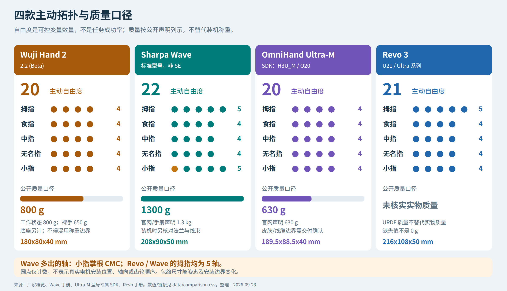
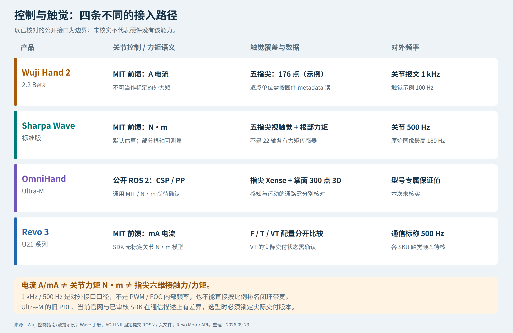

# 四款高自由度灵巧手对比调研

> 历史阶段快照：原调研日期 2026-09-23，本次归档日期 2026-10-18。文中的“当前”指原调研时点。
> 本轮未联网重新核实厂商规格，未重新执行计算、仿真或真机测试。
> 自绘图表随文保存；厂家图片使用原始官方外链，手册截图改为官方手册定位链接。素材获取需要联网，来源和原始哈希见 [sources.md](sources.md)。

Wuji Hand 2 · Sharpa Wave · 临界点 OmniHand 3 Ultra-M · 强脑 Revo 3

研究日期：2026-09-23。基于此前 Wuji 专题与 `revo3-vs-sharpa` 报告，新增官网、型号专属 SDK 和版本兼容性核对。重点面向机械设计、操作算法研发与产品选型，**不是四款实机同台测试**。

全文区分：**官方声明**、**公开接口/模型证据**、**工程推断**、**尚未核实**。官方峰值、寿命与温度声明不等于独立实测；资料更详细也不自动等于硬件更先进。

## 0. 先给结论：四款产品更像四种取舍，而不是一张总分榜

| 产品 | 本次最突出的可确认特点 | 当前最需要补齐的验证 | 我的条件判断 |
| --- | --- | --- | --- |
| **Wuji Hand 2.2 (Beta)** | 20 独立主动轴、小包络；20 轴 1 kHz 报文；公开关节级接口、模型和指尖触觉示例 | 连续热表现、带载寿命、零位一致性、电流—外力矩标定；仍是 Beta | 适合能够参与调试、辨识和迭代的研发团队；不宜直接按成熟连续作业部件验收 |
| **Sharpa Wave** | 22 主动轴、小指掌根可动；N·m 力矩接口；5 个根部力矩传感组件和五指视触觉 | 1.3 kg 的腕部负担、传感器校准、图像链路延迟、触觉面维护与同工况连续输出 | 接触丰富的指尖操作、导纳/阻抗与视触觉研究，优先上台架验证 |
| **OmniHand 3 Ultra-M** | 20 主动轴、标称 630 g；指尖视触觉 + 掌面 300 点三维触觉；公开 SDK 可见两路感知数据结构 | 具体交付版本的总线、关节力矩控制开放程度、控制/触觉频率，以及热声明的测试条件 | 轻量化掌面+指尖感知的有力候选；不能只凭“全直驱”推定已有完整 N·m/MIT 接口 |
| **Revo 3 U21 系列** | 21 主动轴；多种触觉 SKU；工业总线选择；当前电流接口语义明确 | 对应 SKU 的实物质量、连续输出、电流到关节力矩标定，尤其 VT 交付状态 | 工业控制栈接入和按任务选择触觉配置时值得优先验证 |

如果必须按任务缩小名单：**低层力矩/导纳研究先看 Wave；轻量化且要掌面三维触觉先看 Ultra-M；高频关节级研发先看 Wuji；工业总线与分层配置先看 Revo。** 这是依据公开能力的测试优先级，不是综合性能或采购性价比排名。关键来源分别为 [Wuji 文档](https://docs.wuji.tech/docs/en/wuji-hand/latest/overview/)、[Wave 手册](https://documentationpdf.sharpa.com/api/pdf/wave)、[Ultra-M 产品页](https://www.agilink-ai.com/ultra-m.html)、[Revo 手册](https://www.brainco-hz.com/docs/revolimb-hand/revo3/parameters.html)；接口差异详见第 4 节。

## 1. 比较范围与版本：这次新增了什么

### 1.1 锁定四款，而不是四个品牌的最高参数合集

| 本文对象 | 必须排除的混用 |
| --- | --- |
| Wuji Hand 2，当前文档名称 **2.2 (Beta)** | 不混入 Hand 1 的自锁/温升反馈，也不混入 2.1 的固件与接口 |
| **Sharpa Wave 标准型号** | 不混入 Wave SE 的 12 N、30 fps 等较低配置指标 |
| **OmniHand 3 Ultra-M**，SDK 标识 H3U_M/O20 | 不混入普通 OmniHand、旧款 O10/O12、Ultra-T 绳驱旗舰或 Lite |
| **Revo 3 U21/Ultra 21 自由度系列** | 不混入 Pro 16 轴、Basic 13 轴；U21/F/T/VT 的触觉配置分开描述 |

Wuji 最新版本页将 2.2 对应到既有 `hand2_beta2` 模型目录，2.1 对应 `hand2_beta1`；所以名称变化**不应被理解成凭空多出一代全新机械结构**。当前页面将 2.2 固件列为 v2.0.0 起、当前 v2.5.1；2.1 停留在 v1.2.4。实际设备仍需按序列号与版本信息识别。[Wuji 版本兼容表](https://docs.wuji.tech/docs/en/wuji-hand/latest/version-compatibility/)。

### 1.2 相比旧报告的关键增量

1. **Wuji 触觉不再仅写“有五个指尖模块、细节未知”。** 当前官方示例写明拇指 40 点、其余各 34 点，共 176 点，100 Hz；并明确固件升级后的单位变化。
2. **Ultra-M 已找到型号专属头文件与 ROS 2 文档。** 能确认五指各 4 个主动轴，以及 Xense 指尖与 SoC 掌面两路触觉。公开 ROS 2 模式不能照搬 O12 的力矩模式。
3. **Ultra-M 通信资料存在冲突。** 早期官方 PDF 写 CAN FD/RS485/EtherCAT，当前官网写 CAN FD/Ethernet，已核对的 SDK 运动通路主要列 CAN 系列。本文同时保留，不默默拼成“四种总线全支持”。
4. **Revo/Wave 延用已有深入核对结果。** 图片和手册证据保存原检索日期；Revo 的电流语义及型号成熟度在本次再次核对。

证据：[Wuji 触觉示例](https://github.com/wuji-technology/wuji-sdk/blob/f36a41969d8754ef364a34b59196e4d7e211599f/examples/python/wuji_hand_2/3.fingertip_typed.py)、[Ultra-M 头文件](https://github.com/AgibotTech/agillink_omnihand_sdk/blob/026740d9fdd8ba32b0605fa702a992b322076f1b/linux/x64/cpp/include/omnihand/omnihand_3_ultra_m.h)、[OmniHand ROS 2 文档](https://github.com/AgibotTech/agillink_omnihand_sdk/blob/026740d9fdd8ba32b0605fa702a992b322076f1b/doc/en/API_ROS2.md)、[Revo 电机接口](https://github.com/BrainCoTech/brainco-revo3-sdk/blob/main/docs/device/REVO3_MOTOR_API.md)。

## 2. 外形、质量、自由度与力：先统一口径

| Wuji Hand 2 官方结构图 | OmniHand Ultra-M 官方外观 |
| --- | --- |
|  |  |
| Sharpa Wave 官方外观 | Revo 3 官方外观 |
|  |  |

图 1：厂家公开图片，**不是相同比例、相同姿态的尺寸对比**，也不是拆解证据。Wuji、Ultra-M 图片本次下载；Wave、Revo 图片沿用旧报告中的原始文件。来源和 SHA-256 见 [素材来源与清单](sources.md#material-sources)。

### 2.1 结构与本体规格

| 项目 | Wuji Hand 2.2 Beta | Sharpa Wave | OmniHand 3 Ultra-M | Revo 3 U21 系列 |
| --- | --- | --- | --- | --- |
| 主动自由度 | 20 | 22 | 20 | 21 |
| 拇/食/中/无名/小指分配 | 4/4/4/4/4 | 5/4/4/4/5 | 4/4/4/4/4，SDK 可核对 | 5/4/4/4/4 |
| 标称外形，mm | 180×80×40，姿态相关参考值 | 208×90×50 | 189.5×88.5×40 | 216×108×50 |
| 本体质量口径 | 裸手 650 g；含软垫/线缆 800 g；底座另计 70 g | 1.3 kg | 630 g；需确认线缆/皮肤/适配件边界 | 当前所核对产品手册未列实物质量 |
| 根部姿态特点 | 每指 4 轴；拇指 4 轴支持对指 | 拇指 5 轴 + 小指额外 CMC | 每指 4 轴，需用本型号运动学映射 | 拇指 5 轴，其余各 4 |
| 对外关节频率 | 最高 1 kHz，20 轴合包 | 500 Hz 控制/反馈 | 本次未核实到型号专属保证值 | 500 Hz 通信标称 |

数值来源：[Wuji 概览](https://docs.wuji.tech/docs/en/wuji-hand/latest/overview/)、[Wave 手册第 8–9 页](https://documentationpdf.sharpa.com/api/pdf/wave)、[Ultra-M 当前产品页](https://www.agilink-ai.com/ultra-m.html)、[Ultra-M 关节映射](https://github.com/AgibotTech/agillink_omnihand_sdk/blob/026740d9fdd8ba32b0605fa702a992b322076f1b/linux/x64/cpp/include/omnihand/kinematics/omnihand_3_ultra_m/omnihand_3_ultra_m_solver.h)、[Revo 手册](https://www.brainco-hz.com/docs/revolimb-hand/revo3/parameters.html)。

图 2：自由度分配与质量口径可视化。质量条只表示公开声明，缺失值不填零；**不能把不同称重边界的数值当成最终装机质量排名**。[SVG](assets/diagrams/01_structure_mass.svg)。

### 2.2 力与速度：不能用一个数字排强弱

| 项目 | Wuji Hand 2.2 Beta | Sharpa Wave | OmniHand 3 Ultra-M | Revo 3 U21 系列 |
| --- | --- | --- | --- | --- |
| 指尖主动输出力 | 官方当前不将样机负载作为采购承诺；本表不采用渠道 ≥12 N 排名 | 最大主动指尖力 20 N | 本次官方资料未给可同口径比较的单指输出力 | 最大指尖捏力 ≥25 N |
| 整手力/载荷 | 峰值、额定与负载曲线待定 | 官网主动握力 150 N、载荷 40 kg | 稳定抓握 3 kg、提拉 8 kg | 主动握力 ≥100 N；整手负载 20 kg |
| 速度 | 未取得标准化带载开合指标 | 官网动作频率 4 Hz | 典型开合 0.3 s | 关节开合 0.33 s |
| 重复性 | 零位精度仍在优化 | 指尖位置 ±1 mm | 重复定位 ±0.2 mm | 重复运动精度 0.1° |

来源：[Wuji 使用边界](https://docs.wuji.tech/docs/en/wuji-hand/latest/user-notice/)、[Wave 官网](https://www.sharpa.com/pages/wave)、[Ultra-M 官方规格](https://www.agilink-ai.com/ultra-m.html)、[Revo 手册](https://www.brainco-hz.com/docs/revolimb-hand/revo3/parameters.html)。

这里至少有五个“不能直接比”：指尖主动力与两指捏力；握力 N 与提拉 kg；单程开合时间与往返频率；关节角重复性与指尖重复性；峰值力与热稳态连续力。尤其 **Ultra-M/Wave 的触觉 0–30 N 是感知量程，不是电机指尖输出 30 N**。

## 3. 机械路线：高自由度独立驱动，不自动等于无减速器

### 3.1 能确认的共同点与分歧

这四款的共同方向是让大量关节具备主动控制能力，适合改变指间接触和手内物体姿态。Wuji/Revo/Ultra-M 的官方“直驱”描述，不能单独证明其每轴都是电机转子与关节输出轴 1:1 连接；Wave 的 22 个专有执行器也不能据此确定内部传动。**本次没有取得四款均可逐级核验的内部传动剖面、减速比和效率图。**

更可靠的判断分三层：

| 层次 | 能回答的问题 | 不能回答的问题 |
| --- | --- | --- |
| 主动关节表 / SDK | 哪些轴可独立给目标、如何编号 | 转子装在哪、轴承如何支承 |
| URDF / MJCF / 外形 CAD | 连杆树、输出轴、活动范围、碰撞几何 | 齿轮类型、真实电机轴、生产公差 |
| 模组剖面 / 拆解 / 出厂曲线 | 传动与轴承、绕组与编码器、输出性能 | 仍需样本测试才能确认批量可靠性 |

本报告不会把既有 Wuji 的 A/B 教学模型，或某项执行器专利，画成这四款的真实内部结构。即使编码器到关节角的映射是线性的，也可能包含恒定传动比，**“线性映射”不等于“传动比 1”**。

### 3.2 20、21、22 轴具体多在哪里？

Wuji 与 Ultra-M 都是五指各 4 轴，但两者拇指轴线、关节命名和包络未必相同，不能直接复用 20 维动作数组。Ultra-M 的 SDK 枚举采用小指在前、拇指在后的顺序；Wuji 则拇指在前。Revo 普通四指在前、拇指在后；这些首先是软件映射差异，不是机械优劣。[Wuji 控制指南](https://docs.wuji.tech/docs/en/wuji-hand/latest/control-guide/)、[Ultra-M 映射头文件](https://github.com/AgibotTech/agillink_omnihand_sdk/blob/026740d9fdd8ba32b0605fa702a992b322076f1b/linux/x64/cpp/include/omnihand/kinematics/omnihand_3_ultra_m/omnihand_3_ultra_m_solver.h)、[Revo 电机接口](https://github.com/BrainCoTech/brainco-revo3-sdk/blob/main/docs/device/REVO3_MOTOR_API.md)。

Revo 比五指各 4 轴多一个拇指轴。Wave 的拇指也是 5 轴，另在小指增加 CMC 掌根运动，手册给出 0°–25°。**工程推断：**额外拇指轴有助于调整对指姿态；小指掌根轴有助于掌部凹形包络、改变接触法向。但自由度只是潜在可达性的来源，轴线位置、碰撞、行程和控制能力共同决定实际收益。[Wave 手册](https://documentationpdf.sharpa.com/api/pdf/wave)、[Revo 自由度图](https://www.brainco-hz.com/docs/revolimb-hand/revo3/parameters.html)。

Wave 部分双自由度根关节存在非矩形的组合工作空间；Wuji 当前文档也提示 SDK 与模型的轴序映射说明尚需补充。移植策略时应先做关节方向、零位、限位和自碰撞验证，不能只检查动作维度相等。[Wave 手册第 14 页](https://documentationpdf.sharpa.com/api/pdf/wave)、[Wuji 控制指南](https://docs.wuji.tech/docs/en/wuji-hand/latest/control-guide/)。

### 3.3 包装、质量与制造上的工程取舍

Wuji 的官方结构图和模型便于观察串联指节与分布式关节外形；但不能仅凭一个长圆柱外壳确认其内电机沿指骨纵向布置，也不能据此认定一定有 90° 换轴。Ultra-M 的较轻整手指标同样不能证明其使用了更高扭矩密度电机。

**工程推断：**每个自由度独立驱动，可降低欠驱动/跨关节耦合带来的控制限制；代价是更多微型驱动、编码、装配和线束。把质量放进远端指节会增加指内运动惯量与接触碰撞能量；向掌腕迁移则可能增加传动与布线复杂度。四款的真实质量分配、转子惯量和传动摩擦尚不足以同口径量化。

Wave 的质量对应更多主动轴、根部力矩感知与视触觉系统，但不能在没有 BOM 的情况下把全部重量差都归因于这些功能。对于机械臂，应该比较装机总成的质量、质心和转动惯量，而非只看裸手重量。

## 4. 控制与嵌入式接口：四款最值得区分的部分

图 3：公开接口的物理量和感知路径。灰色表示未核实，不表示没有能力；它不是内部 PCB 框图或总线接线图。[SVG](assets/diagrams/02_control_evidence.svg)。

| 项目 | Wuji Hand 2.2 Beta | Sharpa Wave | Ultra-M | Revo 3 U21 |
| --- | --- | --- | --- | --- |
| 公开关节控制形式 | MIT 位置—速度—电流混合 | 位置、导纳、MIT、Zero-force | 当前公开 ROS 2 列 CSP/PP 位置模式；未据此确认通用 MIT/N·m 模式 | 位置、速度、电流、阻抗/阻尼、MIT 组合 |
| 前馈/effort 的关键单位 | **A**，不是 N·m | **N·m** | 型号专属可用力矩命令及标定单位待确认 | **mA**，不是 N·m |
| 输出力矩观测 | 不应按关节电流判断外力，厂家明确限制 | 默认电流估算；部分根关节可切到传感器反馈 | 本次未核实到全轴标定 N·m 反馈 | SDK 明确不提供标定关节力矩模型 |
| 外部通信 | 100BASE-TX Ethernet | Ethernet；高速触觉需千兆条件 | 官网 CAN FD/Ethernet；旧 PDF 与 SDK 口径见下 | RS-485 / CAN FD；EtherCAT 独立集成 |
| 控制/状态周期 | PUB/状态最高 1 kHz；GET 建议 ≤100 Hz | 关节控制/状态 500 Hz | 未核实产品保证值 | 通信 500 Hz，实际取决于链路与主机 |
| 内部 PWM/FOC 频率、减速比、Kt | 未核实 | 未核实 | 未核实 | 未核实 |

依据：[Wuji 单位/频率定义](https://docs.wuji.tech/docs/en/wuji-hand/latest/control-guide/)、[Wave 官方手册控制章节](https://documentationpdf.sharpa.com/api/pdf/wave)、[Ultra-M ROS 2 文档](https://github.com/AgibotTech/agillink_omnihand_sdk/blob/026740d9fdd8ba32b0605fa702a992b322076f1b/doc/en/API_ROS2.md)、[Revo Motor API](https://github.com/BrainCoTech/brainco-revo3-sdk/blob/main/docs/device/REVO3_MOTOR_API.md)。

### 4.1 Wuji 与 Revo：电流型 MIT 不是已经解决了物理力矩控制

两者都可以在关节目标与电流层面实现接触策略，但公开接口中的 A/mA 不能直接改名为 N·m。Revo 的 SDK 明确没有电流到输出力矩的标定模型，`Kp/Kd` 是设备系数；Wuji 用户须知进一步明确表示，当前电流推外力所需的硬件一致性和标定尚未收敛，不应用这些读数判断外部接触力矩。[Revo 接口](https://github.com/BrainCoTech/brainco-revo3-sdk/blob/main/docs/device/REVO3_MOTOR_API.md)、[Wuji 能力边界](https://docs.wuji.tech/docs/en/wuji-hand/latest/user-notice/)。

因而，如果你的策略输出关节目标，二者可作为候选；如果你的实验要求“输出 0.25 N·m，验证误差小于某值”，还需要厂家资料和独立标定，不能直接靠 MIT 字段名完成。

### 4.2 Wave：物理力矩接口更明确，但不是全轴直接测力矩

Wave 的优势是公开 N·m 反馈/前馈，并有每指一个、共五个根部传感器组件。四指 MCP 的屈伸/展收、拇指 CMC 的屈伸/展收可以改用传感器反馈；其余轴不能因此被描述成“都有独立力矩传感器”。手册的 3 N·m/5 N·m 是传感量程，不是关节额定输出。[Wave 手册第 11、28–30、96 页](https://documentationpdf.sharpa.com/api/pdf/wave)。

这更利于根部外载观测和导纳控制，但仍有标定、传感器误差和滤波延迟。量程、噪声、分辨率与总误差不是同一个指标。

### 4.3 Ultra-M：感知接口已有实质内容，运动接口不能借用兄弟型号

固定提交的官方 `OmniHand3UltraM` 头文件提供：指尖整形图、差分图、三维力分布、六维合力/力矩、深度、网格位移及时间戳数据结构；掌面则是独立的三维力场结构。SDK 发布记录把它描述成可选 Xense 指尖触觉与 SoC 掌面触觉支持，实际交付是否包含需核对。[型号专属头文件](https://github.com/AgibotTech/agillink_omnihand_sdk/blob/026740d9fdd8ba32b0605fa702a992b322076f1b/linux/x64/cpp/include/omnihand/omnihand_3_ultra_m.h)、[v1.1.8 发布记录](https://github.com/AgibotTech/agillink_omnihand_sdk/releases/tag/v1.1.8)。

但 ROS 2 文档针对 H3U_M 列出的是 **0=CSP、7=PP**；该文档中的其他力矩/混合模式及 50/100 Hz 触觉频率分别属于 O10/O12 等产品。**不能把统一 SDK 的全部 API 当成 Ultra-M 已实现的全部能力，也不能把它表述成硬件永远不支持力控。** 本次结论仅是：公开证据不足以确认与 Wave 同等级的 N·m/MIT 运动接口。[ROS 2 型号对照](https://github.com/AgibotTech/agillink_omnihand_sdk/blob/026740d9fdd8ba32b0605fa702a992b322076f1b/doc/en/API_ROS2.md)。

通信更需要分层核对：

| Ultra-M 资料 | 原文所列通路 | 应怎样处理 |
| --- | --- | --- |
| 2026-05 路径下的官方单页 PDF | CAN FD / RS485 / EtherCAT | 作为历史官方声明，不直接承诺当前交付 |
| 当前产品网页 | CAN FD / Ethernet | 仍需区分运动控制、感知和网关 |
| 本次审核的 SDK/ROS 2 | ZLG/HCAN/SocketCAN 运动连接；触觉 SoC 网络连接 | 是具体软件通路证据，不意味着所有声明总线都已在这个 SDK 中支持 |

来源：[早期 PDF](https://www.agilink-ai.com/uploads/upload/files/20260530/a7b12675ce5e3b4e9b913801c0c6f659.pdf)、[当前产品页](https://www.agilink-ai.com/ultra-m.html)、[SDK 头文件](https://github.com/AgibotTech/agillink_omnihand_sdk/blob/026740d9fdd8ba32b0605fa702a992b322076f1b/linux/x64/cpp/include/omnihand/omnihand_3_ultra_m.h)。需要总线型集成时，应要求型号/固件对应的接口矩阵和运行示例。

### 4.4 频率的正确比较

1 kHz 与 500 Hz 分别是 1 ms、2 ms 接口周期，并不证明前者的机械力控带宽是后者两倍。完整链路还包括传感、滤波、传输、主机调度、控制、驱动和机械响应。对于四款，**外部报文频率、触觉采样率、内部电流环频率必须分开**；目前不能编出统一的 FOC 高频数值表。

## 5. 触觉对比：覆盖、物理量与数据链路比“点数”更重要

| 维度 | Wuji Hand 2.2 Beta | Sharpa Wave | Ultra-M | Revo 3 |
| --- | --- | --- | --- | --- |
| 指尖 | 官方示例为 5 指触觉流 | 五指视触觉 | 五指视触觉，SDK 有 Xense 接口 | F：三维力；T：压阻；VT：视触觉 |
| 掌面 | 本次未确认与 Ultra-M 同类的全掌阵列 | 本次手册规格重点在指尖 | 官方 300 点三维触觉 | T 全掌压阻；VT 掌面压阻 |
| 数据量口径 | 40+4×34=176 个指尖采样点 | 官网图像 240×240 | 掌面 300 点；指尖有图像与重建场 | T：451 压阻点；VT：336 压阻点+2000 marker |
| 指尖触觉频率 | 示例写 100 Hz，实际按 metadata/设备核对 | 标准 30 Hz；高性能原始图像最高 180 Hz | 本次未核实产品级保证值 | 本次未取得可统一比较的各 SKU 频率 |
| 公开分辨率/量程 | 本次未取得完整标定规格表 | 20 mN、1 mm、量程 30 N | 5 mN、0.04 mm、量程 30 N；形变场精度 0.08 mm | 官方触觉表列 0.01 N、0–20 N，需核实每种传感配置的具体定义 |
| 特别要核对 | 点力单位的固件变化、坐标系和合力作用点 | 30/180 Hz 对应的数据类型与 50/20 ms 延迟 | 指尖/掌面同步、标定与交付配置 | SKU/硬件版本及 VT 成熟度 |

来源：[Wuji 固定提交示例](https://github.com/wuji-technology/wuji-sdk/blob/f36a41969d8754ef364a34b59196e4d7e211599f/examples/python/wuji_hand_2/3.fingertip_typed.py)、[Wave 手册](https://documentationpdf.sharpa.com/api/pdf/wave)、[Ultra-M 触觉规格](https://www.agilink-ai.com/ultra-m.html)、[Revo 正式手册](https://www.brainco-hz.com/docs/revolimb-hand/revo3/parameters.html)。这些数值没有经过统一探头、接触面积、材料与噪声门限的第三方复测。

### 5.1 新发现：Wuji 触觉的单位和力矩含义必须按版本读

官方示例说明：v2.4.0 起逐点力改为满量程归一化表示，法向 0–1、切向 −1–1；早期固件逐点力以 N 表示；合力仍以 N 表示。格式元数据还给出点位、局部方向、传感器安装位姿和合力作用点。算法必须读取 metadata，不能把所有数组直接当作牛顿。

示例中的 `p × F` 是将合力平移到参考点所产生的力矩，**并不自动意味着传感器独立测得了一个完整六维力/力矩，更不是电机输出轴力矩**。这是跨产品比较“力觉”的一个重要边界。[官方触觉示例](https://github.com/wuji-technology/wuji-sdk/blob/f36a41969d8754ef364a34b59196e4d7e211599f/examples/python/wuji_hand_2/3.fingertip_typed.py)。

### 5.2 Wave 与 Ultra-M：都重视视触觉，但不能照规格算出胜率

Ultra-M 的标称力与空间分辨率数字更小，且有明确掌面三维触觉覆盖；Wave 的公开手册对运行模式、延迟、耐久和根部力矩感知说明更具体。**这说明公开优势所在，不证明 Ultra-M 实机触觉一定更准，也不证明 Wave 的力控一定更快。**

例如 180 fps 的帧间隔是 5.56 ms，而 Wave 手册高性能模式延迟仍列 20 ms。传感器分辨率也不能替代迟滞、漂移和绝对误差；图像像素、marker 与独立 taxel 不能放在同一“点数”排行里。[Wave 手册](https://documentationpdf.sharpa.com/api/pdf/wave)、[Ultra-M 规格](https://www.agilink-ai.com/ultra-m.html)。

### 5.3 Revo 的优势在配置选项，限制也在配置

无触觉基础款不能享受触觉版的优势；U21T 的全掌压阻与 Ultra-M 的掌面三维触觉也不是同种测量能力。当前 Revo SDK 仍将 Ultra VisionTouch 标为 Hardware Pilot，所以 VT 应先验证实物交付、触觉标定与接口，而不是直接纳入成熟的双视触觉方案比较。[Revo 型号与接口状态](https://github.com/BrainCoTech/brainco-revo3-sdk/blob/main/docs/device/REVO3_MOTOR_API.md)。

## 6. 扭矩、功率密度和散热：统一理论框架，而不是反推虚假参数

### 6.1 指尖力不能直接变成“电机额定扭矩”

准静态接触下，对单轴的力矩幅值为 `τ=F·r⊥`，多关节一般写为 `τ_contact=J(q)ᵀF`。还需加入重力与摩擦；动态时再加入惯性等项。

取**同一个假设夹具**：有效力臂 25 mm，仅用于量级演算：

| 条件输入 | 对应输出负载力矩 | 是否为实际某关节额定值？ |
| --- | --- | --- |
| 20 N 接触力 | 0.500 N·m | 否；只是将 Wave 标称数字代入相同假设 |
| 25 N 接触力 | 0.625 N·m | 否；Revo 捏力定义还需与单指力统一 |

Wuji 不采用尚未成为官方承诺的峰值做排名；Ultra-M 的 3 kg/8 kg 不是单指力，不能塞进同一列。四款**单关节连续/峰值扭矩、对应转速、减速比和热态降额**在本次材料中都不足以构成同口径排序。

### 6.2 为什么不能由外形判断同轴、换轴或 1:1 直驱

若有减速器，`τ_out≈η·i·Kt·Iq`。纯假设 `i=20、η=0.75`，上述 0.500/0.625 N·m 对应电机约 33.3/41.7 mN·m；若严格 1:1 则需要约 500/625 mN·m 电机力矩。**20:1 不是任何一家已公开的真实减速比**。

两种电机力矩量级差很大，但只有外壳包络时，没有气隙半径、有效长度、电流密度、磁路和热阻，仍无法唯一判断内部结构。换轴也未必等于高减速比，同轴也未必等于无减速器。Wuji 原专题的执行器专利只能证明某种结构思路，不能把专利减速比套给 Hand 2，再套给其他三款。

功率密度必须统一 `P_out=τ_out·ω_out` 的工作点和质量边界。**最大扭矩密度、连续扭矩密度、机械功率密度、整手承载/质量比，是四种不同指标。** 本次不使用“630 g 可提 8 kg”来证明 Ultra-M 电机 W/kg 最高。

### 6.3 电源容量不是热耗散，宣传表温不是连续输出曲线

| 产品 | 可用的电气/热资料 | 能说明什么，不能说明什么 |
| --- | --- | --- |
| Wuji | 12 V/20 A 配套电源；建议 ≥200 W；官方称长期热行为未验证 | 约 240 W 是电源容量量级，不能当作持续耗散；不应自行做长期满载验证 |
| Wave | 静态 15 W；峰值 180 W、10 ms；脚注平均功率 100 W | 有较明确电功率口径，但平均工况仍需补充，不能换算连续关节机械功率 |
| Ultra-M | 官方称连续负载下表温 40–45°C、50 万验证循环，早期 PDF 称不降额 | 是有价值的厂商声明；环境温度、载荷、持续时间、占空比和温点未充分给出 |
| Revo | 24 V 下最大电流 10 A；建议稳定 24 V、>100 W 电源 | 不能把输入上限 240 W 当成实际功耗，更不能与 Wave 静态 15 W 做效率比 |

来源：[Wuji 热限制](https://docs.wuji.tech/docs/en/wuji-hand/latest/user-notice/)、[Wave 电气规格第 8 页](https://documentationpdf.sharpa.com/api/pdf/wave)、[Ultra-M 官方热声明](https://www.agilink-ai.com/ultra-m.html)、[Revo 供电说明](https://www.brainco-hz.com/docs/revolimb-hand/revo3/parameters.html)。

稳态近似 `P_heat=P_in−P_mechanical`；静态持握时没有外部机械功输出，仍会产生铜耗和驱动损耗。应索取在同一接触力、姿态、环境下的时间—力—温度曲线。Wuji 对未验证项的坦诚披露不能直接证明它比其他三款实机更热；反过来，其他厂商的温度声明也不能免除验收。

### 6.4 对机械臂负担的可解释计算

若为了比较取相同的 0.15 m 腕轴到质心力臂，重力矩 `m·g·r` 为：Wuji 工作质量 0.8 kg → **1.18 N·m**；Wave 1.3 kg → **1.91 N·m**；Ultra-M 声明质量 0.63 kg → **0.93 N·m**。Revo 缺相应实物质量，不计算。

这只是相同假设力臂下的量级，不是真实装机重心测试。Wave 与 Ultra-M 在此假设下差约 0.99 N·m，但真实腕部预算仍需加入法兰、线缆、物体、质心偏置和运动惯量。

## 7. 操作算法、制造成本和市场定位

### 7.1 算法选型要看任务，而不是最多自由度

| 你的任务 | 优先验证对象 | 重点验证 |
| --- | --- | --- |
| 关节级遥操作、轨迹采集、高频状态记录 | Wuji；Revo 同时对照 | 关节映射、时序、零位漂移、故障恢复；Wuji 是否可接受 Beta 限制 |
| 指尖滑移/形变与视触觉表征学习 | Wave、Ultra-M | 原始/处理数据开放、时间戳、延迟、皮肤老化与重新标定 |
| 根关节力矩驱动的导纳/阻抗研究 | Wave 优先 | 估算轴和传感轴范围、标定误差、闭环频响 |
| 掌内接触、全手感知和包络抓取 | Ultra-M、Revo T/VT | 三维力与压阻的测量差异、掌面覆盖；VT 的交付成熟度 |
| 小指掌根参与的掌内重定位 | Wave | 第 22 轴实际可达/碰撞约束与对任务的增益 |
| 已有工业总线控制体系 | Revo；Ultra-M 需先澄清交付接口 | 真实可用总线、软件通路、并发传感带宽与故障安全 |
| 不允许长时间停机的连续部署 | 四款都先做专项验收；Wuji Beta 暂不按此默认 | 热稳态、带载寿命、维修件、替换标定、保修与交付周期 |

公开的 ADEPT 研究使用 Flexiv–Sharpa 与五指视触觉，说明 Wave 已被用于具体研究系统；它不是四款同台试验。Wuji 的手套—手—模型链路、Revo 的代码生态和 Ultra-M 的 Python/C++/ROS 2 支持也各有集成价值，不能用论文数量或演示视频直接换算硬件优劣。[ADEPT](https://arxiv.org/abs/2608.19182)、[Wuji SDK](https://github.com/wuji-technology/wuji-sdk)、[BrainCo 代码入口](https://github.com/BrainCoTech)、[AGILINK SDK](https://github.com/AgibotTech/agillink_omnihand_sdk)。

### 7.2 生产成本：独立模组有潜力，但目前不能给 BOM 排名

**工程推断：**独立模组可减少长腱绳布置、张紧和跨关节非线性调试，有利于关节级测试与模组化维修；代价是每轴微型加工、编码、驱动电子和互连密度。多出 1–2 轴不是简单按总价等比例增加成本，根部轴与远端轴的负载、传感和装配要求可能完全不同。

| 成本来源 | 四款比较时应关注的差异 |
| --- | --- |
| 机械/驱动 | 20/21/22 个主动轴不是同规格电机的简单数量对比；缺减速与轴承 BOM |
| 触觉 | 五指视触觉涉及成像、弹性体和算法标定；掌面阵列涉及布线与贴装；Revo 各 SKU 必须分开报价 |
| 力矩感知 | Wave 根部传感器及标定增加部件/测试工作，但可能减少用户侧力控集成工时 |
| 系统集成 | Wuji 的 Beta/API 迭代，Ultra-M 的多通路及模式确认，Wave 的高速图像链路，Revo 的多总线分支 |
| 运维 | 指尖耗材、皮肤、整指/模组更换、再标定、物流与停机损失 |

本次没有四家同配置、同税费、同售后条件的正式报价，**不发布虚假的价格或性价比排名**。可下载 SDK 不等于电机固件源码开放；仿真资产公开不等于内部制造图纸公开，这也会影响二次开发和维修边界。

### 7.3 短期与长期的产品判断

短期：Wuji 更应按可共同迭代的研发样机评估；Wave 的优势是较具体的力矩/触觉接口；Ultra-M 将较低声明质量与全手感知组合在一起，但运动 API 和交付版本要问清；Revo 适合按触觉配置及控制栈分层选型。以上是公开材料呈现的定位，不是推断厂家的内部销售策略。

长期：胜负更可能取决于**连续可用的操作数据、带载可靠性、耗材更换、标定一致性与总使用成本**。高自由度独立驱动在研究平台上有价值，但高冲击、低惯量或成本敏感的部署仍可能选择绳驱、连杆或混合结构。AGILINK 同时提供 Ultra-M 与 Ultra-T，本身就说明同一厂商也在覆盖不同传动需求，不能据此宣布某一路线将取代所有其他路线。[AGILINK 产品矩阵](https://www.agilink-ai.com/)。

## 8. 可靠性与用户问题：有边界，不编故障率

| 产品 | 本次可确认的风险/声明 | 不应作出的外推 |
| --- | --- | --- |
| Wuji 2.2 Beta | 热、耐久、零位/反驱一致性仍在迭代；表面排线需保护；停机后关节可能失力 | Hand 1 的过热反馈不能直接套给 Hand 2；也不把排线提醒说成已发生断指 |
| Wave | 手册空载循环 >100 万；触觉 40 N 下 >10 万；IP20；热表面和触觉载荷限制 | 不等于百万次带载生产，也不等于已知高故障率 |
| Ultra-M | 50 万循环、连续负载表温声明；SDK/文档有型号和接口边界 | 公司整体出货量不等于 Ultra-M 已大规模通过相同工况验证 |
| Revo | 核心关节百万次声明；供电压降/复位、校准自动张开等注意事项；VT 为 Pilot | 不能把同系列出货或基础版成熟度直接算给 VT |

依据：[Wuji 用户须知](https://docs.wuji.tech/docs/en/wuji-hand/latest/user-notice/)、[Wuji 维护/失效状态](https://docs.wuji.tech/docs/en/wuji-hand/latest/troubleshooting/)、[Wave 手册](https://documentationpdf.sharpa.com/api/pdf/wave)、[Ultra-M 声明](https://www.agilink-ai.com/ultra-m.html)、[Revo 手册](https://www.brainco-hz.com/docs/revolimb-hand/revo3/parameters.html)。

本次没有取得足够的、包含硬件/固件版本与工况的独立长期用户统计，因此**不能按“发热投诉数”“断指传闻”“GitHub issue 数”排序可靠性**。厂家故障码说明的是可诊断的失效模式，不是故障发生概率。

### 8.1 按你的机械设计背景，建议优先索取这些材料

1. 每种关节模组的输出力矩—速度—温升包络；连续/峰值时长和降额条件。
2. 电机与输出轴的相对方向、传动比、效率、回差、反驱阈值；输出轴的支撑与允许侧向载荷。
3. 编码器安装在电机侧还是输出侧；是否双编码、是否输出侧闭环；不要仅凭 inner/outer 故障码认定实物配置。
4. 带皮肤、线束、法兰的装机质量、质心及惯量；远端指节质量分布。
5. 每个量的单位、坐标系、标定方法和延迟；电流、关节力矩、指尖合力、触觉场分开列。
6. 电机/关节板与排线、触觉模组的更换方式、标定流程、备件价格和保修边界。
7. 明确型号的运动/感知 API 能力表、可跑的同步记录示例，以及固定 SDK/固件版本。

### 8.2 同工况验证设计：先尊重样机限制

可先做低负载、限速、固定夹具下的输出角/电流/接触力同步记录，再分别验证位置重复性、低刚度响应、触觉迟滞和掉线后的安全状态。断电反驱、使能零电流与主动 Zero-force 要分开测试。

长期带载温升和寿命应在厂家明确批准的工况下进行。**Wuji 当前明确不建议长期满载/高负载测试，不能为了四款“公平对比”强行执行同一高负载脚本；应先索取厂家验证数据，或使用其书面许可的低风险工况。** 所有实机测试都需隔离夹点、考虑失力掉物、明确急停和限位，不用手阻挡手指来测力。

## 9. 最终建议：把选型问题变成可验证的问题

如果你最关心的是**微型模组如何装进去、有没有换轴、哪家电机更好**，四款现有材料都不足以做完整的内部结构优劣结论。下一步最有效的证据是模组剖面、厂商机械访谈和统一台架，不是继续从渲染图猜齿轮。

如果你要搭一个**今天能开始跑算法的研究平台**，应优先确认：Wave 的力矩/触觉链是否符合你的算法；Ultra-M 是否开放所需的关节控制与同步感知；Revo 的具体触觉 SKU 是否可交付；Wuji 的 Beta 边界与迭代成本是否可接受。**先选可闭合的任务链，再比较峰值参数。**

对于你原先的 Wuji 研究，我认为四款对照后最值得追问 Wuji 的是：不是“能否做到 20 轴”，而是**20 轴在热稳态下可用的输出、触觉与运动同步、反驱/零位一致性和故障后的恢复成本**。同样，Ultra-M 的 630 g、Wave 的 N·m 接口、Revo 的配置灵活性，也都应在实际任务里验证价值。

## 附录：来源、数据和转发

来源与检索日期见 [SOURCES.md](sources.md)；核心事实表见 [comparison.csv](assets/tables/comparison.csv)。本报告保留了型号冲突和未公开项，没有把缺失值当作零，也没有用主观分数生成雷达图。

本知识库版本的正文、自绘图表、参数对比表及来源记录组成独立主题包；厂家图片使用官方外链，不随包重新发布。自绘图表示比较关系，不是产品内部图纸。离线阅读时官方图片可能不可见。
