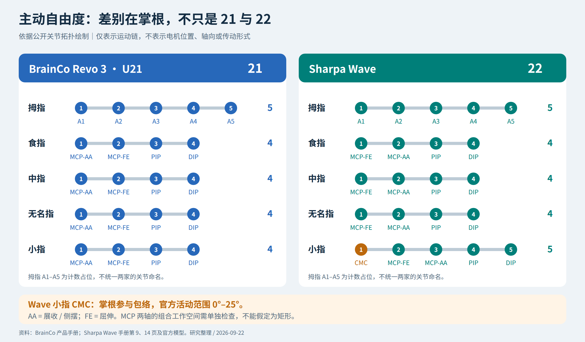
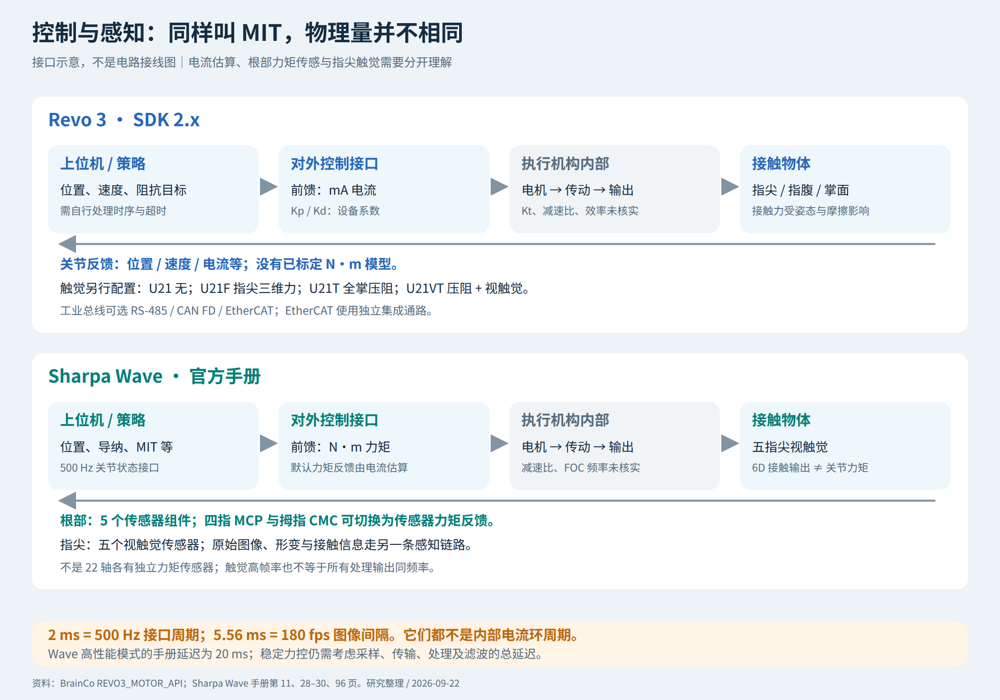

# 强脑 Revo 3 与 Sharpa Wave 对比调研

> 历史阶段快照：原调研日期 2026-09-22，本次归档日期 2026-10-18。文中的“当前”指原调研时点。
> 本轮未联网重新核实厂商规格，未重新执行计算、仿真或真机测试。
> 自绘图表随文保存；厂家图片使用原始官方外链，手册截图改为官方手册定位链接。素材获取需要联网，来源和原始哈希见 [sources.md](sources.md)。

调研日期：2026-09-22。面向机械设计、灵巧操作算法和产品选型；不是实机拆解或第三方台架测评。

**一句话结论：Revo 3 的突出特点是 21 路独立驱动、多种整手触觉配置及工业总线选择；Sharpa Wave 的突出特点是小指掌根自由度、公开的关节力矩接口和根部力矩传感、成熟度较高的指尖视触觉接口。现有公开资料不足以判定哪家的电机、减速器、连续扭矩密度或长期可靠性更好。**

本报告主要比较 Revo 3 的 **U21 / Ultra 21 自由度系列**与 **Sharpa Wave**。不把 Revo 3 Pro / Basic 的指标移植过来，也不把 **Wave SE** 混成标准 Wave。全文使用三种证据标签：**官方公开**指厂家材料中的声明，不等于独立实测；**工程推断**是基于力学与控制原理的分析；**未公开/未核实**表示本次未找到足以确认的材料。

## 1. 产品与版本：先保证比较的是同一件东西


图 1：Revo 3 官方外观图。只能用于观察包络、关节外形和表面覆盖，不能据此判断内部齿轮形式。[来源：BrainCo 产品手册](https://www.brainco-hz.com/docs/revolimb-hand/revo3/parameters.html)。


图 2：Sharpa 官网标准 Wave 栏目的产品图，原图未经改绘，不是内部结构证据。[来源：Sharpa Wave 产品页](https://www.sharpa.com/pages/wave)。

### 1.1 Revo 3：同样的 21 自由度，不同的感知配置

| 型号 | 官方定义的主要感知配置 | 选型时的含义 |
| --- | --- | --- |
| U21 | 基础版，无触觉 | 不能把其他版本的感知优势算到基础版上 |
| U21F | 指尖三维力 | 更接近直接获取指尖接触合力的需求 |
| U21T | 全掌压阻阵列 | 关注掌面、指腹的多点接触和压力分布 |
| U21VT | 手掌压阻阵列 + 指尖视触觉 | 兼顾接触覆盖与指尖局部形变信息 |

产品手册列出了上述配置，但当前 SDK 的电机参考文档仍将 **Ultra VisionTouch 标为 Hardware Pilot**，将 Ultra、Pro 的生产型号标为已发布。因此，“网页有型号”不能替代对具体硬件版本、交期及功能完成度的确认。[产品手册](https://www.brainco-hz.com/docs/revolimb-hand/revo3/parameters.html)、[SDK 型号与接口说明](https://github.com/BrainCoTech/brainco-revo3-sdk/blob/main/docs/device/REVO3_MOTOR_API.md)。

### 1.2 Sharpa：Wave 与 Wave SE 不能串参数

官网比较表的型号标题使用图片。核对图片后，第二列是 **Wave SE**，不是标准 Wave 的另一种测试条件：


| 官网标称项目 | Wave | Wave SE |
| --- | --- | --- |
| 主动自由度 / 整手质量 | 22 / 1.3 kg | 22 / 1.3 kg |
| 指尖力 / 主动握力 | 20 N / 150 N | 12 N / 90 N |
| 承载 / 动作频率 | 40 kg / 4 Hz | 24 kg / 2 Hz |
| 触觉图像规格 | 240 × 240 | 60 × 60 |
| 触觉最高帧率 | 180 fps | 30 fps |
| 原始图像输出 | 支持 | 官网列为不支持 |

这些是官网口径，动作频率和承载测试姿态没有在该表中充分定义。下文若未另行说明，Sharpa 均指 **Wave，而非 SE**。[官方双型号比较页](https://www.sharpa.com/pages/wave)。

## 2. 核心规格：哪些能比较，哪些不能

| 项目 | Revo 3 U21 系列 | Sharpa Wave | 解读 |
| --- | --- | --- | --- |
| 主动自由度 | 21 | 22 | 差异主要在小指掌根，见第 3 节 |
| 外形包络 | 216 × 108 × 50 mm | 208 × 90 × 50 mm | 安装法兰、线束空间还需另外计入 |
| 整手实物质量 | 本次所核对产品手册未列出 | 1.3 kg | 不用 URDF 质量代替实物称重 |
| 指尖力 | 最大捏力 ≥25 N | 最大主动指尖力 20 N | “捏力”与“单指主动指尖力”需统一夹具、姿态再比较 |
| 主动握力 | ≥100 N | 150 N | 各指分配、接触尺寸及持续时间不明确 |
| 整手负载 | 20 kg | 官网 40 kg | 悬挂承载不等于主动提举，也不等于手臂额定负载 |
| 运动速度口径 | 关节开合 0.33 s | 官网 4 Hz | 未定义相同幅度/负载/往返周期，不能直接排快慢 |
| 重复性口径 | 重复运动精度 0.1° | 指尖位置重复性 ±1 mm | 关节角与末端位置是不同指标 |
| 对外频率 | 通信 500 Hz | 手册控制及关节反馈 500 Hz | 均不能推成电机内部 FOC 频率 |
| 主要通信 | RS-485、CAN FD、EtherCAT | Ethernet | 普通以太网不等于 EtherCAT |

数值来自 [Revo 3 手册](https://www.brainco-hz.com/docs/revolimb-hand/revo3/parameters.html)、[Wave 产品页](https://www.sharpa.com/pages/wave)及 [Wave 官方手册，第 8 页](https://documentationpdf.sharpa.com/api/pdf/wave)。均为厂家声明，不是统一台架结果。

**首先避免“参数相除得结论”。** 不能把整手公斤级承载除以整手质量，称为电机扭矩密度；不能用一次动作时间的倒数作为完整往返频率；也不能把不同接触姿态的最大指尖力直接转换成各个关节的额定力矩。

## 3. 机械结构与“直驱”：公开到哪一层？

### 3.1 自由度拓扑：Wave 的第 22 个自由度有实际意义



图 3：根据官方自由度说明、手册及公开 URDF 绘制的功能拓扑。圆点表示独立运动自由度，**不表示电机的物理位置、定子方向或齿轮排列**。SVG 源图见 [可缩放版本](assets/diagrams/01_kinematic_topology.svg)。

图中普通手指根部的轴顺序按所审核模型绘制：Revo 先展收再屈伸，Wave 先屈伸再展收。对于双自由度关节，这首先是运动学坐标分解的区别，不能直接解释成两个实体电机的前后安装顺序。

Revo 3 是“拇指 5 + 其余四指各 4”。Wave 是“拇指 5 + 食/中/无名指各 4 + 小指 5”；Wave 小指多出的 CMC 关节改变小指掌根姿态，手册给出 0°～25°。它增加的是掌部包络能力，而不是给食指增加一个关节。[Revo 自由度说明](https://www.brainco-hz.com/docs/revolimb-hand/revo3/parameters.html)、[Wave 手册，第 9 页](https://documentationpdf.sharpa.com/api/pdf/wave)、[MuJoCo Menagerie 的 Wave 模型说明](https://github.com/google-deepmind/mujoco_menagerie/blob/main/sharpa_wave/README.md)。

**工程推断：**掌根可动有利于沿物体表面改变小指接触法向、形成掌部凹形包络，可能改善球体、圆柱体和掌内物体重定位；代价是增加执行器、支撑件、布线和标定维度。它并不保证任意任务都比 21 自由度成功率高，优势还取决于连杆尺寸、碰撞范围、接触材料和策略训练。


图 4：Revo 3 官方关节分布。厂家的拇指命名、SDK 通道顺序与人手解剖命名不能直接互换；写控制器时应读取设备 `JointLayout`，不要仅凭图上的排列拼数组。[官方手册](https://www.brainco-hz.com/docs/revolimb-hand/revo3/parameters.html)、[SDK 电机参考](https://github.com/BrainCoTech/brainco-revo3-sdk/blob/main/docs/device/REVO3_MOTOR_API.md)。

### 3.2 双自由度根关节不能只看两个独立角度上限

Wave 手册专门列出拇指 CMC、MCP 与四指 MCP 的 **2-DOF workspace**。这意味着选型与运动规划应检查二维可达区域，而不是默认两个单轴范围构成一个完整矩形。它说明有组合姿态限制，**并不能单独证明内部一定采用差动齿轮或某种特定连杆**。[手册第 9、14 页](https://documentationpdf.sharpa.com/api/pdf/wave)。

[Wave 官方双自由度关节工作空间图（官方手册第 14 页）](https://documentationpdf.sharpa.com/api/pdf/wave)

图 5：官方手册第 14 页的完整页面渲染，保留原始坐标和注释。图中运动约束可用于规划讨论，但不能替代当前硬件版本的控制限位。

### 3.3 严格直驱、独立驱动、局部集成是三件不同的事

严格机械意义上的直驱，通常指电机转子直接驱动负载轴、没有减速传动，传动比为 1。产品宣传中的“全直驱”还可能用于强调每个关节可独立主动控制、驱动机构集成在手内或不依赖外置腱绳。

Revo 官方确实使用“全直驱、可反驱”，并明确 21 个独立电机；Wave 官网明确 22 个专有执行模组。然而，本次公开材料没有提供可逐级核验的完整内部传动图，**不能据此认定两者都是 1:1 无减速器，更不能认定每个电机轴都与所控关节轴同轴**。[Revo 产品定义](https://www.brainco-hz.com/docs/revolimb-hand/revo3/parameters.html)、[Wave 产品说明](https://www.sharpa.com/pages/wave)。

| 结构问题 | 本次能确认到的程度 |
| --- | --- |
| 每个自由度是否主动可控？ | 官方说明和公开模型支持 Revo 21、Wave 22 的主动拓扑 |
| 电机在掌内、指节内还是轴心两侧？ | 外观只能提供局部空间线索，未取得完整可验证布置图 |
| 电机轴与 MCP/PIP/DIP 输出轴是否同轴？ | 未核实；URDF 只描述输出运动轴 |
| 是否使用锥齿轮、蜗杆、行星或平行轴齿轮？ | 未取得足以对两款现售产品逐项确认的公开证据 |
| 减速比、齿数、效率、回差、反驱阈值？ | 未找到对应 SKU 的完整实测/出厂数据 |
| 定子尺寸、磁路、绕组、轴承与编码器型号？ | 未核实，不能从外观或故障码反推具体器件 |
| 电流环/PWM 频率、MCU 与固件源码？ | 对外通信资料不能证明这些内部细节 |

对于你关心的“有没有换轴”，结论是：**输出端确实有屈伸轴与侧摆轴；内部是否通过齿轮/连杆换轴仍需剖面图、拆解或供应商确认。** 本报告不把一个工程上可行的假想布局画成两家的真实内部结构。

### 3.4 公开模型和专利能提供什么？

本次对固定提交的官方右手 URDF 做了 XML 核对：Revo 3 为 21 个非固定关节、模型质量求和 1.105 kg；Wave 为 22 个非固定关节、模型质量求和约 1.2433 kg。**这些质量是仿真文件中的惯性元数据，不是产品实物称重，也不能用来判断 Revo 必然更轻。** 逐关节轴、父子链和提交号保存在 [模型审阅摘要](sources.md#model-audit-summary)。[BrainCo 官方模型](https://github.com/BrainCoTech/brainco-description)、[Sharpa 官方模型](https://github.com/sharpa-robotics/sharpa-urdf-usd-xml)。

强脑公开申请 **CN121625194A** 描述了灵巧手的模块化电路分板思路，包括主控、通信、采集和电源等功能板的布置选择。它可用于理解小体积内为什么采用功能分板、叠板或柔性互连，**但不能证明该申请的每个实施例都已用于 Revo 3，也不是电机减速器剖面**。[专利原文](https://patents.google.com/patent/CN121625194A/zh)。

Sharpa 的公开 CAD 库也应区分安装/适配件和内部制造图，公开 URDF/USD/XML 不等于公开了齿轮、绕组及装配公差。[Sharpa OpenCAD](https://github.com/sharpa-robotics/sharpa-opencad-library)。

## 4. 扭矩、功率与热：用理论把宣传数字放回正确位置

以下是**条件计算，不是反向测得的两家硬件参数**。

### 4.1 指尖力到关节力矩：必须知道姿态和力臂

准静态下，外部接触力对关节产生的负载力矩满足：

```text
τ_contact = J(q)ᵀ F                  多关节、多接触点的一般写法
|τ_j| = F · r⊥,j                     单个力相对单个关节轴的力矩幅值
τ_required = τ_contact + τ_gravity + τ_friction
```

这里 `r⊥,j` 是力作用线到该关节轴的垂距，不是把一段指骨长度机械地代入。接触点变化、屈曲姿态变化，MCP、PIP、DIP 分配到的力矩都会变化；动态时还要加入惯性、科氏等项。

仅为了建立量级，假设两款手采用完全相同的夹具，单个关节有效力臂都为 **25 mm**，并暂把宣传指尖力当作单点作用力：

| 条件示例 | 力 | 有效力臂 | 对应输出负载力矩 |
| --- | --- | --- | --- |
| Revo 数值代入示例 | 25 N | 0.025 m | 0.625 N·m |
| Wave 数值代入示例 | 20 N | 0.025 m | 0.500 N·m |

这个计算只回答“这样的外载荷需要多大的输出力矩”，**没有证明 Revo 任意 DIP 的额定力矩为 0.625 N·m，更没有证明其连续力矩更大**。若实际力臂为 50 mm，同样的力需要两倍力矩；若两指捏力的仪器定义不同，25 N 与 20 N 本身也不能直接代入同一工况。

### 4.2 从输出力矩到电机力矩：缺减速比就不能唯一反推

若有理想化减速机构，并定义 `i = 电机转速 / 输出转速`：

```text
τ_out ≈ η · i · τ_motor
ω_motor = i · ω_out
P_out = τ_out · ω_out
```

取纯假设 `i = 20、η = 0.75`，上面的两个输出需求分别对应约 **41.7 mN·m、33.3 mN·m** 电机力矩；若真是 `i = 1` 的直接驱动、暂忽略损失，电机需要直接产生 **625 mN·m、500 mN·m**。这解释了为何小型关节是否带减速器，对磁路体积、转速与发热判断非常关键。**20:1 只是计算假设，不是两家公开减速比。**

径向磁通电机的一阶量级模型还可写为 `τ ≈ 2πσr²L`，其中 `σ` 为气隙切向电磁剪应力、`r` 为有效气隙半径、`L` 为有效长度。可见半径很重要，但 `σ` 又受电流密度、磁路、冷却和占空比限制。没有这些数据，用整手外观尺寸“算出真实扭矩密度”并不成立。

### 4.3 电流不等于已标定输出力矩

在同一电流定义下，电机电磁力矩可近似 `τ_motor = Kt · Iq`。要由电流推到输出端实际负载力矩，还需传动效率、摩擦、温度、方向、加速度等补偿；厂家上报的电流是否就是上述 `Iq` 也要确认。对减速机构而言，驱动和反驱的等效损耗也可能不同。

因此，Revo 的电流接口可以支持研究型阻抗/接触控制，但不能在不知道 `Kt、i、η` 的情况下把 mA 直接重命名为 N·m。Wave 提供力矩单位和部分关节的传感器反馈，减少了这一层集成工作；它仍需要标定，并不意味着所有 22 轴都有独立力矩传感器。接口依据见第 6 节。

### 4.4 功率与散热：两家都缺同工况连续输出证据

Revo 手册给出 24 V 下最大电流 10 A，对应输入侧 **240 W 的电功率量级**，并建议稳定 24 V、额定功率大于 100 W 的电源。这个乘积不是连续机械输出功率，更不是实际持续散热量。[Revo 供电说明](https://www.brainco-hz.com/docs/revolimb-hand/revo3/parameters.html)。

Wave 手册第 8 页给出静态功耗 **15 W**、峰值 **180 W（10 ms 瞬态）**，脚注另列平均功率 **100 W**，但该处未充分定义平均值对应的运动工况。不能用 Wave 的 15 W 静态功耗对比 Revo 的 240 W 输入上限，得出前者效率高 16 倍。[Wave 电气参数](https://documentationpdf.sharpa.com/api/pdf/wave)。

稳态近似满足 `P_heat = P_electrical − P_mechanical`，铜耗随电流平方增加；静态持握虽无外部机械功输出，仍可能持续发热。真正需要索取的是：**环境温度、姿态、夹持力、连续时间、壳温/驱动温度、降额曲线和停机阈值**，而不是只看峰值力。

另外，Wave 1.3 kg 对机械臂腕部不是可忽略项：若质心距离考察轴 0.30 m，仅重力项就是 `1.3 × 9.81 × 0.30 ≈ 3.83 N·m`，还没算物体及运动惯量。这是示例力臂，不是 Wave 的实际安装质心位置。

## 5. 触觉：覆盖范围与指尖信息丰富度是两条路线

| 比较维度 | Revo 3 | Sharpa Wave |
| --- | --- | --- |
| 主要选择 | 三维力、全掌压阻、压阻 + 指尖视触觉，取决于 SKU | 五指尖视触觉；另有根部力矩传感，不能混为同一种传感器 |
| 接触覆盖 | T/VT 版本强调掌面与指腹覆盖，具体以交付配置为准 | 公开触觉规格集中在指尖，不能假设手掌也有同等分辨率触觉 |
| 高维输出 | VT 的视触觉实际数据接口和交付成熟度需确认 | 原始图像、形变图、接触点、六维接触力/力矩 |
| 更直接对应的任务 | 多点包络抓握、掌内接触状态、全手压力分布 | 指尖滑移、局部接触几何、精细插接和触觉表征学习 |

来源：[Revo 型号配置](https://www.brainco-hz.com/docs/revolimb-hand/revo3/parameters.html)、[Wave 手册，第 11–12 页及触觉章节](https://documentationpdf.sharpa.com/api/pdf/wave)。表中任务匹配是工程分析，不是同任务胜率结果。

### 5.1 不要把 taxel、marker、pixel 加到一张“触觉点数排行榜”

Revo 当前正式手册列 U21T **451 个压阻点**，U21VT **336 个压阻点 + 2000 个视触觉 marker**；检索缓存和 staging 页面曾出现 **416、301 + 2000** 的旧口径。本文采用当日正式手册，但采购时应锁定传感器布置图及硬件版本，而不是仅写“触觉版”。[正式手册](https://www.brainco-hz.com/docs/revolimb-hand/revo3/parameters.html)、[staging 版本页面](https://staging.brainco.tech/product/revo3)。

Wave 的 **240 × 240** 图像格点、Revo 的压阻采样点和视触觉标记点不是同一种独立物理传感单元。插值图像的像素数更不能直接等于可分辨接触点数。评价应看空间响应函数、接触面积、噪声、迟滞与校准误差。

Wave 当前手册给出力分辨率 **20 mN**、空间分辨率 **1 mm**、测量范围 **30 N**、最大允许载荷 **50 N**。其中 50 N 是避免损伤的载荷边界，不是主动指尖力，也不是测量满量程；“分辨率”也不是“绝对精度”。官网个别表格把以 N 表示的量写在 Spatial Resolution 下，应按手册区分物理量。[Wave 触觉手册](https://documentationpdf.sharpa.com/api/pdf/wave)、[官网表格](https://www.sharpa.com/pages/wave)。

### 5.2 180 fps 不代表六维力反馈全链路 180 Hz、低于 6 ms 延迟

Wave 手册区分：标准模式 **30 Hz**，涵盖原始图像及处理输出；高性能模式最高 **180 Hz**，明确对应原始图像流。两种模式延迟分别列 **50 ms、20 ms**。处理后的力/形变输出还需核对运行位置、计算链路和时间戳。[Wave 手册第 11–12 页及触觉流章节](https://documentationpdf.sharpa.com/api/pdf/wave)。

计算上 `1/180 ≈ 5.56 ms` 只是相邻图像的采样间隔，不是端到端延迟；20 ms 延迟约跨越 3.6 个这样的间隔。高速稳定接触控制不能只把图像 fps 当成闭环带宽指标。

## 6. 控制接口：最重要的差异不是“都有 MIT 模式”



图 6：基于公开接口整理的功能框图，不是内部 PCB 接线图。灰色模块表示未公开的电机/传动细节；根部力矩和指尖触觉是不同测量链。[SVG 源图](assets/diagrams/02_control_sensing.svg)。

### 6.1 Revo：电流语义清楚，开发者需承担力矩建模

当前 SDK 明确：位置使用 degree，速度使用 rpm，电流使用 mA；MIT 最后一项叫 `feedforward_current_ma`。`Kp/Kd` 是设备系数，不能默认解释成标准 N·m/rad、N·m·s/rad。SDK 不提供已标定的关节 N·m 输出，也不自动执行电流到关节力矩的转换。[官方 Motor API](https://github.com/BrainCoTech/brainco-revo3-sdk/blob/main/docs/device/REVO3_MOTOR_API.md)。

对机械/控制研究的含义：若要做可跨手比较的力矩限制、动力学辨识或基于 SI 单位的阻抗控制，应增加传动/摩擦辨识和外部载荷标定；若只是位置跟踪、遥操作和策略输出关节目标，门槛没有那么高。指尖力传感可提供另一条接触反馈，但不能等价替代所有关节的输出力矩测量。

官方协议公开了寄存器和状态/保护信息；RS-485 采用 Modbus RTU，CAN FD 有相应封装。`Manager/Hand` 的 SDK 2.x 通路面向 RS-485/CAN FD，**EtherCAT 是独立 Linux IgH C++ 集成通路**。电压/主板温度等低频采样、状态订阅与 Servo 发送频率也应分开看。[通信协议](https://www.brainco-hz.com/docs/revolimb-hand/revo3/protocol.html)、[产品连接与实时控制说明](https://www.brainco-hz.com/docs/revolimb-hand/revo3/parameters.html)。

### 6.2 Wave：N·m 接口 + 部分根关节的直接感知，但不是全轴力矩传感

Wave 手册给出以 N·m 表示的反馈和 MIT 前馈项，其公式为：

```text
τ_ref = Kp · (q_target − q) + Kd · (dq_target − dq) + τ_ff
```

关节力矩默认来自电流估计；四指 MCP 的屈伸/展收、拇指 CMC 的屈伸/展收，可以切换为集成传感器的反馈，切换前需标定。手册列的是 **5 个根部传感器组件，每指一个**，不是 22 个轴各有独立传感器。其满量程列为拇指 5 N·m、其余手指 3 N·m，采样 500 Hz；**量程不是关节可输出的额定扭矩**。[Wave 手册，第 11、28–30、96 页](https://documentationpdf.sharpa.com/api/pdf/wave)。

这给基于接触力的导纳、低刚度操作和根部外载监测提供了更直接的接口优势，但传感器的测量坐标、耦合补偿和标定误差仍需确认。手册还列位置、导纳、MIT、Zero-force 等模式；Zero-force 下可反驱的描述，不能替代断电反驱力矩曲线。

精度也不应理想化：手册给出的根部传感器总误差为零位标定后、25°C 下的 `±(1% FSR + 5% reading)`。以 3 N·m 量程、1 N·m 读数代入，误差界量级为 ±0.08 N·m；这是按规格公式计算，不是本次实测。不能把很小的噪声或数字分辨率当成同样小的绝对误差。[传感器规格，第 11 页](https://documentationpdf.sharpa.com/api/pdf/wave)。

### 6.3 500 Hz 的共同点与未知项

500 Hz 对应 2 ms 的接口周期。两家都应实测主机到设备的往返延时、抖动、丢包后行为和多传感并发负载。**本次未找到可确认两家实际 FOC 电流环、PWM、编码器采样和内部速度环频率的资料。**

Wave 高速触觉流需要千兆以太网条件；它的关节控制流和图像流占用不同带宽，不能只看“有 Ethernet”就认为 180 fps 必然可用。[Wave 手册通信和触觉章节](https://documentationpdf.sharpa.com/api/pdf/wave)。

两家都有可下载 SDK/模型，不能因此写成“底层全开源”。尤其 Sharpa SDK 的公开仓库主要是分发入口，安装包包含库文件与头文件；可调用 API、模型开放、固件可下载和电机控制固件源码开放是四个不同层次。[Revo SDK](https://github.com/BrainCoTech/brainco-revo3-sdk)、[Sharpa SDK](https://github.com/sharpa-robotics/sharpa-wave-sdk)、[Sharpa 固件分发](https://github.com/sharpa-robotics/sharpa-wave-firmware)。

## 7. 对灵巧操作算法的影响

**两家的共同价值是高维主动关节，而不是“直驱”三个字本身。** 在手内旋转物体、改变接触点、主动探索等任务中，可以单独调节远端和近端姿态，策略空间更丰富；与此同时，21/22 维动作、碰撞约束和接触切换也提高了训练与调试难度。

| 任务/团队能力 | 更值得优先验证的方向 | 原因与保留条件 |
| --- | --- | --- |
| 全掌接触、包络抓取、掌内接触状态识别 | Revo U21T；需要视触觉再看 U21VT | 感知覆盖更贴合问题；VT 交付状态及数据通路先核实 |
| 指尖触觉表征、滑移检测、精细插接 | Wave | 图像/形变/接触输出资料较完整；仍需评估皮肤磨损与延迟 |
| 基于 SI 力矩单位的导纳/阻抗研究 | Wave 优先上台架 | N·m 语义及根部传感器减少集成步骤；不是全轴直接力矩测量 |
| 已有 EtherCAT 或 CAN FD 工业机器人控制栈 | Revo 优先核对集成 | 接口选择多；确认对应软件通路和实际周期 |
| 基于关节目标的遥操作、模仿学习 | 两者均可 | 比较动作范围、重定向质量、时序和示教效率，不能只看关节数 |
| 整手动力学、全轴力矩控制 | 两者均需额外验证 | Revo 缺公开标定力矩；Wave 远端仍有估算与传动不确定性 |

公开研究 **ADEPT（2026 年 8 月）** 使用 Flexiv–Sharpa 系统及五指视触觉开展灵巧操作，说明 Wave 已进入具体研究流程；但它不是两款手的同台基准，也不能把整个系统的算法成果全归因于手的硬件。[论文原文](https://arxiv.org/abs/2608.19182)。Revo 同样提供官方模型和学习/重定向相关代码入口，不能因为单篇论文就判定另一方没有生态。[BrainCo 官方组织](https://github.com/BrainCoTech)。

**工程判断：**短期选型的关键往往是“现成数据能否直接进入自己的训练与控制流程”；长期比较则更依赖连续作业、传感标定漂移、失效恢复、零件更换和数据分布一致性，而不是初始峰值力与自由度数字。

## 8. 制造成本、可靠性和使用风险

### 8.1 哪个更便宜？公开信息不足以直接下结论

本次未核实到可作为双方同配置、同服务条件比较的正式成交报价，也未取得 BOM、量产良率与维修价目。不能从“国产”“多一个自由度”或宣传定价直接推出谁的总成本更低。

**工程推断：**21/22 路主动驱动都会带来精密机械、驱动电子、线束与校准装配成本。局部模块化有潜力减少整手装配调试、允许按模组更换，但也可能把成本集中到微型轴承/齿轮、紧凑散热与高密度互连。没有内部结构和生产数据，不能证明哪家已兑现这些优势。

Wave 的根部力矩感知和指尖视触觉会增加传感、标定与软件链路工作；Revo 不同触觉 SKU 的传感器、排线、贴装和覆盖件成本也不一样。因此应分两层比较：**相近功能配置的采购成本**与**任务达标后的全生命周期成本**。后一层包含手套/皮肤、传感面、关节模组、返厂周期、标定工时和停机损失。

### 8.2 厂家寿命数字不是用户故障率

Revo 声明核心关节弯折寿命达百万次，但公开概览没有给足可复现实验条件。Wave 当前手册更具体：整手标称寿命 **超过百万次空载循环**，触觉传感器 **40 N 下超过十万次**。不能把空载关节寿命等同于带载抓取寿命，也不能把触觉耐久与整手耐久混成一个数字。[Revo 可靠性说明](https://www.brainco-hz.com/docs/revolimb-hand/revo3/parameters.html)、[Wave 手册第 12 页](https://documentationpdf.sharpa.com/api/pdf/wave)。

Wave 手册明确提示外壳可能发热，断电后至少等待 30 分钟冷却再接触相关热表面；防护等级为 IP20，并对触觉面的压力、法向和滑动载荷设限。这说明热、安全与软触觉表面维护是需要管理的问题，**并不证明其日常工作必然过热或故障率高**。[Wave 安全与环境章节](https://documentationpdf.sharpa.com/api/pdf/wave)。

Revo 手册提醒供电不足会导致压降或主控复位，上电校准可能自动张开，接线前需断电；这些应进入系统调试清单，而不是当成已经发生的用户投诉。[Revo 使用注意事项](https://www.brainco-hz.com/docs/revolimb-hand/revo3/parameters.html)。

本次没有取得能同时确认型号、硬件/固件版本、工况和处理结果的独立长期故障统计，**不对两家的发热、断指、无法反驱等传闻作事实性背书**。官方故障码、FAQ 和仿真模型 issue 可以反映诊断接口或软件问题，但不是实物返修率证据。

### 8.3 推荐向两家提出同一套验收问题

| 验收项 | 应记录的条件与结果 |
| --- | --- |
| 力与连续输出 | 相同指姿、接触点、夹具及速度；报告 10 s、10 min、30 min 的力、温度及降额 |
| 反驱 | 分别测断电、使能零电流/零力模式、低刚度控制；记录正反向启动力矩与运动迟滞 |
| 传动与编码 | 逐关节减速比、回差、输出轴支撑、编码器位置；是否真正输出侧闭环 |
| 电气峰值 | 单指、多指、堵转保护分别测；说明电源、线长与采样带宽 |
| 实时性 | 实测命令—反馈时间戳、分位数延迟、抖动、丢包保护及恢复；触觉并发开启 |
| 触觉 | 力/空间精度而不只分辨率；迟滞、温漂、剪切、滑移与磨损后重标定 |
| 力矩接口 | 单位、标定方法、估算/测量轴范围、误差模型、滤波延迟 |
| 可维护性 | 手指与触觉面能否现场换；换后标定时间、备件价格、保修边界 |
| 成交配置 | 具体 SKU、硬件/固件、感知覆盖、软件授权、交期与验收不达标处理 |

测试应使用厂家允许的工况与防护夹具，不通过徒手阻挡关节、超额加载或未经许可拆解来验证宣传指标。

## 9. 最终判断

如果当前目标是**工业控制栈集成、整手接触感知、按传感器层级选择配置**，我会把 Revo 3 列为优先验证对象，重点追问实际交付版本、连续力矩、整手质量和电流到输出力矩的标定资料。

如果当前目标是**触觉驱动的指尖操作、可用 N·m 接口、根关节外载感知和小指掌根参与的掌内操作**，我会先验证标准 Sharpa Wave；它公开文档对这些能力描述更具体。代价是要接受并验证整手质量、视触觉计算/网络链路、传感面维护及实际采购成本。

如果问题限定为**“谁的直驱电机与减速器设计更先进、热扭矩密度更高？”**，我的结论是暂不能排出名次。缺的不是更多外观视频，而是相同条件的连续力矩—转速—温升曲线、传动/编码架构和带载寿命数据。

## 附：资料、图片与转发

完整索引见 [sources/SOURCES.md](sources.md)；官网图片原始 URL、检索日期和校验值见 [素材来源与清单](sources.md#material-sources)。自行绘制的图仅表达拓扑与接口，不伪装成厂家内部图纸。

本知识库版本保留正文、自绘图表和来源记录；厂家图片通过官方外链展示，原始下载文件留在研究工作区。分享时保留本主题包的相对路径，离线阅读时官方外链图片可能不可见。
