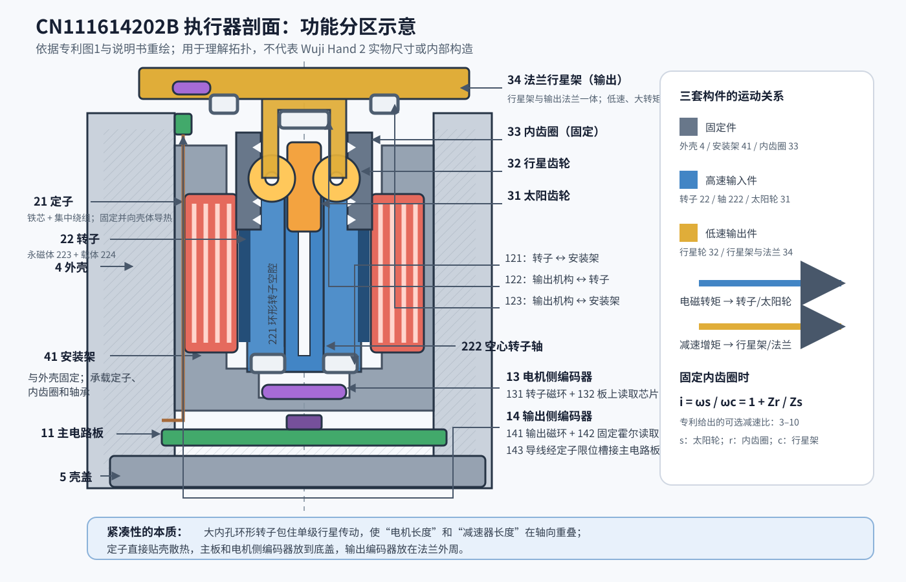
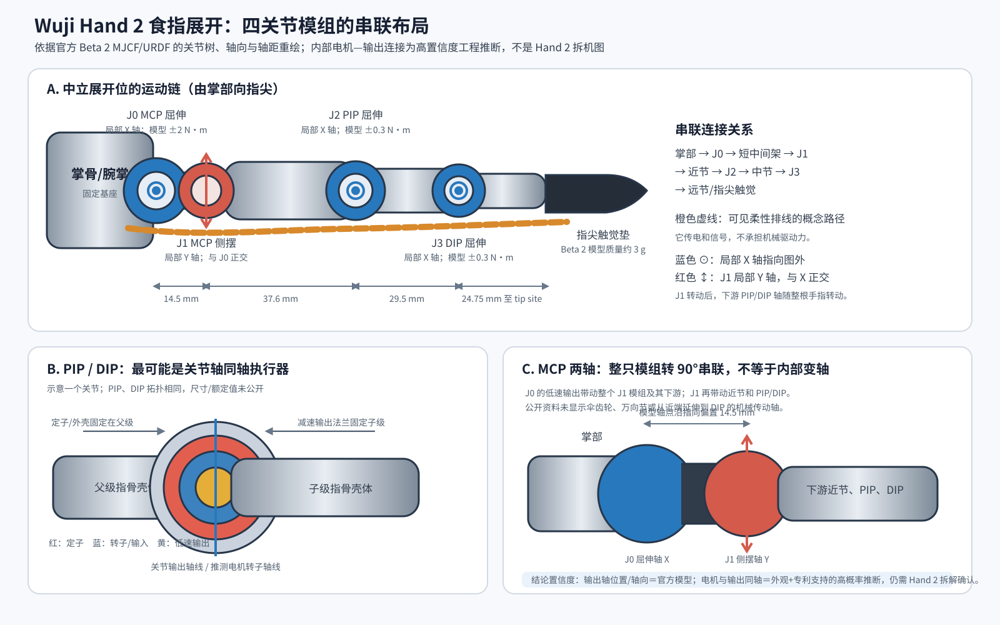

# Wuji Hand 2 机械结构、驱动与产品竞争力调研

> 历史阶段快照：原调研日期 2026-09-21，本次归档日期 2026-10-18。文中的“当前”指原调研时点。
> 本轮未联网重新核实厂商规格，未重新执行计算、仿真或真机测试。
> 自绘图表随文保存；厂家图片使用原始官方外链，手册截图改为官方手册定位链接。素材获取需要联网，来源和原始哈希见 [sources.md](sources.md)。

> 调研日期：2026-09-21\
> 研究对象：Wuji Hand 2（以当前公开的 Beta 2 为主），并回溯 Wuji Hand 1 作为技术路线对照\
> 证据口径：官方产品页、官方文档和开源模型优先；专利、媒体访谈和用户反馈分别标注，不能混作量产规格

## 0. 结论摘要

1. **Wuji 所说的“直驱”不是严格意义上的电机转子 1:1 直接驱动关节。** Hand 2 明确存在减速传动；更准确的说法是“每个关节独立、就地布置的旋转执行器，无绳索远程传动”。公开资料没有披露 Hand 2 的减速器类型、减速比、齿隙、连续/峰值关节扭矩、电机额定功率、效率图或功率密度。

2. **当前最接近关节扭矩的数据来自官方 MJCF，而不是硬件规格书。** 模型将四指 MCP 屈伸轴的执行器力矩范围设为 ±2.0 N·m，MCP 侧摆为 ±0.2 N·m，PIP/DIP 为 ±0.3 N·m；拇指两个 CMC 轴为 ±0.6 N·m，MCP/IP 为 ±0.3 N·m。这些是仿真 `actuatorfrcrange`，不能当作实机连续/峰值额定扭矩。产品侧可确认的指标是整手 20 个主动自由度、20 轴 1 kHz 控制、100BASE-TX 以太网、MIT 位置—速度—电流混合控制、12 V 供电，以及合作渠道给出的峰值指尖力不低于 12 N。

3. **Hand 2 的核心工程价值是“20 个独立轴 + 人手尺度 + 可反驱”。** 对操作算法而言，它减少了绳索摩擦、迟滞、蠕变、张力漂移和机械耦合，使“命令关节—实际关节”的映射更直接，适合关节空间策略、阻抗控制、示教回放、模仿学习和仿真迁移。但它仍有齿轮、电流环和摩擦，且官方明确表示各轴反驱力矩一致性、零位精度、由电流估算外力的一致性仍在调校。因此不能把它等同于无减速器的高透明度真直驱手，也不能把电流值直接当作可靠接触力矩。

4. **紧凑性的关键不是把所有东西都塞进掌内，而是把执行器沿指骨分布。** 官方 CAD/MJCF 显示，每指由四个串联主动关节组成，质量主要集中在近端和中节执行器壳体，末节本体很轻；主控、电源分配和网络接口集中于腕掌区域，指面用柔性排线串接分布式关节板和指尖触觉。指骨壳体同时承担结构、轴承/减速器定位和散热路径。无绳索、滑轮、腱鞘和张紧器也节省了掌内路由空间。

5. **热设计仍是 Hand 2 当前最大的产品化风险之一。** 官方 Beta 2 用户须知直接说明：长时间连续工作的温升、表面温度和降额行为尚未完成验证，不建议做长时间满载或高负载连续测试。12 V/20 A、额定不低于 200 W 是电源容量要求，不是整手持续功耗，更不是散热量；缺少绕组电阻、力矩常数、效率图和占空比，无法计算可信的热耗散。

6. **Hand 1 的“高温、噪声、难反驱”有公开用户反馈和媒体采访佐证，但不能直接外推到 Hand 2。** Hand 1 官方定义为自锁旋转直驱关节；一位公开用户报告数分钟内可接近 85°C，并估计减速比约 100–200:1，但这是单一用户经验，不是官方标定。Hand 2 已改为可反驱，并在固件中加入温度、电流和相电流异常保护，但当前仍是 Beta 2。对于“Hand 2 掌指断裂”，本次没有找到可核验的照片、批次、工况、售后记录或官方事故说明，不能作为已证实缺陷。

7. **短期产品化，独立关节模组路线很有竞争力；长期不会由单一路线通吃。** 研发平台、高自由度遥操作和算法数据采集偏好独立旋转模组；高冲击、低惯量、极致仿生和成本敏感的量产任务更可能采用绳驱、连杆/差动或混合驱动。较合理的长期方向是：关键姿态轴用高透明度独立执行器，远端或强耦合轴用腱/差动/连杆，把电机质量向掌腕迁移。

---

## 1. 先厘清版本与术语

### 1.1 Hand 1 与 Hand 2 不是同一执行器性格

| 项目 | Wuji Hand 1 | Wuji Hand 2 Beta 2 |
|---|---:|---:|
| 主动自由度 | 20 | 20 |
| 尺寸 | 201 × 75 × 50 mm | 180 × 80 × 40 mm |
| 裸手/工作质量 | 约 580 g | 裸手约 650 g；含软垫、外皮和输出线约 800 g，不含底座 |
| 传动表述 | 自锁旋转直驱关节 | 可反驱旋转直驱关节 |
| 控制接口 | USB 2.0；后续版本/定制可有 EtherCAT、CAN-FD | 100BASE-TX Ethernet，静态 IP |
| 控制方式 | FOC，位置/电流能力 | FOC；MIT 位置—速度—电流混合控制 |
| 全轴控制频率 | 官方 FAQ：反馈最高 1 kHz，典型使用 60 Hz | 20 轴上、下行均可 1 kHz |
| 成熟度 | 已销售产品 | 官方仍称 Beta 2 原型，参数和接口可能变化 |

来源：[Hand 1 产品页](https://www.wuji.tech/zh/hand)、[Hand 1 FAQ](https://community.wuji.tech/t/wuji-hand-frequently-asked-questions-faq/15)、[Hand 2 产品文档](https://docs.wuji.tech/docs/en/wuji-hand/latest/overview/)、[Hand 2 控制指南](https://docs.wuji.tech/docs/en/wuji-hand/latest/control-guide/)。

### 1.2 “直驱”的行业语义

机械工程中，严格的 direct drive 通常意味着负载直接连接电机、减速比接近 1:1。Wuji 的产品语境明显更宽：它强调电机—减速器执行器直接置于相应旋转关节，不再通过长绳索、腱鞘或跨关节连杆传力。Hand 1 的自锁特性、第三方对高减速比的估计，以及 Hand 2 官方/宣传资料对齿轮啮合和传动效率的描述，都表明它不是无减速器结构。

所以本文统一使用：

- **独立关节模组/就地旋转驱动**：对 Wuji “直驱”的准确工程描述；
- **真直驱**：电机近 1:1 驱动负载；
- **准直驱 QDD**：低减速比、高反驱性执行器。

目前没有足够证据把 Hand 2 归为真直驱或典型 QDD。

---

## 2. Hand 2 执行器性能：已知、可推断与未知

### 2.1 可确认的整手与控制参数

| 参数 | 公开值 | 证据等级与说明 |
|---|---:|---|
| 主动轴数 | 20，五指各 4 轴 | 官方规格 |
| 外形 | 180 × 80 × 40 mm | 官方规格 |
| 质量 | 裸手约 650 g；工作状态约 800 g；安装底座约 70 g | 官方 Beta 2 文档 |
| 驱动 | 全无刷电机，FOC | 官方规格 |
| 机械特征 | 每轴可反驱、串联独立旋转关节 | 官方规格，但无反驱力矩曲线 |
| 指尖力 | 峰值 ≥12 N | 合作/渠道规格；官方 Beta 文档暂不将整手负载曲线作为采购承诺 |
| 供电 | 11–13 V，标称 12 V；配套 12 V/20 A，建议额定 ≥200 W | 官方硬件集成文档；不是实测持续功耗 |
| 通信 | 100BASE-TX Ethernet，RJ45 | 官方规格 |
| 20 轴控制/状态频率 | 最高 1 kHz，单个报文覆盖 20 轴 | 官方控制指南 |
| 本体 IMU | 原始数据 100 Hz，无板载姿态融合 | 官方 SDK 文档 |
| 触觉 | Beta 2 每个指尖一个触觉垫/模块 | 官方模型版本说明；详细量程和空间分辨率未公开 |

来源：[概览](https://docs.wuji.tech/docs/en/wuji-hand/latest/overview/)、[硬件集成](https://docs.wuji.tech/docs/en/wuji-hand/latest/hardware-integration/)、[控制指南](https://docs.wuji.tech/docs/en/wuji-hand/latest/control-guide/)、[SDK Reference](https://docs.wuji.tech/docs/en/wuji-hand/latest/sdk-reference/)、[Tommoro 产品页](https://tommoro.ai/hand)。

### 2.2 扭矩：只有仿真约束，没有硬件额定表

官方开源 MJCF 的执行器范围如下：

| 关节 | MJCF `actuatorfrcrange` |
|---|---:|
| 食/中/环/小指 MCP 屈伸 | ±2.0 N·m |
| 食/中/环/小指 MCP 侧摆 | ±0.2 N·m |
| 食/中/环/小指 PIP | ±0.3 N·m |
| 食/中/环/小指 DIP | ±0.3 N·m |
| 拇指 CMC 屈伸、侧摆 | ±0.6 N·m |
| 拇指 MCP、IP | ±0.3 N·m |

这组数值对算法仿真很有用，但有三个限制：

1. 它是模型的关节侧力矩限制，不等于电机轴扭矩；
2. 没说明连续、短时峰值、热态降额和占空比；
3. 官方模型说明中曾提示部分执行器参数需要通过系统辨识更新。

因此不能据此反推电机型号或保证实际抓取载荷。公开模型：[Wuji Hand 2 Beta 2 MJCF](https://github.com/wuji-technology/wuji-description/blob/main/hand2/hand2_beta2/body/mjcf/right.xml)。

### 2.3 减速比、功率密度和电机常数

**Hand 2 下列关键参数均未公开：**

- 减速器形式及减速比；
- 电机额定/峰值转矩、额定转速和机械功率；
- 关节连续/峰值输出转矩和转矩—转速包络；
- 电机质量、主动材料质量和 W/kg 功率密度；
- 力矩常数、反电动势常数、相电阻/电感；
- 减速器效率、回差、空回、库仑摩擦、反驱力矩随温度的曲线；
- 轴承型号、寿命和允许冲击载荷。

同公司执行器专利提供了一条**可能的技术脉络，而不是 Hand 2 的拆机证据**：上海无际机器人专利 CN111614202B 描述了内转子无刷电机、部分或全部嵌入转子环形空腔的单级行星减速器、3–10 的减速比、双绝对编码器和壳体导热设计，并提出电机常数质量指标不低于 1.5 N·m/(kg·√W)。该指标是 motor constant density，不是常说的机械输出功率密度 W/kg。由于 Hand 2 官方从未确认采用该具体结构，不能把专利中的 3–10 当作产品减速比。

专利：[CN111614202B PDF](https://patentimages.storage.googleapis.com/26/c0/86/e4d5e3409357ef/CN111614202B.pdf)。

#### 2.3.1 专利图 1 的结构逐项解读

> 重要边界：下面解释的是 CN111614202B 的一个执行器实施例。专利申请于 2020 年，能够证明 Wuji 掌握并保护过这种紧凑执行器思路，但没有公开证据证明 Hand 2 的每种关节都原样采用该结构。尤其不能据此认定 Hand 2 的实际减速比就是 3–10。

这张剖视图的轴线是上下方向：**图上方是低速输出法兰，图下方是电路板和壳盖；左右方向是执行器的径向。** 图中的 1 是整个执行器，2 是电机总成，3 是减速器总成。整个机构最好按三套构件理解，而不是逐条引线阅读：

| 构件组 | 专利编号 | 运动状态 | 作用 |
|---|---|---|---|
| 固定件 | 外壳 4、安装架 41、内齿圈 33、壳盖 5 | 固定 | 构成定子和减速器的共同机架，并把反力矩传给机器人结构 |
| 高速输入件 | 转子 22、转子轴 222、太阳轮 31、电机侧编码盘 131 | 随电机高速旋转 | 把无刷电机电磁转矩输入行星减速器 |
| 低速输出件 | 行星轮 32、法兰行星架 34、输出侧编码盘 141 | 同向低速旋转 | 减速增矩，直接连接手指连杆或下一关节 |

##### A. 电机部分：21、22、221、222

- **21 定子**：最外圈的环形定子，包含定子铁芯和集中绕组。它固定在外壳 4 内壁，专利建议用导热胶粘接。铜耗和大部分铁耗可以沿“定子 → 导热胶 → 铝合金外壳”排出。
- **22 转子**：位于定子内侧的内转子，由永磁体 223 和永磁体载体 224 构成。它不是普通实心转子，而是做成大内孔的环形转子。
- **221 环形转子空腔**：转子内部的有效空间。专利要求其直径可达到定子外径的 60% 以上，目的就是把行星减速机构嵌入这里。
- **222 转子轴**：与转子固定或一体成形，并与太阳轮 31 固连。专利还提出将其做成空心轴，以便穿电源线、信号线或其他线路。

这里容易产生一个误读：图中左右各画出一块定子和转子，是因为剖切面穿过了环形结构的两侧，并不是两台电机。

##### B. 单级行星减速器：31、32、33、34

- **31 太阳齿轮**：输入件，与转子轴 222 固定，所以转速等于电机转速。
- **32 行星齿轮**：同时与太阳轮 31 和内齿圈 33 啮合，并由行星架支承。图 1 的剖面只能看到落在剖切面中的行星轮；实际圆周上通常需要多颗行星轮分担载荷，具体颗数应以实施结构为准。
- **33 内齿圈**：固定在安装架 41 上，不转动。它承受减速器的反力矩，并经安装架传给外壳。
- **34 法兰行星架**：行星架与输出法兰做成一体，是最终低速输出件。这样省掉独立联轴器、输出轴和法兰连接螺钉，也缩短轴向尺寸。

在“太阳轮输入、内齿圈固定、行星架输出”的构型下，理想传动比为：

\[
i=\frac{\omega_s}{\omega_c}=1+\frac{Z_r}{Z_s}
\]

其中 \(Z_s\) 为太阳轮齿数、\(Z_r\) 为内齿圈齿数。太阳轮和行星架同向转动，输出转速约为输入的 \(1/i\)，理想输出转矩约为输入的 \(i\) 倍，实际还要乘以传动效率。专利给出的**可选**减速比是 3–10。

这项专利的核心空间创新就在这里：普通结构是“电机轴向长度 + 减速器轴向长度”，本结构让减速机构的大部分甚至全部落入 221 环形转子空腔，因此两者在轴向上重叠。它仍是有齿轮的低减速比执行器，不是 1:1 真直驱。

##### C. 三组轴承与力流：121、122、123

| 编号 | 配合的构件 | 机械作用 |
|---|---|---|
| **121 第一轴承** | 转子 22 ↔ 安装架 41 | 支承高速转子，确定转子相对定子/机架的同轴度 |
| **122 第二轴承** | 输出机构 34 ↔ 转子 22 | 使低速输出行星架可相对高速转子旋转，并支承二者之间的同轴嵌套 |
| **123 第三轴承** | 输出机构 34 ↔ 安装架 41 | 将输出端径向/轴向载荷较直接地传给固定机架，提高输出法兰刚度 |

从载荷路径看，外部载荷施加在法兰行星架 34 上：一部分经第三轴承 123 直接进入安装架 41；另一部分可经第二轴承 122、转子和第一轴承 121 回到安装架。齿轮啮合反力则经固定内齿圈 33 进入安装架。该三轴承拓扑的价值是，在极短轴向尺寸内同时约束高速转子和低速输出，而不是让行星齿轮本身承担输出端的全部倾覆力矩。

图中的 **1241–1246** 不是六个额外功能零件，而是三组轴承的轴向限位面/卡簧：

- 1241（转子卡簧）+ 1242（安装架台阶）：约束第一轴承 121；
- 1243（法兰行星架台阶）+ 1244（转子轴卡簧）：约束第二轴承 122；
- 1245（法兰行星架环形凸缘）+ 1246（安装架台阶）：约束第三轴承 123。

说明书在描述第三限位结构时有一处把“第五限位部”也写成 1246 的笔误；同段后文、附图编号总表和图中引线共同表明，正确对应应为第五限位部 1245、第六限位部 1246。

专利允许轴承再用胶粘固定。对于真实产品，这些位置的轴向游隙、胶层厚度、轴承预紧和热膨胀会直接影响齿轮啮合、输出摆差、反驱摩擦及寿命，但专利没有给出公差链和预紧量。

##### D. 双编码器：13 与 14

**电机侧编码器 13**位于图下方：

- 131 是固定在转子上的径向充磁、两极、中空磁环；
- 132 是固定在主电路板 11 上的读取芯片，可采用霍尔式绝对编码器；
- 它测量的是高速转子/太阳轮角度，可以支持换相和高速侧位置控制。

**输出侧编码器 14**位于图上方输出法兰外周：

- 141 是套在法兰行星架 34 外圈的中空磁环；
- 142 是固定于外壳的读取装置，实施例包含第一、第二霍尔传感器 1421/1422 和小电路板 1423；
- 143 是连接输出编码器和主板的导线，穿过外壳内腔及定子限位槽 211；
- 它直接测量法兰行星架相对壳体的绝对位置，不必用电机角度除以传动比来间接估算输出角度。

双编码器理论上可以观测 \(q_m-iq_{out}\) 所反映的齿隙、弹性形变或装配误差，也能让输出位置闭环消除一部分减速器误差。但该专利只明确保护双侧位置检测，没有声明这是经过标定的关节扭矩传感器；仅凭两编码器差值不能直接得到可信扭矩，还需要传动刚度、摩擦、温漂和齿隙模型。

##### E. 外壳、电路板与热设计：4、41、411、5、11、42、43

- **4 外壳**：圆筒形固定件，可用铝合金并在输出侧开减重槽；也是主要散热体。
- **41 安装架**：由外壳一端向内延伸，围成 **411 减速器安装腔**，同时承载定子、固定内齿圈和三组轴承中的固定侧。
- **5 壳盖**：封闭电机侧，通过 42 盖合螺钉与外壳连接；43 是将外壳与外部基座/连杆连接的螺钉孔。
- **11 主电路板**：固定在壳盖内侧，可集成 FOC 驱动、上位机通信以及电源/通信接头；132 电机侧编码器芯片也直接放在这块板上。

专利热设计的强项是把发热定子直接固定到外壳，而不是让热量先穿过转子轴承。可选方案还包括外部散热套、散热片和液冷套。它没有给出热阻、允许绕组温度或连续工况，所以“散热路径合理”不等于已经证明某一尺寸下的连续输出能力。齿轮啮合损耗、轴承损耗和转子涡流产生的热，仍要经过转动件—轴承/润滑脂—机架等更差的路径排出。

##### F. 从机械设计角度应重点质疑的地方

1. **行星轮轴和轴承细节缺失。** 图中没有给出行星轮是滑动轴、滚针还是微型滚珠支承；这对效率、回差和寿命影响很大。
2. **输出法兰的倾覆刚度。** 扁平结构的轴承跨距有限，手指受到侧向撞击时，123 的尺寸与配合会成为关键。
3. **齿圈和安装架一体化公差。** 内齿圈与电机定子共享外壳基准，能提高同轴性，但会把齿轮加工、轴承孔和定子气隙纳入同一复杂公差链。
4. **磁编码器串扰。** 输出磁环、转子永磁体、电机相电流和可选数字罗盘距离很近，需要磁路设计、差分/标定和温漂补偿。
5. **导线 143 的可制造性。** 它要经过定子限位槽且不能侵入气隙、转子或轴承装配空间，绝缘、固定、返修和耐振动都需要额外工艺。
6. **胶粘连接的热—结构耦合。** 导热胶、编码磁环胶和轴承固持胶会受温度循环、离心力、润滑污染和固化公差影响。
7. **低减速比带来的电机代价。** 3–10 的行星级利于反驱和带宽，但同样输出转矩下要求电机产生更大转矩和电流；小体积中的铜耗仍可能成为连续性能瓶颈。

专利部件编号原始依据可在 [Google Patents 中文全文](https://patents.google.com/patent/CN111614202A/zh) 的“附图说明”和“具体实施方式”中核对。

Hand 2 预热视频的第三方转述还提到传动效率提升 20%、反驱力矩约 0.05 N·m、轻量转子和特种合金骨架。这些没有出现在当前正式规格表，也缺少测试边界，只能列为“厂商宣传转述”，不能用于选型验收：[Humanoids Daily 报道](https://www.humanoidsdaily.com/news/wuji-tech-teases-wuji-hand-2-high-engineering-ambitions-behind-a-cgi-veil)。

### 2.4 散热量与热路径

目前无法从公开资料计算 Hand 2 的散热量。12 V × 20 A = 240 W 只是配套电源上限，文档建议的 200 W 也是电源额定能力，不代表手持续吸收或耗散 200 W。

实际热损耗应至少分为：

\[
P_{loss}=I_{rms}^{2}R+P_{iron}+P_{driver}+P_{gear/friction}
\]

缺少相电阻、RMS 电流、PWM/FOC 工作点、铁耗、驱动板效率、减速器效率和任务占空比，不能给出瓦数。结构上可以推断的散热路径是：绕组/定子 → 金属关节壳体/骨架 → 外壳和软垫 → 自然对流；同公司专利也描述过定子与壳体导热粘接及可选散热套，但是否原样用于 Hand 2 未证实。

更重要的是，官方 [Beta 2 用户须知](https://docs.wuji.tech/docs/en/wuji-hand/latest/user-notice/) 明确写明：

- 热设计仍在迭代；
- 长时间连续工作的温升、表面温度和降额行为尚未验证完成；
- 不建议长时间满载或高负载连续运行；
- 建议环境温度 15–30°C，并保持通风；
- 触发热保护后会限流或停止输出。

这比任何未经边界定义的“散热改善”宣传更适合作为当前工程决策依据。

---

## 3. 控制方式、频率和底层端口

### 3.1 控制环与命令语义

Hand 2 对外提供 MIT 风格混合控制：

\[
\tau_{cmd}=K_p(q_d-q)+K_d(\dot q_d-\dot q)+\tau_{ff}
\]

但 SDK 的 `effort` 字段实际单位是电流 A，而不是已经标定的 N·m。官方推荐的初始配置是 `Kp ≥ 3`、`Kd = 0.01–0.05`、电流限制不超过 1.5 A；默认示例约为 `Kp=5`、`Kd=0.01`、1.0 A，软件允许的硬上限为 2 A。官方同时警告：当前从电流到外部关节力矩的标定一致性和闭环验证尚未完成。

能确认的是外层命令语义和本体采用 FOC；**不能确认**电机电流环、速度环和位置环在嵌入式驱动器内部各自的采样/PWM 频率。1 kHz 是整手网络命令和状态的最高频率，不应误写成 FOC PWM 频率。

### 3.2 网络频率与端口

- 20 轴命令：单报文最高 1 kHz；
- 20 轴 `joint_states`：原生最高 1 kHz；
- 请求—应答式 GET：官方建议不超过 100 Hz；
- IMU：100 Hz；
- 左手默认 IP：`192.168.1.110`；右手：`192.168.1.111`；
- 子网掩码：`255.255.255.0`；默认网关：`192.168.1.1`；
- 数据端口：`50001`；无 DHCP；
- Wuji Studio 更新记录把设备数据通道描述为 UDP。

来源：[控制指南](https://docs.wuji.tech/docs/en/wuji-hand/latest/control-guide/)、[硬件集成](https://docs.wuji.tech/docs/en/wuji-hand/latest/hardware-integration/)、[Wuji Studio Changelog](https://github.com/wuji-technology/wuji-studio/blob/main/CHANGELOG.md)。

### 3.3 嵌入式固件公开到什么程度

目前的公开边界是：

- [wuji-sdk](https://github.com/wuji-technology/wuji-sdk) 提供 Python 示例、C 头文件和预编译动态库；
- 可设置 20 轴 mask、目标位置/速度、Kp/Kd 和电流前馈/限制；
- 可读关节位置、速度、电流、温度、母线/诊断及错误状态；
- 固件通过 Wuji Studio/CLI 升级，固件镜像不单独公开下载；
- SDK 文档提到内部 `wuji-proto`，但报文帧格式、CRC、序列号、时间戳同步机制、丢包重传策略和驱动器 bootloader 接口没有公开；
- 没有公开每个关节电机板的 MCU、PWM 频率、ADC 同步、编码器总线、板间总线或调参接口；
- 公开资料没有明确 Hand 2 编码器数量、位数、绝对/增量制式。不能把 Hand 1 的“双编码器”或专利的双绝对编码器直接移植成 Hand 2 事实。

从官方故障说明中的“关节驱动板指示灯”、单指可独立失效、每指可整体更换，以及逐轴温度/电流诊断，可以合理推断系统采用了分布式关节/手指电子架构；但板间拓扑仍属未知。

固件成熟度也要注意：官方 [Release Notes](https://docs.wuji.tech/docs/zh/wuji-hand/beta1/release-notes/) 显示，2026 年 6 月发布 Beta 1 文档，7 月进入与 Beta 1 硬件不兼容的 Beta 2/v2.0 接口，此后连续修复通信中断停机、升级、触觉零点/阈值、捏合时误报过流、相电流不平衡判断等问题。这说明保护链路在快速完善，集成方应锁定硬件批次、固件版本、SDK 版本和模型版本，不能只写“Hand 2”。

---

## 4. 机械结构与紧凑集成

### 4.1 可从官方 CAD/MJCF 直接读出的结构

Hand 2 是典型的五指、每指四主动转轴的串联结构：

- 食指、中指、环指、小指：MCP 屈伸 + MCP 侧摆 + PIP 屈伸 + DIP 屈伸；
- 拇指：两个近似正交的 CMC 轴 + MCP + IP；
- 每一轴都由独立执行器控制，没有用一个电机机械耦合多个指节；
- 官方结构分三层：承载关节/传动/电机的骨架，软垫，以及外皮；
- 指头可按整指更换，外皮、软垫和指甲为维护件；内部板卡不面向用户维修。

官方模型中的典型指节轴距约为：四指近端两轴间 14.5 mm、之后约 37.6 mm、29.5 mm，末轴到指尖参考点约 24.75 mm；拇指对应约 14.75、32.5、35 和 29.8 mm。这表明每个执行器的轴向/径向包络必须控制在约 20 mm 级指宽内。

#### 4.1.1 食指展开时的四关节模组布局

官方 Beta 2 MJCF 将食指写成一条严格的串联树：

    wrist（掌部）
    └── proximal：J0 MCP flex，局部 X 轴
        └── proximal_abd：J1 MCP abd，局部 Y 轴，距 J0 约 14.5 mm
            └── middle：J2 PIP，局部 X 轴，距 J1 约 37.6 mm
                └── distal：J3 DIP，局部 X 轴，距 J2 约 29.5 mm
                    └── tip_sensor_frame / tip，距 J3 参考点约 24.75 mm

由此可以确定：

- MCP 屈伸、PIP、DIP 在零位时是三个平行的局部 X 轴；
- MCP 侧摆是局部 Y 轴，与上述屈伸轴正交；
- J0 与 J1 不是完全共点的球铰或万向节，而是沿指向错开约 14.5 mm 的两个串联转轴；
- J1 侧摆时，整个近节、PIP 模组、DIP 模组和指尖一起侧摆，所以 PIP 与 DIP 两轴始终在下游指骨坐标系中保持平行，但它们相对掌坐标系的方向会随 J1 改变；
- PIP 与 DIP 是两个独立主动轴。算法中常见的 DIP≈0.7×PIP 只是仿生重定向约束，不是机械耦合。

来源：[官方模型仓库说明](https://github.com/wuji-technology/wuji-description/blob/main/README.md)及 [Beta 2 右手 MJCF](https://github.com/wuji-technology/wuji-description/blob/main/hand2/hand2_beta2/body/mjcf/right.xml)。

##### MCP 侧摆、PIP 和 DIP 实际怎样连接

从机械运动链看，它们不是用一根长轴相连，而是“上一级输出承载下一级整套模组”：

1. **J0 MCP 屈伸**的一侧固定于掌部，低速输出侧带动一个很短的中间架以及整个 J1 模组。
2. **J1 MCP 侧摆**相对 J0 转过 90°安装。J1 的输出侧带动完整近节指骨，以及装在其远端的 PIP 模组。
3. **J2 PIP**的固定侧属于近节指骨，输出侧带动中节指骨和整个 DIP 模组。
4. **J3 DIP**的固定侧属于中节指骨，输出侧只带动远节、指尖骨架和触觉垫。

“固定侧”和“输出侧”具体放在图像左侧还是右侧，可能因装配和左右手镜像而变化；但每个旋转副两侧分别连接父链接和子链接的拓扑不会变。PIP 电机并不通过机械轴驱动 DIP 电机：PIP 只负责转动包括 DIP 模组在内的整个下游，DIP 再独立转动末节。

供电、通信和编码信号通过柔性排线跨越这些模块。裸骨架图片中可以看到橙色 FPC 沿指节侧面/背面及关节间隙布置；它是电连接，不承担关节传力。官方也特别提示指面柔性排线容易被刮擦和拉扯。

##### PIP/DIP 是否存在“变轴”机构

目前最合理的判断是：**PIP 和 DIP 很可能采用电机转子轴、减速器输出轴与真实关节轴同轴的扁平执行器，不存在伞齿轮式 90°变轴。** 证据包括：

1. 官方 MJCF/URDF 在 PIP、DIP 各定义一个就地独立旋转关节，没有腱索或机械耦合自由度；
2. 裸骨架渲染图在每个 PIP/DIP 铰轴位置都能看到圆形轴向端盖，外观符合扁平同轴模组；
3. 官方将架构描述为“串联直驱旋转关节”；
4. 同公司 CN111614202B 专利正是转子—太阳轮—行星架—输出法兰同轴的扁平执行器；
5. 在约 20 mm 指宽中再加入伞齿轮或正交轴系会增加轴承、侧隙、噪声和装配体积，与该产品的紧凑化目标相悖。

但这一结论的置信度应写成“高概率”，不能写成“已经拆机确认”。原因是：

- URDF/MJCF 只描述外部运动学输出轴，不描述电机转子轴；
- 官方 STEP 是扁平化的外形/链接实体，没有电机、齿轮和轴承零件树；
- 当前没有公开的 Hand 2 实物拆解或内部剖面；
- 理论上仍可能在圆壳内部使用一小级平行偏置齿轮，只要最终输出轴与 URDF 轴一致。

因此，针对问题“DIP 关节旋转轴是否就是 DIP 电机定子/转子的轴向中心线”，本报告的回答是：**从公开外形、运动学与专利技术路线看，大概率是同轴；公开证据尚不足以给出 100% 确认。** MCP 的“轴向改变”则是通过把两个完整关节模组正交串联实现，而不是在一个模组内部用伞齿轮改变动力方向。

##### 指腹下面实际放了什么

Hand 2 的官方结构是骨架—软垫—外皮三层。结合模型和裸骨架图，可以区分两类区域：

- **近节和中节指腹下面**：主要是金属承载壳体、关节模组的一部分以及 FPC/连接空间；没有证据显示这里覆盖连续的大面积触觉阵列。
- **远节/指尖下面**：Beta 2 模型有单独、固定焊接到 distal link 的 tip_sensor_frame，模型质量约 3 g；这对应指尖触觉垫及其安装骨架，而不是一个额外转动关节。
- **关节圆盘位置**：圆盘中心是旋转轴及轴承/减速输出，周围短轴向空间可能容纳电机、减速器和编码器；具体叠层仍需拆解确认。
- **外侧可见橙色线路**：更符合沿指骨表面铺设的柔性板/排线，而不是通过一根贯穿 PIP—DIP 的中空机械传动轴。

模型中的链接质量分别约为：J0 后的短 proximal 链接 11.6 g、J1 后的 proximal_abd 链接 33.9 g、PIP 后的 middle 链接 21.2 g、DIP 后的 distal 链接 5.0 g、指尖传感器链接 3.0 g。这些是整段链接的惯量模型，不能直接解释为各电机自身质量；但它清楚显示，DIP 之后只剩很轻的末节和触觉垫，DIP 执行器主体更可能归属于它的父级中节，而不是悬在指尖。

### 4.2 质量分配揭示了什么

Beta 2 MJCF 惯量数据合计约 623 g，接近官方 650 g 裸手值。腕掌主体约 232 g；每根食/中/环指约 75 g，小指约 69 g，拇指约 98 g。四指中，近端侧摆/执行器段约 30–34 g，中节约 19–21 g，末节刚体约 5 g，触觉垫约 3 g。

这是很有意义的布局信号：较重的电机和减速结构集中于近端及中节，真正的远端链接很轻，减少了远端转动惯量。它仍比把所有电机放在前臂的绳驱手更重，但比“每个末节都背完整电机”合理得多。

### 4.3 为什么能在小空间内布置 20 轴

综合官方模型、产品文档和同公司专利，可以形成如下工程解释：

1. **执行器结构与指骨同轴/共壳。** 电机、减速器、轴承和编码位置沿关节轴紧凑堆叠，壳体既是执行器机架，也是指骨和散热件，减少独立支架、联轴器和紧固件。
2. **没有长距离腱索系统。** 省掉滑轮、腱鞘、预紧弹簧、张紧器和掌内交叉走线，把掌部容积留给主控、电源和接口。
3. **电子器件分布式。** 指关节附近有驱动/传感电子，腕掌承担汇总与供电。电源和通信通过沿指面铺设的柔性排线通过各关节，而不是每轴单独一束圆线。
4. **重复模组降低非重复体积。** 四根长指大量共享拓扑和零件，拇指做专用变体；同一套关节接口也支持整指快速更换。
5. **触觉集中在指尖。** 当前 Beta 2 不是全掌高密度电子皮肤，五个小型指尖传感垫对布线、带宽、散热和装配的压力小得多。
6. **远端轻量化。** 将较大的执行器段放在近端和中节，末节主要保留输出结构与触觉。

其中，“减速器是否嵌入电机转子空腔、是否为单级行星”只能由同公司专利提供可能性，官方 STEP 没有内部零件层级，不能下定论。

### 4.4 布局代价

- 电机和减速器随指运动，指端等效惯量高于腱驱方案；
- 每个关节都要处理轴承、齿轮、编码、驱动、电源和信号，装配公差链复杂；
- 指面柔性排线暴露于弯折、刮碰、拉扯和污染，官方也明确警告它较脆弱；
- 小体积、高电流、低自然对流面积使连续热负载困难；软垫和外皮又会增加热阻；
- 磁性工具/物体靠近关节可能影响磁体或编码器，官方要求避免；
- 维修粒度偏向“整指/整模组更换”，现场难以维修板卡或减速器。

---

## 5. 为什么选择全关节独立旋转驱动

### 5.1 技术优势

| 维度 | 独立关节模组的优势 |
|---|---|
| 运动学 | 20 个命令自由度基本对应 20 个物理关节，少机械耦合，标定和控制直观 |
| 控制 | 每轴可单独做位置、速度、电流/阻抗控制；适合接触过程调整刚度 |
| 反驱与示教 | Hand 2 可由外力移动，便于手把手示教、安全释放和接触顺应 |
| 仿真迁移 | URDF/MJCF 中的一轴一执行器模型更接近实机，减少腱索隐状态 |
| 维护 | 单指故障不必使全手失效，整指可替换，模块化诊断清晰 |
| 制造扩展 | 重复关节模组可批量制造、自动测试，并跨手型复用 |
| 数据 | 每轴状态和电流能统一采集，利于遥操作数据集和策略训练 |

### 5.2 技术缺点

- 指内电机带来更高运动质量、碰撞动能和根部关节负担；
- 热源多且分散，散热表面积小，持续夹持容易热降额；
- 关节模组的小型齿轮和轴承要同时承担冲击、侧向力和反复反驱，寿命挑战大；
- 20 套电机、编码器、驱动和线束使 BOM、标定点和故障点增加；
- 若仍使用中高减速比，齿隙、摩擦、噪声和冲击脆弱性不会因“直驱”名称消失；
- 电流估算扭矩需要准确的力矩常数、效率和摩擦模型，尤其在微小接触力下容易失真。

### 5.3 对操作算法是否有独特优势

有优势，但不是“只有直驱才能做”。最显著的是**降低动作传递中的隐状态**：

- 腱驱手的实际关节位置不仅取决于电机位置，还取决于腱索张力、摩擦、回差、弹性、蠕变、路由曲率和接触载荷；
- 连杆/差动手存在固定耦合，策略输出的独立自由度少于表面关节数；
- 独立关节模组更接近 Markov 状态假设，位置命令、状态观测和仿真模型更一致。

这有利于遥操作动作复现、关节空间强化学习、动作分块、轨迹优化和 sim-to-real。可反驱和较低摩擦还可提升阻抗控制与外部示教质量。CMU 关于 direct-drive hands 的研究把这种价值概括为 force–motion transparency：[Direct Drive Hands: Force-Motion Transparency in Grasping and Manipulation](https://publications.ri.cmu.edu/storage/publications/2019/06/0166_FI.pdf)。

但 Hand 2 当前有三个现实限制：

1. 没有公开的真实关节力矩传感器，主要是电流代理；
2. 官方承认各轴反驱力矩和电流—外力标定一致性仍在优化；
3. 触觉目前集中在指尖，不能覆盖整根手指和掌面接触。

因此它对“动作可控性”和“仿真建模”确有独特优势，对精确力控的优势仍需要标定数据证明。

---

## 6. 直驱、绳驱、连杆与混合驱动的路线判断

| 路线 | 主要优点 | 主要缺点 | 更适合的阶段/场景 |
|---|---|---|---|
| 就地独立旋转模组 | 控制映射直接、模块化、布线逻辑清晰、易做 20 个真主动轴 | 指内质量和发热大；执行器多；冲击与齿轮寿命压力高 | 当前科研平台、遥操作采集、通用操作验证、小批量高客单价市场 |
| 绳驱/腱驱 | 电机可移到掌腕/前臂；手指轻、惯量小；易获得仿生柔顺和小关节 | 摩擦、迟滞、蠕变、预紧和维护复杂；装配与标定难；腱索寿命与张力漂移 | 极轻手指、高速/高冲击、强调仿生和被动顺应的产品 |
| 连杆/差动 | 传力刚性、效率和重复性好；可用较少电机形成稳定包络抓取 | 固定耦合减少独立可控 DOF；奇异位形、侧隙与复杂空间连杆限制手型 | 工业抓取、低成本可靠夹持、动作种类较固定的量产终端 |
| 混合驱动 | 可把关键轴独立控制，把远端轴轻量耦合；平衡透明度、重量、成本 | 系统同时拥有两类传动的建模、装配和维修复杂度 | 中长期通用型量产手，尤其成本/可靠性优先于“20 轴全独立”时 |

学术综述对这些权衡的总结可参见：[Frontiers 2024 灵巧手综述](https://www.frontiersin.org/journals/neurorobotics/articles/10.3389/fnbot.2024.1513458/full) 和 [Robotics 2026 综述](https://www.mdpi.com/2218-6581/15/8/146)。腱鞘传动中的非线性摩擦、黏弹性、迟滞和蠕变有大量实证研究，例如：[Tendon-sheath friction study](https://www.sciencedirect.com/science/article/pii/S1474667016384932)、[Friction, hysteresis and creep study](https://cris.unibo.it/handle/11585/123029)。

### 6.1 短期判断（1–3 年）

技术上，Wuji 路线非常适合高自由度算法开发平台：集成快、状态接口统一、可把手当作 20 轴机器人使用。市场上，科研院校、具身智能公司和遥操作数据团队愿意为“开箱即用的 20 主动轴”支付高价，小批量阶段也能消化复杂 BOM。

短期障碍是 Beta 成熟度、热连续性、触觉覆盖、协议开放度和现场维修能力。对需要 8–16 小时生产节拍、跌落/冲击或大量水尘污染的工业客户，仅有峰值演示不够。

### 6.2 长期判断（3–8 年）

长期最可能出现任务分化，而不是一条路线胜出：

- 高性能通用手：关键 MCP/拇指对掌轴用低摩擦独立模组，远端关节用腱/差动，触觉和力矩闭环增强；
- 工业量产手：用连杆/差动减少执行器数，牺牲部分独立 DOF 换寿命、节拍和价格；
- 高动态仿生手：把电机上移到掌腕/前臂，继续采用腱驱或混合驱动；
- 研究/数据手：保留全独立轴，因为算法自由度和数据可解释性本身就是产品价值。

### 6.3 制造成本是否有优势

Wuji 路线的成本优势主要在**工程复用与装配标准化**，不是天然低 BOM：

- 同类关节模组、指骨、驱动板可重复生产和自动 EOL 测试；
- 避免人工穿腱、预紧、打结和逐根校准，减少高度依赖技师的工时；
- 整指换修可降低售后诊断时间；
- 运动学标定比复杂腱索传动更稳定，软件维护成本较低。

成本劣势则是每手 20 套电机—减速器—编码器—驱动器，精密微型齿轮和轴承良率敏感，柔性板与连接器多，热测试和逐轴标定也不能省。只有在关节模组达到较大规模、零件高度共用、自动化装配成熟后，复用优势才可能覆盖 20 套执行器 BOM。

一篇 2026 年采访引述公司战略负责人称，核心部件由 Wuji 设计、上游代工、团队组装，Hand 1/Hand 2 单手价格约 1.1 万/1.3 万美元；这不是官网统一报价，不同渠道报价更高，适合视作小批量市场信号而非量产成本：[证券时报/东方财富转载](https://finance.eastmoney.com/a/202606253782812883.html)。

---

## 7. 已知问题与用户反馈的证据审查

### 7.1 Hand 1 发热、难反驱和噪声

这几项具有一定证据基础，但需分开看：

- 官方称 Hand 1 使用“自锁旋转直驱关节”，因此不能反向推动主要是设计特征，不是单台故障；
- Hand 1 API 文档的默认关节电流限制约 1.5 A、最大 3.5 A，并在约 85°C 起进入 70% 降额、约 93°C 进入更强降额，说明热保护确实是重要设计约束：[Hand 1 API](https://docs.wuji.tech/docs/en/wujihandpy/latest/api-reference/)；
- 一位公开用户称其设备数分钟内可到约 85°C、无散热器的关节更热、噪声较明显，并主观估计减速比约 100–200:1。这是单一样机/工况的用户陈述，没有功率、环境和动作占空比，不能作为全批次指标：[用户公开动态镜像](https://mobile.twstalker.com/jerryhuang01)；
- ICRA 现场采访类报道也转述 Hand 1 发热明显、不易反驱、受强冲击较脆弱，Hand 2 的目标正是改善这些问题：[现场报道](https://www.laohu8.com/post/580978889220672)。

### 7.2 Hand 2 当前官方承认的风险

| 风险 | 官方信息 |
|---|---|
| 热 | 长时间温升、表面温度、降额尚未完成验证，不建议持续满载 |
| 可靠性 | 耐久、跌落、振动和冲击保证尚未完成，不应作为已验证量产指标 |
| 力矩估计 | 电流到外部力矩的标定一致性及闭环尚未验证 |
| 反驱一致性 | 不同关节仍在调校 |
| 零位 | 零位精度仍在优化 |
| 柔性排线 | 指面排线脆弱，应避免拉扯、刮碰；建议保持软垫/外皮安装 |
| 急停 | 当前只有软件急停，没有独立硬件急停 |
| 失联 | 新固件在通信中断后停止电机，需显式重新使能，抓持物可能跌落 |
| 维修 | 用户可换外皮、软垫、指甲和整指，不能维修内部电路板 |

来源：[User Notice](https://docs.wuji.tech/docs/en/wuji-hand/latest/user-notice/)、[Troubleshooting](https://docs.wuji.tech/docs/en/wuji-hand/latest/troubleshooting/)、[Reference](https://docs.wuji.tech/docs/en/wuji-hand/latest/reference/)。

### 7.3 “Hand 2 掌指断裂”是否属实

截至本次检索，没有找到能够交叉验证的公开原始材料：没有明确序列号/批次、载荷和碰撞工况、断裂照片或视频、断口位置、售后/RMA 记录，也没有官方召回或故障公告。因此报告不把“掌指断裂”写成已发生的普遍质量问题。

可以确认的只是：官方仍未完成跌落、振动、冲击和长期耐久保证，且将整指设计为可换模块。两者说明机械可靠性仍应通过验收测试验证，但不能反向证明已有批量断裂。

若供应商或用户能提供案例，至少应索取：硬件 Beta 版本、左右手和序列号、固件版本、是否装软垫/外皮、断裂发生在碰撞还是主动输出、指令电流限制、断口宏观照片和 RMA 结论。

---

## 8. 与同类高自由度产品比较

> 下表尽量使用厂商公开规格。不同厂商对“负载”“抓力”“峰值”“额定”的定义并不一致，不能直接把最大数字排序。

| 产品 | 驱动/DOF | 质量与尺寸 | 控制与触觉 | 公开优势 | 公开短板/不确定性 |
|---|---|---|---|---|---|
| **Wuji Hand 2 Beta 2** | 20 主动轴；可反驱独立旋转模组 | 裸手约 650 g；180×80×40 mm | Ethernet 100M；20 轴 1 kHz；MIT 混合；5 个指尖触觉垫 | 人手尺度下 20 真主动轴；开放 STEP/URDF/MJCF；整指模块化；网络频率高 | 减速比、额定扭矩/功率、热和寿命数据未公开；触觉规格不完整；Beta 可靠性未闭环；协议内部细节闭源 |
| **智元/灵巧智能 OmniHand Ultra-M** | 20 主动轴；官方称全直驱旗舰 | 630 g；189.5×88.5×40 mm | CAN-FD/RS485/EtherCAT；指尖视觉触觉，掌面约 300 taxels | 公开宣称连续负载表温 40–45°C 不降额、50 万次；0.3 s 开合；±0.2 mm；触觉指标完整 | “稳定 3 kg/提拉 8 kg”和发布稿“整手 5 kg”口径不同；公开资料仍缺单关节扭矩、减速比和标准化第三方测试 |
| **Sharpa Wave** | 22 主动轴，22 个专有执行器；行业通常归为直驱模组路线 | 1.3 kg；208×90×50 mm | 千兆以太网；500 Hz；DTA 视觉触觉最高 240×240、180 fps | 指尖力最高 20 N；公开 >100 万次寿命以及冲击/温循测试；触觉信息密度高 | 比 Wuji/Ultra-M 重约一倍、尺寸更大；官方页面未披露减速比和单关节额定扭矩；高指标 SKU 与低指标 SKU 要区分 |
| **它石 DexHand** | 公开宣传强调“手脑一体”和触觉世界模型 | 未找到可核验的完整机械规格表 | TacForeSight/OmniVTA，宣传可感知约 0.03 mm 纹理 | 触觉感知、腕力和模型一体化叙事强 | DOF、质量、传动、扭矩、热、控制频率和接口缺少公开工程数据，无法做等口径机械比较 |

资料来源：

- OmniHand Ultra-M：[官方规格 PDF](https://www.agilink-ai.com/uploads/upload/files/20260530/a7b12675ce5e3b4e9b913801c0c6f659.pdf)、[WAIC 发布稿](https://en.prnasia.com/releases/apac/agibot-unveils-four-new-products-at-waic-2026-showcasing-embodied-ai-in-real-world-operations-541184.shtml)；不要与旧款 10 主动轴 OmniHand 混淆。
- Sharpa Wave：[官方产品页](https://www.sharpa.com/pages/wave)。
- 它石 DexHand：[Gasgoo 发布报道](https://www.gasgoo.com/robot/news/70460383.html)。公开内容偏产品发布，未达到可做详细机械审查的程度。

### 8.1 Wuji 相对优势

- 在 650 g、180 mm 级手体内实现 20 个独立主动轴，质量/自由度比优秀；
- 1 kHz 全轴双向通信，对高速策略和数据记录友好；
- 官方公开完整外形 STEP、URDF、MJCF、碰撞网格和安装附件，算法/集成透明度明显高于只给宣传页的产品；
- 可反驱、无腱索隐状态，软件控制抽象干净；
- 整指可换，适合实验室快速恢复运行；
- 相比 Sharpa Wave 更轻、更接近普通人手外形。

### 8.2 Wuji 相对不足

- Ultra-M 和 Wave 已公开更具体的温升、寿命、冲击或触觉规格，Wuji 当前反而主动声明这些尚未验证；
- 触觉仅见指尖模块，公开的量程、分辨率、帧率和耐久度不如 Ultra-M/Wave 完整；
- 缺少关节级连续/峰值扭矩—转速—温度曲线和减速器数据，不利于严肃选型；
- 无硬件急停、底层协议/固件闭源，工业集成和功能安全能力有限；
- Beta 1→Beta 2 存在硬件/接口不兼容，当前版本锁定和长期供货风险较高。

---

## 9. 公开结构图、CAD 和“拆解图”在哪里

### 9.1 最有价值的公开资料

1. [Wuji Description 总仓库](https://github.com/wuji-technology/wuji-description)：官方维护的 Hand 2 Beta 1/Beta 2 模型。
2. [Hand 2 Beta 2 目录](https://github.com/wuji-technology/wuji-description/tree/main/hand2/hand2_beta2)：含 body、attachment、mujoco scene 等。
3. [右手完整 STEP](https://github.com/wuji-technology/wuji-description/blob/main/hand2/hand2_beta2/body/step/wuji-hand2-description-right_beta2_with_mount_step.STEP)：适合检查整机外包络和机械干涉。
4. [右手 MJCF](https://github.com/wuji-technology/wuji-description/blob/main/hand2/hand2_beta2/body/mjcf/right.xml)：最适合查看关节树、轴向、行程、惯量、质心和仿真执行器限制。
5. [Hand 2 官方概览](https://docs.wuji.tech/docs/en/wuji-hand/latest/overview/)：三层结构、尺寸、关节定义、可换件和系统框图。
6. [硬件集成文档](https://docs.wuji.tech/docs/en/wuji-hand/latest/hardware-integration/)：安装孔、电源、网络和法兰信息。

### 9.2 STEP 能看到什么、不能看到什么

公开 STEP 包含多个 BREP 实体，可以用于外形、装配姿态、安装和干涉分析；但产品树被扁平化，内部没有“电机/太阳轮/行星轮/编码器/驱动板”等有意义的零件命名，也没有爆炸图、材料、配合、公差、轴承或紧固件 BOM。Beta 2 模型说明还指出，其 STEP 主体与 Beta 1 基本相同，新增触觉垫主要体现在机器人模型中。

因此它不是内部结构图，更不是拆机数据。目前没有找到可验证的 Hand 2 实物完整拆解照片或视频。网上多数“结构解析”基于官方 CGI/渲染图，不能据此确定齿轮级数、编码器布置或 PCB 拓扑。

---

## 10. 建议的采购/研发尽调测试

如果目标是决定是否采购或仿制这一架构，建议要求供应商提供并现场复测以下数据：

### 10.1 关节执行器台架

- 每类关节的减速比、减速器形式、回差和空载反驱力矩；
- 25°C/45°C 下连续与 1 s、10 s 峰值转矩—转速曲线；
- 0、0.3、0.6、1.0、1.5、2.0 A 下的输出力矩标定，正反方向分别测量；
- 电流关闭时、使能零电流时、热态时的反驱力矩；
- 位置阶跃、正弦扫频、力矩带宽和 1 kHz 网络抖动/丢包；
- 输出轴径向/轴向刚度和冲击后零位漂移。

### 10.2 热与整机耐久

- 15/25/35°C 环境下，典型抓取和堵转占空比的绕组估温、关节壳体、外皮表面温度；
- 明确降额阈值、恢复滞环和触发后的控制行为；
- 单指周期、整手开合、持续夹持和随机操作四种寿命工况；
- 指面 FPC 最小弯曲半径、弯折寿命、刮擦和拉脱力；
- 手指侧碰、指尖冲击、整手跌落和被动物体反推测试；
- 失联、掉电、过温、过流时是否掉物，以及上位机恢复状态机。

### 10.3 软件与版本

- 锁定硬件 BOM revision、固件、SDK、URDF/MJCF 的兼容矩阵；
- 要求 UDP 报文时序、时间戳、校验、端序、丢包和 watchdog 说明；
- 确认 Linux 实时线程、网卡独占、交换机环境下能否稳定达到 1 kHz；
- 确认触觉和关节流是否共享带宽，传感器时间同步误差是多少；
- 明确固件回滚、离线升级、长期维护和设备变砖恢复流程。

---

## 11. 最终判断

Wuji Hand 2 最值得肯定的不是某个尚未公开的电机峰值，而是它把 20 个独立、可反驱的旋转轴做进了接近人手的体积，并提供了 1 kHz 的统一控制接口和质量较好的官方机器人模型。这对算法研究、遥操作采集和快速集成确有实际价值。

但从机械产品定型角度，它目前仍是 Beta：决定工程可用性的减速比、连续扭矩、效率、热阻、寿命和冲击数据没有公开，官方还明确保留了热、反驱一致性、力矩标定、零位与可靠性的风险。其“全关节直驱”应理解为架构选择，而不是自动等价于低摩擦、低热、高可靠或低成本。

如果用途是实验室算法平台，Wuji Hand 2 的独立轴、模型开放度和 1 kHz 接口构成明显优势；如果用途是连续生产、重载或碰撞频繁的现场设备，应把热态连续能力、FPC 寿命、关节冲击和失联掉物作为采购前置门槛。在没有台架曲线和耐久报告之前，不宜仅凭“12 N 指尖力”“可反驱”或预热视频中的效率数字做量产设计。

---

## 附录 A：证据可信度说明

| 等级 | 含义 | 本文示例 |
|---|---|---|
| A | 官方当前产品文档、官方代码/模型 | 尺寸、质量、控制频率、IP/端口、MJCF 约束 |
| B | 官方专利、访谈或合作渠道 | 专利执行器结构、峰值指尖力、公司制造策略 |
| C | 媒体现场采访/厂商宣传转述 | Hand 1 问题、Hand 2 传动效率和反驱力矩 |
| D | 单一用户经验或社区讨论 | Hand 1 温升和估计减速比 |
| E | 工程推断 | 分布式电子、质量布局含义、可能的嵌套执行器结构 |

文中凡涉及 Hand 2 内部减速器、板间总线、编码器数量和具体热路径的内容，若无官方产品级材料，均不应越过 B/E 级证据边界。

## 附录 B：核心资料索引

- [Wuji Hand 2 官方文档入口](https://docs.wuji.tech/docs/en/wuji-hand/latest/overview/)
- [控制指南](https://docs.wuji.tech/docs/en/wuji-hand/latest/control-guide/)
- [硬件集成](https://docs.wuji.tech/docs/en/wuji-hand/latest/hardware-integration/)
- [用户须知](https://docs.wuji.tech/docs/en/wuji-hand/latest/user-notice/)
- [故障排查](https://docs.wuji.tech/docs/en/wuji-hand/latest/troubleshooting/)
- [SDK Reference](https://docs.wuji.tech/docs/en/wuji-hand/latest/sdk-reference/)
- [固件与文档 Release Notes](https://docs.wuji.tech/docs/zh/wuji-hand/beta1/release-notes/)
- [官方机器人模型仓库](https://github.com/wuji-technology/wuji-description)
- [官方 SDK 仓库](https://github.com/wuji-technology/wuji-sdk)
- [Wuji Hand 1 产品页](https://www.wuji.tech/zh/hand)
- [同公司紧凑执行器专利 CN111614202B](https://patentimages.storage.googleapis.com/26/c0/86/e4d5e3409357ef/CN111614202B.pdf)
