# RoboParty RP1：机械结构、执行器与算法深度技术报告

> 阶段快照：原研究日期 2026-10-16；本次仅迁入总结并整理阅读链接，未重新执行原研究的计算、仿真或真机测试。
> 原文中的下载、文件数和检查结果描述原研究工作区。`WORKSPACE/` 表示原工作区逻辑根目录；正文中的脚本命令不在本笔记包执行。
> 原源码引用已尽量转为固定提交；未收录资料的链接明确标为“工作区资料”，来源、哈希和获取边界见 [来源说明](sources.md)。

**面向机器人研发从业者｜官方资源与源码快照：2026-10-16**

本报告基于已经下载的官方 CAD、制造 BOM、URDF/MJCF、控制源码、电机测试 PDF 和策略权重。数值分为四类：**官方标称、文件事实、本地计算、工程推断**。未进行真机测试的项目明确标注。HTML 版带目录、图片与本地资源链接；PDF 版适合批注。

[TOC]

## 1. 核心判断

RP1 的突出价值是机械制造资料、动力学描述、关节通信和部署代码同时开放，适合把机械设计、执行器约束与 sim-to-real 联合研究。现在最需要解决的不是“有没有 URDF”，而是**制造版本、描述模型、驱动参数与策略训练版本能否形成一致的证据链**。

本次审计发现以下直接影响研发的事项。

1. **主 CAD/BOM 是 RP1.3.4，主 URDF 内部名却是 rp1.3.2。** 不应直接把模型中的所有轴心、质量和限幅视为当前交付样机的真值。
2. **24/28 轴机身、30 轴整机和含手部的自由度统计需要拆开。** 两腿 12、腰 2、两臂 10/14 得到 24/28；运动头增加 2 后可成为 30。不能将手指的机械自由度和主动电机数混算。[官方配置说明](https://github.com/Roboparty/RP1/blob/ef132918ce24d52f95d8fb7784c7e9930575efef/README.zh-CN.md)
3. **腰是 Roll + Yaw，没有 Pitch。** 与三轴腰平台相比，低位前伸、前俯搬运的代偿更多落到髋膝踝、站位和肩肘。
4. **URDF effort 与实机模组不是逐轴一致。** URDF 所有臂轴为 35.3 N·m，髋/膝/腰多为 141.7；实机配置的髋 Yaw 与肩 Pitch 使用中型模组，制造 BOM 又将新增腕关节列为 RZW5552-2C。统一的 effort 不足以表达这些差异。
5. **并联踝不能用两个独立 70.6 N·m 限值完整描述。** 公开几何复算表明，零位、两电机各限 35.3 N·m 时，关节力矩多边形顶点约落在 Pitch ±74.75、Roll ±37.44 N·m 附近，且随姿态变化。
6. **5 kg 负载需要姿态、TCP 与时间定义。** 指定水平前伸姿态下，左肩静态重力矩由空载 10.27 N·m 上升到腕末轴原点挂 5 kg 的 32.82；TCP 再延伸 100 mm 则为 37.69。它超过该 URDF 的 35.3，却不能由此判定实际中型肩部模组无法完成短时举升。
7. **已经获取基础策略。** 本次取得部署仓库的五个 24 轴 ONNX，以及 MimicLite 的 24/28 轴权重、配置与原生评估摘要；七个模型均通过 CPU 离线加载和有限输入测试。它们的 observation/action 契约不同，不能互换文件名直接部署。
8. **默认主机循环是 250 Hz，策略是 50 Hz。** 架构图 500 Hz、模组 EtherCAT 1 kHz、FOC 20 kHz 属于不同层级；LRO 当前驱动的 EtherCAT 分支仍明确抛出不支持异常。
9. **有 IK 代码，不代表 RP1 的接触操作 VLA 闭环已经交付。** RPO 在线双臂 IK、全身运动重定向 IK、RL 策略与任务级 VLA 需要分层评价。


*图 1：RoboParty 制造仓库整机图。说明性图片来源 `rp1_hardware`，保留 CC BY-SA 4.0 署名；技术图纸沿用原仓库许可。*

## 2. 已下载资料、版本和证据边界

### 2.1 本地资源入口

| 本地目录 | 内容与用途 |
| --- | --- |
| [CAD/RP1_SolidWorks_Source](https://github.com/Roboparty/rp1_hardware/releases/download/v0.1.0/RP1_SolidWorks_Source.zip) | 原生 `.SLDASM`、`.SLDPRT` |
| [CAD/RP1_Parasolid_Model](https://github.com/Roboparty/rp1_hardware/releases/download/v0.1.0/RP1_Parasolid_Model.zip) | RP1.3.4 整机 `.x_t`，约 1.20 GB |
| [CAD/RP1_Drawings](https://github.com/Roboparty/rp1_hardware/releases/download/v0.1.0/RP1_Drawings.zip) | 可编辑 `.SLDDRW` |
| [RP1 制造仓库](https://github.com/Roboparty/rp1_hardware/tree/99c17acdeb9ddffe55e927d6f6646787a648f762) | 185 个 STEP：CNC113、打印51、橡胶8、板卡13；另有 PDF/BOM/线束/CMF |
| [RP1 描述仓库](https://github.com/Roboparty/rp1_description/tree/84529a55649b5c9796d49093c266208c879f9f29) | 24/28 轴 URDF、MJCF、STL |
| [ROMOMO](https://github.com/Roboparty/ROMOMO/tree/a9140df7b4e93631d755b5afa1e2c7dff2cfe439) | 模组图纸、测试报告、协议和上位机说明 |
| [部署代码](https://github.com/Roboparty/roboparty_deploy/tree/43154d7d6b0f467e3b6f708fb2f5d959e1f7a20a) | 已初始化 inference、motors、IMU 等子模块 |
| [24 轴策略包](https://drive.google.com/drive/folders/1QSMEzhPz_YJ29LB0LP6VC3V9lR73sDwP)、[28 轴策略包](https://drive.google.com/drive/folders/10nzo4O9ZFJTLf0283RKns_Xmm4YxhjL1) | PT、ONNX、YAML、manifest、原生仿真摘要 |
| [RP Hand 模型（工作区资料）](sources.md#artifact-be3cf1286af9) | 左右手 Parasolid、DH116/DH116S URDF/MJCF |
| [X1 20250307 CAD（工作区资料）](sources.md#artifact-f406d705f8cb) | 官方整机 STEP、零件 STEP |
| [分析数据（工作区资料）](sources.md#artifact-f44e85c4b8ea)、[复算脚本（工作区资料）](sources.md#artifact-8c5967fd8486)、[图片](assets/figures/) | 逐轴 CSV、JSON、力矩扫描、原始日志 |

RP1 原生整机入口在解压目录内的 `RP1_SolidWorks_Source/RP1.3.4整机.SLDASM`。保留同包文件相对位置；编辑工程图需与对应模型建立引用。[官方打开说明](https://github.com/Roboparty/rp1_hardware#cad-downloads)

**RP1 整机公开交换包是 Parasolid；本次没有将零件 STEP 冒充整机 STEP。** 制造仓库实际含 113 个 CNC、51 个打印、8 个橡胶和13个板卡 STEP，共185个；原生包另有 `kickme0001.stp`，不能凭文件名认定它是当前整机。可在支持 Parasolid 的 SolidWorks/NX 中导入 `.x_t`，另存 STEP AP242；转换后应核对单位、实体数量、装配层级与材料属性。STL 无法保留配合、公差和实体拓扑。X1 官方整机 STEP 已取得并解压。

### 2.2 关键版本

| 对象 | 本次快照 | 使用注意 |
| --- | --- | --- |
| 制造 Release | `v0.1.0`，装配/BOM 标为 RP1.3.4 | 以料号和修订管理加工 |
| description | `84529a55649b5c9796d49093c266208c879f9f29`；内部名 rp1.3.2 | 与 CAD 3.4 不默认一致 |
| deploy 父仓库 | `43154d7d6b0f467e3b6f708fb2f5d959e1f7a20a` | 应按 gitlink 固定依赖 |
| inference 子模块 | `06b82ddeb55aeb3bbf9b6855beb4bf700e3a4493` | 本文接口/节拍分析基准 |
| motors 子模块 | `45eac3ff3dc860e3bd688c1e62a3c5368166849a` | 本文驱动/协议分析基准 |
| robolab | `6b1c3d9988497c8961dcba77892de32edc1770e1` | 扫描未找到 RP1 专用任务，主要为 RPO 链路 |
| MimicLite 权重 | `20261010` | 包含各自的模型/数据 revision |

主 URDF SHA-256：`938e75a0c9c4c92f5ac90914aff33e15aacc2d9d306fd77fa23a10cf948265c9`。其他提交号和子模块状态见 [source_manifest.json（工作区资料）](sources.md#artifact-9a7c0e7a2c06)，官方最新 Release API 响应见 [快照（工作区资料）](sources.md#artifact-29dec3194cef)。

官方 API 的 latest 为 `v0.1.0`，发布时间为2026-09-30 13:58:56 UTC（北京时间21:58:56）；本次三个主体CAD附件的字节数与GitHub发布的SHA256 digest均匹配，见 [发布附件核验（工作区资料）](sources.md#artifact-952daabda79f)。

已验证：ZIP CRC、资源哈希、运动树、惯量数值合法性、mesh 引用、FK、静态重力矩、踝闭链公式、MJCF 编译与 `mj_forward`、ONNX CPU 有限输入。未验证：策略闭环行走、实机载荷、热降额、碰撞验收、频响与整臂定位精度。后面的结论均受此边界约束。

## 3. 宏观横向比较

### 3.1 配置口径先于参数排名

| 平台 | 官方高度/质量口径 | 主要机构配置 | 开放资料的研究价值 |
| --- | --- | --- | --- |
| RP1 / Pro | 1.35 m；约 39/41 kg，含末端和电池 | 腿各 6、腰 2、臂各 5/7、头 0/2 | 原生 CAD、制造、电气、描述与控制同时可追溯 |
| Origin / RPO | 1.25 m；约 34 kg | 腿各 6、腰 1、臂各 5，共 23 | DIY 原型与新平台的机构演进基线 |
| 智元 X1 开源版 | 1.30 m；约 33 kg，页面存在版本变化 | 开源指南写机身 29 关节 + 2 夹爪，头可扩展 | STEP、SW、BOM、SOP、训练/推理 |
| 宇树 G1 / EDU | 1.32 m；约 35 kg / 35 kg+ | 23 轴基础机身；常见 29 轴 EDU；总数 23–43 含选配 | 模型与 SDK/遥操作/RL 生态，制造 CAD 非同等开放 |
| 智元 X2 / Ultra | 1.31 m；约 35/39 kg | 当前英文页 25/30：腰 3、臂各 5/7、头 0/1 | 产品接口和开发工具；未取得同等公开制造级整机 CAD |

数据来源：[RP1 官方](https://www.roboparty.com/products/RP1)、[RPO 官方](https://www.roboparty.com/products/RPO)、[X1 开源开发指南](https://agibot.com/filepage/251.html)、[G1 官方](https://www.unitree.com/g1)、[X2 当前英文规格](https://agibot.com/products/X2)。X1 当前英文产品页写 34 DoF，其他语言/历史资料出现 31/41；X2 日文页的头部和基础版 DOF 也不同，不能跨版本拼表。

单臂载荷不能只按数字排名。RP1 的 5 kg 缺少完整姿态/持续时间定义；G1 基础/EDU 为约 2/3 kg；X2 当前规格区分“特定姿态最大 3 kg”与“全范围 ≤1 kg”，均不含末端，后者更适合制定验收条件。X1 旧页面的 ≥0.5 kg 又是不同版本和工况。现有证据不足以做统一载荷排行榜。[RP1](https://www.roboparty.com/products/RP1)、[G1](https://www.unitree.com/g1)、[X2](https://agibot.com/products/X2)

### 3.2 机构架构如何影响研发任务

RP1 相对 Origin 不只是增加自由度：Origin 髋序列为 **Yaw→Roll→Pitch**，RP1 为 **Pitch→Roll→Yaw**。改变近端关节排序，会改变惯量、碰撞包络和大角度时的力矩方向。原型机的标定、IK 与权重不能只改数组维度后迁移。RP1 多一轴腰、七轴臂再增加四个远端腕轴，提供了更多操作姿态，也增加了惯量和接口管理成本。

与 G1 29 轴、X2 Ultra 三轴腰相比，RP1 缺少躯干 Pitch。低位前伸或双手搬箱时，三轴腰能在不改变脚位的条件下重分配胸腔和手部位置；RP1 可以用髋膝踝和肩肘代偿，但关节力矩与支撑裕度不同。七轴臂不会自动补回整个躯干的前俯自由度。

X1 的官方部件统计含 4 个 L28 直线模组，因此“关节数=旋转电机数”不成立。踝部线性传动和 RP1 双旋转电机连杆踝，应分别建立速度、力和热约束映射。X1 模组 R86-3 的 200 N·m 峰值也不能直接与 RP1 10062 的 160 比较整机承载：传动位置、额定转速、质量、持续输出和载荷路径都不同。

RP1 与 X1 的开放优势，是可以追到料号、公差、材料和装配过程；G1 的优势更多体现为现成 SDK、产品集成与社区工具。做机械改型时，制造资料能降低结构假设成本；做 VLA 数据采集时，接口稳定性、相机外参、时钟和示教成功率通常更直接。X2 的产品任务接口开放，不能据此推导其制造图纸也公开。

### 3.3 本地解析的模型比较

| 文件 | 活动关节 | link 数 | link 质量和 / kg | 解释 |
| --- | ---: | ---: | ---: | --- |
| RP1 `rp1.urdf` | 28 | 29 | 40.7264 | 主对象 |
| RP1 `rp1_24dof.urdf` | 24 | 25 | 39.1093 | 五轴臂 |
| RPO `rpo.urdf` | 23 | 24 | 33.7569 | 原型机描述版本 |
| X1 训练 `x1.urdf` | 12 | 58 | 35.3227 | 上半身固定的训练降阶模型 |
| G1 `g1_29dof.urdf` | 29 | 40 | 35.1151 | 固定 link 计入质量 |

这是文件质量和，不是同一台秤称出的整机对比。X1 的 12 个活动关节仅说明所选训练模型锁定上身。原始逐轴数据见 [comparison_models.json（工作区资料）](sources.md#artifact-0dbf26803acb)。X2 未取得同口径完整模型，因此不填猜测的长度/惯量。

### 3.4 关节尺度与模型执行器的同口径比较

下表是本次所选官方URDF中的**模型数值**，每格为`effort N·m / velocity rad/s`；不能替代实机额定点或峰值性能。特别是并联机构，串联等效值需要经过传动映射。

| 左侧关节 | RP1 28轴模型 | RPO模型 | X1训练模型 | G1 29轴模型 |
| --- | --- | --- | --- | --- |
| Hip Pitch | 141.7 / 14.24 | 120 / 25 | 150 / 8 | 88 / 32 |
| Hip Roll | 141.7 / 14.24 | 120 / 25 | 150 / 8 | 88 / 32 |
| Hip Yaw | 141.7 / 14.24 | 120 / 25 | 50 / 24 | 88 / 32 |
| Knee | 141.7 / 14.24 | 120 / 25 | 150 / 8 | 139 / 20 |
| Ankle Pitch | 70.6 / 21.89 | 27 / 8 | 80 / 10 | 35 / 30 |
| Ankle Roll | 70.6 / 21.89 | 27 / 8 | 80 / 10 | 35 / 30 |

这些配置体现不同的训练假设：X1髋膝更偏高力矩/低速度设定，G1髋部速度上限更高，RP1采用统一大模组量程。不能把每一行的力矩和速度相乘当作可同时达到的峰值功率，也不能据此推导运动表现。G1模型的膝139 N·m与产品页基础/EDU的90/120 N·m本身就不是同一口径。

零位轴心原点距离也需保留定义：RP1 Hip Pitch→Knee为356.34 mm、Knee→Ankle Pitch为308.47；X1同名轴约267.77/306.79；G1约340.92/300.01。RPO因髋排序不同，以最远端Thigh Pitch→Knee测得250.00、Knee→Ankle Pitch约300.72 mm。这说明“同为大腿”可能包含完全不同的髋偏置段，不能直接按这些数值比较大腿外观长短或人体比例。

X1训练模型六种腿轴范围统一±3.14 rad，显然不能据此认定物理膝和闭链踝可完整转一圈。比较训练资产时，首先审查其降阶、简化与限幅，再比较算法成绩。原始证据均保存在 [comparison_models.json（工作区资料）](sources.md#artifact-0dbf26803acb)，对应Git提交见附录E。

## 4. RP1 运动链与 link 尺寸

### 4.1 按部位拆解自由度

| 部位 | DOF | 运动链与关键差异 |
| --- | ---: | --- |
| 每腿 | 6 | Hip Pitch→Roll→Yaw→Knee→Ankle Pitch→Roll；物理踝闭链 |
| 腰 | 2 | Roll→Yaw，后续 Yaw 的世界轴随 Roll 倾斜 |
| 每臂基础版 | 5 | 肩三轴 + 肘 + 腕 Roll |
| 每臂七轴版 | 7 | 再加腕 Yaw/Pitch；一般姿态有一维运动学冗余 |
| 主模型头 | 0 | 30 轴产品再加两轴头；本 URDF 未建入 |
| RP Hand | 每手 6 主动 / 11 机械的资料口径 | 联动/欠驱动，不等于 11 个独立动作输入 |

左右 knee 轴方向相反；肩 Pitch 轴约倾斜 5°；踝 Roll 轴有约 0.204° 小倾斜。active joint 的 origin RPY 均为零，但 axis 不全是标准正交基。零位不是默认自然站姿，不能根据骨架图里前臂朝向判断实机常态。

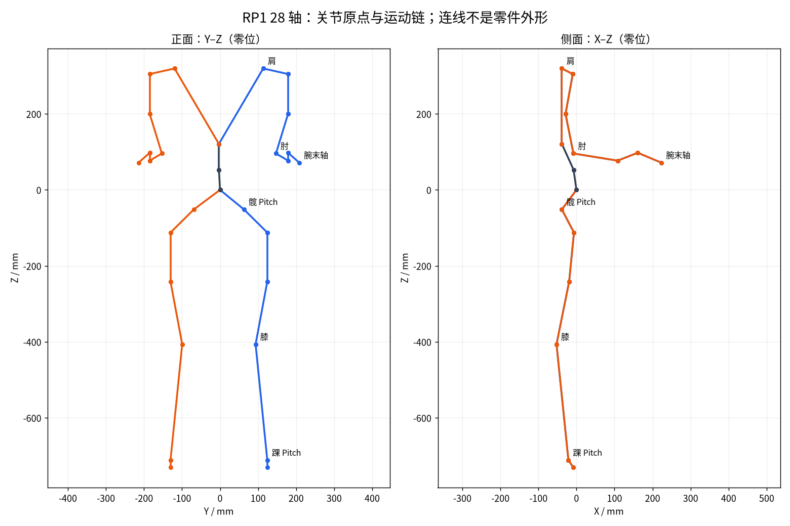

*图 2：官方 URDF joint origin 计算，单位 mm。连线是运动链，不是杆件外形或承力中心线。*

### 4.2 “link 长度”的四种定义

URDF `origin xyz` 是坐标系平移，不总是人的“大腿长”。至少要区分：相邻 joint 原点距离、指定轴心原点距、两轴线最短距、外形/人体尺度标称长度。RP1 的三个髋原点分布在不同位置，选择不同近端轴会得到很不一样的“大腿长度”。

| 零位左侧测量 | 计算值 / mm | 含义 |
| --- | ---: | --- |
| Hip Pitch 原点→Knee 原点 | 356.34 | 包含三个髋偏置段 |
| Hip Pitch 与 Knee 轴线最短距 | 355.04 | 平行轴垂距 |
| Hip Roll 原点→Knee 原点 | 299.24 | 改参考轴后显著变化 |
| Hip Yaw 原点→Knee 原点 | 171.19 | 不能解释成“大腿仅 171 mm” |
| Knee 原点→Ankle Pitch 原点 | 308.47 | 含横向偏置 |
| Knee 与 Ankle Pitch 轴线最短距 | 306.93 | 更适合平面膝踝近似 |
| Shoulder Pitch 原点→Elbow 原点 | 228.28 | 非大臂外壳总长 |
| Elbow 原点→Wrist Pitch 原点 | 240.44 | 以七轴臂末轴作端点 |
| 左右 Shoulder Pitch 原点距 | 232.99 | 非整机外宽 |
| 左右 Hip Pitch 原点距 | 132.00 | Hip Roll 原点距为 254.51 |
| Wrist Roll 原点→Yaw 原点 | 56.90 | 位移 [53,0,20.701] |
| Wrist Yaw 原点→Pitch 原点 | 73.54 | 位移 [62.136,29.458,-26.067] |

官方标称大腿 250、小腿 300、单臂 550 mm。当前模型没有给出与“250 mm 大腿”明确对应的测量定义，而且 CAD/URDF 修订不同。合理结论是核对定义和版本，不能简单宣布某个数错误。应在 RP1.3.4 CAD 中逐一标记旋转轴线，按同一零位导出运动学表。数据见 [link_lengths.json（工作区资料）](sources.md#artifact-69c57e130b90)，全量 origin 和限位见 [28 轴 CSV（工作区资料）](sources.md#artifact-06c6b8837c48)。

### 4.3 质量与惯量

所有 link 惯量通过正定性和主惯量三角不等式检查；mesh 引用存在。28 轴总质量 **40.726375 kg**；零位质心相对骨盆 `base_link` 为 **[-14.05,-3.15,-81.82] mm**。该 z 不是离地重心高度。两腿合计 **18.325 kg，占 45.0%**；双臂 **9.231 kg，占 22.7%**。

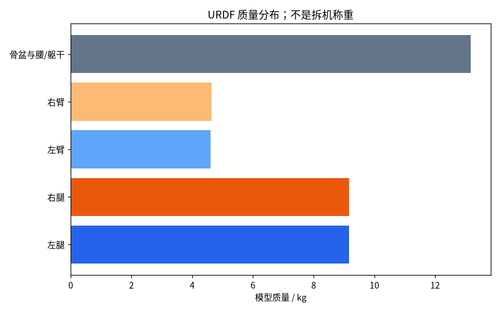

*图 3：URDF 文件质量聚合，不是拆机称重。左腿 9.1614、右腿 9.1638、左臂 4.5985、右臂 4.6327 kg。*

28 轴比 24 轴多 **1.6171 kg**，约每臂多 0.8085 kg。新增质量在远端，对肩肘加速惯量和制动能量的影响大于同质量放在躯干。数值合法只排除明显坏惯量，不能证明材料、空腔、线束、电池和末端归属正确；总质量正确也可能隐藏错误的 link 质量分配。

本次通过 `Σ(m JvᵀJv + Jwᵀ I Jw)` 计算了固定躯干、零位左臂 link-only 质量矩阵。其对角项约为 **0.3532、0.3132、0.002425、0.05694、0.000820、0.003104、0.0000909 kg·m²**。肩肘耦合项明显，逐轴 `τ≈Iα` 不能代替整臂逆动力学；这里还未加转子反射惯量、工具和浮动基座耦合。

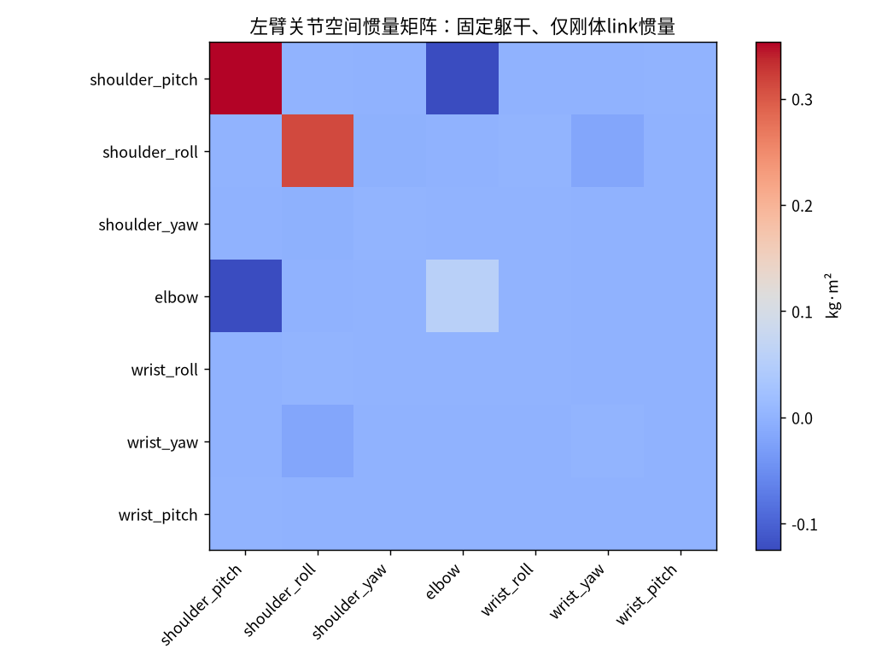

*图 4：固定躯干、URDF 零位的七轴左臂质量矩阵，原始数值见 [arm_inertia.json（工作区资料）](sources.md#artifact-71171ae03291)。*

## 5. 机械结构的工程评价

### 5.1 髋膝：轴排序、载荷路径与装配刚度

Pitch 置于髋部近端，让大模组承担前后摆腿；其后 Roll/Yaw 的空间偏置会改变极限姿态下的侧向力臂和干涉。收益可能来自髋部包络、装配和走线；代价是不能用一个理想球铰简化整个髋部。相对 Origin 的排序是否更好，应以任务空间、碰撞距离、关节负载和惯量判定，轴排序没有普遍最优。

膝的 URDF 大弯曲范围约 162°，为蹲姿和折叠留出几何空间。但深蹲能否承载，取决于 COP、躯干姿态、载荷与足跟接触，不能把峰值力矩当持续输出。结构 BOM 可见 P20 膝轴承座、AL6061-T6 抱箍/本体、深沟球轴承、推力滚针轴承等。应沿地面反力→足部→踝铰支→胫骨→膝轴承座→股骨→骨盆追踪载荷，重点检查分体抱箍、开窗、螺栓组与连接面微滑移。

形成强度结论至少需要单足支撑/冲击载荷谱、预紧与摩擦、轴承倾覆组合、输出法兰弯矩、小腿局部屈曲和疲劳循环。现有图纸足以支持建模，不足以在没有边界条件时给出安全系数。跌倒与搬运工况也不能靠额定运动力矩覆盖。

### 5.2 并联踝：减少远端惯量，也增加约束耦合

公开控制代码的长杆 **210.636 mm**、短杆 **139.941 mm**、两摇臂均 **26 mm**，固定点 z 分别为 **209.663/138.663 mm**，足部参考偏移 z=-19 mm，杆端横向 ±15 mm。它们是球铰/机构中心距离，不能拿连杆零件外形总长直接代入。左右有镜像和不同初相位。[几何源码](https://github.com/Roboparty/roboparty_inference/blob/06b82ddeb55aeb3bbf9b6855beb4bf700e3a4493/src/utils/decouple_rp1.cpp)

把驱动电机向小腿近端布置通常可降低足部远端质量，但会引入球铰间隙、杆件轴向刚度、装配误差、预紧和姿态相关机械增益。低减速比不自动等于足端力控透明。URDF 的串联等效是合理抽象，前提是同时处理状态、速度、力矩、惯量和可行域映射。

### 5.3 腰：Roll 的收益与 Pitch 的代偿

Roll+Yaw 可以支持侧倾、转向、重心横移和侧向够取。因为 Yaw 位于 Roll 后，大幅侧倾时它不再绕世界竖直轴；重定向应使用完整链变换，不能直接将躯干 Euler 角逐项下发。没有腰 Pitch 时，保持脚固定的低位前伸更多依赖髋膝踝，改变腿部力矩和相机视线。

推荐跨平台用同一任务比较：双脚固定、手掌保持水平，TCP 从胸前移到膝前，记录可达性、碰撞距离、关节力矩、COP 裕度和工具姿态误差。这样比“腰多一个自由度所以更强”更有判别力。

### 5.4 五轴与七轴臂

固定基座时五轴臂的雅可比秩最多 5，一般无法独立满足任意六维末端约束。可以放松工具某个朝向或移动基座完成任务。七轴臂通常有一维冗余，但需要明确的避障、远离限位、肘姿态或力矩优化目标；不加目标就会出现不稳定的肘部漂移。

肩 Pitch 的约 5° 倾角、左右轴符号和不对称范围必须保留。简单“目标镜像+所有角取负”容易错。新增腕部质量不仅增加静态重力矩，还增加 `M(q)q̈` 和制动需求。简单手势/粗搬运可能更重视五轴版的成本和惯量；工具定向、插接、双臂协同更需要七轴，但应先核对腕模组额定能力和回差。

### 5.5 十字腕外观不等于理想共点球腕

当前 URDF 中 Wrist Yaw 与 Pitch 轴线最短距离是 **62.136 mm**，两轴不共点。Roll→Yaw 的原点偏移 [53,0,20.701] mm，Yaw→Pitch 为 [62.136,29.458,-26.067] mm。因此不能直接套用“先解腕心、再解析腕角”的球腕 IK。该结论仅针对这份模型，最终需与 3.4 CAD/实机轴心复核。

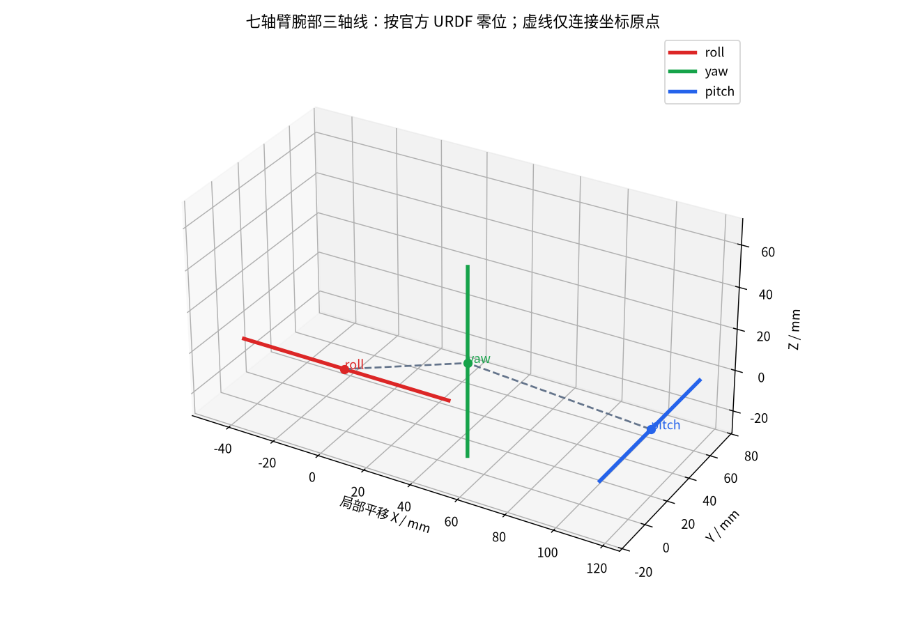

*补充图：三条腕轴线按 URDF 零位绘制，虚线只连接原点。*

偏置腕旋转会带来 TCP 平移；工具标定不应只填一个末端 z 长度。数值 IK 应包含完整 SE(3) 误差、关节限位、速度/加速度、自碰撞和 null-space 正则。腕部线束包络、接插件拉扯和限位处的安全裕量同样影响可用工作空间。

### 5.6 工艺、公差与精度


*图 5：官方 YCL.M000642 大臂上本体加工图。完整 PDF 在 CNC/Common；原技术图纸按 CERN-OHL-W-2.0。*

图纸标注 AL6061-T6、喷漆、重要尺寸/角度特性，例如 65±0.05 mm、15°±0.02°，并要求未标注尺寸以 3D 为准。复刻需同时使用 3D、2D、CMF、BOM；通用公差要求与底部公差表的优先级应在加工前明确。0.02° 的角度偏差在 0.55 m 力臂上约对应 0.19 mm 一阶偏差，但多接合面、间隙与载荷挠曲会叠加，不能由单件公差推导整臂精度。

重复定位、绝对定位、受载定位和动态跟踪是四个不同指标。若要做插接，应建立 TCP 标定、关节零偏辨识、受载挠曲模型与外部测量闭环；不能把编码器 bit 数当末端精度。

## 6. 并联踝的定量复算

### 6.1 映射与验证方法

定义 `q=[pitch,roll]`，电机输出角 `θ=[θA,θB]`。将公开 C++ 的杆长约束和雅可比公式独立转写成 Python，没有修改上游控制器：

```text
A cos(θ+θ0) + B sin(θ+θ0) + C = 0
θ = f(q),  J = ∂θ/∂q
θdot = J qdot
τq = Jᵀ τθ,  τθ = J⁻ᵀ τq
```

解析雅可比与中心差分抽样最大差约 **1.64×10⁻⁹**；杆长约束残差 <5.7×10⁻¹⁴ mm；功率恒等式残差约 1.8×10⁻¹⁵ W。这验证公式转写自洽，不等于 CAD 几何或实机标定准确。脚本 [advanced_audit.py（工作区资料）](sources.md#artifact-b78d67a0fa73)，结果 [ankle_audit.json（工作区资料）](sources.md#artifact-8c670f78e908)。

零位雅可比为：

```text
             Pitch       Roll
motor A     1.058482    -0.539724
motor B    -1.059000    -0.520819
```

### 6.2 力矩包络与 RL 执行器模型

当两电机各限 ±35.3 N·m，电机坐标矩形经 `Jᵀ` 映成关节坐标平行四边形。零位顶点约为 `(74.747,-0.667)`、`(-0.018,-37.437)`、`(-74.747,0.667)`、`(0.018,37.437)` N·m。电机反向出力主要产生 Pitch，同向出力主要产生 Roll。它不是 URDF 两个独立 ±70.6 的矩形。

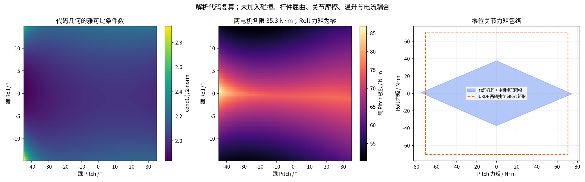

*图 6：Pitch [-0.78,0.61] rad、Roll [-0.26,0.26] rad，9,801 点。第三幅为零位包络。未加入碰撞、杆件屈曲、温升、电压/转速及总电流约束。*

扫描中纯 Pitch、Roll 力矩要求为零时，Pitch 极限约 **50.30–86.92 N·m**；雅可比条件数 **1.84–2.93**，未遇到杆长几何无解。不能据此认定矩形内没有球铰干涉或碰撞。两轴同时输出时必须满足组合包络，不能同时取各自最大值。

训练时推荐在执行器层执行：串联关节请求→电机力矩→电机电压/转速/热限幅→实际串联关节力矩。位置动作策略也应经过同样的映射与延迟，否则可能学到实机无法输出的踝 Roll 纠偏。附加惯量近似 `Mq,ref=Jᵀ Iθ J`，通常有姿态相关交叉项；给串联两轴各填同一 armature 不能完整等效。

### 6.3 公开实现的收敛与下发路径

正解以上次解为初值，最多 100 次迭代，步长系数 0.5，以电机角残差范数 <1e-3 停止。该值是数值容差，不是足端定位精度。逆解 acos 参数越界会警告并截断；雅可比直接求逆，未在该函数看到阻尼伪逆/条件数门限；达到迭代上限仍返回估计。集成时需显式检查残差、分支连续性和可行域。

`RobotInterface::apply_action` 对踝先计算关节空间 PD+前馈，再用 `J⁻ᵀ` 得电机力矩，随后编码为位置目标：

```text
θtarget = θmeasured + (τmotor + Kd_motor × θdot_measured) / Kp_motor
motor_velocity_target = 0
motor_feedforward_target = 0
```

理想无延迟且参数一致时，本地 PD 可恢复请求力矩；实际依赖反馈时效、增益标度、量化与饱和。Kp=0 时表达式无意义，不能将普通串联关节的纯力矩设置直接套到踝路径。[源码](https://github.com/Roboparty/roboparty_inference/blob/06b82ddeb55aeb3bbf9b6855beb4bf700e3a4493/src/robot_interface.cpp)

反馈变量虽名 `motor_current_`，LRO 驱动按 ±TauMax 解码后上送 joint_tau，属于协议标度力矩估计；它不是外置输出力矩传感器，也不应仅凭变量名当作真实相电流。接触估计还需要摩擦/惯量补偿和实机标定。

## 7. 电机模组、减速器、供电与控制

### 7.1 从制造 BOM 确认数量，不能从 URDF effort 猜模组

本次直接解析两份整机 XLSX，对“模组”行按零件号汇总：

| 模组 | 料号 | 5 轴臂机身数量 | 7 轴臂机身数量 | 机构/配置对应 |
| --- | --- | ---: | ---: | --- |
| RMM10062-2E | YCL.D000031 | 8 | 8 | 两腿 Hip Pitch/Roll、Knee 共 6，加腰 2 |
| RMM8463-2E | YCL.D000027 | 4 | 4 | 两髋 Yaw 与两肩 Pitch；与软件中型模型的槽位对应 |
| RMM6562-2E | YCL.D000020 | 12 | 12 | 四个踝驱动 + 双臂各四个其余基础关节 |
| RZW5552-2C | YCL.D000048 | 0 | 4 | 七轴臂新增的两侧腕部两轴 |
| 合计 | — | 24 | 28 | 不含未列在这些模组行中的手指执行器 |

数量来自 BOM；轴位对应结合部署 `robot.yaml` 与装配分组判读。新腕轴的实际驱动常数不能从名称近似成 6562。当前 28 轴配置给新增腕电机填 model 0，注释是 PJ2_55_5550，而 BOM 是 RZW5552-2C；应要求提供其确切映射、减速比、峰值/额定力矩、惯量、零位与固件参数。[官方 BOM](https://github.com/Roboparty/rp1_hardware/tree/99c17acdeb9ddffe55e927d6f6646787a648f762/04_BOM)、[28 轴 robot.yaml](https://github.com/Roboparty/roboparty_inference/blob/06b82ddeb55aeb3bbf9b6855beb4bf700e3a4493/robots/rp1/robot.yaml)

### 7.2 模组参数：保留版本差异

| 项目 | RMM6562-2E 图纸/测试 | RMM8463-2E 图纸 | RMM10062-2E 图纸/测试 |
| --- | --- | --- | --- |
| 额定电压 | 48 V | 48 V | 48 V |
| 减速比 | 19.5:1 | 20:1 | 22:1 |
| 额定力矩 | 10 N·m ±5% | 20 N·m ±5% | 44 N·m ±5% |
| 图纸峰值力矩 | 35 N·m | 87 N·m | 160 N·m |
| 额定转速 | 60 rpm | 60 rpm | 80 rpm |
| 峰值转速 | 200 rpm | 155 rpm | 130 rpm |
| 额定功率标注 | 62.8 W | 87.9 W，见下方冲突 | 370 W |
| 模组重量 | 实测 533.1 g；图纸 ≤530 g | 图纸 <800 g | 实测 1197 g；图纸 <1260 g |
| 转子惯量 | 8.3 kg·mm² | 25 kg·mm² | 60.6 kg·mm² |
| 背隙标注 | ≤15 arcmin | ≤15 arcmin | 11.4 arcmin |
| 双编码器 | 电机端 17 bit / 输出端 19 bit | 同左 | 内/外圈 17/19 bit |
| 通信 | CAN-FD / EtherCAT | CAN-FD / EtherCAT | CAN-FD / EtherCAT |

原始证据：[ROMOMO 官方资料](https://github.com/Roboparty/ROMOMO)，本地分别位于 `6562/`、`8463/`、`10062/`。图纸与样机测试条件不同，重量差异保留，不自行平均。

官方 RP1 产品页称双级行星、内转子结构；这一拓扑通常有利于兼顾效率、成本和较低减速比，但回差、摩擦、轴承与齿轮啮合误差依然存在。没有完整齿轮内部设计与实测回驱曲线时，不推断预紧方法、齿轮级配或背驱效率。也不能把行星减速器概括成“天然适合力控”，力控性能需看全执行器频响。[官方产品说明](https://www.roboparty.com/products/RP1)

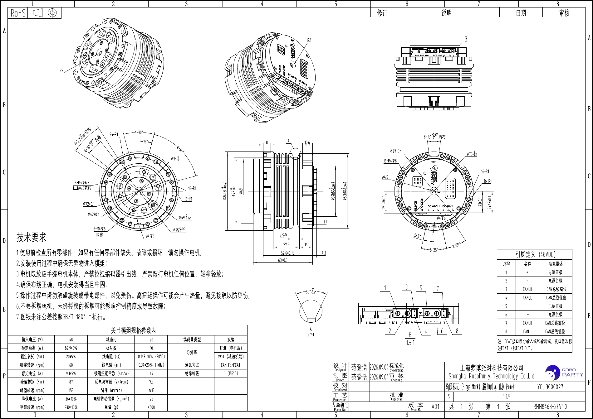

*图 7：RMM8463 原始图纸。关键规格位于左下角；该图纸本身存在额定功率与额定转速/力矩的算术不一致。*

### 7.3 必须明确的参数冲突

| 冲突 | 实际证据 | 对研发的影响 |
| --- | --- | --- |
| 8462 vs 8463 | 官网 ROMOMO 8462 写 14/42 N·m；制造 BOM/8463 图纸写 20/87 | 应按样机铭牌和修订选择参数，不能取一个中间值 |
| 驱动中型限值 | model 2 注释 PJ3_75_8462，TauMax=56.5 N·m、SpdMax=16.13 rad/s | 是协议/软件量程，不等于 8463 的 87 N·m 实机能力 |
| 8463 额定功率 | 图纸 87.9 W，而 20 N·m×60 rpm 的机械功率为 125.66 W | 87.9 W 正好接近 14 N·m×60 rpm，应核对表格修订，不能假定连续额定点成立 |
| 10062 峰值 | 封面/图纸 160；测试报告内规格表又写 140；实测短时约 164.5/165.6 | 保留工况与版本，不能用一次最大值覆盖全部持续时间 |
| 腕部型号 | BOM RZW5552 vs 驱动 model 0 的 5550 注释 | 新腕的额定能力与参数仍需独立资料 |
| URDF effort | 全臂 35.3；髋 Yaw 141.7 | 肩可能保守、髋 Yaw 可能过宽；训练约束缺少逐轴型号一致性 |

驱动量程表是：model 0：±12.5 rad、±21 rad/s、±36 N·m；model 1：±12.5、±21.89、±35.3；model 2：±12.5、±16.13、±56.5；model 3：±12.5、±14.24、±141.7。KpMax=500、KdMax=50。MIT 发送前会按量程截断。**协议能编码多少，和当前物理模组能安全持续输出多少，是两个约束。**[驱动源码](https://github.com/Roboparty/roboparty_motors)；本次精确文件在 deploy 的 `src/motors/src/drivers/lro/lro_motor_driver.cpp`。

### 7.4 台架报告揭示的持续能力与热约束

6562 在约 48 V、60 rpm、10 N·m 工况下，正向输入约 92.29 W、机械输出 63.12 W，总成效率 **68.39%**；反向约 **67.36%**。在 25°C 环境运行 60 min，电动机约 **71.2°C**、外壳 **53.7°C**。最大效率约 82.56% 出现在 190 rpm、7 N·m，不能用最高效率代替低速持物效率。报告还写 200 rpm 时输出仅约 5.3 N·m、维持 2 min，说明峰值转速与峰值力矩不同时成立。

10062 在 80 rpm、44 N·m 下，正向输入 **457.43 W**、输出 **370.36 W**、效率 **80.97%**，反向 **82.57%**。24°C 环境运行 60 min 后，MOS **119.0°C**、外壳 **77.0°C**、电动机 **107.4°C**、板卡 **97.5°C**。它证明台架额定点能维持到该热状态，但不能自动外推到装进封闭髋腔、与邻近模组互相加热时的连续能力。

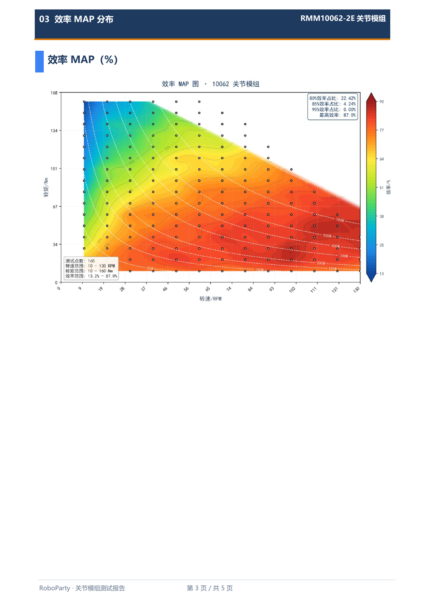

*图 8：10062 厂商台架效率 MAP，原报告第 3 页（PDF 第 4 页）。不同速度/负载效率显著变化。*

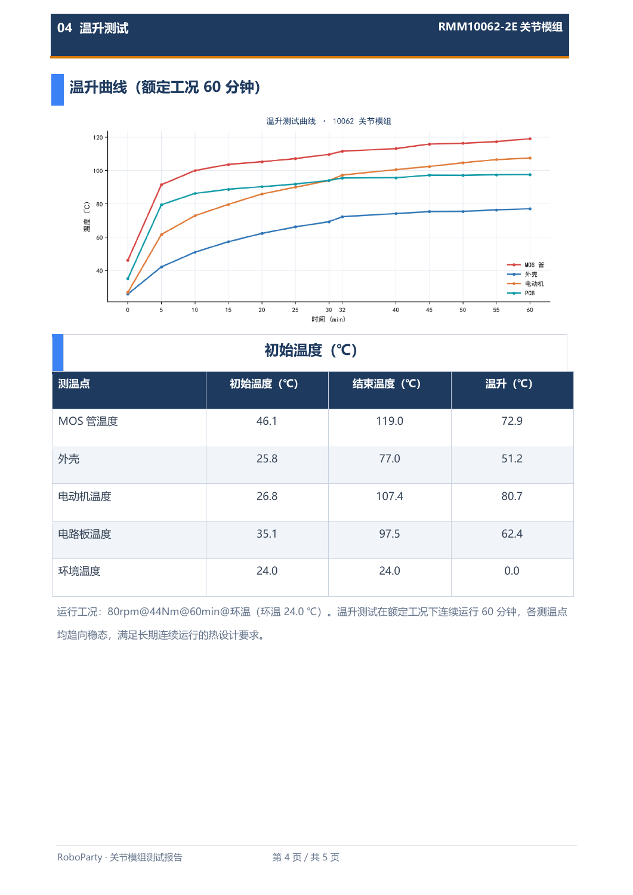

*图 9：10062 台架 60 min 温升与终值，原报告第 4 页。应据此建立实机热模型和降额策略，而不是仅引用 160 N·m。*

峰值电流也要区分定义：10062 报告在不同位置出现 25.71 A、20.38 A，而结论的 60 rpm/159.3 N·m 点输入最大 53.42 A；6562 同样有峰值工况和瞬时记录不同的现象。没有采样位置、滤波、相电流/母线电流和时间窗，不宜把它们合并成一条 Kt 曲线。

10062 图纸“模组扭矩常数”写 0.163 N·m/A，与测试的输出侧约 3.89 N·m/A 不是同一量级。0.163×22≈3.586，但仍涉及效率和电流定义。它可能反映电机侧与输出侧字段混用，必须查明，不能把 0.163 直接用于关节输出力矩控制。

### 7.5 惯量、回差与精度

按理想减速关系，输出侧反射转子惯量 `Jout≈Jrotor N²`：6562 约 **0.003156 kg·m²**；8463 约 **0.0100**；10062 约 **0.02933**。MJCF 的常用 armature 为 0.01 和 0.029085325。大模组数量级接近，但小模组、髋 Yaw 中型模组和并联踝不应只按一个常数覆盖。额外 armature 可以是辨识拟合值，差异不必然是错误，需给来源与实验依据。

输出端 19 bit 理论角分辨率约 **0.000687°**；驱动位置字段 16 bit、范围 ±12.5 rad 时，每 LSB 约 **0.0219°**；硬件介绍的模组重复定位声明为 **±0.1°**。这三个数字分别是编码器分辨率、通信量化与模组性能声明，均不等于整臂 TCP 精度。

15 arcmin 背隙等于 0.25°，若以 0.55 m 力臂作纯几何放大约 2.40 mm；±0.1° 对应约 0.96 mm。一阶估算不能替代实机误差模型，因为输出编码闭环、预载、齿面换向、关节弹性和多轴误差叠加方式都会改变结果。对反复换向、低速插接和接触操作，比 bit 数更有意义的是双向定位误差曲线与受载挠曲。

### 7.6 总线、量化与真实控制层级

24 轴配置使用四路 CAN-FD：`can1/can2/can0/can3`，模组数 **7/7/5/5**；28 轴是四路各 7。LRO 批量 MIT 下发将每路最多 8 组命令打包成一个 64-byte CAN-FD 帧，ID 为扩展帧 0x8080；反馈为单模组状态帧。不能按“每轴一个 8-byte 命令帧”直接估算当前发送负载。

以满载 7 模组一路、250 Hz 为例，64-byte 命令加 7×8-byte 反馈，仅数据字节约 30 kB/s；实际占用还包括仲裁段、帧头、CRC、stuffing、重传、USB 批处理与其他节点。数据吞吐充足不等于时间确定性，应测传感器采样→USB/SocketCAN→推理→回发→执行的 p99 延迟与抖动。[桥固件](https://github.com/Roboparty/roboparty_EtherCANFD)

MIT 命令字段：位置 16 bit、速度 12 bit、力矩 12 bit、Kp 12 bit、Kd 9 bit。按量程计算，小模组力矩步长约 **0.0172 N·m**，大模组约 **0.0692 N·m**，Kp 步长约 0.1221、Kd 约 0.09785（以协议单位计）。量化与踝部位置编码力矩路径叠加后，应实测低力矩抖动，而不能假定理想连续 PD。

硬件介绍称 HPM5E3YIGN1、RISC-V 480 MHz、FOC/SVPWM 20 kHz、48 V（24–60 V）、双编码器；CAN-FD 仲裁 1 Mbps、数据 4 Mbps；EtherCAT 1 kHz、节点同步 <1 μs 属厂商声明。本次未见相应时钟/频响实测日志。资料中“电流环带宽 20 kHz”与表格“电流环频率 20 kHz”混用，没有 Bode 图不能认定闭环带宽等于采样频率。LRO SDK 当前明确不支持 EtherCAT，不能把模组物理支持写成现有部署已经走 EtherCAT。

### 7.7 供电、热插拔与能量账本

产品页标 10 Ah、3 h、140 W USB-C/磁吸快充、1.5 h，并有大小双电池设计。若**假定**主包为约 48 V、10 Ah，则能量约 480 Wh；3 h 对应平均总功率约 160 W，仅是能量预算，不代表持续跑步或双臂负载工况。140 W×1.5 h 只有 210 Wh，无法从空到满补入 480 Wh，尚未计损耗。可能是充电路径、SOC 范围、包电压或规格定义不同，应要求提供充电曲线与电源拓扑，而不是替厂商选择解释。[官方规格](https://www.roboparty.com/products/RP1)

BOM 具有主电池、两个小电池、HOTSWAP/电池转接板和多路供电线，说明热插拔需要作为系统设计验证。应明确小电池能维持计算机还是也能维持姿态控制；拔主包时的电压跌落、最大输出、电机使能策略、预充和反灌路径均需检查。末端产品页为 24 V 内走线，不能把关节 48 V 母线直接用于灵巧手。

机器人制动、落脚和外部拖动可能回馈能量。BMS 是否允许充电、满电状态的母线过压、急停后制动路径、DC/DC 和桥板共地、线束压降/温升，是本体分析的一部分。源码存在超温/欠压保护声明不等于已验证整机失效模式；但报告不据此假设其没有保护。


*图 10：官方 BODY01 线束图。加工与复刻应按针脚、线径、长度、屏蔽与修订使用完整 PDF。*

## 8. 机械臂负载复算：5 kg 在什么条件下有意义

### 8.1 方法与假设

采用原始 28 轴 URDF，固定骨盆，左肩 Pitch=-π/2、左肘=-π/2，右侧对应 +π/2，其余 q=0。载荷作为每手点质量，挂在 Wrist Pitch 原点或其局部 x 向 100 mm 处；包含 link 自重，不含额外工具自重、摩擦、动态、碰撞和热约束。

对每个关节，用下游 link 质心与点载荷计算重力广义力矩；势能中心差分在一个加载工况对全部 28 轴交叉检查，最大误差约 **1.06×10⁻⁸ N·m**。这保证计算方法一致，不保证模型与实机质量完全一致。原始结果见 [gravity_payload.json（工作区资料）](sources.md#artifact-0130b30d04ab)。

| 每手载荷 / kg | TCP 偏移 / mm | 左肩 Pitch 绝对力矩 / N·m | 左肘 / N·m | 腕 Pitch / N·m |
| ---: | ---: | ---: | ---: | ---: |
| 0 | 0 | 10.270 | 2.962 | 0.016 |
| 1 | 0 | 14.780 | 5.220 | 0.016 |
| 3 | 0 | 23.800 | 9.736 | 0.016 |
| 5 | 0 | 32.821 | 14.252 | 0.016 |
| 1 | 100 | 15.754 | 6.198 | 0.994 |
| 3 | 100 | 26.721 | 12.668 | 2.948 |
| 5 | 100 | 37.689 | 19.138 | 4.903 |

腕原点点载荷对末轴几乎无额外重力矩，不代表腕部无需承重，而是力臂近零；轴承仍承受力和其他方向力矩。100 mm 工具延伸使腕 Pitch 的负担显现。

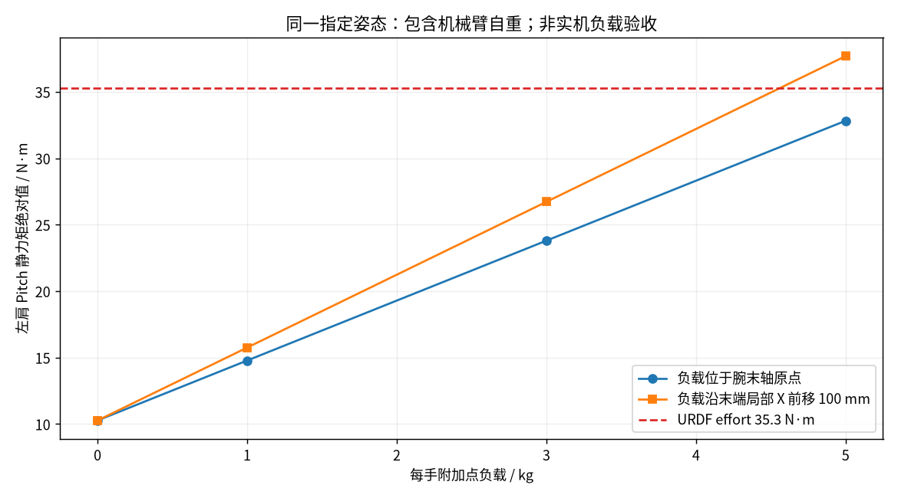

*图 11：指定姿态的静态力矩。图中的 35.3 N·m 是 URDF 限值，不能当作中型肩电机实际峰值。*

### 8.2 如何客观解释

若严格按 URDF 肩限值 35.3，5 kg+100 mm 已超限；若按制造 BOM 中型模组 87 N·m 短时峰值，则不能判其不可行。但它仍超过 8463 图纸的 20 N·m 额定力矩，提示长时间水平持物可能热受限；额定点本身又存在第 7 节的功率冲突，需实机确认。肘部 6562 额定约 10 N·m，在 3 kg、TCP100 mm 时已需约 12.67 N·m，**持续工作可能由肘而非峰值肩矩先约束**。

动态需求还包括 `M(q)q̈ + C(q,q̇)q̇ + g(q)`、工具偏心、加减速冲击和接触外力。应给出完整载荷图：肩/肘姿态、工具质量/质心、有效工作半径、占空比、运动速度、环境温度、允许末端挠曲。单一“5 kg”适合产品概述，不足以指导工程选型。

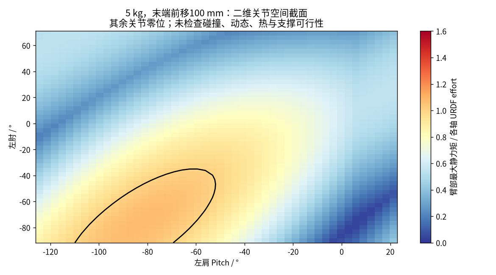

*图 12：固定其他轴、5 kg、TCP100 mm 的肩/肘姿态切片，以 URDF effort 归一化。未施加碰撞、接触与温升条件，不是认证工作空间或整机平衡证明。*

双臂前伸还会显著改变整机质心。本次两手各 5 kg 时，静态模型质心 x 从空载该姿态约 18.17 mm 移到 98.00 mm，TCP100 mm 时约 117.63 mm；这是骨盆参考下的数学姿态，不代表实机站稳。真正要同时检查足底支撑、多边形边界、地面摩擦、COP/接触力与腿部力矩，而不是仅看肩够不够力。

<!-- GENERATED_SECTIONS -->

## 9. 下半身强化学习：模型准确性、策略和复现

### 9.1 URDF “准确”应拆成五个问题

| 层级 | 本次证据 | 还需要验证什么 |
| --- | --- | --- |
| 语法/引用 | 24/28 轴树连通，mesh 可找到，惯量数值合法 | 软件版本、导入器行为 |
| 几何运动学 | FK 和尺寸可复算；腕偏置、轴倾角明确 | CAD3.4/实机轴线、零位、限位与工具坐标 |
| 刚体动力学 | link 质量与惯量可用；URDF/MJCF 质量和一致 | 实物称重、质心、惯量辨识、部件配置 |
| 执行器 | 有力矩/速度、armature、PD 和驱动 | T-N 包络、热降额、摩擦、延迟、闭链饱和 |
| 接触/传感器 | 有碰撞、摩擦与 IMU 描述 | 橡胶刚度、地面、接触时序、IMU 外参/偏置/噪声 |

因此，本次可以确认它是**可用于研究和建立基线的模型**，不能确认它是**已经过系统辨识、与当前每台实机一致的数字孪生**。一份 URDF 能导入并不意味着 RL 转实机的 gap 已解决。

主 URDF 的 `base_link` 没有 collision；足部每侧以 7 个横置圆柱近似接触，其他位置多为 STL 碰撞。MJCF 则有 capsule 等简化碰撞体。外观 mesh 几何正确，也不保证落地碰撞模型、足底软胶和自碰撞过滤正确。没有骨盆碰撞会影响跌倒/爬起、碰地终止和奖励；用网格凸包与解析胶囊时的自碰撞也可能不同。

MJCF 默认 `timestep=0.005`、implicitfast、Newton solver、joint damping/frictionloss=0.01、碰撞 `condim=4`、摩擦参数 `0.9 0.2 0.2`、`solref=0.01 1`。这些是建模选择，不是本体材料的实测属性。不同引擎的摩擦、软接触和 solver 参数不能逐值抄写后认定物理等价。URDF `<dynamics armature=...>` 还是扩展属性，某些导入器可能忽略；MJCF armature 显式存在，使用前应查实际编译模型，而非只看文本。

### 9.2 本次 MuJoCo 验证

用 MuJoCo **3.16.0** 编译 description 下四个 MJCF，并执行一次 `mj_forward`。28 轴模型 `nq=35/nv=34/nu=28`，24 轴为 `31/30/24`；多出的 7/6 来自浮动基座的位置与速度表示。质量分别约 40.7264/39.1093 kg，编译通过。[完整结果（工作区资料）](sources.md#artifact-67b643e0ced9)

这证明模型能被该版本引擎接受并计算正向动力学量，不是站立、走路或 sim2real 验收。robot.xml 的 actuator 是 gear=1 的 torque motor，`ctrlrange` 表示力矩输入限幅；需要外部 PD 或策略转换。不能直接把 ONNX 输出的关节位置残差送进 motor ctrl 当力矩。

### 9.3 最紧迫的执行器 gap

**髋 Yaw 的约束错位尤其值得优先核对。** URDF 与 MJCF 给 141.7 N·m，但 robot.yaml 对应 model 2 的协议量程为 56.5 N·m，BOM 又是额定20/峰值87的 8463。训练若长期利用 141.7 的髋旋转输出，实机可能在通信量程或物理电流层先饱和。肩 Pitch 则相反，模型 35.3 可能比中型模组能力保守，但“放大上限”前要先解决连续额定点、模型惯量与硬件版本。

并联踝另有姿态相关多边形约束。动作高频变化还会受到 PD、延迟、转速与电压限制。推荐在仿真加入电机坐标饱和、速度相关 T-N 和简单热状态，而非仅随机扩大 torque limit。对落脚冲击，应检查饱和持续时间和电机侧速度峰值；随机化无法补偿错误的轴定义或符号。

### 9.4 基础速度行走策略的真实接口

部署 24 轴 `configs/default.yaml` 和 `policy.metadata.json` 给出：

```text
主机控制 dt = 0.004 s                 → 250 Hz
推理 decimation = 5                  → 50 Hz
单时刻观测 = 3+3+3+24+24+24          → 81
历史堆叠 = 3                         → 输入 [1,243]
输出 = 24                            → [1,24]
历史排列 = term/obs-major；每项内 oldest→newest
归一化 = 模型内嵌 EmpiricalNormalization，epsilon=0.01
q_des = q_default + 0.25 × clipped_action
```

观测依次含角速度、身体坐标系重力方向、速度命令、关节位置/速度、上一动作。term-major 与普通把 `[整帧t-2,整帧t-1,整帧t]` 串接的 frame-major 不同，形状相同也会产生完全错误的输入。位置项是否减默认姿态、速度/角速度在哪个坐标系、last_action 是原始输出还是缩放目标，都应按源码构造，不能只按变量名字填张量。

元数据写 checkpoint iteration=9999，作者做了 512 样本的训练 actor/ONNX 对照，最大误差约 **9.54×10⁻⁷**；本次另独立验证文件 SHA、形状、CPU 加载和 16 组小幅随机输入输出有限。没有重现原训练 actor 对照，也没有执行行走闭环。模型 SHA 为 `63d908b91e7cf478d870f03eecd955b2faa85cc65397258db71a58155efb52db`。[配置与权重](https://github.com/Roboparty/roboparty_inference/tree/06b82ddeb55aeb3bbf9b6855beb4bf700e3a4493/robots/rp1_24dof)

同仓库 28 轴 default 却是单帧 93、历史 10、frame-major，输入应为 930 维，并有不同的 USD→URDF 重排。不能把 24 轴速度策略或后述 MimicLite28 权重放进这个 default，凭输出轴数相同就认为兼容。

24 轴 default 的 `clip_actions=100`、scale=0.25，意味着仅按该动作裁剪仍可能形成约 ±25 rad 残差；YAML 的 joint_limits 又统一为 ±3.14，不是 URDF 每轴限位。在所审计的 inference 输出路径中，看到了 action clip/scale/default 与重排，**没有看到在这一处逐轴执行 URDF 硬限位裁剪**。这不等于系统所有层都无保护，但说明不能把这个配置当机械限位验收依据，尤其肘、踝与不对称肩 Roll。

### 9.5 已下载 ONNX 的契约对照

| 模型 | 实际输入 | 实际输出 | 能说明什么 |
| --- | --- | --- | --- |
| deploy24 `policy.onnx` | obs [1,243] | actions [1,24] | 基础速度策略接口 |
| `policy_amp.onnx` | obs [1,243] | actions [1,24] | 同形状，语义/训练仍需按配置 |
| `policy_wave.onnx` | obs [1,126] | actions [1,24] | 不能按基础81×3协议调用 |
| `policy_interrupt.onnx` | obs [1,246] | actions [1,24] | 额外输入对应上身干预等配置 |
| `policy_ufo.onnx` | obs [1,646] | action [1,24] | 需要相应潜变量/历史布局 |
| MimicLite24 | command [264]、policy [450] | action [24]、priv_student [512] | 双输入动作跟踪，不是速度行走 |
| MimicLite28 | policy [518]、command [296] | action [28]、priv_student [512] | 双输入动作跟踪，单样本无 batch 维 |

七个均本次 CPU smoke test 通过。模型名字不是能力验证，尤其 `policy_ufo` 不能替代完整的训练来源/机器人版本声明。[本次 ONNX 审计（工作区资料）](sources.md#artifact-bd7517694c6d)

### 9.6 MimicLite：有训练与部署包，仍要读评估边界

已通过官方 MimicLite README 链接下载 RP1 24/28 轴 `20261010` 包。包含 `finetune.pt`、`policy.onnx`、`policy.yaml`、`training-config.yaml`、`manifest.json`、`native-summary.json`、`native-rollout.pt`、训练曲线、运行时源码和版本文件。manifest 指向固定 Hugging Face 模型与 LAFAN 重定向数据 revision。它不是拿当前 description 任意替换就能复现的策略。[官方入口](https://github.com/Roboparty/MimicLite)、[checkpoint 说明](https://github.com/EGalahad/mimic-lite/blob/main/docs/checkpoints.md)

作者说明 RP1 使用 512×3 actor、8×8192 个环境，Train/Adapt/Finetune 为 4000/1000/2000 updates。PT 支持策略续训，但包不恢复完整 optimizer 状态，不能声称精确恢复中断训练。ONNX 只是推理产物。包中 `step_dt=0.02`，与速度策略同为50 Hz并不意味着观测/动作相同。

MimicLite history 取 [0,1,2,3,4,8,16] 的稀疏历史，还带未来/过去参考轨迹步 [-8,-4,-2,0,1,2,3,4]；这要求命令与时钟一致。在线遥操作无法直接提供真正未来轨迹，需要缓存、预测、延迟处理或改策略契约。

下载包自带原生评估摘要：

| 作者记录（未由本次重新运行） | RP1 28 | RP1 24 |
| --- | ---: | ---: |
| 环境数 / 步数 | 64 / 2000 | 64 / 2000 |
| body_pos metric | 0.02470 | 0.02363 |
| joint_pos metric | 0.05064 | 0.04080 |
| root_pos metric | 0.58972 | 0.52835 |
| lafan_progress | 0.89553 | 0.90899 |
| success_rate 字段 | 0.0 | 0.0 |

metric 名称保留原样，单位与聚合定义需追踪奖励实现，不能直接当硬件 TCP 误差。manifest 明确 root_pos_error 终止关闭、integrated deploy evaluation 未支持；参考 motion 平均长度大于 2000 步评估窗。因此 success_rate=0 不能简单解释成“所有动作都失败”，同样不能把约90%窗口进度宣传成约90%完整动作成功率。较大的根位置漂移与早停记录说明需补全动作、根漂移、接触、足滑与真机验证。

### 9.7 其他算法仓库的成熟度

| 仓库 | 本次实际看到的交付物 | 不应推导的结论 |
| --- | --- | --- |
| roboparty_train / robolab | 传统训练骨架及 RPO 资源 | 不能凭总入口文案认定当前 pin 已含 RP1 完整复现任务 |
| MimicLite | RP1 配置、24/28 权重、训练/部署包 | 不等于全部动作真机验收 |
| UFO | mjlab、FB-CPR-Aux/TeCH、G1/RP1 配置/数据入口 | README 明确 RP1 TeCH 未真机测试；G1 验证不能外推 RP1 |
| I-BFM-Code | 训练源码、166.560M-step 权重分片、搬/推/踢箱配置与输入数据 | 当前资源主要是 G1，不能直接称 RP1/VLA 已验证 |
| P-BFM | main 分支自述代码尚未上传 | 项目页/论文不等于可运行代码 |
| INTACT-JEPA | 说明/项目资料，Code/Models 标 coming soon | 世界模型研究不等于已提供本体控制接口 |

I-BFM 权重和 Git LFS 数据已拉取，未执行其 pickle/PT 或训练脚本。约 210 GiB replay buffer 未下载，给出官方地址和命令；当前磁盘余量不足以完整存放它，且它对本次机械分析不是必要输入。[I-BFM 官方说明](https://github.com/Roboparty/I-BFM-Code)、[UFO](https://github.com/Roboparty/UFO)、[P-BFM](https://github.com/Roboparty/P-BFM)、[INTACT-JEPA](https://github.com/Roboparty/INTACT-JEPA)

### 9.8 推荐的 RL 复现次序

先冻结样机/BOM/固件/URDF/电机 YAML/策略 manifest 的版本矩阵；再核对电机与 URDF 两套顺序、符号、零位和 IMU 外参。24 轴配置的 URDF→motor 映射把腰与两腿总线槽位重排；不能将 YAML 增益数组按 URDF 顺序直接使用。

接着做固定基座关节小信号辨识：阶跃/扫频、不同方向摩擦、零力矩回驱、传感器时间戳与延迟。对踝部单独验证 J、正逆解残差、力矩多边形和硬限位；再建立 T-N/温升模型。之后做有悬吊保护的关节响应和低能量站立，最后扩展到地形与负载。每阶段应记录动作、估计/目标力矩、饱和、温度、电压和丢帧，而不是只录视频。

域随机化应以辨识不确定度为依据：质心/惯量、工具负载、摩擦、地面、增益、延迟、时钟抖动、传感器偏置。改变末端、头部、电池或打印件材料后，应先更新质量与接触模型，不能指望任意大的随机范围抵消错误的结构版本。

## 10. 上半身 VLA、IK、全身控制与操作能力

### 10.1 先区分四个层级

VLA 负责从视觉/语言/状态产生动作或动作块；IK/轨迹层将任务空间目标转为可执行关节动作；全身控制分配躯干/腿/接触力；驱动层实现关节阻抗/力矩。某一层开源，不能替代其他层的交付。

```text
视觉/语言/本体状态 → VLA 动作块（任务与模型决定更新节拍）
        ↓ 时钟同步、坐标/单位、动作有效性、超时处理
工具位姿/关节参考 → IK + 轨迹/碰撞约束
        ↓ 动力学/接触与上下身协调
全身策略或 WBC → 关节 q/v/τ/Kp/Kd
        ↓ 四路 CAN-FD、踝闭链映射、本地伺服
执行器 → 关节反馈/相机/IMU → 数据记录与闭环
```

在所审计的 RP1 官方快照中，没有形成“RP1 专用 VLA 权重 + 明确 observation/action schema + 数据集 + 接触控制 + 真机成功率”的完整可复现链路。Party OS 的路线图包含 VLA，运动跟踪/无监督控制成果也丰富，但不能据此认定操作 VLA 已具备。这里的判断是公开交付物范围，不能用来断言其内部研发能力。

### 10.2 IK 是否开源：答案是有，但适用对象要明确

`roboparty_xr_teleop/teleop/robot_control/robot_arm_ik.py` 明确针对 RPO/历史 Atom01 资产。Pinocchio+CasADi+IPOPT，锁住两腿12轴和 torso1轴，留下双臂共10轴；末端附加约150 mm局部x偏移。优化包含位置、姿态、关节正则与平滑项，权重约50/0.5/0.02/0.1，max_iter=20、tol=1e-4，并有失败回退和重力前馈计算。[开源 IK](https://github.com/Roboparty/roboparty_xr_teleop/blob/6a42270997f9ff8af10fad791d7390e8a5c0755a/teleop/robot_control/robot_arm_ik.py)

这是一份可读、可改的双臂数值 IK，但没有把腿与腰纳入求解，也不是 RP1 七轴臂的直接实现。五轴臂难以同时满足两个六维末端目标，权重会形成折中；IPOPT tol 不等于 TCP 精度。迁移 RP1 需要换模型、工具/肩坐标、轴序/限位/碰撞、七轴冗余目标，并验证解的连续性与实时失败率。

`human-humanoid-tools` 则提供 Newton IK 与 interaction-mesh 的 MPC-SQP 重定向，覆盖全身姿态，是“有全身 IK/重定向代码”的证据。[官方工具](https://github.com/Roboparty/human-humanoid-tools) 但全身运动学重定向不自动保证接触力、摩擦锥、执行器力矩与平衡可行；离线或重定向求解速度也不等于在线力控稳定带宽。应分别回答：全身姿态 IK、在线全身速度 IK、带接触约束逆动力学 WBC，各自是否实现。

### 10.3 控制频率与延迟：不能只报一个 Hz

| 层级 | 当前证据 | 正确解释 |
| --- | --- | --- |
| RPO XR→IK→ROS 参考程序 | 默认 --frequency=30 Hz | 配置目标，非每周期必达；不是 RP1 臂伺服频率 |
| RP1 基础策略 | 50 Hz | 网络推理/动作更新 |
| RP1 默认主机控制 | 250 Hz | dt=0.004 的目标循环 |
| 官方架构示意图 | 500 Hz | 示意/目标值，与本次默认配置不同 |
| 模组 EtherCAT | 1 kHz 声明 | 当前 LRO SDK 尚未支持该路径 |
| FOC | 20 kHz 声明 | 本地采样/更新频率，不等于闭环带宽 |

VLA 的动作块频率需按具体模型测量，不能凭 RK3588/Orin 名称给出。视觉曝光、传输、预处理、模型推理、动作块缓存、IK、ROS、USB/CAN 与执行器采样都会贡献延迟。例：TCP 速度0.3 m/s时，20 ms感知/执行时间错位对应6 mm几何误差；这已可能大于编码器量化。应记录 sensor timestamp、host receive、policy start/end、command send、actuator sample，报告 p50/p95/p99 与最坏连续超时。

### 10.4 位置精度：目前能说与不能说的

有模组 ±0.1° 重复定位声明，没有找到 RP1 整臂/双臂带载绝对定位与重复定位的完整公开验收数据。机械零偏、肩倾角、非球腕偏置、回差、受载挠曲和相机外参都会使实际末端偏离模型。IK 的优化残差只是模型坐标下的数值结果。

专业评估应分别记录空载/额定载荷、单向/双向到位、空间各方向、冷/热机和速度条件。以外部光学测量或测量臂建立 ground truth，同时保存关节反馈。若目标是插接，建议测插接轴方向的刚度/顺应性、换向误差、接触峰值力与成功率，而非只报告 XYZ 位置平均误差。

### 10.5 阻抗与力控：有 MIT 通道，还缺任务级证据

驱动可下发 q/v/Kp/Kd/τ，具备实现关节阻抗的基础。对普通串联关节，可写 `τ=Kp(qd-q)+Kd(vd-v)+τff`；对踝部还要经过第6节的映射和位置编码力矩路径。API 接受这五个数，不证明实际输出力矩跟踪已标定，也不保证全身接触稳定。

操作常用任务空间形式 `τ=Jᵀ(Kx e + Dx e_dot + Fff)+g(q)+τnull`。需要一致的动力学模型、输出力矩估计、重力补偿、null-space 与饱和策略。若没有腕六维力传感器，可以做电流/动量观察器，但接触力估计会受齿轮摩擦、温度、线束和惯量误差影响；低速微力操作尤其应实测。资料没有证明 RP1 标配六维腕力传感器，因此不把它当作已有硬件。

高刚度 PD 配合迟到的视觉动作可能造成接触振荡；应考虑加速度/jerk限制、阻抗调度、接触检测、能量/被动性约束和动作块中断。步态策略与上身 VLA 同时输出时，应明确上身命令优先级、训练时的上身动作分布、重心扰动与失联回退。现有 interrupt 路径覆盖末尾10个臂动作，不能默认覆盖28轴版本的14个臂轴。

### 10.6 灵巧手：模型已经取得，执行器映射仍需核验

本次取得 DH116/DH116S 左右手 URDF/MJCF 与两侧 `.x_t`，下载文件按官方 manifest SHA256 校验通过。虽然文档创建时写资源私有，本次实际匿名请求可取得这些指定附件；应以本次下载记录和原文件许可为准，不能沿用过期“无法下载”的判断。

四份手 URDF 均有 **17 links、11 revolute、5 fixed**，其中 **5 个 revolute 带 mimic**，因此独立关节数为6。mimic 名称为 finger13、finger22、finger32、finger42、finger52。这是文件结构事实，但 SDK ID1–6 到这些关节的侧别、零位、单位与方向映射，官方文档明确尚未发布经过核验的对应表。[模型说明](https://github.com/Roboparty/rp_dexhand/blob/e43fd90970019b093d41c131d3839d375a74f2be/docs/models.md)、[本次解析（工作区资料）](sources.md#artifact-1b71982b0ffc)

资料给约379 g、147.54×73.53×26.35 mm、蜗杆类传动、闭合/张开≤0.7 s、约20 ms反馈等参数；它们属于手部产品/SDK，不能套到机身伺服。触觉为选项，不能因为硬件可装就假定 SDK 已提供可训练的高频触觉张量。DH116 与 DH116S 不可仅改文件名互换；ROS 适配、厂商 EtherCAT SDK 与 RoboParty CAN-FD 封装也是不同路线。

对 VLA，建议将六维主动手动作作为输出，mimic 在仿真/可视化层展开；数据中记录每轴指令、反馈、故障和可能的电流/触觉，并保存工具安装变换。不要让网络对11个机械关节独立输出互相矛盾的动作。

### 10.7 一套可交付 VLA 数据接口至少要包含什么

每个 episode 保存本体/手/工具/相机/策略版本；图像曝光与传感器时间戳；q、qdot、估计τ、目标q/v/τ/Kp/Kd；手六轴状态；IMU；相机内外参；任务指令；接触/成功/干预标记。action schema 应明确关节绝对/增量、TCP位置/姿态表达、参考坐标、单位、动作块步长、插值与超时。

还需给出相机标定与时间同步方法、碰撞检查、动作有效性门控、策略暂停/恢复、示教延迟和失败样本。若仅提供 IK 与步态策略，应将其定位为 VLA 基础设施；如果宣称 VLA 能力，应给出 RP1 上的任务集、每任务尝试次数、成功定义、载荷/视角/背景变化与失败分布。

## 11. 结构与算法联合设计的建议

### 11.1 优先补齐能改变结论的数据

| 优先级 | 工作 | 可交付结果 | 为什么值得先做 |
| --- | --- | --- | --- |
| P0 | 3.4 CAD→模型版本对照 | 轴心/惯量/料号/限位差异表 | 一次解决尺寸、IK与RL共同基准 |
| P0 | 确认8462/8463与5550/5552 | 每轴铭牌/固件/量程/额定图 | 避免错误力矩和反射惯量 |
| P0 | 踝闭链验收 | 几何残差、可行域、饱和、失效回退 | 直接影响站立与冲击可靠性 |
| P0 | 观测/动作黄金样本 | 同一状态输入与期望输出、hash | 排除堆叠/归一化/顺序错误 |
| P1 | 关节频响与延迟 | Bode、p99时间、丢帧分布 | 决定阻抗与sim2real真实性 |
| P1 | 带载手臂图谱 | 姿态×载荷×TCP×温升/挠曲 | 比单一5kg指标更能指导任务 |
| P1 | 接触/足底辨识 | 摩擦、刚度、阻尼、COP/足滑 | 提升落脚与搬运可靠性 |
| P1 | 几何/工具/视觉标定 | 零偏、TCP、相机外参、残差 | 建立精细操作基线 |
| P2 | 任务级WBC/VLA验证 | 统一schema、任务集、成功/失败记录 | 形成可复现上层能力 |

### 11.2 推荐实验矩阵

**机械臂：** 以0/1/3/5 kg、工具偏心0/50/100 mm、冷机与热稳态、近身/中程/远伸姿态组成矩阵。记录肩肘腕电流/估计力矩、温度、稳态误差和外部TCP位置；加慢速换向与有限加速度动作，区分峰值力矩、持续热限制和间隙误差。先按保守可用包络筛选，不能直接把所有组合下发。

**踝部：** 固定小腿，在机械限位内标定 Pitch/Roll 网格，外部测量足部姿态；测试正逆运动残差、J的差分一致性、迟滞与左右差异；对零位和边界做不同方向负载，识别关节空间2×2刚度。实际限幅在电机坐标施加，保留饱和前后轨迹。

**整机：** 同一硬件配置做静态站立、步行、转向、上下身协同、负载变化；记录足滑、COP/接触力估计、关节峰值/RMS力矩、温升、电池电压/能量、失步/干预次数。比较时固定地面、速度、负载、软件版本和电池SOC。跑得快、动作像人和操作可靠是三类指标，应分别评价。

**算法：** 先验证单步输入黄金样本，再同一轨迹跨推理后端对照，随后匹配物理步长/控制步长进行sim2sim。原生训练评估、ONNX集成闭环、真机测试分别记录。对MimicLite补全motion而非只看2000步窗口，对VLA增加视觉/时间扰动与动作中断。

### 11.3 本报告对 RP1 的客观评价

作为开放研究平台，RP1 已经提供了足够多的实物制造与控制资源，尤其原生CAD、制造图、板级/线束资料、闭链踝映射和多个可下载策略，这种开放深度对从业者有实际价值。其结构选择也明确：保持约1.35 m的小人形体量，用双轴腰、并联踝和可选七轴臂平衡运动、成本和操作需求。

当前最明显的工程短板是**跨版本一致性与性能定义**：CAD3.4/URDF3.2，中型/腕模组版本，模型限幅与驱动量程，默认控制节拍与架构文案，负载/充电/频率的测试条件。它们不等于产品不能用，但会提高第三方复现、改型与操作研究的验证成本。

对下半身RL，资源已超过“只有一个模型”的阶段，下一步应优先做执行器与接触辨识；对上半身VLA，七轴臂和开放控制通道提供了基础，但在线全身协调、末端精度、接触阻抗、数据规范和任务成功率仍需要工程化闭环。不能用运动演示替代精细操作能力，也不能因公开交付物不完整而否定其内部已有能力。

## 12. 获取受限或超大资源、许可与复算

RP1四个主体CAD包、描述与制造仓库、MimicLite两套权重、RP Hand关键模型和X1 STEP均已落盘。资源精确地址、大小、SHA256、解压入口和重试命令见 [资源下载与复现指南（工作区资料）](sources.md#artifact-97dc94c531b3)。未下载的约210 GiB I-BFM replay buffer给出官方地址与命令；未发现的RP1整机STEP不以STL转换冒充，提供从原生CAD/Parasolid导出的方式。

许可按仓库和文件划分：RP1自有制造设计为 **CERN-OHL-W-2.0**，说明图片/文档为 **CC BY-SA 4.0**；ROMOMO文档、模组图纸/测试材料声明 **CC BY 4.0**（图7–9来源于此）；UFO为 **CC BY-NC 4.0**；不同代码仓库有各自许可证；第三方模组/手部文件保留原条款。不能因总入口写“开源”就统一按GPL或可商用解释。[RP1许可范围](https://github.com/Roboparty/rp1_hardware/blob/99c17acdeb9ddffe55e927d6f6646787a648f762/LICENSES.md)、[ROMOMO许可](https://github.com/Roboparty/ROMOMO/blob/a9140df7b4e93631d755b5afa1e2c7dff2cfe439/LICENSE)、[UFO许可](https://github.com/Roboparty/UFO/blob/bedef7f5898d20cf9a237aa44f1c4a23f93c937a/LICENSE)

本报告引用的官方图保留来源。新增分析文字/计算图按 CC BY-SA 4.0 提供；原始下载文件不重新许可。计算脚本只进行离线解析/数值分析，没有刷写固件、运行机器人或将资料发布到外部服务。

复算的核心脚本是 `scripts/analyze_models.py`（FK/质量/重力/MJCF/图）、`scripts/advanced_audit.py`（踝与ONNX）、`scripts/build_report.py`（附录与HTML/PDF）、资源下载脚本和清单脚本。环境与完整命令见下载指南。所有“本地计算”结论都应连同原始模型hash和假设使用。


## 附录 A：逐轴几何、范围与模型限值

下表全部来自原始28轴URDF。L/R为left/right；名称省略`_joint`。xyz是**父link坐标系**中的joint origin，单位mm，不是世界坐标，也不总是物理杆长。角范围转成度；速度为rad/s。所有活动joint的origin RPY为0，完整轴向见随后表格和原CSV。

| 关节 | origin xyz / mm | 范围 / ° | effort / N·m | 速度 / rad/s |
| --- | --- | --- | --- | --- |
| L_hip_pitch | -38.43, 62.99, -51.64 | -163.9…163.9 | 141.7 | 14.24192 |
| L_hip_roll | 31.91, 61.25, -60.67 | -42.4…149.0 | 141.7 | 14.24192 |
| L_hip_yaw | -12.70, 0.00, -129.00 | -158.1…158.1 | 141.7 | 14.24192 |
| L_knee | -33.20, -30.81, -165.09 | -162.1…3.4 | 141.7 | 14.24192 |
| L_ankle_pitch | 31.31, 30.81, -305.33 | -44.7…35.0 | 70.6 | 21.88648 |
| L_ankle_roll | 13.07, 0.00, -18.92 | -14.9…14.9 | 70.6 | 21.88648 |
| R_hip_pitch | -38.43, -69.01, -51.64 | -163.9…163.9 | 141.7 | 14.24192 |
| R_hip_roll | 31.91, -61.25, -60.67 | -149.0…42.4 | 141.7 | 14.24192 |
| R_hip_yaw | -12.70, 0.00, -129.00 | -158.1…158.1 | 141.7 | 14.24192 |
| R_knee | -33.20, 30.81, -165.09 | -3.4…162.1 | 141.7 | 14.24192 |
| R_ankle_pitch | 31.31, -30.81, -305.33 | -44.7…35.0 | 70.6 | 21.88648 |
| R_ankle_roll | 13.07, 0.00, -18.92 | -14.9…14.9 | 70.6 | 21.88648 |
| waist_roll | -7.58, -3.01, 52.98 | -40.1…40.1 | 141.7 | 14.24192 |
| waist_yaw | -30.84, 0.00, 68.00 | -166.7…166.7 | 141.7 | 14.24192 |
| L_shoulder_pitch | 0.00, 116.50, 198.49 | -194.8…134.6 | 35.3 | 21.88648 |
| L_shoulder_roll | 28.74, 65.35, -14.61 | -26.9…166.2 | 35.3 | 21.88648 |
| L_shoulder_yaw | -19.06, 0.00, -105.00 | -164.4…164.4 | 35.3 | 21.88648 |
| L_elbow | 20.80, -31.89, -104.14 | -91.7…71.0 | 35.3 | 21.88648 |
| L_wrist_roll | 116.09, 31.86, -18.79 | -146.7…146.7 | 35.3 | 21.88648 |
| L_wrist_yaw | 53.00, 0.00, 20.70 | -69.9…69.9 | 35.3 | 21.88648 |
| L_wrist_pitch | 62.14, 29.46, -26.07 | -69.9…69.9 | 35.3 | 21.88648 |
| R_shoulder_pitch | 0.00, -116.50, 198.49 | -134.6…194.8 | 35.3 | 21.88648 |
| R_shoulder_roll | 28.74, -65.35, -14.61 | -166.2…26.9 | 35.3 | 21.88648 |
| R_shoulder_yaw | -19.06, 0.00, -105.00 | -164.4…164.4 | 35.3 | 21.88648 |
| R_elbow | 20.80, 31.89, -104.14 | -71.0…91.7 | 35.3 | 21.88648 |
| R_wrist_roll | 116.09, -31.86, -18.79 | -146.7…146.7 | 35.3 | 21.88648 |
| R_wrist_yaw | 53.00, 0.00, 20.70 | -69.9…69.9 | 35.3 | 21.88648 |
| R_wrist_pitch | 62.14, -29.46, -26.07 | -69.9…69.9 | 35.3 | 21.88648 |


### A.1 轴向与父子链

axis在joint局部坐标系表达；切勿按名称猜正方向。

| 关节 | 父link | 子link | axis |
| --- | --- | --- | --- |
| L_hip_pitch | base | L_hip_pitch | 0.000000, 1.000000, 0.000000 |
| L_hip_roll | L_hip_pitch | L_hip_roll | 1.000000, 0.000000, 0.000000 |
| L_hip_yaw | L_hip_roll | L_hip_yaw | 0.000000, 0.000000, -1.000000 |
| L_knee | L_hip_yaw | L_knee | 0.000000, -1.000000, 0.000000 |
| L_ankle_pitch | L_knee | L_ankle_pitch | 0.000000, 1.000000, 0.000000 |
| L_ankle_roll | L_ankle_pitch | L_ankle_roll | 0.999994, 0.000000, 0.003556 |
| R_hip_pitch | base | R_hip_pitch | 0.000000, -1.000000, 0.000000 |
| R_hip_roll | R_hip_pitch | R_hip_roll | 1.000000, 0.000000, 0.000000 |
| R_hip_yaw | R_hip_roll | R_hip_yaw | 0.000000, 0.000000, -1.000000 |
| R_knee | R_hip_yaw | R_knee | 0.000000, 1.000000, 0.000000 |
| R_ankle_pitch | R_knee | R_ankle_pitch | 0.000000, 1.000000, 0.000000 |
| R_ankle_roll | R_ankle_pitch | R_ankle_roll | 0.999994, 0.000000, 0.003556 |
| waist_roll | base | waist_roll | 1.000000, 0.000000, 0.000000 |
| waist_yaw | waist_roll | waist_yaw | 0.000000, 0.000000, -1.000000 |
| L_shoulder_pitch | waist_yaw | L_shoulder_pitch | 0.000000, 0.996190, 0.087156 |
| L_shoulder_roll | L_shoulder_pitch | L_shoulder_roll | 1.000000, 0.000000, 0.000000 |
| L_shoulder_yaw | L_shoulder_roll | L_shoulder_yaw | 0.000000, 0.000000, -1.000000 |
| L_elbow | L_shoulder_yaw | L_elbow | 0.000000, -1.000000, 0.000000 |
| L_wrist_roll | L_elbow | L_wrist_roll | 1.000000, 0.000000, 0.000000 |
| L_wrist_yaw | L_wrist_roll | L_wrist_yaw | 0.000000, 0.000000, -1.000000 |
| L_wrist_pitch | L_wrist_yaw | L_wrist_pitch | 0.000000, 1.000000, 0.000000 |
| R_shoulder_pitch | waist_yaw | R_shoulder_pitch | 0.000000, -0.996190, 0.087156 |
| R_shoulder_roll | R_shoulder_pitch | R_shoulder_roll | 1.000000, 0.000000, 0.000000 |
| R_shoulder_yaw | R_shoulder_roll | R_shoulder_yaw | 0.000000, 0.000000, -1.000000 |
| R_elbow | R_shoulder_yaw | R_elbow | 0.000000, 1.000000, 0.000000 |
| R_wrist_roll | R_elbow | R_wrist_roll | 1.000000, 0.000000, 0.000000 |
| R_wrist_yaw | R_wrist_roll | R_wrist_yaw | 0.000000, 0.000000, -1.000000 |
| R_wrist_pitch | R_wrist_yaw | R_wrist_pitch | 0.000000, -1.000000, 0.000000 |


### A.2 24轴与28轴的差异

24轴的末端关节名为`left/right_wrist_joint`；28轴改为`wrist_roll_joint`并增加yaw/pitch。不是仅从数组末尾删四项。

| 对象 | 24轴 | 28轴 |
| --- | --- | --- |
| 活动轴/links | 24/25 | 28/29 |
| 质量/kg | 39.109318 | 40.726375 |
| 单臂主动轴 | 5 | 7 |
| 新增质量总和/kg | — | 1.617058 |


## 附录 B：逐 link 质量、质心和主惯量

质心在各link局部坐标系，单位mm；主惯量为kg·m²。collision列为URDF元素数量，不是接触点数量；base没有collision需要特别注意。

| link | 质量/kg | 局部COM/mm | 主惯量/kg·m² | collision |
| --- | --- | --- | --- | --- |
| base | 3.295000 | -37.861, -3.012, -44.793 | 6.995e-03, 8.140e-03, 9.624e-03 | 0 |
| L_hip_pitch | 1.839302 | -3.270, 58.866, -57.652 | 2.361e-03, 3.042e-03, 3.384e-03 | 1 |
| L_hip_roll | 1.473000 | -5.190, -0.035, -80.841 | 1.713e-03, 3.828e-03, 3.974e-03 | 1 |
| L_hip_yaw | 2.483000 | -19.593, -0.232, -123.764 | 3.397e-03, 1.176e-02, 1.226e-02 | 1 |
| L_knee | 2.557000 | 31.052, 30.464, -133.623 | 2.910e-03, 1.816e-02, 1.833e-02 | 1 |
| L_ankle_pitch | 0.166057 | 1.263, 0.000, -13.192 | 2.389e-05, 3.642e-05, 4.292e-05 | 1 |
| L_ankle_roll | 0.643000 | 8.711, -0.002, -21.633 | 3.518e-04, 1.920e-03, 2.011e-03 | 7 |
| R_hip_pitch | 1.841749 | -3.268, -58.680, -57.649 | 2.366e-03, 3.044e-03, 3.391e-03 | 1 |
| R_hip_roll | 1.473000 | -5.190, -0.035, -80.841 | 1.713e-03, 3.828e-03, 3.974e-03 | 1 |
| R_hip_yaw | 2.483000 | -19.581, 0.231, -123.766 | 3.349e-03, 1.181e-02, 1.226e-02 | 1 |
| R_knee | 2.557000 | 31.153, -30.668, -134.046 | 2.879e-03, 1.800e-02, 1.816e-02 | 1 |
| R_ankle_pitch | 0.166057 | 1.263, 0.000, -13.192 | 2.389e-05, 3.642e-05, 4.292e-05 | 1 |
| R_ankle_roll | 0.643000 | 8.711, -0.002, -21.633 | 3.518e-04, 1.920e-03, 2.011e-03 | 7 |
| waist_roll | 1.532019 | -30.582, 0.041, -0.295 | 1.643e-03, 1.663e-03, 2.213e-03 | 1 |
| waist_yaw | 8.343000 | -1.424, 0.080, 128.866 | 4.108e-02, 9.285e-02, 1.092e-01 | 1 |
| L_shoulder_pitch | 0.828500 | -2.275, 58.772, -11.459 | 5.626e-04, 7.777e-04, 7.867e-04 | 1 |
| L_shoulder_roll | 0.769168 | -16.134, 0.006, -66.094 | 4.623e-04, 8.114e-04, 8.466e-04 | 1 |
| L_shoulder_yaw | 0.952273 | 14.476, -1.120, -85.875 | 7.224e-04, 1.879e-03, 1.894e-03 | 1 |
| L_elbow | 0.779229 | 72.228, 31.079, -18.095 | 5.898e-04, 1.126e-03, 1.194e-03 | 1 |
| L_wrist_roll | 0.161159 | 18.270, 0.000, 10.276 | 1.011e-04, 1.589e-04, 1.770e-04 | 1 |
| L_wrist_yaw | 1.034942 | 30.847, 0.401, -27.885 | 5.414e-04, 1.497e-03, 1.520e-03 | 1 |
| L_wrist_pitch | 0.073198 | 23.035, -9.529, 0.000 | 2.538e-05, 6.476e-05, 6.659e-05 | 1 |
| R_shoulder_pitch | 0.828508 | -2.275, -58.562, -11.459 | 5.631e-04, 7.750e-04, 7.841e-04 | 1 |
| R_shoulder_roll | 0.804427 | -16.262, 0.005, -68.104 | 4.806e-04, 8.881e-04, 9.217e-04 | 1 |
| R_shoulder_yaw | 0.952253 | 14.308, 1.122, -85.925 | 7.221e-04, 1.883e-03, 1.889e-03 | 1 |
| R_elbow | 0.779225 | 72.228, -30.906, -17.993 | 5.888e-04, 1.127e-03, 1.193e-03 | 1 |
| R_wrist_roll | 0.161159 | 18.270, 0.000, 10.276 | 1.011e-04, 1.589e-04, 1.770e-04 | 1 |
| R_wrist_yaw | 1.034937 | 30.844, -0.412, -27.878 | 5.414e-04, 1.497e-03, 1.520e-03 | 1 |
| R_wrist_pitch | 0.072213 | 22.822, 9.676, 0.000 | 2.503e-05, 6.439e-05, 6.652e-05 | 1 |


## 附录 C：实机电机槽位、型号与默认增益

下表按URDF顺序展开robot.yaml；bus/ID/model/Kp/Kd原本按电机顺序配置。model0/1/2/3的物理版本与BOM差异见第7节。增益是配置值，不是频响实测。

| 24轴关节 | motor索引 | bus | ID | model | Kp | Kd |
| --- | --- | --- | --- | --- | --- | --- |
| L_hip_pitch | 0 | can1 | 2 | 3 | 120.0 | 9.0 |
| L_hip_roll | 1 | can1 | 3 | 3 | 120.0 | 9.0 |
| L_hip_yaw | 2 | can1 | 4 | 2 | 90.0 | 6.0 |
| L_knee | 3 | can1 | 5 | 3 | 120.0 | 9.0 |
| L_ankle_pitch | 4 | can1 | 6 | 1 | 40.0 | 2.0 |
| L_ankle_roll | 5 | can1 | 7 | 1 | 40.0 | 2.0 |
| R_hip_pitch | 7 | can2 | 2 | 3 | 120.0 | 9.0 |
| R_hip_roll | 8 | can2 | 3 | 3 | 120.0 | 9.0 |
| R_hip_yaw | 9 | can2 | 4 | 2 | 90.0 | 6.0 |
| R_knee | 10 | can2 | 5 | 3 | 120.0 | 9.0 |
| R_ankle_pitch | 11 | can2 | 6 | 1 | 40.0 | 2.0 |
| R_ankle_roll | 12 | can2 | 7 | 1 | 40.0 | 2.0 |
| waist_roll | 13 | can2 | 1 | 3 | 150.0 | 12.5 |
| waist_yaw | 6 | can1 | 1 | 3 | 150.0 | 12.5 |
| L_shoulder_pitch | 14 | can0 | 1 | 2 | 30.0 | 2.5 |
| L_shoulder_roll | 15 | can0 | 2 | 1 | 30.0 | 2.5 |
| L_shoulder_yaw | 16 | can0 | 3 | 1 | 20.0 | 1.5 |
| L_elbow | 17 | can0 | 4 | 1 | 30.0 | 2.5 |
| L_wrist | 18 | can0 | 5 | 1 | 20.0 | 1.5 |
| R_shoulder_pitch | 19 | can3 | 1 | 2 | 30.0 | 2.5 |
| R_shoulder_roll | 20 | can3 | 2 | 1 | 30.0 | 2.5 |
| R_shoulder_yaw | 21 | can3 | 3 | 1 | 20.0 | 1.5 |
| R_elbow | 22 | can3 | 4 | 1 | 30.0 | 2.5 |
| R_wrist | 23 | can3 | 5 | 1 | 20.0 | 1.5 |


## 附录 D：资源规模、校验与计算摘要

统计按本地文件计数，归档和解压副本会分别计入；不是唯一零件数。Git对象、软件环境和报告本身不计入下表字节总和。

| 项目 | 结果 |
| --- | --- |
| 顶层官方仓库 | 33 |
| 资源文件 | 22859 |
| 资源字节（不含.git） | 22,411,376,193（22.41 GB） |
| 未解析Git LFS指针 | 0 |
| STEP/STP文件 | 765 |
| URDF文件 | 115 |
| SolidWorks零件/装配/工程图 | 706 / 92 / 206 |
| PDF文件 | 555 |
| Parasolid x_t | 6 |


### D.1 URDF与MJCF零位交叉检查

按同名关节对齐，扣除MJCF浮动基座初始平移；28轴原点、轴向和零速重力项一致到浮点误差。它验证两个文件相互一致，不证明二者与实机一致。

| 误差 | 最大值 |
| --- | --- |
| 关节原点/m | 1.665e-16 |
| 关节轴 | 2.220e-16 |
| 重力矩/N·m | 3.872e-15 |


### D.2 原始mesh的MuJoCo渲染

以下使用官方mesh、官方零位进行静态渲染；加光照/背景仅为阅读，未做受控行走仿真。

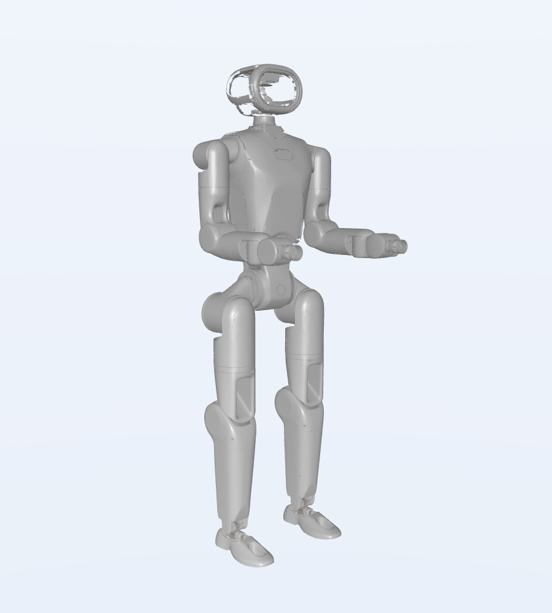

### D.3 STEP实体读取审计

OpenCascade已读取 **172/173** 个RP1机械STEP/STP文件；默认转换后长度为mm。包围盒按零件原生坐标轴，不是装配后的link长度；体积未乘材料密度，不作为质量真值。Parasolid和SW未通过该读入器转换。全量记录见 [STEP JSON（工作区资料）](sources.md#artifact-538df3cad575) 与 [CSV（工作区资料）](sources.md#artifact-2a9f968d2108)。

| 原始文件 | 实体出现次数 | 包围盒/mm | 几何体积/mm³ |
| --- | --- | --- | --- |
| YCL.M000225_腰部Yaw限位环.STEP | 1 | 100.00, 14.20, 100.00 | 8050.6 |
| YCL.M000226_腰部Roll限位环.STEP | 1 | 93.97, 36.66, 11.20 | 5863.3 |
| YCL.M000292 膝盖轴承座.STEP | 1 | 29.53, 99.00, 28.25 | 7153.8 |
| YCL.M000448 小腿本体左.STEP | 1 | 136.73, 50.68, 295.36 | 129951.4 |
| YCL.M000449 小腿脚踝分离块.STEP | 1 | 50.71, 35.91, 79.38 | 34106.4 |
| YCL.M000451 镜向小腿脚踝分离块.STEP | 1 | 50.71, 35.91, 79.38 | 34106.6 |
| YCL.M000452 镜向小腿本体左.STEP | 1 | 136.73, 50.68, 295.36 | 129970.2 |
| YCL.M000642 大臂上本体（01版）.STEP | 1 | 39.75, 80.00, 114.44 | 43026.1 |
| YCL.M000704 kickme版本躯干框架.STEP | 1 | 238.36, 151.65, 136.50 | 251938.6 |
| YCL.M000708 把手-kickme.STEP | 1 | 182.28, 32.81, 65.20 | 48966.6 |
| YCL.M000716-03 kickme版本躯干后壳.STEP | 15 | 252.07, 345.39, 92.41 | 371374.6 |
| YCL.M000717-03 kickme版本躯干前壳.STEP | 17 | 252.07, 344.51, 106.22 | 336736.4 |
| YCL.M000710 kickme_版本电池导向支架.STEP | 1 | 20.40, 165.00, 109.10 | 95620.9 |
| YCL.M000711-02 kickme_版本主板支架.STEP | 5 | 115.75, 144.00, 10.50 | 31368.1 |
| YCL.M000705 kickme把手胶塞-l.STEP | 1 | 10.34, 11.00, 17.24 | 684.1 |
| YCL.M000706 kickme把手胶塞-r.STEP | 1 | 14.02, 11.00, 17.65 | 729.6 |
| kickme0001.stp | 1 | 238.36, 151.65, 145.46 | 235895.8 |


包围盒采用OpenCascade 7.9.3.1的AddOptimal、禁用三角化与形状公差扩张，避免普通Add对曲面产生过松边界。几何体积没有进行材料/密度换算，也没有完成逐面流形与制造验收。

以下文件已成功下载，但本次OpenCascade未得到可用于计算的实体；不能将读取失败直接判定为原件损坏。需在原生CAD或其他STEP导入器复核，对应原件与日志均已保留。

| 文件 | 本次读入结果 |
| --- | --- |
| YCL.M000663 大腿本体（量产）.STEP | No transferable shape; STEP roots=1 |


## 附录 E：官方仓库提交与定位

完整子模块状态、获取时间和工作树状态见 [source_manifest.json（工作区资料）](sources.md#artifact-9a7c0e7a2c06)。下列Git提交已固定；网页/下载服务内容未来可能变化。

| 仓库 | 提交前12位 | 本地路径 |
| --- | --- | --- |
| [AgibotTech/agibot_x1_hardware](https://github.com/AgibotTech/agibot_x1_hardware) | 29e662154dec | official_sources/AgibotTech/agibot_x1_hardware |
| [AgibotTech/agibot_x1_infer](https://github.com/AgibotTech/agibot_x1_infer) | 9e0b818804d6 | official_sources/AgibotTech/agibot_x1_infer |
| [AgibotTech/agibot_x1_train](https://github.com/AgibotTech/agibot_x1_train) | e6651b9ab843 | official_sources/AgibotTech/agibot_x1_train |
| [Roboparty/I-BFM-Code](https://github.com/Roboparty/I-BFM-Code) | b4547263e925 | official_sources/Roboparty/I-BFM-Code |
| [Roboparty/INTACT-JEPA](https://github.com/Roboparty/INTACT-JEPA) | 4da43ffe8bf3 | official_sources/Roboparty/INTACT-JEPA |
| [Roboparty/MimicLite](https://github.com/Roboparty/MimicLite) | 897624097e93 | official_sources/Roboparty/MimicLite |
| [Roboparty/P-BFM](https://github.com/Roboparty/P-BFM) | c441ebd1f847 | official_sources/Roboparty/P-BFM |
| [Roboparty/Party_OS](https://github.com/Roboparty/Party_OS) | 44596a2c5d7a | official_sources/Roboparty/Party_OS |
| [Roboparty/ROMOMO](https://github.com/Roboparty/ROMOMO) | a9140df7b4e9 | official_sources/Roboparty/ROMOMO |
| [Roboparty/RP1](https://github.com/Roboparty/RP1) | ef132918ce24 | official_sources/Roboparty/RP1 |
| [Roboparty/RP1_firmware](https://github.com/Roboparty/RP1_firmware) | 1cfbe77abeaa | official_sources/Roboparty/RP1_firmware |
| [Roboparty/UFO](https://github.com/Roboparty/UFO) | bedef7f5898d | official_sources/Roboparty/UFO |
| [Roboparty/human-humanoid-tools](https://github.com/Roboparty/human-humanoid-tools) | 1181cc98593d | official_sources/Roboparty/human-humanoid-tools |
| [Roboparty/robolab](https://github.com/Roboparty/robolab) | 6b1c3d998849 | official_sources/Roboparty/robolab |
| [Roboparty/roboparty_EtherCANFD](https://github.com/Roboparty/roboparty_EtherCANFD) | aa36e16fd88f | official_sources/Roboparty/roboparty_EtherCANFD |
| [Roboparty/roboparty_build](https://github.com/Roboparty/roboparty_build) | da6b3f2eced3 | official_sources/Roboparty/roboparty_build |
| [Roboparty/roboparty_deploy](https://github.com/Roboparty/roboparty_deploy) | 43154d7d6b0f | official_sources/Roboparty/roboparty_deploy |
| [Roboparty/roboparty_dexhand](https://github.com/Roboparty/roboparty_dexhand) | 046108e7ba80 | official_sources/Roboparty/roboparty_dexhand |
| [Roboparty/roboparty_inference](https://github.com/Roboparty/roboparty_inference) | 06b82ddeb55a | official_sources/Roboparty/roboparty_inference |
| [Roboparty/roboparty_repo](https://github.com/Roboparty/roboparty_repo) | 305387ff9a50 | official_sources/Roboparty/roboparty_repo |
| [Roboparty/roboparty_train](https://github.com/Roboparty/roboparty_train) | 92008a6317d6 | official_sources/Roboparty/roboparty_train |
| [Roboparty/roboparty_xr_teleop](https://github.com/Roboparty/roboparty_xr_teleop) | 6a42270997f9 | official_sources/Roboparty/roboparty_xr_teleop |
| [Roboparty/robot_supplychain](https://github.com/Roboparty/robot_supplychain) | 5ea5ca62d4a7 | official_sources/Roboparty/robot_supplychain |
| [Roboparty/roboto_origin](https://github.com/Roboparty/roboto_origin) | c71fd9287d28 | official_sources/Roboparty/roboto_origin |
| [Roboparty/rp1_description](https://github.com/Roboparty/rp1_description) | 84529a55649b | official_sources/Roboparty/rp1_description |
| [Roboparty/rp1_hardware](https://github.com/Roboparty/rp1_hardware) | 99c17acdeb9d | official_sources/Roboparty/rp1_hardware |
| [Roboparty/rp1_test](https://github.com/Roboparty/rp1_test) | af2d30b03b8f | official_sources/Roboparty/rp1_test |
| [Roboparty/rp_dexhand](https://github.com/Roboparty/rp_dexhand) | e43fd9097001 | official_sources/Roboparty/rp_dexhand |
| [Roboparty/rpo_description](https://github.com/Roboparty/rpo_description) | 8e0f8f78903d | official_sources/Roboparty/rpo_description |
| [Roboparty/rpo_hardware](https://github.com/Roboparty/rpo_hardware) | 4272767a0ab0 | official_sources/Roboparty/rpo_hardware |
| [unitreerobotics/unitree_rl_gym](https://github.com/unitreerobotics/unitree_rl_gym) | 276801e46c5d | official_sources/unitreerobotics/unitree_rl_gym |
| [unitreerobotics/unitree_ros](https://github.com/unitreerobotics/unitree_ros) | 5994d4faef0a | official_sources/unitreerobotics/unitree_ros |
| [unitreerobotics/xr_teleoperate](https://github.com/unitreerobotics/xr_teleoperate) | 817fb00c63cd | official_sources/unitreerobotics/xr_teleoperate |


### E.1 关键源码与文档索引

- [RP1 URDF](https://github.com/Roboparty/rp1_description/blob/84529a55649b5c9796d49093c266208c879f9f29/urdf/rp1.urdf)

- [24轴 URDF](https://github.com/Roboparty/rp1_description/blob/84529a55649b5c9796d49093c266208c879f9f29/urdf/rp1_24dof.urdf)

- [MJCF](https://github.com/Roboparty/rp1_description/blob/84529a55649b5c9796d49093c266208c879f9f29/mjcf/robot.xml)

- [踝映射](https://github.com/Roboparty/roboparty_inference/blob/06b82ddeb55aeb3bbf9b6855beb4bf700e3a4493/src/utils/decouple_rp1.cpp)

- [命令/踝PD路径](https://github.com/Roboparty/roboparty_inference/blob/06b82ddeb55aeb3bbf9b6855beb4bf700e3a4493/src/robot_interface.cpp)

- [推理堆叠/动作转换](https://github.com/Roboparty/roboparty_inference/blob/06b82ddeb55aeb3bbf9b6855beb4bf700e3a4493/src/inference_node.cpp)

- [LRO驱动](https://github.com/Roboparty/roboparty_motors/blob/45eac3ff3dc860e3bd688c1e62a3c5368166849a/src/drivers/lro/lro_motor_driver.cpp)

- [速度策略元数据](https://github.com/Roboparty/roboparty_inference/blob/06b82ddeb55aeb3bbf9b6855beb4bf700e3a4493/robots/rp1_24dof/models/policy.metadata.json)

- [RPO IK](https://github.com/Roboparty/roboparty_xr_teleop/blob/6a42270997f9ff8af10fad791d7390e8a5c0755a/teleop/robot_control/robot_arm_ik.py)

- [MimicLite检查点](https://github.com/EGalahad/mimic-lite/blob/3253810ce21dbcc05d8f4942a017ea3eaffc6cf1/docs/checkpoints.md)

- [模组硬件介绍](https://github.com/Roboparty/ROMOMO/blob/a9140df7b4e93631d755b5afa1e2c7dff2cfe439/RMM%E5%85%B3%E8%8A%82%E6%A8%A1%E7%BB%84%E7%A1%AC%E4%BB%B6%E4%BB%8B%E7%BB%8D-V261013.pdf)
