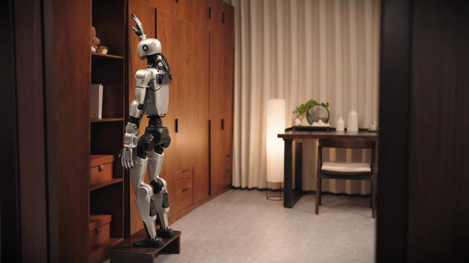
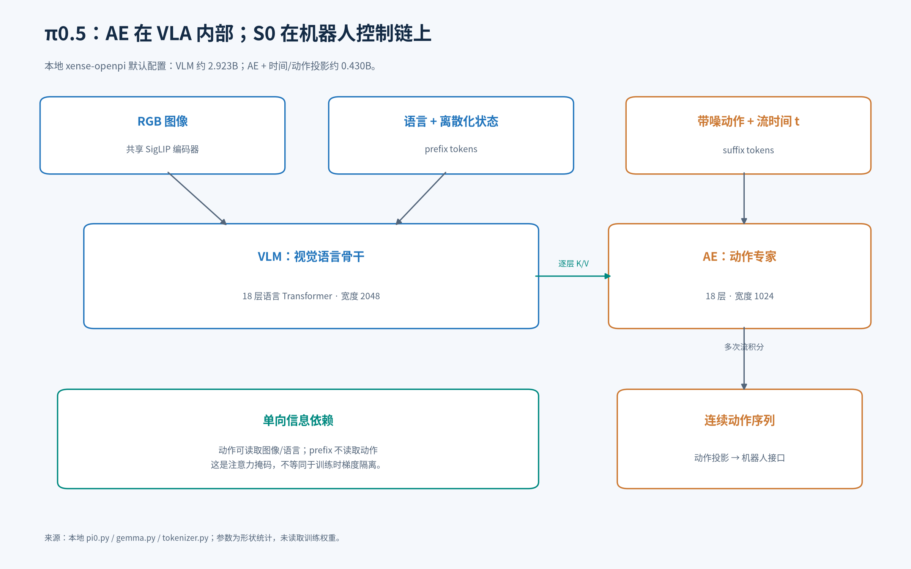
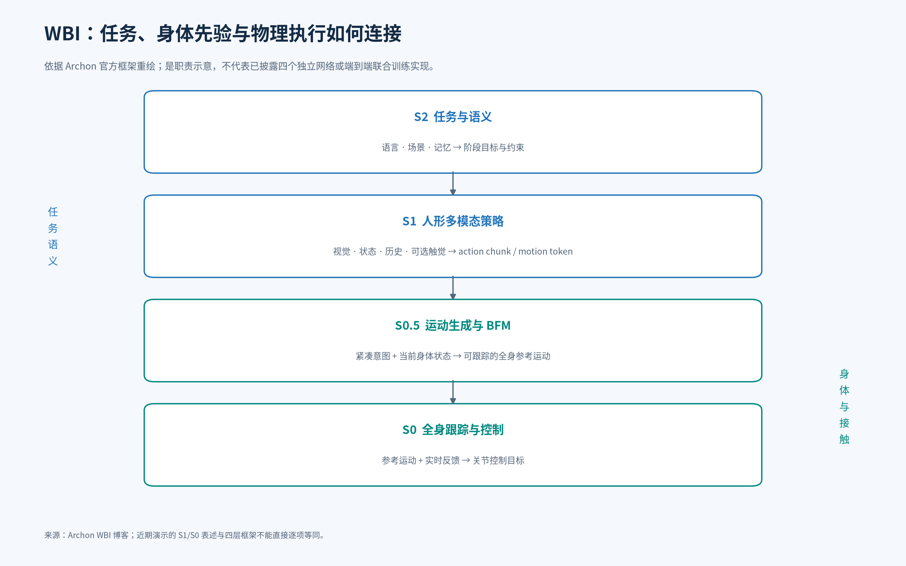
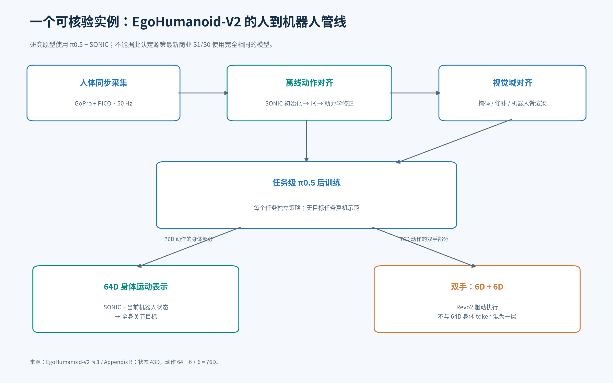
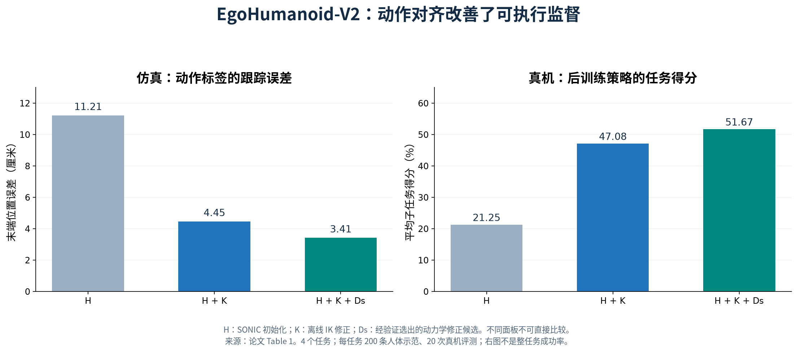
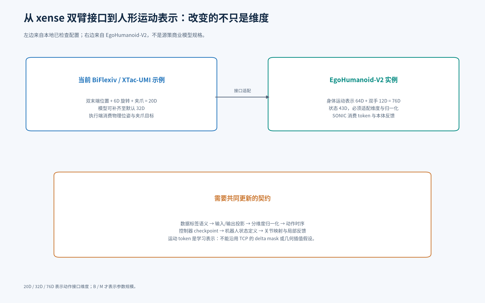
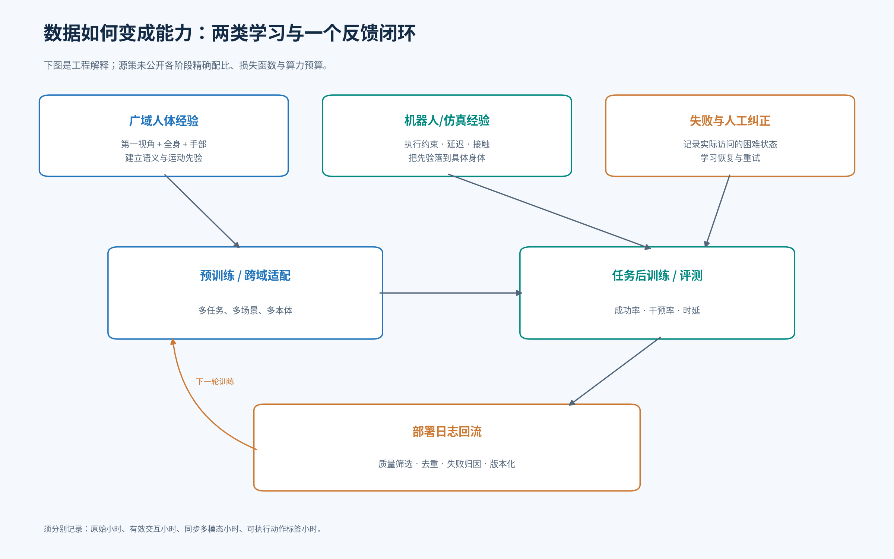
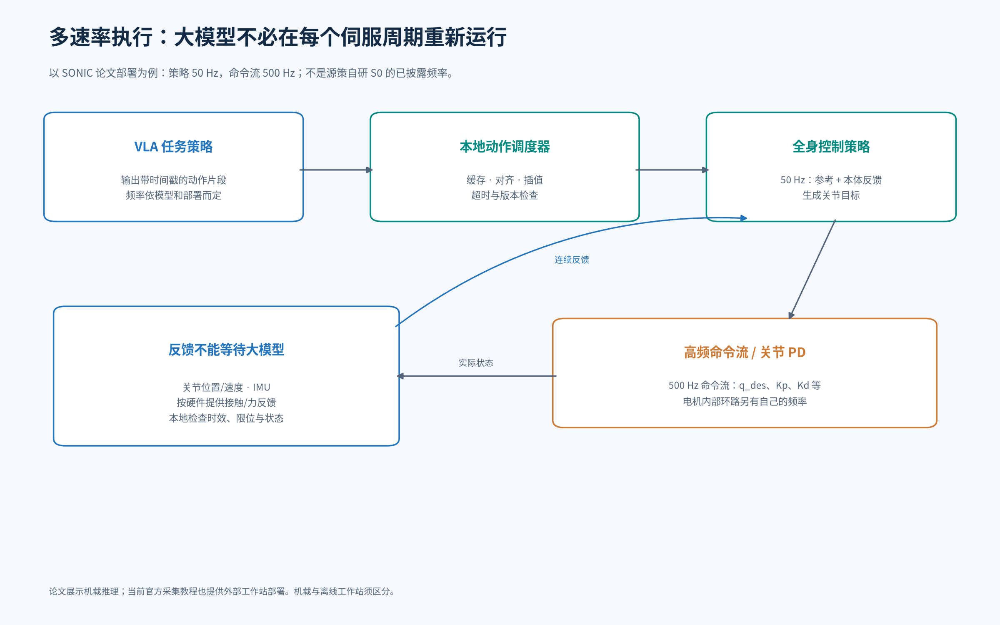

# 源策未来技术路线调研与学习报告

> 迁入说明（2026-10-20）：继承原调研的历史快照。原文件此前仅保存第 1—6 节；本轮先在原工作区补齐同一会话已起草的第 7—15 节，再迁入本包。本轮未重新联网核验技术结论，未重跑参数统计或开展机器人实验。来源、工作区资料与变更边界见 [sources.md](sources.md)，版本哈希见 [provenance.json](provenance.json)。

> 从 π0.5 后训练出发，理解 VLA、动作专家、人体数据与全身控制如何组成一个系统。
>
> 调研截止：**2026 年 10 月 20 日**。对象：**Archon Robotics，源策未来**。本地比较基线：`xense-openpi`（原工作区检出，见 [工作区资料](sources.md#workspace-openpi)），提交 `1424384a975b443eaac70b416189067a8547c94c`。报告包含代码阅读、CPU 参数形状统计、论文与官方资料检索、官方短片抽帧；**没有开展机器人复现实验**。

## 阅读导航

- [1. 先回答最关心的问题](#s1)
- [2. 术语与模块边界](#s2)
- [3. 从本地 π0.5 拆解 VLM 与 AE](#s3)
- [4. 源策 WBI 的架构与公开证据](#s4)
- [5. 模型到底有多大](#s5)
- [6. 与 xense-openpi 的逐项比较](#s6)
- [7. 人体数据、数百万小时与后处理](#s7)
- [8. 预训练、后训练与纠偏闭环](#s8)
- [9. 机器人全身数据怎么采](#s9)
- [10. 本地运动控制怎么落地](#s10)
- [11. 与当前主流路线的比较](#s11)
- [12. 技术评价、行业争论与评测陷阱](#s12)
- [13. 对 Xense 的可执行建议](#s13)
- [14. 未公开信息与交流问题清单](#s14)
- [15. 学习路径、来源与可复查附件](#s15)

<a id="s1"></a>
## 1. 先回答最关心的问题

**源策值得关注的地方，是把人体全身经验、机器人任务学习与底层运控放进同一条能力增长路线。公开资料还不足以把它还原成一张精确到每个网络、参数与训练配比的产品实现图。**

| 你的问题 | 当前能够给出的答案 | 证据边界 |
| --- | --- | --- |
| 它是什么技术路线？ | WBI：面向人形机器人的全身智能。官方框架包含任务语义、多模态身体策略、运动生成、实时控制。 | 官方技术方向；不等于四个已独立发布的模型。 |
| VLA 与 AE 怎么接？ | 在你熟悉的 π0.5 中，AE 是 VLA 内部的动作生成网络，通过逐层注意力读取视觉语言信息。 | 本地代码可核查；源策商业 S1 的内部结构未完整公开。 |
| AE 就是“小脑”吗？ | 不能这样等同。动作专家生成动作片段；全身控制器利用实时反馈执行、平衡与处理接触。 | 两者职责和运行周期不同。 |
| 源策 VLA、AE 各多少参数？ | 本次未找到可信的公开规格。 | 不能用相关论文或 π0.5 的参数替代。 |
| 我们的模型多大？ | 本地默认 π0.5 总计约 **3.353B**；视觉语言部分约 **2.923B**；动作专家和投影约 **0.430B**。 | CPU 形状统计，无 LoRA，`action_dim=32`。 |
| 只有预训练吗？ | 不是。官网明确包含人体数据预训练与真机后训练；相关论文也有清楚的任务级后训练。 | 商业模型的具体任务数据量、配比未公开。 |
| 自采数百万小时 ego？ | **没有找到足以支持这一结论的证据。**创始人采访谈的是汇总网络和开源数据可达到的规模。 | 自采量、有效多模态量、带动作标签量必须分别统计。 |
| 有什么最接近的公开实例？ | `EgoHumanoid-V2`：π0.5 输出身体运动表示与双手指令，SONIC 执行身体控制。 | 是相关研究原型，不能直接当作最新商业产品。 |

以上公司的方向依据[官网](https://www.archon.tech/)与[WBI 技术博客](https://www.archon.tech/blog/whole-body-intelligence-cn)；“百万小时”的语境见[李天羽与诺亦腾的对谈](https://www.sohu.com/a/1081909406_413980)。参数统计及本地代码索引见第 5、15 节。



*图 1：官网链接的短片 `s0.mov` 约 14.1 秒处抽帧。它直观展示了身体支撑与伸手可达范围的关系；单张画面不说明控制自主性、试验成功率或训练方式。来源：[官方媒体文件](https://assets.archonrobotics.tech/demo/20260930/s0.mov)。*

### 1.1 本报告如何区分证据

- **官方披露**：能证明公司公开主张了什么，不自动证明实现细节或量化优势。
- **论文／公开代码**：能支撑对应版本、平台、任务下的方法与实验，不能自动外推到商业产品。
- **采访／媒体**：采访可反映当事人判断；报道中的对比数字仍需要原始评测协议。
- **代码实测**：本次只做参数形状统计与静态阅读，不代表训练效果或实机性能。
- **工程解释／建议**：用于理解、设计或验证系统；明确不当作源策内部实现。

网页可能更新。WBI 博客页面标注 2026-07-13，但本报告读取的是 10 月 20 日可访问版本，不能保证其中每一句都在 7 月首次上线时存在。

<a id="s2"></a>
## 2. 术语与模块边界

| 名称 | 在这里指什么 | 典型输出 | 最容易混淆的地方 |
| --- | --- | --- | --- |
| VLM | 视觉语言模型，提供图像与语义表征 | 隐藏状态、文本、语义特征 | 能理解图像不代表能稳定控制身体。 |
| VLA | 根据视觉、语言等信息生成动作的完整策略 | 动作序列或运动表示 | 常常已经包含 AE，并非 AE 上游另一个互斥模块。 |
| AE：Action Expert | 本报告讨论 π0.5 时的“动作专家” | 连续动作的流向量，积分后得到动作 | 不是自动编码器，也不天然等于电机控制器。 |
| AE：Autoencoder | 另一种常见缩写，即自动编码器 | 压缩表示与重建结果 | 在 BFM、动作 tokenizer、视频 VAE 中可能出现；必须看上下文。 |
| BFM | 行为基础模型，学习可复用的身体运动先验 | 运动潜变量、参考轨迹或控制目标 | 不同论文放在运动生成层或控制层，名称不唯一。 |
| WBC／tracker | 全身控制／运动跟踪 | 关节位置、速度、力矩等目标 | 输入通常还包括当前身体反馈，而非只播放轨迹。 |
| WBI | 源策提出的系统级全身智能路线 | 跨层组织出来的任务行为 | 是研究与系统范式，不是一种固定 Transformer。 |
| S0、S1、S2 | 公司或论文采用的职责分层名称 | 随方案而异 | 不同公司的同名层不保证同构、同频率或同参数量。 |
| motion token | 表示一段运动意图的学习表示 | 向量或离散索引 | 可能是连续向量；不必是自然语言 token。 |
| proprioception | 本体感觉 | 关节状态、姿态等 | 人体骨架坐标不能直接当作机器人关节状态。 |

BFM 的一个具体实例使用 CVAE 与蒸馏，但这不意味着所有 BFM 都是同一种自动编码器；参见[BFM 原始项目](https://bfm4humanoid.github.io/)。

**建议把“语义模型 → 动作专家 → 运动接口 → 全身控制器 → 电机”逐个画出来。**即使一些模块融合训练，也要弄清部署时传递的变量、时间戳和反馈是什么。

<a id="s3"></a>
## 3. 从本地 π0.5 拆解 VLM 与 AE

### 3.1 你平时的后训练实际在学习什么

对一个普通任务，可以把策略写成：

\[
A_{t:t+H-1}\sim\pi_\theta(A\mid I_t,\ell,s_t)
\]

其中，`I` 是一个或多个相机图像，`ℓ` 是任务指令，`s` 是机器人状态，`H` 是预测窗口，`A` 是未来动作片段。策略并不因名字叫 VLA，就必须输出全身电机电流。

在本地 BiFlexiv 示例中，动作是双末端位姿和夹爪；在人形研究中，动作可以换成身体运动表示。**网络能输出多少维，与这些维度是否有可执行的语义，是两个问题。**



*图 2：根据本地实现绘制。注意力信息从 prefix 流向动作分支；训练梯度如何流动，需要额外查看损失与 stop-gradient。*

### 3.2 输入怎样进入模型

本地实现的路径是：

1. 图像进入共享的 **SigLIP `So400m/14`** 编码器，并投影到语言分支宽度。
2. 任务语言进入 PaliGemma tokenizer。
3. π0.5 的状态先归一化，再离散化为数字文本并加入 prompt；π0 则另外有连续状态投影。
4. 图像 token 与语言／状态 token 组成 **prefix**。
5. 带噪动作进入动作投影，形成 **suffix**；流时间通过时间 MLP 与自适应归一化影响动作专家。

对应代码：[模型配置（工作区资料）](sources.md#workspace-openpi)、[模型构建与嵌入（工作区资料）](sources.md#workspace-openpi)、[状态 tokenizer（工作区资料）](sources.md#workspace-openpi)。

这解释了一个常见现象：你改了状态定义、归一化或 prompt，虽然没有改 Transformer 层数，模型实际接收到的条件也可能已经改变。

### 3.3 两个不同宽度的 Transformer 怎样连接

本地默认语言分支宽度为 `2048`，动作分支宽度为 `1024`，深度均为 `18`。它们各自有投影与前馈权重，但投影后的注意力头规格兼容，能够在每层把不同 token 的 K/V 放进同一注意力计算中。

简化地说，动作分支在每一层都可以问：**“当前这段动作需要关注哪些图像区域、任务词和身体状态？”**它不是只接收一次 VLM 最后一层的单个向量。

以行表示 query、列表示 key，掩码的概念形式是：

```text
                   视觉/语言 prefix     动作 suffix
prefix 查询              可见                不可见
suffix 查询              可见                 可见
```

因此：

- 视觉语言 prefix 不依赖当前噪声动作，可以先计算并缓存 K/V。
- 动作专家在多轮去噪／流积分中重复读取缓存。
- “前向注意力不可见”和“反向梯度隔离”是不同操作。
- 这个实现中的 expert 按 token 类型使用不同权重，不应直接理解成带路由器的稀疏 MoE。

见[共享注意力实现（工作区资料）](sources.md#workspace-openpi)与[采样代码（工作区资料）](sources.md#workspace-openpi)。

### 3.4 Flow matching 为什么能够输出动作

按本地代码的时间方向，令真实动作片段为 `A`，高斯噪声为 `ε`：

\[
X_\tau=(1-\tau)A+\tau\epsilon,
\qquad u_\tau=\epsilon-A.
\]

动作专家学习预测 `uτ`，训练误差是预测向量场与监督向量场之间的平方误差。推理时从 `τ=1` 的噪声开始，以负时间步长积分到 `τ=0`，得到动作片段。

这里有两个时间轴：**流时间 `τ`** 表示生成过程走到哪一步；**机器人执行时间 `t`** 表示动作将在哪个物理时刻发生。它们不是一回事。默认 `num_steps=10` 指生成积分步数，不是动作窗口只有 10 帧，也不是机器人伺服频率。

### 3.5 为什么你的 SFT 不等于完整的基座预训练

Physical Intelligence 的 knowledge insulation 方案用离散动作及其他 token 预测目标训练骨干，同时限制连续动作专家对骨干的梯度干扰。它与仅冻结骨干、仅调 AE 也不同。见[原始方法说明](https://www.pi.website/research/knowledge_insulation)。

本地 `Pi0.compute_loss()` 主要实现动作流损失和训练期 RTC 分支。**加载 `pi05_base` 做后训练，不是在本地重新运行全部互联网视觉语言、多机器人、规划与离散动作预训练。**基座已经包含的能力、当前训练代码的损失、你采集的任务数据，应分别讨论。

<a id="s4"></a>
## 4. 源策 WBI 的架构与公开证据

### 4.1 官方四层框架应该怎么读



*图 3：依据[官方 WBI 框架](https://www.archon.tech/blog/whole-body-intelligence-cn)重绘。具体张量接口、网络数量及训练耦合方式未完整披露。*

从工程上理解：S2 给出阶段目标；S1 根据观察决定身体行为；S0.5 把意图展开成可跟踪运动；S0 用当前反馈执行。可以类比“决定取什么、身体如何参与、形成怎样的参考、实际如何保持稳定”，但这些比喻不是可用于实现的接口规格。

近期报道常把系统概括成 S1/S0 两层。**不能据此断言四层被删除、S0.5 已被 AE 吸收，或现在只有两个网络。**正式架构版本说明尚缺失。相关的[10 月报道](https://www.36kr.com/p/4026619117933185)可用于了解公司展示与传播口径。

### 4.2 最具体的相关研究：EgoHumanoid → EgoHumanoid-V2

这条研究线与公司的 WBI 思路相关，但需要保留归属边界：V2 有源策联合作者，官方博客引用 EgoHumanoid；**它不是源策商业 S1/S0 的公开模型卡。**

| 研究 | 对理解路线的帮助 | 不能外推的结论 |
| --- | --- | --- |
| [EgoHumanoid](https://opendrivelab.com/EgoHumanoid/) | 人体第一视角数据与机器人数据共同训练；将上肢末端动作与下肢指令统一到可学习接口。 | 不能把分离式上下肢控制等同于最新全身协同控制。 |
| [EgoHumanoid-V2](https://opendrivelab.com/EgoHumanoid-V2/) | 明确采用 π0.5、身体运动表示和全身 tracker，并公开动作对齐代码。 | 不能断言源策商业模型仍使用 π0.5 或 SONIC。 |
| [AMS](https://opendrivelab.com/AMS/) | 通过人体运动与合成平衡运动，研究动态性与稳定性的统一；官网将其列为相关方案原型。 | 不能认定现有商业 S0 就是原版 AMS。 |

### 4.3 一个足够具体的 VLA → 运控连接实例


*图 4：EgoHumanoid-V2 官方原图，版权归原作者。来源：[项目页](https://opendrivelab.com/EgoHumanoid-V2/)。*

V2 的关键规格如下，适用范围仅限该研究：[论文 §3、§4 与附录 B](https://arxiv.org/html/2609.37181v1)。

| 项目 | 论文实现 |
| --- | --- |
| 人体采集 | 颈部 GoPro、PICO 身体和手部追踪；处理为 50 Hz 配对数据。 |
| 机器人 | Unitree G1，搭配 Revo2 双手。 |
| 策略输入 | 适配后的第一视角图像、43 维机器人状态、语言。 |
| 策略输出 | `64D 身体 motion token + 左手 6D + 右手 6D = 76D`。 |
| 身体执行 | SONIC 消费运动表示及身体反馈；手部指令由手驱动执行。 |
| 策略训练 | 从 `pi05_base` 出发，每任务独立后训练 30,000 步，batch 256。 |
| “零样本”含义 | 不使用目标任务的真机示范；仍使用该任务的人体示范做后训练。 |

这说明了一条直接可理解的路径：**你现在熟悉的 π0.5 并不一定要被替换；它可以学习另一种动作接口，把身体稳定问题交给具有反馈的运控层。**这不是说接口适配就足以得到源策的全部能力。



*图 5：论文与公开接口的教学示意。右侧双手与身体 token 是同一策略输出中的不同部分。*

### 4.4 为什么人体动作需要离线对齐

下面的解释帮助理解公开代码，而非对源策内部数据管线的断言。

人体记录告诉你手、脚与躯干怎样运动；机器人还需要知道：它的身体比例能否达到这些位置、控制器实际会偏到哪里、这种参考是否会导致失稳。仅让人体骨架“看起来像”机器人动作，不能保证手能碰到物体。

V2 公开管线先获得初始机器人运动，再做运动学参考修正，随后依据控制器回放与响应模型修正运动表示。这里修正的对象包括**参考或 token**，不是简单在部署时把所有关节再覆盖一遍。见[公开 pipeline](https://github.com/OpenDriveLab/EgoHumanoid-V2/blob/7f72d1c442d821e6705d4a9f234507af0b6232e4/data_alignment/action_alignment/src/pipeline.py)与[响应模型接口](https://github.com/OpenDriveLab/EgoHumanoid-V2/blob/7f72d1c442d821e6705d4a9f234507af0b6232e4/data_alignment/action_alignment/src/refinement/response.py)。

从控制角度理解，手部的修正会改变躯干与腿的受力，已协调的全身输出不能随意被外部 IK 覆盖。这是研究“离线改监督、在线保持统一控制”有价值的原因；它不意味着在线 IK 在任何机器人系统里都不可用。



*图 6：按论文 Table 1 重绘。左侧是仿真跟踪误差；右侧是四项任务的平均子任务得分。每任务评测 20 次，每次含三个阶段；51.67% **不是完整任务成功率**。原始数据见[论文](https://arxiv.org/html/2609.37181v1#S4.T1)。*

### 4.5 截止日期还应关注 PingpongDuo

官网已列出 10 月的[PingpongDuo](https://www.archon.tech/research/PingpongDuo)。它采用分层团队规划、运动技能和击球修正来实现双机器人配合。

这项结果有助于认识团队在全身控制、技能切换与物理反馈方面的工作，但**不应把乒乓双打直接当作语言通用 VLA 的验证**，也不能借其局部定位精度证明家庭操作精度。

<a id="s5"></a>
## 5. 模型到底有多大

### 5.1 源策商业模型：目前不知道的部分

| 对象 | 本次可核查的参数量 | 处理方式 |
| --- | --- | --- |
| 商业 S1／VLA | 未找到公开数字 | 不估算成 3B、7B 或其他规模。 |
| 商业 AE | 未找到独立规格 | 甚至不能确认产品是否按 π0.5 的方式划分动作专家。 |
| 商业 S0 | 未找到公开数字 | 不把 SONIC 或 AMS 的规模算到它头上。 |
| S0.5 或 BFM | 未找到对应独立权重与规模 | 可能是职责描述，不足以证明单独模型的存在。 |
| 相关 V2 中的 VLA | π0.5 家族 | 不能把本地默认维度统计当作 V2 修改后权重的精确计数。 |

“没有公开”是检索结论，不代表模型小、技术弱或没有这些模块。

### 5.2 对你们本地默认配置的实际统计

统计使用 `nnx.eval_shape()` 构建参数形状，不读取 checkpoint、不分配完整权重。检查的 10 个核心文件相对本地 HEAD 均无修改。结果保存在[参数计数 JSON](assets/evidence/openpi-parameter-summary.json)；代码在[复查脚本（工作区资料）](sources.md#workspace-parameter-count)。

| 模块 | 本地 π0 | 本地 π0.5 |
| --- | ---: | ---: |
| SigLIP 图像编码器及投影 | 414,803,696 | 414,803,696 |
| 语言骨干，含词嵌入 | 2,508,531,712 | 2,508,531,712 |
| 动作专家 Transformer | 311,464,960 | 427,932,672 |
| 动作、时间、状态等外部投影 | 3,248,160 | 2,165,792 |
| **总计** | **3,238,048,528** | **3,353,433,872** |

统计口径：默认 `gemma_2b + gemma_300m`，无 LoRA，`action_dim=32`。词嵌入、图像投影计入骨干；动作分支的自适应归一化计入动作专家。

由此可见：

- “Gemma 2B”是模型家族标签，不是整个视觉语言部分只有严格 20 亿参数。
- “300M action expert”常是近似称呼。这个 π0.5 实现的条件归一化引入了额外参数，计入后动作 Transformer 约 **428M**。
- VLM 与 AE 合起来构成这里的 VLA，不能再把“VLA 3.35B + AE 0.43B”重复相加。
- 改成 76 维动作，会改变输入／输出投影等参数；不能原样引用这个精确总数。

仅按 2 字节／参数估算，默认 π0.5 权重约 6.71 GB，即 6.25 GiB；这**不包含**激活、K/V、优化器、编译和运行时内存，不是显存需求实测。

### 5.3 已公开控制模型只能作量级参照

[SONIC](https://nvlabs.github.io/GEAR-SONIC/)报告从 1.2M 扩展到 42M 的控制模型；[Figure Helix 02](https://www.figure.ai/news/helix-02)披露其 S0 为 10M。它们说明底层反馈控制可以用远小于 VLM 的网络实现；**不说明源策 S0 的参数，也不说明越小或越大越好。**实时性、输入历史、动作接口和训练分布都必须一起比较。

<a id="s6"></a>
## 6. 与 xense-openpi 的逐项比较

### 6.1 比较的对象必须对齐

`xense-openpi` 是已有训练、推理与平台适配代码；WBI 是公司的系统路线。不能把未放在同一仓库里的能力全部判为不存在。下表只讨论**实际检查的本地代码与示例**，不代表 Xense 其他系统没有相关能力。

| 维度 | 本地 xense-openpi 已检查部分 | 源策公开路线／相关研究 | 实际差异 |
| --- | --- | --- | --- |
| 基座 | π0、π0-FAST、π0.5，含 JAX／PyTorch 路径 | 商业模型细节未公开；V2 使用 π0.5 | 基座名称相同，系统目标仍可不同。 |
| 示例任务 | 双臂抓取、装配、插接等 | 全身移动操作、身体与接触协同 | 数据分布与执行约束变化更大。 |
| 动作 | BiFlexiv、XTac-UMI 示例为 20D TCP／夹爪 | V2 为 64D 身体表示加 12D 双手 | 不是给原向量多接几个关节就完成。 |
| 采集 | XTac-UMI 支持离体采集，并非只有真机遥操作 | 人体全身经验与机器人 grounding | 共同点是离体采集；差别在全身反馈。 |
| 触觉 | 有数据开关与硬件路径；所查 XTac 示例不消费触觉流 | 官方路线包含触觉；实际覆盖与消融未披露 | 数据含触觉不等于模型使用触觉。 |
| 时序 | 训练期 RTC、客户端 chunk 调度 | 还需高频平衡反馈 | RTC 不能替代全身 controller。 |
| 后训练 | SFT、LoRA，以及 `rlt/` 的 RL-token 路径 | 真机后训练；报道包含 DAgger | 不能概括成“他们有 RL，我们没有”。 |
| 执行 | 对接已有机器人运行时／驱动 | 全身跟踪、接触和平衡 | 主要新增工作是完整人形执行契约。 |

证据：[BiFlexiv（工作区资料）](sources.md#workspace-openpi)、[XTac-UMI（工作区资料）](sources.md#workspace-openpi)、[RLT（工作区资料）](sources.md#workspace-openpi)、[RTC（工作区资料）](sources.md#workspace-openpi)。

### 6.2 两种 20D 排列也不能混用

```text
BiFlexiv: [left_tcp(9), right_tcp(9), left_gripper(1), right_gripper(1)]
XTac-UMI: [left_tcp(9), left_gripper(1), right_tcp(9), right_gripper(1)]
```

每个 TCP 的 9 维是 `xyz + 6D 旋转表示`。维数相同，夹爪位置却分别在 `18/19` 与 `9/19`。delta mask、归一化和输出解码不能直接交换。一个 64D 运动向量与 64 个关节角有同样长度，也可能完全不是同一种语义。



*图 7：76D 是研究 V2 的规格，不是源策商业模型规格。*

### 6.3 可以复用什么、必须重做什么

归一化、训练入口、服务、记录与 RTC 经验可以复用。引入全身 token 后，要重新确认动作维度、状态补齐、checkpoint 加载、控制器版本、手部指令顺序、坐标系与动作时效。不要假定潜变量允许按普通位姿方式做 delta 或插值。

配置文件名也不是实际参数：所查 XTac YAML 虽含 `h200`，却未显式覆盖 `action_horizon`，默认配置为 `50`。实际实验还需核对加载结果及命令行覆盖。[所查配置（工作区资料）](sources.md#workspace-openpi)

<a id="s7"></a>
## 7. 人体数据、数百万小时与后处理

### 7.1 “数百万小时”是什么口径

创始人谈的是汇集网络与开源社区的人类／机器人数据可以形成很大的时长，并强调这不自动带来机器人智能。它不是源策已完成同等规模自采的公告。[采访授权刊载](https://www.sohu.com/a/1081909406_413980)

因此，不能写成“自采数百万小时、全部同步全身和触觉、全部用于商业模型预训练”。这些需要数据清单、去重、有效率与模态覆盖率证明，官网尚未提供完整 dataset card。

另一个名称陷阱：学术界已有 [ECCV 2022 EgoBody](https://sanweiliti.github.io/egobody/egobody.html)，来自 ETH／Microsoft。不能凭同名就把它与源策报道中的 EgoBody 视为同一套。

| 时长口径 | 实际信息 | 不能直接推导 |
| --- | --- | --- |
| 原始视频 | 像素、可能有音频 | 准确动作、下半身和力的真值。 |
| 第一视角有效交互 | 手与物体操作过程 | 全身均可观测。 |
| 同步多模态 | 视觉、身体／手部姿态等 | 每种信号都是直接实测。 |
| 可执行标签 | 经适配、回放、验证的机器人动作 | 覆盖全部地形与接触。 |
| 真机闭环 | 实际状态、指令、干预与结果 | 已达到生产可靠性。 |

多视角总小时与独立的人类经验小时也不同。以下是**各项目自己的数字，不是源策已证实的训练混合**：

| 项目 | 公开规模／口径 |
| --- | --- |
| [Ego4D](https://ego4d-data.org/docs/) | 文档约 3,600 小时并持续更新；不等于全部有原生动作标签。 |
| [Ego-Exo4D](https://docs.ego-exo4d-data.org/) | V2 为 1,286.30 视频小时、221.26 ego 小时；版本需区分。 |
| [EgoDex](https://machinelearning.apple.com/research/egodex-learning-dexterous-manipulation) | 829 小时、194 种桌面任务，同步手／手指追踪。 |
| [EgoScale](https://research.nvidia.com/labs/gear/egoscale/) | 20,854 小时带动作标签的人体第一视角数据。 |
| [SONIC](https://nvlabs.github.io/GEAR-SONIC/) | 700 小时动捕、超过 1 亿帧，面向运动先验。 |
| [GEN-1](https://generalistai.com/blog/gen-1) | 厂商称超过 50 万小时物理交互数据。 |
| [DreamDojo](https://github.com/NVIDIA/DreamDojo) | 约 4.4 万小时人体第一视角视频，面向世界模型。 |

视频语义、手姿态、身体动捕和真实接触，是不同监督。不能把其他公司的规模转述为源策的数据量。

### 7.2 采集系统需要记录什么

以下是工程建议，不是源策商业 EgoBody 的完整硬件清单：

- 视觉：第一视角 RGB、曝光时间、相机标定、可用深度或其他视角。
- 身体：头、躯干、骨盆、四肢、手脚关键点或骨架参数；保留置信度。
- 手部：腕姿态、指关节或关键点、遮挡与追踪失效标记。
- 空间：身体与相机的坐标关系、地面、轨迹漂移和重定位。
- 接触：按任务需要保存可获得的触觉／力觉；画面接触不能替代全部力信息。
- 上下文：指令、子阶段、结果、操作者、场景、设备版本、来源与授权标签。

V2 的公开硬件为 **PICO 4 Ultra、五个 tracker（双腕、腰、双踝）、颈部 GoPro**，可作为研究参考，不能据此判断商业系统全部相同。[固定版本说明](https://github.com/OpenDriveLab/EgoHumanoid-V2/blob/7f72d1c442d821e6705d4a9f234507af0b6232e4/README.md#hardware-setup)

完整骨架数组，不等于每个关节都有独立传感器实测，更不等于采到了地面反作用力。低成本系统往往混合直接观测与姿态模型估计。

### 7.3 从原始信号到训练样本

下表是工程分解，**不是源策已披露的逐步 SOP**。

| 阶段 | 处理 | 质量证据 |
| --- | --- | --- |
| 原始入库 | 保存原始流、时钟、标定与版本 | 校验和、来源、缺帧。 |
| 时间对齐 | 时钟偏移和漂移、曝光与控制延迟 | 方法、误差测量、有效时间窗。 |
| 空间标定 | 统一相机、头、骨盆、腕、地面关系 | 单位、坐标轴、旋转顺序、重标定。 |
| 片段筛选 | 去掉等待、无交互与严重遮挡，分割任务 | 有效比例、物体与场景覆盖。 |
| 标注／伪标注 | 任务描述、人体估计、事件与结果 | 标签来源、置信度、人工抽检。 |
| 身体适配 | 重定向、IK、可达性和约束检查 | 端点误差、限位、自碰撞。 |
| 执行验证 | 用目标控制器回放并筛选 | 稳定性、通过率、拒绝比例、版本。 |
| 视觉域处理 | 按需做视角变换、移除人体臂、修补与渲染 | 伪影、物体几何改变、域差消融。 |
| 样本构建 | 配对观测与动作、生成 chunk、分组归一化 | schema、mask、训练／评测隔离。 |
| 部署回流 | 收集失败、干预、恢复并补采缺口 | 干预原因、结果与版本对照。 |

“重采样到 50 Hz”不代表“绝对同步误差达到 20 ms”。采样周期、时间戳精度与同步误差是三件事。V2 附录也区分了无外部脉冲时的时间一致性与绝对同步误差。[论文附录 A.1](https://arxiv.org/html/2609.37181v1)

量纲示例：末端以 1 m/s 运动时，20 ms 配对偏差对应 2 cm 位移。时间标签可以占用很大一部分精度预算。

### 7.4 无动作标签的视频与规模化成本

至少有三条路径：先学视觉／语义，再连接机器人动作；估计相机、手、身体或潜在动作，构造伪监督；学习未来视觉状态或联合视频与动作的世界模型／WAM。它们对标签、损失和算力的需求不同。

以下只是计算示例，**不是源策运营数字**：

- 10,000 套设备，每套每天 2 小时，50 天得到 100 万原始小时。
- 若仅 60% 通过筛选，约需 83.3 天得到 100 万有效小时。
- 单路 4 Mbps 视频每小时约 1.8 GB；100 万小时约 **1.8 PB**。两路约 3.6 PB，尚未计深度、派生结果与副本。

应核查有效监督产出速度、后处理吞吐、覆盖、质量与下游收益。自动描述不能补回从未观测到的身体与接触信号。

<a id="s8"></a>
## 8. 预训练、后训练与纠偏闭环

### 8.1 把不同学习目标分开

下表是系统设计解释，不表示源策公开采用了全部算法。

| 对象 | 常见数据与目标 | 补足的能力 |
| --- | --- | --- |
| 视觉语言骨干 | 图文、视频、任务语义 | 识别、理解、语义泛化。 |
| 身体运动先验 | 动捕、骨架、参考运动 | 协调与运动分布。 |
| 全身 tracker | 仿真参考跟踪与身体反馈 | 平衡、跟踪、扰动恢复。 |
| 跨域适配 | 人体／机器人共同或对齐数据 | 传感器、形态、动作语义差异。 |
| 任务后训练 | 特定任务人体或真机示范 | 行为与任务条件的对应。 |
| 纠偏／RL | 干预、失败、奖励与实际反馈 | 关键阶段效率、恢复和鲁棒性。 |

[AMS](https://opendrivelab.com/AMS/)的人体运动与合成平衡数据，是理解不同信号如何互补的一个实例。

### 8.2 特定任务后训练确实存在

官网包含真机后训练；研究 V2 对每个任务单独训练策略。但商业演示中的任务是否共用一套权重、怎样选任务、有哪些独立规划组件，尚缺完整说明。

| “零样本”的对象 | 仍可能存在的训练或适配 |
| --- | --- |
| 目标任务真机示范 | 该任务的人体示范后训练。 |
| 新家庭／新物体 | 别处采集的同类行为适配数据。 |
| 新本体 | 关节映射、传感器标定或独立控制器适配。 |
| 新任务 | 相近动作组合、视觉子目标或语义等价训练任务。 |

[Helix 2.5](https://www.figure.ai/news/helix-2-5-zero-shot-30-home-generalization)的零样本针对评测家庭与物体；不能与 V2 的“没有目标任务真机示范”直接互换。

### 8.3 DAgger 与在线 RL 的区别

BC 学习示范者访问过的状态；策略犯错后会进入不同状态。DAgger 类方法让当前策略产生它实际访问的状态，在这些状态上获取专家纠正，再用于训练。它不等于把全部失败动作当正样本，也不自动等于强化学习。[原始论文](https://arxiv.org/abs/1011.0686)

人形接管还要求控制器从当前姿态继续执行。报道提到源策的人形 DAgger，但采样策略、干预阈值、标签和损失未完整公开，不能指定它使用某种 RL 算法。[相关报道](https://t.cj.sina.com.cn/articles/view/3996876140/ee3b7d6c001017u2m)

### 8.4 与你们 RLT 的关系

本地 rlt 模块先从冻结 VLA 的 prefix 表征训练 RL-token 编码／重建结构，再用 actor／critic 做在线学习，与 [PI 的 RL tokens](https://www.pi.website/research/rlt)方向相近。

这里可能同时出现 Action Expert 和 autoencoder 两种 AE。**RL token 是观测表征接口；SONIC motion token 是身体动作接口**，不能因为都叫 token 就互换。



*图 8：教学用系统示意，不能当作源策各阶段的实际训练配比。*

<a id="s9"></a>
## 9. 机器人全身数据怎么采

### 9.1 人体采集与机器人采集

人体采集是人直接完成任务，记录其感知和身体信号，之后适配成机器人监督。机器人采集则让机器人在遥操作或自主策略下实际行动，记录真正经历的状态、指令与结果。

后者提供执行滞后、控制误差、接触与失败；前者通常更容易覆盖自然环境。只保存人的参考动作，不能替代机器人实际状态。

### 9.2 建议的数据契约

下面是设计清单，具体字段必须以硬件实际提供的信号为准。

| 类别 | 建议记录 | 需要区分 |
| --- | --- | --- |
| 身体状态 | 关节位置／速度、基座姿态、IMU、状态估计 | 实测、滤波估计与参考值。 |
| 接触受力 | 足底接触、力／力矩、触觉及可用性 | 指令力矩不等于实际接触力。 |
| 策略动作 | 原始 VLA chunk、身体 token、手部动作 | 语义、时间范围、归一化状态。 |
| 控制输出 | tracker 输出、限幅后目标、PD／力矩指令 | 上层目标与最终发送命令。 |
| 遥操作 | 人体参考、手柄状态、接管标记 | 专家意图与自主策略输出。 |
| 视觉场景 | 原始时间戳、标定、局部地形 | 运动相机不能沿用固定工位外参。 |
| 结果运行时 | 阶段、成功、失败、干预、时延、停机 | 不能只留下成功视频。 |
| 版本 | 本体、手、控制器、模型、处理与标定版本 | token 必须绑定生成／解码器版本。 |

教学用记录层次可以是 observation、reference、action、execution、outcome、metadata。不要把它误认为现有 xense-openpi 协议。

### 9.3 为什么保存整条指令链

如果只保存下一帧实际关节位置，得到的是系统响应，不一定是专家下达的动作。若只保存上层目标，又不知道它是否真的执行成功。保留**参考 → 控制输出 → 测量状态**，才能区分目标选错、跟踪失败、接触受限和硬件问题。

这也是人体与机器人同名状态字段不能直接拼接训练的原因：它们未必有相同的物理语义。

### 9.4 可参考的开源流程

[NVIDIA 全身采集教程](https://nvlabs.github.io/GR00T-WholeBodyControl/tutorials/data_collection.html)把相机、PICO 人体参考、机器人状态汇入记录器并导出 LeRobot。当前教程让主要组件运行于工作站，机器人端发布相机；这不是所有系统的固定部署形式。

[GMR](https://github.com/YanjieZe/GMR)可参考人体到机器人的几何重定向。它不自动解决物体接触、动力学可执行性与任务成功，是管线中的一个环节。

<a id="s10"></a>
## 10. 本地运动控制怎么落地

### 10.1 大模型与身体反馈采用不同周期

拿着物体弯腰时，手的目标、负载、躯干姿态和脚底支撑共同决定稳定性。视觉语言推理停顿时，关节反馈和平衡控制仍要继续。

合理分工是：大模型提出带时序的运动意图；控制层持续消费身体状态和参考；驱动完成更底层的执行。



*图 9：SONIC 论文实例为策略 50 Hz、命令流 500 Hz，并有独立输入与规划循环；不是源策商业 S0 的已披露频率。[部署章节](https://arxiv.org/html/2511.07820v3)*

### 10.2 一条典型执行链

相机与状态 → VLA 未来片段 → 带时间戳缓存 → 身体表示／参考与当前反馈 → 全身控制策略 → 关节目标与约束检查 → 机器人驱动。

身体反馈连续返回控制层。“本地”还应明确指机器人机载计算机，还是同一局域网的外部工作站。SONIC 论文描述机载执行，当前开源教程也有工作站模式，不能混用它们的时延与断网假设。

关节 PD 的教学形式为：力矩 = Kp × 位置误差 + Kd × 速度误差 + 前馈项。真实驱动还有内部闭环与限幅；不能仅凭输出了关节目标就认定接触稳定性得到保证。

### 10.3 RTC 解决另一类问题

RTC 处理上层推理与动作接续：新片段生成时继续执行旧片段，识别哪些未来动作已经无法改变。它不替代身体平衡反馈。

人形系统需要明确：观察对应哪个时刻；动作是否过期；还剩多少有效窗口；接管后旧 chunk 是否失效；运动潜变量是否允许插值；断流时如何保持、恢复或退出。

本地 max_delay=10 的注释按 30 fps 解释约 330 ms；若动作频率为 50 Hz，同样十步仅 200 ms。延迟与窗口必须按真实时间核对。

### 10.4 本地运行时的验证点

工程上应记录真实控制周期与最坏时延，检查目标序号、时间戳、有限值、关节顺序、单位与限位，区分模型返回、动作接受、命令发送，并在仿真中验证断流和接管。

这些信息也决定示范能否成为可靠标签。仅看训练 loss，难以定位执行失败的来源。

<a id="s11"></a>
## 11. 与当前主流路线的比较

### 11.1 截止 2026 年 10 月，不能把“主流 VLA”只理解成桌面 π0.5

| 路线 | 公开重点 | 与 WBI 的关系／差异 |
| --- | --- | --- |
| π0.5／FAST | 连续动作专家或离散动作 token；成熟的开源适配基线 | 你们可直接阅读、修改的学习入口；全身接口仍需另外设计。 |
| [π0.7](https://www.pi.website/blog/pi07) | 2026-04；多模态 prompt、行为元信息和视觉子目标，研究技能组合泛化 | 主要扩大任务条件与数据吸收能力，不自动给出特定人形的全身运控。 |
| [GR00T N1.7](https://developer.nvidia.com/blog/develop-humanoid-robot-policies-end-to-end-with-nvidia-isaac-gr00t/) | 3B 基座，VLM 与动作生成网络；数据、仿真、后训练与部署工具链 | 与全身策略及控制器对接已有公开路线，适合作为可复查工程参照。 |
| [Helix 02](https://www.figure.ai/news/helix-02) | S2 语义、S1 全身视觉运动、S0 身体反馈；公开 S1 200 Hz、S0 1 kHz | 分层全身学习并非源策独有；这些频率属于该版本。 |
| [Helix 2.5](https://www.figure.ai/news/helix-2-5-zero-shot-30-home-generalization) | 2026-09；从人体 Index 数据预训练，再适配行为并评测未见家庭 | 有人体预训练贡献的消融；不能把 02 架构细节无条件外推到 2.5。 |
| [Gemini Robotics 2](https://deepmind.google/models/gemini-robotics/vla/) | 全身、灵巧操作与具身推理；当前页面标注 private preview | 说明 VLA 已覆盖全身方向；参数与内部接口并非全部公开。 |
| [GEN-1](https://generalistai.com/blog/gen-1) | 大规模人体交互预训练、机器人适配和系统级推理 | 人体数据规模化是共同趋势，不等于已解决全部足式全身控制。 |
| [EgoScale](https://research.nvidia.com/labs/gear/egoscale/) | 人体预训练、对齐中训练、任务后训练的灵巧手迁移 | 对理解人体动作监督与跨本体适配很有帮助。 |
| [DreamZero／WAM](https://dreamzero0.github.io/) | 结合视频生成先验，联合预测未来视频与动作 | 改变学习目标与骨干来源；仍需机器人执行接口。 |
| [SONIC](https://nvlabs.github.io/GEAR-SONIC/)／[BFM](https://bfm4humanoid.github.io/) | 身体运动先验和控制接口 | 主要比较的是下层能力，不宜拿它们直接与完整 VLA 排名。 |

这里比较职责和公开证据，不做跨任务成功率排行榜。GR00T 官方技术博客给出 N1.7 的 3B 与 Cosmos-Reason2-2B 骨干信息；不能用两个近似家族数字相减，推导动作头的精确参数量。

PI 也在 [2026-10-13 公布 API beta](https://www.pi.website/blog/api-beta)。其新产品能力不能自动视为已进入当前本地开源权重或仓库。

### 11.2 真正应比较的五条轴

1. **任务与环境**：固定桌面、移动双臂、双足、非平地和复杂接触。
2. **动作接口**：TCP、关节、速度、全身参考或学习 token。
3. **数据监督**：无标签视频、人体动作、机器人动作、部署与失败。
4. **适配成本**：新任务、新家、新手、新本体分别要多少数据与工程。
5. **评测口径**：完整成功、子任务进度、是否允许干预、是否挑选演示。

“大家都使用 Transformer”没有充分解释差异；“名字不叫 VLA”同样没有证明新范式。

<a id="s12"></a>
## 12. 技术评价、行业争论与评测陷阱

以下为结合公开证据的研究判断，不是源策已证实的商业性能。

### 12.1 值得认可的技术取向

**把控制器当作数据基础设施。**控制器不仅负责最终部署，也影响遥操作能采到什么、人体动作能否转成可执行监督。更好的跟踪与接触能力，有机会提高数据有效率。

**把身体参与任务作为学习对象。**弯腰、换支撑、抬脚、侧身与主动观察改变可达空间，不能完全被静态 TCP 轨迹覆盖。

**把人体规模与机器人约束分工。**人体经验提供多样性，真机和仿真反馈提供执行约束。是否奏效仍需控制变量的消融，而非只比较总小时。

### 12.2 还没有被公开证据证明的部分

“四层”不证明四个独立模型，也不证明梯度贯穿全栈；跨两款机器人展示不等于同一权重零适配迁移；完成多步任务不自动证明单模型长程规划；在多个城市采集不自动证明跨场景泛化。

公开相关论文使用 π0.5，并不反驳公司研发原生人形基座的目标；反过来，公司目标也不能证明现有产品所有模块均已从头预训练。研究原型、路线与产品版本应分开讨论。

### 12.3 怎样阅读“2 厘米”与“51.67%”

[10 月报道](https://www.36kr.com/p/4026619117933185)转述源策 S0 末端误差进入约 2 cm 区间。但没有完整公开的测试定义，不能把它当作普适精度，也没有已核实的行业标准规定“2 cm 即合格”。

要追问：测量的是手腕、工具尖端还是手指；相对什么坐标系；均值还是最大误差；有没有负载与接触；静态还是动态；是否使用外部追踪；失败和跌倒有没有计入。

V2 的 51.67% 是子任务得分；Helix 2.5 的 56% 是其特定未见家庭评测的整任务成功口径。两者任务、硬件、数据和评分不同，不能相减排名。

### 12.4 潜变量动作的收益与代价

收益可能是更紧凑的动作空间、自然的运动先验、对全身协调更友好的接口。但它也绑定解码器和身体分布。替换控制器、改变 token 编码或硬件后，旧标签可能需要重新编码或验证。

归一化、几何 delta 和直线插值对物理位姿有明确意义，对学习 token 未必如此。低维也不自动代表可解释或安全。

### 12.5 人形是否必然优于轮式双臂

这是任务经济性问题。双足可能在台阶、低位和狭窄空间有价值；固定工位可能更重视稳定吞吐、能耗、维护和失效成本。源策选择足式全身方向，可以被理解为长期能力下注，不能由此判定轮式路线没有价值。

建议对同一工作需求比较任务覆盖、人工干预、有效工作时间、重置和维护成本，再评价形态优势。商业判断不应只依据视频的动作复杂度。

### 12.6 应期待什么样的下一轮证据

最有价值的是：可复查的数据说明与模型卡、相同下游数据的人体预训练消融、完整未剪辑评测、按任务和场景拆分的失败与干预统计、新本体适配成本，以及控制器升级后监督是否稳定。

目前公开内容足以支持“路线有明确工程动机、存在相关实机研究”，尚不足以证明已解决开放世界通用人形智能。

<a id="s13"></a>
## 13. 对 Xense 的可执行建议

本节是建议，不是已经执行的仓库改动或实验。

### 13.1 先建立能够复查的接口基线

把现有 π0.5 的观测、动作语义、归一化、时序与执行日志固定下来。特别检查 20D 特征顺序、delta mask、触觉是否真的被使用、真实 action_horizon 和 checkpoint 版本。

这一步能复用现有工作，也为以后判断“换模型还是换数据更有效”提供基线。

### 13.2 有全身平台时，先验证控制与记录

选择一个有公开部署协议的全身控制器作为研究起点，先在仿真回放参考，检查跟踪、支撑变化和失败记录，再采少量机器人闭环示范。不要把可运行的 VLA 服务等同于全身系统已可部署。

若暂时没有对应硬件，仍可完成数据 schema、人体到机器人适配和仿真回放，不必为了学习路线先扩建数采规模。

### 13.3 再让熟悉的 π0.5 学习新动作接口

以公开 V2 的模式理解迁移：动作可以变成身体 token 加手指令，但输入／输出投影、状态长度、归一化、mask 与权重加载均需适配。76D 不能通过原来只接受 32D 的接口直接塞入。

先确定动作标签可执行，再比较策略训练。这样失败时更容易定位是标签、视觉域还是策略问题。

### 13.4 选择能揭示身体协同的任务

研究候选包括低处取物、边移动边搬运、脚踩踏板同时投放、不同支撑高度的放置。任务应根据实际平台能力选取，不以视频炫技为目标。

建议在等量真机数据下比较：机器人示范基线、加入人体数据、加入动作对齐、加入视觉域处理、再加入干预数据。控制模型、算力与评测条件，才能判断每一步是否值得。

### 13.5 触觉与 RLT 可以形成自己的研究重点

所查 XTac 配置保存的数据包含触觉而当前策略不使用。可以先针对遮挡、滑移或精细插接等具体瓶颈，验证增加触觉是否改善成功或恢复，再扩张采集。

已有 RLT 适合研究关键阶段在线改进；它与全身学习不冲突，但需要确认新的动作表示适合当前 actor／critic 和探索约束。

### 13.6 建议的评测表

| 项目 | 应记录什么 |
| --- | --- |
| 成功 | 完整任务成功率，并单独列子任务进度。 |
| 干预 | 次数、原因、发生阶段与无干预连续时长。 |
| 执行 | 端点误差、跟踪失败、状态失配与重置。 |
| 时序 | 推理、传输、缓存年龄、控制周期和最坏时延。 |
| 泛化 | 未见房间、物体、操作者、任务组合与本体分别评测。 |
| 数据效率 | 原始／有效／真机小时、处理通过率、任务新增成本。 |
| 统计 | 样本数、随机种子或初始条件、误差区间与失败计入规则。 |

不要把同一条演示切成相邻片段分别进入训练和测试；人体与机器人同一任务实例也要防止跨划分泄漏。

<a id="s14"></a>
## 14. 未公开信息与交流问题清单

| 优先级 | 希望获得的信息 | 为什么影响结论 |
| --- | --- | --- |
| 高 | 商业 S1、AE、S0 的网络、参数与 checkpoint 版本 | 确认真实架构和部署成本。 |
| 高 | S1/S0 与四层框架的对应关系 | 避免把职责图当具体实现图。 |
| 高 | 输出是关节、参考还是 token，动作频率与窗口多大 | 决定接入现有仓库的工作量。 |
| 高 | 自采原始量、有效多模态量、可执行标签量与真机量 | 核查“规模”真实含义。 |
| 高 | 人体／机器人／仿真比例、采样方式与监督损失 | 判断数据收益来自哪里。 |
| 高 | 每任务是否后训练、几套权重、多少真机／纠偏数据 | 判断通用能力和适配成本。 |
| 高 | 2 cm 指标的坐标系、端点、负载、统计方式与失败规则 | 判断精度是否适用于目标任务。 |
| 高 | 完整成功率、干预次数与未剪辑评测 | 区分演示与稳定能力。 |
| 中 | 采集硬件、标定、时钟、漂移和质量筛选 | 判断数据噪声与后处理成本。 |
| 中 | 跨 G1/T2 是共同权重、重训练还是少量适配 | 判断跨本体迁移强度。 |
| 中 | 地形、触觉与力信息怎样进入各层 | 判断接触能力的依据。 |
| 中 | 更换 S0 后旧数据是否需重编码 | 判断数据资产与控制器的绑定。 |
| 中 | 模型是否机载、最坏延迟、断流与恢复协议 | 判断实际运行要求。 |
| 中 | 代码、权重和数据的开放范围及版本计划 | 判断复现与合作可行性。 |

其中前八项，比一个不带定义的总参数量或总小时数更能改变技术判断。

<a id="s15"></a>
## 15. 学习路径、来源与可复查附件

### 15.1 从你现有经验出发的阅读顺序

1. 读本地 pi0_config、pi0、gemma、tokenizer，把 prefix、suffix、注意力与流时间连接起来。
2. 读 BiFlexiv 与 XTac-UMI 接口，手动写出每一维和 delta mask。
3. 看 EgoHumanoid-V2 框架与接口，理解人体记录如何转成机器人监督。
4. 读 SONIC 的 motion token、控制反馈与多速率部署。
5. 回到源策 WBI 博客，逐层标注已公开接口与未知实现。
6. 用同一套问题读 Helix、GR00T、Gemini、GEN-1，避免只记模型名字。

阅读后应能回答：一个训练样本里哪些是观察、参考、动作和结果；AE 输出的物理含义是什么；下层消费哪个时刻的动作；如果机器人没碰到目标，应该检查哪一层。

### 15.2 主要资料索引

全部资料访问日期为 2026-10-20。正文引用紧邻对应结论；下面便于集中阅读。

| 编号 | 资料 | 类型与用途 |
| --- | --- | --- |
| P01 | [Archon 官网](https://www.archon.tech/) | 公司当前方向、预训练与后训练。 |
| P02 | [WBI 中文技术博客](https://www.archon.tech/blog/whole-body-intelligence-cn) | 官方四层框架；页面标注 2026-07-13。 |
| P03 | [WBI 英文技术博客](https://www.archon.tech/blog/whole-body-intelligence) | 对照术语与引用；不是另一个独立实验。 |
| P04 | [EgoHumanoid 项目](https://opendrivelab.com/EgoHumanoid/) | 早期人体与机器人学习研究。 |
| P05 | [EgoHumanoid 论文](https://arxiv.org/html/2602.10106v1) | 2026-02，分离式接口与共同训练。 |
| P06 | [EgoHumanoid-V2 项目](https://opendrivelab.com/EgoHumanoid-V2/) | 方法、原图和实验。 |
| P07 | [V2 论文 v1](https://arxiv.org/html/2609.37181v1) | 2026-09-29，接口、后训练、评测与局限。 |
| P08 | [V2 固定版本代码](https://github.com/OpenDriveLab/EgoHumanoid-V2/tree/7f72d1c442d821e6705d4a9f234507af0b6232e4) | 已检查硬件、pipeline 与响应模型；不能等同全商业栈。 |
| P09 | [AMS](https://opendrivelab.com/AMS/) | 人体／合成平衡数据与全身跟踪。 |
| P10 | [SONIC 项目](https://nvlabs.github.io/GEAR-SONIC/) | 规模、运动接口与 VLA 连接。 |
| P11 | [SONIC 论文 v3](https://arxiv.org/html/2511.07820v3) | 控制规模、多速率机载执行。 |
| P12 | [BFM](https://bfm4humanoid.github.io/) | 行为基础模型的一个具体定义。 |
| P13 | [EgoScale](https://research.nvidia.com/labs/gear/egoscale/) | 人体预训练、对齐中训练与任务后训练。 |
| P14 | [PI knowledge insulation](https://www.pi.website/research/knowledge_insulation) | VLM／动作专家的训练关系。 |
| P15 | [PI RL tokens](https://www.pi.website/research/rlt) | 2026-03，观测压缩与快速在线 RL。 |
| P16 | [π0.7](https://www.pi.website/blog/pi07) | 2026-04，条件化与组合泛化。 |
| P17 | [PI API beta](https://www.pi.website/blog/api-beta) | 2026-10，产品更新与开源基线应区分。 |
| P18 | [GR00T N1.7 技术博客](https://developer.nvidia.com/blog/develop-humanoid-robot-policies-end-to-end-with-nvidia-isaac-gr00t/) | 2026-07，模型与工作流。 |
| P19 | [GR00T 代码](https://github.com/NVIDIA/Isaac-GR00T) | 公开实现与当前版本。 |
| P20 | [全身数据采集教程](https://nvlabs.github.io/GR00T-WholeBodyControl/tutorials/data_collection.html) | 机器人／人体／相机记录示例。 |
| P21 | [全身 VLA 部署教程](https://nvlabs.github.io/GR00T-WholeBodyControl/tutorials/vla_inference.html) | 模型服务、客户端与控制层的连接。 |
| P22 | [Helix 02](https://www.figure.ai/news/helix-02) | 2026-01，分层全身学习与频率规格。 |
| P23 | [Helix 2.5](https://www.figure.ai/news/helix-2-5-zero-shot-30-home-generalization) | 2026-09，人体预训练消融与未见家庭评测。 |
| P24 | [Gemini Robotics 2](https://deepmind.google/models/gemini-robotics/vla/) | 当前全身 VLA 能力与公开状态。 |
| P25 | [GEN-1](https://generalistai.com/blog/gen-1) | 2026-04，厂商人体数据与后训练说明。 |
| P26 | [DreamZero](https://dreamzero0.github.io/) | 世界动作模型的另一条学习路线。 |
| P27 | [DreamDojo](https://github.com/NVIDIA/DreamDojo) | 世界模型数据规模与开源说明。 |
| P28 | [Ego4D](https://ego4d-data.org/docs/) | 公共第一视角数据。 |
| P29 | [Ego-Exo4D](https://docs.ego-exo4d-data.org/) | 多视角与版本统计口径。 |
| P30 | [Apple EgoDex](https://machinelearning.apple.com/research/egodex-learning-dexterous-manipulation) | 同步手姿态采集。 |
| P31 | [GMR](https://github.com/YanjieZe/GMR) | 人体动作几何重定向。 |
| P32 | [DAgger 原始论文](https://arxiv.org/abs/1011.0686) | 纠偏数据聚合的概念来源。 |
| P33 | [PingpongDuo](https://www.archon.tech/research/PingpongDuo) | 2026-10，公司相关全身控制研究；不是通用 VLA 验证。 |
| I01 | [创始人与诺亦腾对谈](https://www.sohu.com/a/1081909406_413980) | 一手采访的授权刊载；原对谈首发标注 2026-08-29。 |
| I02 | [同采访原始发布页](https://www.geekpark.net/news/371148) | 本次直接访问不稳定，结合授权刊载核查。 |
| M01 | [机器之心相关报道](https://t.cj.sina.com.cn/articles/view/3996876140/ee3b7d6c001017u2m) | 2026-10-10，演示、任务与纠偏的报道口径。 |
| M02 | [极客公园／36氪相关报道](https://www.36kr.com/p/4026619117933185) | 2026-10-15，2 cm 与跨本体等传播信息；不是第三方复现。 |
| D01 | [ECCV 2022 EgoBody](https://sanweiliti.github.io/egobody/egobody.html) | 同名消歧，不代表源策数据。 |

### 15.3 本地证据与附件

- [参数计数脚本（工作区资料）](sources.md#workspace-parameter-count)：CPU 形状追踪，不加载 checkpoint。
- [参数统计摘要](assets/evidence/openpi-parameter-summary.json)：保留配置、分组计数和总数；逐叶形状明细仍为[工作区资料](sources.md#workspace-parameter-count)。
- [本地代码证据（工作区资料）](sources.md#workspace-code-evidence)：提交、文件哈希和相对 HEAD 的修改状态。
- [配图生成脚本（工作区资料）](sources.md#workspace-figure-generation)：生成原始中文示意图与实验数据重绘。
- [视频抽帧记录（工作区资料）](sources.md#workspace-video-inspection)：所读官方片段的时长与采样数。

本次未获取源策商业权重、完整数据清单与内部训练日志；全文的未知项应保留，不能由相关论文、媒体报道或同行数据替代。配图中的官方原图与视频帧版权归原权利人，其来源均已标注；原创示意不声称为内部架构图。
