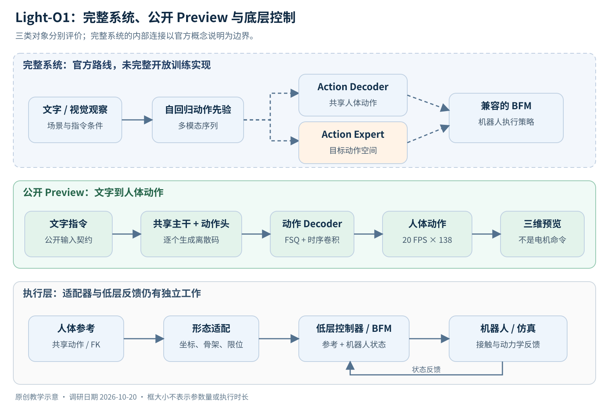
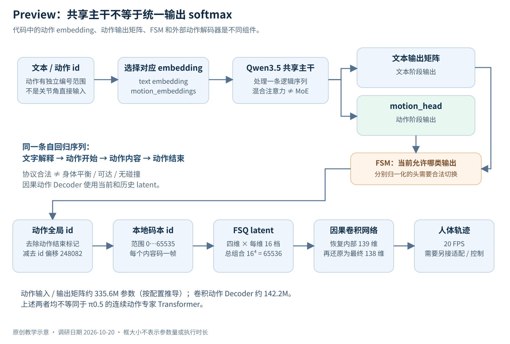
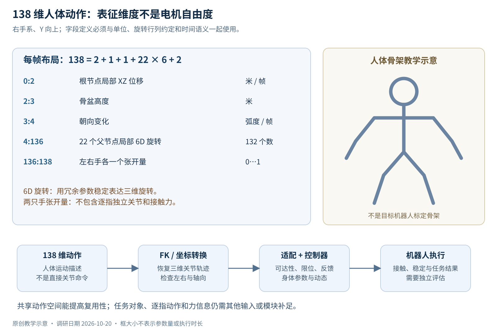
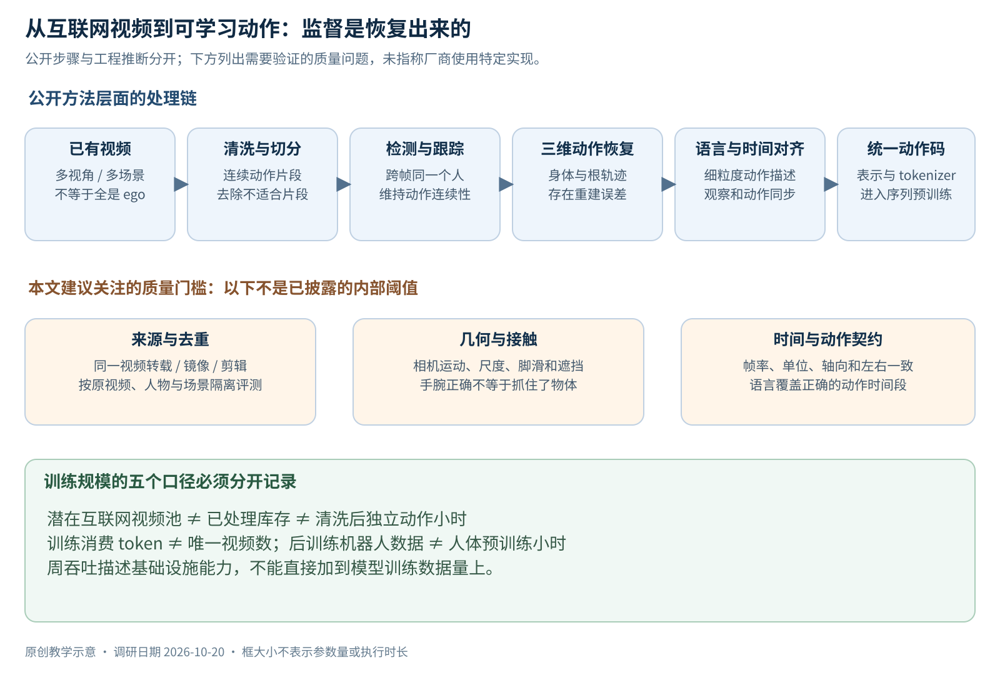
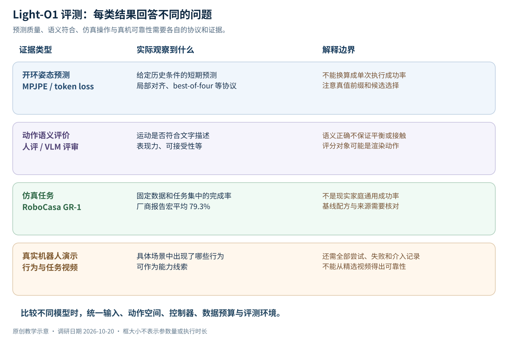

# Light-O1：模型架构、动作表示、训练数据与产业路线调研报告

> 迁入快照：原调研截止2026-10-20；本轮只整理归档和引用，未重新验证技术结论。入口见[README.md](README.md)，来源与未随文保存的材料见[sources.md](sources.md)。


> 调研截止：2026-10-20。面向有 π0.5 / OpenPI 后训练经验、希望理解全身具身模型内部连接的工程读者。\
> 调研对象：**亮源新创（Light Origins）的 Light-O1**。公司中文名以官网为准；模型名中是字母 O。\
> 本文依据公开官网、模型配置、推理源码、数据集与相关论文整理。公开仓库 main 与模型 main 会继续变化；本次未下载大模型权重、未运行 GPU 推理、未执行机器人实验。没有本地 xense-openpi 工作树的实测结论。

本文把证据分成四种：**公开实现可核对**、**厂商公开报告**、**本文推导**、**尚未披露**。公式、示意图与工程建议属于解释和分析，不代表 Light Origins 公开了相同的内部训练实现。所有本地 SVG 都是本文原创教学图，框大小不表示参数比例或执行时间。

## 阅读导航

1. [先建立正确的模型边界](#1-先建立正确的模型边界)
2. [从 π0.5 迁移过来的知识地图](#2-从-π05-迁移过来的知识地图)
3. [完整系统与公开 Preview 的架构](#3-完整系统与公开-preview-的架构)
4. [138 维动作究竟是什么](#4-138-维动作究竟是什么)
5. [FSQ、动作 token 与因果解码器](#5-fsq动作-token-与因果解码器)
6. [参数量、MoE 与显存](#6-参数量moe-与显存)
7. [数据来源和视频到动作的流水线](#7-数据来源和视频到动作的流水线)
8. [预训练、适配与人类反馈](#8-预训练适配与人类反馈)
9. [如何读 Scaling Law 和评测](#9-如何读-scaling-law-和评测)
10. [与 OpenPI、Natura-1 和其他路线对照](#10-与-openpinatura-1-和其他路线对照)
11. [公开代码阅读与部署边界](#11-公开代码阅读与部署边界)
12. [对 xense 项目的实际启发](#12-对-xense-项目的实际启发)
13. [评价、行业讨论与待回答的问题](#13-评价行业讨论与待回答的问题)
14. [来源索引](#14-来源索引)

## 1. 先建立正确的模型边界

**最重要的判断：Light-O1 完整系统、Light-O1-Preview 开源权重、执行动作的底层控制器，是三个需要分别评价的对象。**

| 对象 | 已有公开依据 | 读者能据此做什么 |
| --- | --- | --- |
| Light-O1 完整系统 | 官网说明多模态人类动作先验及机器人适配路线，展示视觉条件下的移动与操作 | 分析技术路线、评测协议和系统分工 |
| Light-O1-Preview | 模型卡明确只开放文字到动作；公开权重、动作解码资源与推理代码 | 生成共享人体动作，查看文本解释与三维运动 |
| BFM / 底层控制器 | 接收动作参考，结合机器人状态完成运动跟踪；公开 G1 示例另接 GEAR-SONIC | 在特定机器人模型与控制器下研究动作执行 |

边界依据：[模型卡](https://huggingface.co/LightOriginsHQ/Light-O1-Preview)、[公开仓库](https://github.com/lightorigins/Light-O1)、[G1 仿真说明](https://github.com/lightorigins/Light-O1/blob/main/examples/sonic/README.md)。



*图 1：公开 Preview 的动作路径可查代码；完整模型的视觉与机器人适配路径以官方概念说明为依据。虚线表示本次公开材料不足以复现内部连接。*

从你已有的 π0.5 经验出发，可以先记住四句话：

- π0.5 常见部署方式是“观察当前图像和机器人状态，再生成一段连续控制动作”。
- Preview 更接近“读懂动作指令，再逐个生成离散动作码，最后还原为共享人体轨迹”。
- 人体轨迹描述的是身体怎样运动；机器人执行还需要处理关节限制、平衡、接触和反馈。
- 因此，漂亮的人体动画、仿真跟踪、真实机器人完成任务，是不同层次的证据。

前三者在概念上的连接，后文会逐步拆解。这里并不把“人体动作生成”视作已经解决了机器人控制。

### 1.1 本文重点回答什么

你原来对 Natura-1 的疑问可以完整迁移过来，但 Light-O1 的回答不同：公开 Preview 没有一个已确认的 50B MoE 主体，也不能照搬“3B VLM 加 300M Action Expert”的 π0.5 结构。公开实现提供了更具体的线索：Qwen3.5 主干、独立动作嵌入与输出矩阵、离散码协议、FSQ 动作解码器，以及机器人仿真的适配示例。

本文最值得细看的部分是：

1. **动作码怎样通过共享 Transformer 生成，怎样被还原成身体运动。**
2. **为什么 138 维不是 138 个电机，也不意味着逐指灵巧手控制。**
3. **为什么开环姿态误差随数据下降，仍然需要闭环机器人实验。**
4. **哪些组件能直接借鉴到 xense-openpi，哪些还缺数据和训练实现。**

## 2. 从 π0.5 迁移过来的知识地图

### 2.1 VLM、VLA、动作专家、动作编解码器分别做什么

| 术语 | 通常处理的对象 | 学到的能力 | 与执行器的距离 |
| --- | --- | --- | --- |
| VLM | 图像、文本、视频 | 识别、描述、推理、语义对齐 | 通常还没有机器人动作接口 |
| VLA | 视觉、语言、动作 | 根据观察和指令预测动作 | 取决于动作空间，有时可直接接执行器 |
| Action Expert | 条件特征与带噪动作等 | 在特定动作空间生成连续轨迹 | 常接机器人关节或末端位姿 |
| Action Encoder / Decoder | 连续动作和离散码 / latent | 压缩、重建动作 | 可以只输出人体运动，仍需控制器 |
| BFM / 跟踪策略 | 参考动作、机器人自身状态 | 稳定跟踪、平衡、动态控制 | 通常更靠近低层控制 |

**AE 的缩写必须先展开。** 在 π0.5 讨论里，AE 多半指 Action Expert；在离散动作表示里，AE 也可能被用来指 Autoencoder。Light-O1 的图中同时存在 Action Decoder 与 Action Expert，把二者都叫“AE”会直接误导架构理解。

可以把两种学习任务写成：

$$
\text{动作生成策略：}\quad p_\theta(a_{t:t+H}\mid o_{\leq t},\ell)
$$

$$
\text{动作编解码：}\quad z=E_\phi(a_{1:T}),\qquad \hat a_{1:T}=D_\psi(z)
$$

前者回答“此刻应该怎么做”，后者回答“怎样紧凑地表达一段已经给定的运动”。编解码器本身并不会因为能重建运动，就知道杯子在哪里或应该先开哪个柜门。这是理解整个报告的基础。

### 2.2 OpenPI 里的 action chunk 为什么不是一个普通文本 token

在典型 OpenPI π0.5 路径中，图像与文本提供条件，连续动作专家通过 flow matching 学习速度场。推理时从噪声动作开始，做若干更新，得到多个未来时间步的连续动作。动作维度、状态编码、归一化与机器人配置绑定。

公开代码可从 [pi0.py](https://github.com/XenseRobotics-AI/xense-openpi/blob/main/src/openpi/models/pi0.py) 和 [pi0_config.py](https://github.com/XenseRobotics-AI/xense-openpi/blob/main/src/openpi/models/pi0_config.py) 核对；π0.5 的论文训练流程与具体后训练脚本也应分开理解。基础方法见 [π0 论文](https://arxiv.org/abs/2410.24164)、[π0.5 论文](https://arxiv.org/abs/2504.16054)。

对 OpenPI 代码中的一种时间约定，可以写：

$$
x_\tau=(1-\tau)A+\tau\epsilon,\quad
u_\tau=\epsilon-A
$$

模型预测速度，再从噪声端沿相反时间方向积分。不同论文和实现可能把时间方向反过来；比较时应核对公式，不能只看变量名。

而离散动作生成先选一个码，再由解码器把码流展开成连续信号：

$$
p_\theta(z_{1:T}\mid\ell)
=\prod_{t=1}^{T}p_\theta(z_t\mid\ell,z_{<t}),
\qquad \hat A=D_\psi(z_{1:T})
$$

这里的 (z_t) 不一定表示某个单独关节，也不一定是“拿杯子”这样的语义技能。它可以只是运动空间中的一个紧凑量化编码。

### 2.3 离散和连续不是公司之间的绝对分界

π0.5 的研究训练流程也涉及离散动作表征；FAST 使用另一种动作压缩方案。因此，“有动作 token”不是 Light-O1 独占的概念。应比较的是：压缩哪种动作空间、每个码覆盖多少时间、是否保留机器人状态、是否另外训练连续专家，以及最终怎样闭环执行。参见 [FAST](https://www.pi.website/research/fast) 与 [Knowledge Insulation](https://www.pi.website/research/knowledge_insulation)。

同样，自回归可以描述动作码的时间生成；flow matching 可以描述一个动作块的连续生成。两者能出现在一个系统不同层次中，不能用一个词排除另一个词。

## 3. 完整系统与公开 Preview 的架构

### 3.1 两条执行路线要分开画

官网给出的完整系统含两条接口：共享人体动作经解码后接兼容 BFM，或通过 diffusion 类 Action Expert 适配目标动作空间再接其他 BFM。机器人适配还使用定向采集的数据。官方概念图没有公布专家层数、注意力连接、梯度流或各执行器的完整训练配方。参见 [官方技术说明](https://www.lightorigins.cn/en/blog/light-o1)。

理解这两条路线，可以用一个“意图—运动—控制”的教学分层：

| 层次 | 需要回答的问题 | 典型输入与输出 | 缺失时会怎样 |
| --- | --- | --- | --- |
| 指令与场景理解 | 要做什么，目标在哪里 | 语言、图像 → 语义条件 | 动作自然却目标错误 |
| 动作生成 | 身体各部分怎样配合 | 条件 → 人体动作 / 目标动作 | 理解正确但动作不连贯 |
| 形态适配 | 这个机器人能怎样完成 | 人体参考 → 机器人参考 | 腿长、关节方向和手型不匹配 |
| 反馈控制 | 实际误差怎样纠正 | 参考、自身状态 → 执行动作 | 能离线播放但容易失稳 |
| 环境交互 | 物体是否真的被移动 | 新观察 → 后续动作 | 没抓住物体却继续执行后续步骤 |

这是本文的系统分析框架，不意味着 Light-O1 内部严格使用五个独立网络。

### 3.2 Preview 的实际计算路径

公开 Transformers 实现展示了一条明确路径：

```text ids / motion ids
      ↓ 选择对应 embedding
共享 Qwen3.5 Transformer
      ↓
text logits 或 motion logits
      ↓ FSM 限制合法输出区间
动作全局 id → 本地码本 id
      ↓
FSQ 展开 → 因果卷积动作解码器
      ↓
(frames, 138) 人体动作
```

代码依据：[transformers_model.py](https://github.com/lightorigins/Light-O1/blob/main/light_deploy/transformers_model.py)、[fsm.py](https://github.com/lightorigins/Light-O1/blob/main/light_deploy/fsm.py)、[generate.py](https://github.com/lightorigins/Light-O1/blob/main/light_deploy/generate.py)。



*图 2：示意共享主干、动作输出矩阵与动作解码器的连接。文本和动作共享序列模型，不代表二者使用同一个输出 softmax。*

### 3.3 模型卡的简述与代码的精确表述

模型卡强调文本与动作来自同一条自回归生成流。源码进一步表明，当前推理类包含独立的 `motion_embeddings` 与 `motion_head`，并非只有原有文本 embedding 和原有文本输出矩阵。

因此，应把下面两件事同时理解清楚：

- **共享的是 Transformer 序列建模过程。** 动作不是在完整文本回答之后，交给一个完全无关的外部动作语言模型生成。
- **输出参数与概率归一化仍有模态区分。** FSM 源码特别说明文本头、动作头按分开的 softmax 训练，推理时应屏蔽另一类输出，不能把拼接后的 logits 当成训练过的统一概率分布。

这是公开代码比宣传概述更有解释力的例子。它不等于“模型卡完全错误”，而是说明“一个流”并不唯一决定底层矩阵布局。依据：[模型卡](https://huggingface.co/LightOriginsHQ/Light-O1-Preview)、[模型类](https://github.com/lightorigins/Light-O1/blob/main/light_deploy/transformers_model.py)、[有限状态机](https://github.com/lightorigins/Light-O1/blob/main/light_deploy/fsm.py)。

### 3.4 推理文本的作用与局限

可读的动作解释有工程价值：人能更早发现左右方向、动作顺序、交互对象是否理解错误。但“先给出一段解释”本身不证明解释是内部决策的忠实因果记录，也不证明轨迹满足碰撞、平衡或接触约束。

因此，合理的验证方式是干预实验：保持任务相同，改变约束或输入描述，检查动作是否随正确约束变化；同时测量轨迹和任务结果。只评估解释是否流畅，会把语言能力当成运动能力。


## 4. 138 维动作究竟是什么

### 4.1 每一帧的数据布局

公开的 `human_action_138_v1` 定义如下。切片使用 Python 左闭右开的写法；这里描述的是模型接口，不是机器人电机定义。[动作格式文件](https://huggingface.co/LightOriginsHQ/Light-O1-Preview/blob/main/human_action_138_v1.json)

| 切片 | 维数 | 含义 | 单位或约定 |
| --- | ---: | --- | --- |
| `0:2` | 2 | 根节点局部地面位移 | 米 / 帧，局部 XZ 平面 |
| `2:3` | 1 | 骨盆高度 | 米 |
| `3:4` | 1 | 朝向变化 | 弧度 / 帧 |
| `4:136` | 132 | 22 个关节的父节点局部 6D 旋转 | 每关节 6 个数 |
| `136:137` | 1 | 左手张开程度 | 0 到 1 |
| `137:138` | 1 | 右手张开程度 | 0 到 1 |
| 合计 | **138** | 共享人体动作 | 右手系、Y 向上、20 帧 / 秒 |

$$
138=2+1+1+22\times6+2
$$

**这些 138 个数不是 138 个自由度。** 比如，一个三维刚体旋转的自由度是 3，可以用 6 个冗余数来表达。另一方面，两个手张开量也无法描述每根手指的独立关节。



*图 3：人体动作表征、运动学重建与机器人控制各有职责。图中的人体骨架是教学示意，不是论文中的拟合人体或机器人标定结果。*

### 4.2 6D 旋转为什么有六个数

常见旋转表示包括欧拉角、四元数、旋转矩阵。神经网络直接回归欧拉角会遇到周期边界和奇异性；连续 6D 表示是一种常用替代，理论背景见 [On the Continuity of Rotation Representations in Neural Networks](https://arxiv.org/abs/1812.07035)。

教学上可以把网络输出看成两个三维向量 (a,b)，经正交化得到旋转基：

$$
r_1=\frac{a}{\|a\|},\quad
r_2=\frac{b-(r_1^\top b)r_1}{\|b-(r_1^\top b)r_1\|},
\quad r_3=r_1\times r_2
$$

这个构造解释了“六个数表达三维旋转”的原因。**行向量与列向量约定必须跟实现一致。** Light-O1 的 FK 采用按行堆叠的约定；直接套用另一套按列处理的工具，会造成看起来很像“左右手或坐标轴出错”的结果。[fk.py](https://github.com/lightorigins/Light-O1/blob/main/light_deploy/action_tokenizer/fk.py)

### 4.3 为什么要分离根轨迹和身体局部姿态

这是运动表征中的一种有用设计。把身体在地面上怎样移动，与关节相对父节点怎样旋转分开，可以使相似动作在不同世界位置下共享更多结构。

例如，“向前走两步再挥手”可分为：

1. 根节点的地面位移与朝向变化；
2. 躯干和四肢的局部运动；
3. 手部状态的变化。

但这种分离会带来明确的工程责任：根轨迹积分方式、初始朝向和世界坐标必须一致。局部位移如果被误当成世界系绝对位置，动作在可视化里可能仍然“动了”，实际路径却会完全不同。

公开 FK 使用固定骨架偏移重建关节位置，并且对位移积分与朝向更新有明确先后顺序。这能用于显示与适配输入，不代表完成了目标机器人身体参数的标定。[fk.py](https://github.com/lightorigins/Light-O1/blob/main/light_deploy/action_tokenizer/fk.py)

### 4.4 为什么它不能直接覆盖灵巧手精细操作

从接口的信息容量即可判断：两只手各一个张开值，只能表达非常粗的手型变化。它不能唯一决定拇指对掌、食指侧向调整、多指包覆或指尖接触力。

对你熟悉的双臂 / 灵巧手系统，至少还需要区分：

| 信息 | Preview 公共动作接口能提供什么 | 精细操作通常还需要什么 |
| --- | --- | --- |
| 腕部位置与朝向 | 可通过骨架与旋转求得 | 与机器人末端坐标系、工具中心点对齐 |
| 手型 | 左右各一个张开程度 | 逐指姿态、欠驱动映射或抓取协同变量 |
| 接触 | 没有直接接触力字段 | 力 / 触觉、滑移状态、接触约束 |
| 目标物体 | 公共 Preview 是文字输入 | 视觉定位、物体几何与任务状态 |
| 机器人可达性 | 共享人体轨迹不保证 | IK、关节限位、碰撞与动力学 |

后两列是本文的控制系统分析，不是声称 Light-O1 完整内部系统没有这些能力。完整系统可以通过另一动作空间或其他控制模块补足；**公开接口不支持推断未发布的细节**。

## 5. FSQ、动作 token 与因果解码器

### 5.1 FSQ 在压缩什么

FSQ 是 Finite Scalar Quantization。它把一个低维连续 latent 的每个维度量化到有限档位，再把各维组合编码成整数。它与“训练一个有 65,536 个独立中心向量的普通查表码本”不是同一个设计。方法来源：[FSQ 论文](https://arxiv.org/abs/2309.15505)。

Light-O1 公开解码配置使用四个各 16 档的维度：

$$
K=16^4=65,536
$$

四维 latent 是动作压缩后的内部坐标，**不表示机器人的四个关节或四个自由度**。参见 [decoder_config.json](https://huggingface.co/LightOriginsHQ/Light-O1-Preview/blob/main/action_tokenizer/decoder_config.json)。

### 5.2 一个动作码怎样变成四维 latent

设本地动作码为 $i\in[0,65535]$。混合进制展开可写为：

$$
b=(1,16,256,4096),\qquad
q_j=\left\lfloor i/b_j\right\rfloor\bmod16
$$

$$
z_j=(q_j-8)/8
$$

例如 $i=4660=\mathrm{0x1234}$，四维档位按低位在前得到 ((4,3,2,1))，再得到 ((-0.5,-0.625,-0.75,-0.875))。这是本文按公开公式构造的教学例子，不是实际动作样本。

接下来由训练过的解码网络把整个 latent 序列变回人体运动。一个码的几何意义必须结合训练分布和时间上下文理解，不能仅按数字大小理解成“动作强度”。具体展开与反归一化见 [decoder.py](https://github.com/lightorigins/Light-O1/blob/main/light_deploy/action_tokenizer/decoder.py)。

### 5.3 全局 token id 与本地码本 id 不是同一个数

在文本和动作共用逻辑序列时，模型需要不同的编号范围。公开配置中的关键关系是：

| 项目 | 数值 / 关系 |
| --- | --- |
| 动作内容码本 | 本地 id `0..65535` |
| 动作 id 偏移 | `248082` |
| 动作内容全局 id | `248082..313617` |
| 动作结束 id | `313618`，不是合法内容码 |
| 动作嵌入 / 输出行数 | `65544`，包括内容以外的额外行 |

依据：[模型配置](https://huggingface.co/LightOriginsHQ/Light-O1-Preview/blob/main/config.json)。

因此，动作流进入解码器之前，要先去掉结束标记，再减去偏移。把全局编号直接传给 65,536 大小的本地码本会越界。这里“65,544 行”和“65,536 个有效动作码”并不矛盾。

### 5.4 因果卷积解码器怎样恢复连续运动

公开网络使用时序卷积与残差块，配置为隐藏通道 768、20 个 stage、膨胀率 ([1,2,4,8]\) 重复五次，输出内部 139 维。网络本身没有时序上采样路径；结合数据契约，可以推导本实现中每个内容码对应一帧 20 FPS 动作。[网络实现](https://github.com/lightorigins/Light-O1/blob/main/light_deploy/action_tokenizer/network.py)、[解码配置](https://huggingface.co/LightOriginsHQ/Light-O1-Preview/blob/main/action_tokenizer/decoder_config.json)

为什么内部是 139，最终却是 138？解码结果经过反归一化，其中两个内部通道通过 `atan2` 合并成朝向增量，手部通道限制在 ([0,1]\)，于是变成最终接口。该处理避免把角度周期边界直接作为单一普通数值回归的问题。[decoder.py](https://github.com/lightorigins/Light-O1/blob/main/light_deploy/action_tokenizer/decoder.py)

“因果”表示输出不使用未来 latent。**它没有保证输出满足刚体动力学。** 卷积能够学到运动平滑性、姿态模式和时间关联；接触与稳定性仍须由训练目标、数据和控制层共同约束。

### 5.5 两个有用的数量级推导

以下都是本文从公开结构推导的结果：

- 每帧一个 65,536 类的码，理论内容信息上限为 16 bit；20 FPS 对应约 **320 bit/s**。这不是模型的网络带宽，也不包括文本、视觉、存储格式或服务协议。
- 若只统计这条卷积链的最大时序依赖范围，卷积核和膨胀率给出 $1+2\times75+4=155\$ 帧，约 7.75 秒。它是解码器的理论感受野，**不是 Transformer 记忆时长**。

这两个量说明离散表征可以非常紧凑，但“码流短”与“神经网络计算轻”是两回事。

### 5.6 FSM 为什么是必需的

有限状态机负责约束“现在应该生成文本、动作开始、动作内容，还是动作结束”。这能避免把本来只在各自输出空间归一化训练的两个头混用。

它解决的是**输出协议合法性**，无法保证动作物理合法。一个完全符合 token 协议的序列，仍可能发生脚滑、重心偏移或手穿过桌面。类似地，一个合法 JSON 也可能含有错误的业务数据。

## 6. 参数量、MoE 与显存

### 6.1 能确定的参数口径

| 组件或口径 | 可确定到什么程度 | 不应据此推断什么 |
| --- | --- | --- |
| Preview 模型页 | Hugging Face 标示约 **6B**，BF16 | 不能直接当作完整机器人系统总参数 |
| 预训练起点 | 官方说明基于 Qwen3.5-4B | 不能用 6B 减 4B 得到“2B 动作专家” |
| 动作输入与输出矩阵 | 按配置与代码可算约 **335.6M** | 不是连续动作专家 Transformer |
| 公共动作解码网络 | 按结构推导约 **142.2M** | 不包含未发布编码器或 BFM |
| 完整系统 diffusion Action Expert | 内部尺寸未披露 | 不能假设等于 π0.5 的约 300M |
| LightBot / G1 底层 BFM | 不属于 Preview 同一权重口径 | 不能忽略它们对执行能力的贡献 |

模型标示见 [模型页](https://huggingface.co/LightOriginsHQ/Light-O1-Preview)；矩阵和解码器的计算依据分别是 [模型类](https://github.com/lightorigins/Light-O1/blob/main/light_deploy/transformers_model.py) 与 [解码网络](https://github.com/lightorigins/Light-O1/blob/main/light_deploy/action_tokenizer/network.py)。**本文未读取所有 safetensors 的真实 tensor 元数据，因此不声称已经完成整模精确审计。**

### 6.2 动作矩阵怎样算出 335.6M

配置给出主干隐藏宽度 (d=2560\)，动作行数 (V_a=65544\)。当前代码创建动作 embedding 和独立无偏置输出矩阵：

$$
P_{\mathrm{motion}}=V_a d+dV_a
=2\times65544\times2560
=335,585,280
$$

这是两张大矩阵的参数量。它们约占 BF16 的 0.67 GB 十进制存储，但不会像另一套深层动作专家那样反复进行多层去噪。不能只因为都在三亿参数数量级，就把两种组件视为同一种架构。

### 6.3 解码器参数的可复核推导

令 (h=768\)，内部输出 (f=139\)，latent 通道 (z=4\)。按公开结构，计入 weight normalization 的额外尺度参数：

$$
P_{\mathrm{in}}=hz+h
$$

$$
P_{\mathrm{stage}}
=(3h^2+h)+(h^2+h)+(4h^2+4h)+(4h^2+h)
$$

$$
P_{\mathrm{out}}=5fh+f+f
$$

$$
P_{\mathrm{decoder}}
=P_{\mathrm{in}}+20P_{\mathrm{stage}}+P_{\mathrm{out}}
=142,203,158
$$

另有两组各 139 个归一化数值，共 278 个非网络参数数值。公开解码文件约 284 MB，与这个数量级相符，但文件大小只是交叉核验，不能替代 tensor 审计。[解码目录](https://huggingface.co/LightOriginsHQ/Light-O1-Preview/tree/main/action_tokenizer)

### 6.4 公开 Preview 是否是 MoE

公开配置是 Qwen3.5 稠密分支：32 层主干，线性注意力与完整注意力交替；没有公开的专家路由、top-k 专家选择等 MoE 配置。因此，目前证据支持把 **Preview 视作稠密的混合注意力模型**。不能因为它有两个输出头、多个动作组件，或“hybrid”这个词，就叫 MoE。[Light-O1 配置](https://huggingface.co/LightOriginsHQ/Light-O1-Preview/blob/main/config.json)、[Qwen3.5-4B 配置](https://huggingface.co/Qwen/Qwen3.5-4B/blob/main/config.json)

MoE 的核心是对输入进行专家路由，使每个 token 只使用部分专家计算。注意力类型混合、固定模态分支、动作输出头，都是不同的设计维度。可参考 [Switch Transformer](https://arxiv.org/abs/2101.03961) 和 [Mixtral 官方说明](https://mistral.ai/news/mixtral-of-experts/)。

完整未发布系统是否有不同结构，公开证据不足，不能由 Preview 反向断言。

### 6.5 实际部署显存应怎样估计

若仅按 6B × 2 字节计算，得到约 12 GB 的权重量级。实际推理还要加视觉相关保留权重、缓存、运行时分配、解码器、临时张量与内存碎片；模型页“6B”本身也是取整标示。因此，这个算式不构成“某款 12GB 显卡一定能运行”的承诺。

同理，参数更少不自动意味着机器人闭环更快。需要同时报告：

- 文本解释生成时间；
- 首个动作码和首段可执行动作的等待时间；
- 持续动作生成速度与实际动作消费速度；
- 机器人低层反馈频率；
- 视觉更新、队列与通讯延迟。

这些才是与 OpenPI 控制体验直接相关的系统量。


## 7. 数据来源和视频到动作的流水线

### 7.1 先分清五种“数据规模”

| 数据量 | 实际衡量什么 | 经常被误读成什么 |
| --- | --- | --- |
| 全球或互联网潜在视频存量 | 可以设想利用的原始内容空间 | 模型已经训练过的有效小时 |
| 处理系统每周吞吐 | 基础设施能处理多少视频 | 每周新增多少独立、高质量训练小时 |
| 清洗后的动作小时 | 纳入某一数据版本的可用运动 | 每小时都具有同等监督质量 |
| 训练处理 token 数 | 优化器实际消费的序列长度总量 | 独立视频条数或唯一动作小时 |
| 机器人适配数据量 | 目标形态、相机和任务的监督覆盖 | 预训练阶段的人体视频总量 |

这个区分适用于 Light-O1，也适用于 Natura-1。一个处理系统可以反复处理、重建、重标注相同视频；训练也可以重复采样。因此，吞吐、库存、训练曝光必须分别记录。

公开发布给出的最大实验规模为约 **10 万小时人类动作、120B 多模态 token**；数据基础设施宣称周处理 **20 万视频小时**。这些数字的统计对象不同，不能互相替代。[官方说明](https://www.lightorigins.cn/en/blog/light-o1)

### 7.2 Light-O1 的主线是互联网人类视频，不应统一写成 ego 采集

公开方法强调从现有互联网视频恢复人体运动。Nymeria 等第一视角数据出现在适配与迁移实验中。因而不能把整个预训练数据来源写成“派采集员戴头部摄像机拍摄”。

这与 Natura-1 所强调的定向采集主体形成了有意义的路线区别，但也不能简单说其中一种“必然更先进”。它们承担的数据问题不同：

| 维度 | 定向采集的人类示范 | 利用已有互联网视频 |
| --- | --- | --- |
| 时间同步与传感器标定 | 有机会从采集时设计 | 往往要事后估计 |
| 行为分布 | 可按任务需求组织 | 覆盖广，但分布由平台与拍摄习惯决定 |
| 接触与近距离手部 | 可安排腕部 / 近景设备 | 遮挡、裁切、分辨率常成为限制 |
| 长尾动作 | 需要额外组织采集 | 可能自然存在丰富样本 |
| 质量控制 | 可返工和补录 | 很多片段只能筛掉 |
| 跨平台重复 | 可以统一 episode 记录 | 同一视频可能被剪辑、转发和镜像 |

本表是对两种数据策略的工程分析，不是厂商公开了完整成本或良率对照实验。

### 7.3 “视频 → 动作”至少要解决哪些问题



*图 4：蓝色表示公开方法层面的步骤，橙色表示本文建议关注的质量门槛。具体网络、阈值与筛选比例并未全部公开。*

官网公开到的步骤是：视频切分、人物检测与跟踪、三维动作恢复、细粒度语言标注、时间对齐。下面展开的是这些步骤在工程上需要完成的工作，不是披露 Light Origins 内部使用的具体软件清单。

**第一步：选择可用于动作学习的视频。**\
要判断人体是否可见、镜头是否剪切、多人是否交叉、动作是否足够连续。一个适合做视频理解的数据片段，不一定适合恢复准确的身体运动。例如，电影中的多机位剪辑很利于理解剧情，却会破坏轨迹连续性。

**第二步：确定跨帧是同一个人。**\
人物检测解决“每帧有哪些人”；跟踪解决“上一帧这个人对应下一帧哪一个人”。身份切换会把两个人的运动拼成一条不可能的轨迹。长遮挡、换装和镜头切换都可能导致这种错误。

**第三步：从二维图像估计三维身体。**\
这里存在深度、身体尺度、相机运动与遮挡的不确定性。同一段二维投影可能对应多种三维姿态，单目重建无法凭空得到真实接触力。可以研究 [Nymeria](https://arxiv.org/abs/2406.09905) 等具有更丰富传感信息的数据集，理解观测条件对监督质量的影响；这不等于 Light-O1 使用了其全部传感器作为预训练输入。

**第四步：区分相机运动和人的根轨迹。**\
如果拍摄者向后退、画面里的人向前走，像素变化同时包含两者。缺少可靠尺度或相机估计时，人体关节局部姿态可能还不错，世界系根轨迹却很差。这恰好会影响“人在原地摆腿”和“向目标移动”之间的区别。

**第五步：把手、脚、物体与接触串起来。**\
手腕位置正确，不代表手指抓住物体；脚接近地面，也不代表没有滑动。精细操作更依赖小范围几何、接触时序与物体状态。对只提供粗手型的接口，不能默认这些信息已经完整保留。

**第六步：给动作加上正确的语言与时间边界。**\
“拿起杯子”需要区别伸手、闭合抓取、提起和放置；一句描述如果覆盖错误的时间段，会把监督变成相互矛盾的标签。标注系统还应区分可见事实与对意图的猜测。

**第七步：统一到训练时的坐标与动作契约。**\
单位、轴向、左右、骨架层次和帧率都必须固定。比如把米 / 帧错误理解成米 / 秒，会使根运动速度产生约一个帧率因子的偏差。对于 20 FPS 数据，这不是小误差。

### 7.4 官方没有给出的数据细节

以下项目对复现非常关键，但公开材料没有形成完整可执行配方：

- 原始网站 / 数据提供者清单、各来源比例和视频下载范围；
- 唯一视频、剪辑和转载去重后的统计；
- 第一视角与第三视角比例、全身可见率；
- 动作重建所用模型、相机估计与地面估计实现；
- 人工标注和自动语言标注各占多少；
- 轨迹质量阈值、接触与脚滑筛选、失败片段保留策略；
- 训练 / 评估是否按原视频、人物和场景分组隔离；
- 预训练中的通用语言视觉数据配比和机器人数据配比。

“未披露”不等于“没有做”。它的含义是外部读者不能依据现有材料验证。

### 7.5 适配实验里的三个数据域

| 数据域 | 一手资料能确认的性质 | 在理解迁移时有什么价值 |
| --- | --- | --- |
| Nymeria | 多模态第一视角日常人体运动数据 | 测量从广泛视频先验到另一人体观测域的迁移 |
| HIW-500 | G1 在真实环境中的遥操作机器人数据 | 测量从人体先验到机器人形态的适配 |
| 自采 LightBot 数据 | 厂商自己的机器人遥操作域，完整数据未公开 | 观察厂商自有形态上的迁移趋势，外部复现能力有限 |

参考：[Nymeria 论文](https://arxiv.org/abs/2406.09905)、[HIW-500 官方项目](https://bitrobot-foundation.github.io/humanoids-in-the-wild-500-hours/)、[Light-O1 实验说明](https://www.lightorigins.cn/en/blog/light-o1)。

这里有一个很容易忽略的区别：HIW-500 中的“人类遥操作机器人”与“摄像头拍到人做事”，监督信号不同。前者通常能获得机器人状态和动作日志；后者需要恢复人体动作，再解决跨形态转换。

## 8. 预训练、适配与人类反馈

### 8.1 只有预训练吗

**不是。** 公开仓库说明先从视频恢复的人体动作预训练，再用定向数据后训练以适配形态和意图。公开推理代码不能因此自动变成可复现的后训练仓库。[README](https://github.com/lightorigins/Light-O1)

可以把学习流程按目标理解为：

| 阶段 | 学习目标 | 解决什么问题 | 对你已有经验的对应 |
| --- | --- | --- | --- |
| 原始基础模型 | 语言与视觉表征 | 获得语义和多模态基础 | 下载预训练 VLM |
| 人体动作预训练 | 观察、语言与离散动作序列的统计联系 | 获得大范围运动先验 | 比单任务机器人微调更上游 |
| 形态与任务适配 | 目标数据域的动作分布 | 对齐机器人、相机与任务接口 | 最接近你做过的 VLA 后训练 |
| 意图对齐 | 人更偏好的动作解释和结果 | 改善指令遵循与动作可接受性 | 不等同于普通行为克隆 |
| 执行器训练 | 可跟踪性、平衡、动态恢复 | 把参考运动落实到身体 | 可能属于独立低层策略 |

本表是教学分解。公开资料没有证明五个阶段都是单独、严格串行且不混合数据的训练任务。

### 8.2 自回归训练为什么能学习动作先验

对混合序列 (s=$s_1,\ldots,s_N$\)，典型目标是：

$$
\mathcal L_{\mathrm{AR}}
=-\sum_i w_i\log p_\theta(s_i\mid s_{<i})
$$

这里 (w_i) 可以表示不同 token 类型的训练权重。**这个公式是概念解释，公开推理仓库未披露 Light-O1 的完整权重配比、mask 与训练损失实现。**

如果序列只有文字和动作，模型会学习“描述与运动的对应”；如果还有按时间排列的观察，模型有机会学习场景条件与后续动作的对应。然而，“观察—动作”统计规律是否足以形成可靠闭环策略，还要看数据覆盖、状态可观测性与实际任务评估。

你做单任务后训练时可能更关心：物体姿态变化覆盖够不够、动作归一化是否正确、成功轨迹质量如何。大规模人体动作预训练关注的则多一个层次：动作表征能否在不同来源和身体形态之间保持可复用结构。

### 8.3 机器人适配到底对齐哪些东西

至少有四类分布差异：

1. **观察差异**：网上第三视角、头部第一视角、固定外部相机、机器人腕部相机不同。
2. **身体差异**：人和机器人关节拓扑、活动范围、惯量、手型不同。
3. **动作差异**：共享人体姿态、机器人关节目标、末端位姿和力控制目标不同。
4. **任务差异**：会“弯腰拿东西”的运动先验，不等于知道某个抽屉的阻力或某种夹爪的抓取边界。

因此，后训练不是只把最后一个线性层维度改一下。它通常涉及数据接口、时间同步、坐标变换、动作归一化、控制频率与形态差异共同对齐。

### 8.4 RLHF 的公开程度

官方表示使用人类反馈强化学习进行意图对齐，但没有公开具体算法、偏好数据量、奖励模型或在线交互配方。[方法说明](https://www.lightorigins.cn/en/blog/light-o1)

可以据此判断“作者声称存在这一后训练环节”，**不能据此指定它使用 PPO、GRPO、DPO，或断言进行了大规模真实机器人在线 RL**。它引用的 [InstructGPT / RLHF 论文](https://arxiv.org/abs/2203.02155) 是方法背景，不是完整训练日志。

对动作模型，人类反馈可能关注“是否符合指令”“动作是否自然”“是否冒犯或令人不适”等。机器人任务成功与物理约束则需要额外评价。本文不把这些可能的偏好目标当作厂商已经公开的奖励项。

### 8.5 文本解释与动作能否分开调采样

公开接口提供解释与动作阶段的部分独立采样参数。这提示工程上应分别观察两种不确定性：解释多样性与动作轨迹多样性。解释更详细可能占用上下文与生成预算，动作随机性更高可能增加轨迹变化，但不会自动提高闭环可执行性。[generate.py](https://github.com/lightorigins/Light-O1/blob/main/light_deploy/generate.py)

对试验设计，建议固定动作随机种子，单独修改解释约束；再固定文字提示，改变动作温度。这样能区分“理解发生变化”和“同一理解下采样变化”。

## 9. 如何读 Scaling Law 和评测



*图 5：不同评测观察不同能力，不能把上游预测指标换算成下游任务成功率。此图没有表示所有系统必须沿同一顺序发展。*

### 9.1 官方实验协议中最影响解读的部分

官方在人类动作预训练的六档 token 预算上比较适配结果。目标域后训练预算固定，但对配置与 checkpoint 取最优；姿态误差采用真实动作前缀条件下的一秒开环预测，局部骨盆坐标并对齐朝向，四次采样取最小误差。误差条是 checkpoint 窗口的标准差。拟合含误差下限 (L_0\)。[完整实验协议](https://www.lightorigins.cn/en/blog/light-o1)

以下是本文对这个协议的分析。

**它有价值。** 比起只展示几个动作视频，这类实验更直接地追问“上游人体数据是否能改善下游形态的预测”。固定若干训练设置、比较多个规模，也能减轻单个结果偶然性的影响。

**它还不是闭环成功率曲线。** 给定真实历史前缀的一秒预测，会把前面的历史保持在正确分布中。真正滚动执行时，机器人误差会进入下一次输入，漂移可能累积，接触事件也会改变后续状态。

### 9.2 best-of-four 为什么会改变结论口径

设一个模型对同一条件生成四段动作 (A^{(1)},\ldots,A^{(4)}\)，报告：

$$
e_{\mathrm{best4}}=\min_k e(A^{(k)},A^{\mathrm{GT}})
$$

这个分数回答“候选里是否存在比较接近真值的结果”。机器人实际执行通常没有未来真值可用，无法按同一准则选择候选。

这不意味着该指标没有意义。它可以衡量多模态生成是否覆盖正确运动，但读者必须再问：

- 单次采样平均误差是多少？
- 候选重排序使用什么可在线得到的评分？
- 生成四次的额外延迟是否计算？
- 随机种子与难例分布如何影响排序？

没有这些补充，不能把 best-of-four 当作一次真实执行的质量。

### 9.3 局部姿态 MPJPE 为什么不等同于到达目标

常见定义：

$$
\mathrm{MPJPE}
=\frac{1}{TJ}\sum_{t,j}
\|p_{t,j}-p^{\mathrm{GT}}_{t,j}\|_2
$$

骨盆居中和朝向对齐有利于比较“动作形状”，但会弱化或移除一部分全局根位置与朝向误差。如果机器人身体姿态很像，却站在桌子外半米，局部姿态指标仍可能不错，任务却失败。

因此，可同时报告局部姿态误差、全局轨迹误差、足部滑动、手部目标误差、跟踪稳定性与任务成功率。它们对应不同工程问题，不能只选一个数字解释全部能力。

### 9.4 带下限的幂律怎样理解

$$
L(D)=L_0+\alpha D^{-\eta}
$$

其中 (D\) 是训练曝光规模，(L_0\) 表示不可被当前拟合消除的下限。若先减去 (L_0\) 再画 log-log 图，斜率会随 (L_0\) 的选择改变。

对姿态预测，编解码重建误差本身会产生底噪：即使模型选中了“正确的码”，解码也可能不能完美还原原动作。因此，学习模型误差与 tokenizer 误差需要分开分析。

数据量更大时，计算量通常也随之改变。除非同时做固定计算预算实验，否则趋势更适合解释为“扩大训练曝光带来的结果”，不能单独归因于数据质量、模型容量或某个网络模块。

### 9.5 最优 checkpoint 与误差条的两点提醒

第一，对每个规模取“最佳配置和最佳 checkpoint”，衡量的是搜索后可达到的上界。它与“同一固定超参数，随机训练一次”的预期效果不同。评价是否公平，需要看每档的搜索预算与筛选规则。

第二，checkpoint 间标准差不是机器人任务成功率的置信区间。相邻 checkpoint 往往强相关，也不等同于独立采样多次实机试验。阅读误差条时，应先明确随机变量是什么。

### 9.6 RoboCasa、动作语义与真机演示应怎样分开读

| 评测 | 公开结论的范围 | 不能直接推出 |
| --- | --- | --- |
| RoboCasa GR-1 | 厂商报告 24 个仿真桌面任务宏平均成功率 79.3%；每任务评估 50 次 | 真实家庭泛化成功率、真机全身移动成功率 |
| HY-Motion-Bench / SSAE | README 报告 Preview 总分 78.0，高于列出的 HY-Motion-1.0 74.7 与 Kimodo 61.4 | 机器人抓取成功率、控制稳定性 |
| Motion Arena | 人对动作生成进行配对评价，评价指令符合程度等 | “人类级机器人操作”或客观物理可行性 |
| 官网真机视频 | 展示若干动作与任务行为 | 无剪辑成功率、全量失败分布和任意新任务能力 |

来源：[官网评测协议](https://www.lightorigins.cn/en/blog/light-o1)、[README 的 SSAE 表](https://github.com/lightorigins/Light-O1)、[HY-Motion 论文](https://arxiv.org/abs/2512.23464)。

RoboCasa 每任务同为 50 次时，共 1,200 次评测；宏平均是每任务成功率的等权平均。这个总数是本文按协议计算，不是另一个未公开的测试集。训练数据来自基准遥操作数据，每任务 1,000 条轨迹的含义可结合 [NVIDIA 仿真数据集卡](https://huggingface.co/datasets/nvidia/PhysicalAI-Robotics-GR00T-Teleop-Sim) 阅读。

基线也需分别看：官网说明其重训了 GR00T N1.7 与 π0.5，而 DIAL 数字取自论文。即使表中放在一起，来源与训练配方也并非完全相同。背景资料：[GR00T N1.7 模型卡](https://huggingface.co/nvidia/GR00T-N1.7-3B)、[OpenHLM](https://arxiv.org/abs/2606.22174)、[DIAL](https://arxiv.org/abs/2603.29844)。

### 9.7 尚未完成的独立验证

本调研没有：

- 复现官网训练曲线或重新拟合其指数；
- 统计完整公开视频的每次成功与失败；
- 从 Preview 重建官网完整视觉控制系统；
- 在 xense 硬件上测试与 π0.5 的优劣；
- 把社交媒体对视频的评价当作模型内部实现证据。

这些限制决定本文能给出架构和证据分析，不能给出已经完成独立复现的性能排名。


## 10. 与 OpenPI、Natura-1 和其他路线对照

### 10.1 最直接的三方比较

| 维度 | xense-openpi 常见 π0.5 路径 | Light-O1-Preview | Natura-1 公开描述 |
| --- | --- | --- | --- |
| 核心输出 | 目标机器人动作块 | 共享人体离散动作码，再解码 | 多模态时序中的视频与动作等 |
| 动作生成 | 连续 flow matching 专家 | 共享自回归主干 + 动作输出头 | 官方称统一 50B MoE |
| 模型能力边界 | 视觉条件策略，取决于 checkpoint 和数据 | 当前开源文字到动作 | 完整系统演示与厂商评测 |
| 身体接口 | 数据配置绑定机器人动作空间 | 22 关节人体运动 + 粗手型 | 面向双臂灵巧操作等，内部接口未完整公开 |
| 低层控制 | 工程上通常已有机器人控制栈 | 另需形态适配与 BFM | 需要机器人执行系统，公开细节有限 |
| 公开可复现范围 | 训练 / 后训练 / 推理代码较多 | 公开权重与推理，不含完整训练流水线 | 缺少完整可运行公开权重与训练实现 |
| 对现有经验的迁移 | 可直接继续开展后训练 | 能借鉴表征、协议与动作先验思路 | 主要用于路线分析与数据体系参考 |

依据：[xense-openpi](https://github.com/XenseRobotics-AI/xense-openpi)、[Light-O1 仓库](https://github.com/lightorigins/Light-O1)、[Natura-1 官网](https://www.naturewill.com/blog/natura-1)。Natura-1 更详细的证据与未知项应参见配套报告；这里不把不同硬件、数据与评测协议的分数拼成统一排名。

### 10.2 你看到的“VLA + AE”在三条路线中含义不同

**OpenPI 路线**：图像语言前缀和连续动作后缀在多层计算中连接。动作专家利用前缀条件生成连续动作，推理可复用前缀缓存。它不是“VLM 先生成一句话，动作专家只读这句话”。

**Preview 路线**：文本与动作 token 经共享主干建模，动作输出矩阵预测离散码；外部时序解码网络把码流重建为连续人体运动。没有证据表明公开 Preview 在这条路径中运行 π0.5 式的连续动作去噪专家。

**完整 Light-O1 的另一接口**：官网允许用 diffusion Action Expert 把先验接到目标动作空间。其具体主干—专家连接和训练实现没有开放到与 OpenPI 同样可读的程度。

第一条可从 [OpenPI 模型代码](https://github.com/XenseRobotics-AI/xense-openpi/blob/main/src/openpi/models/pi0.py) 核对；第二条见 [公开模型类](https://github.com/lightorigins/Light-O1/blob/main/light_deploy/transformers_model.py)；第三条见 [官方概念说明](https://www.lightorigins.cn/en/blog/light-o1)。

### 10.3 “不同”并不自动等于“替代”

对固定双臂台面任务，控制目标通常更关注末端位姿、夹爪或灵巧手关节、接触与视觉纠偏；完整人体根轨迹和腿部运动可能不是当前瓶颈。

对移动人形机器人，身体姿态、步态、转身、弯腰、双手协同又可能成为关键先验。共享人体表示能把大量人类运动组织到同一接口中，提供跨动作任务的复用基础。

因此，评价时应问“目标问题中的哪个瓶颈被解决”，而不是只看谁的参数大、谁的身体部件多。

### 10.4 放进更广的行业地图

以下是截至调研日期可核对的代表性路线，**不声称覆盖所有最新版本**。

| 路线 | 代表材料 | 核心关注 | 与 Light-O1 的关系 |
| --- | --- | --- | --- |
| 连续机器人动作模型 | π0.5、GR00T N1.7 | 视觉语义与机器人动作生成 | 可作为完整系统目标动作接口的参考 |
| 文本人体运动生成 | HY-Motion 1.0、Kimodo | 指令对应的运动质量与控制 | 与 Preview 更适合比较动作生成 |
| 人体到机器人运动跟踪 | GEAR-SONIC / Whole-Body Control | 身体动态、跟踪与执行 | 是从共享动作到机器人运动的关键桥梁 |
| 第一视角人体动作迁移 | EgoMimic、EgoScale | 人体观测到机器人策略迁移 | 研究跨视角和跨形态对齐 |
| 视频与动作联合建模 | DreamZero、FLUX.3 Action | 未来视觉与动作之间的联系 | 与单纯人体动作生成的监督目标不同 |
| 大规模定向人类示范 | Dyna-2、GEN 系列 | 数据体系与目标任务迁移 | 与已有互联网视频利用的采集成本不同 |
| 分层人形控制系统 | Figure Helix 系列 | 高层理解与高频低层控制 | 说明系统能力不能只归到一个上层模型 |

一手来源：[GR00T N1.7](https://huggingface.co/nvidia/GR00T-N1.7-3B)、[HY-Motion](https://arxiv.org/abs/2512.23464)、[Kimodo](https://research.nvidia.com/labs/sil/projects/kimodo/)、[Whole-Body Control](https://github.com/NVlabs/GR00T-WholeBodyControl)、[EgoMimic](https://egomimic.github.io/)、[EgoScale](https://research.nvidia.com/labs/gear/egoscale/)、[DreamZero](https://dreamzero0.github.io/)、[FLUX.3 Action](https://bfl.ai/models/flux-3-action)、[Dyna-2](https://www.dyna.co/dyna-2)、[GEN-1](https://generalistai.com/blog/gen-1)、[Helix 02](https://www.figure.ai/news/helix-02)。

比较这些系统时，至少应统一四个条件：输入信息、动作空间、低层控制器和评测环境。一个模型只读文字，另一个持续读视觉；一个输出人体姿态，另一个输出执行器动作；这种情况下只对比分数几乎没有解释力。

## 11. 公开代码阅读与部署边界

### 11.1 建议的代码阅读顺序

| 顺序 | 文件 | 阅读时要回答的问题 |
| --- | --- | --- |
| 1 | [README](https://github.com/lightorigins/Light-O1/blob/main/README.md) | 这次到底开放了什么能力 |
| 2 | [config.json](https://huggingface.co/LightOriginsHQ/Light-O1-Preview/blob/main/config.json) | 主干、宽度、词表与特殊 id 怎样定义 |
| 3 | [transformers_model.py](https://github.com/lightorigins/Light-O1/blob/main/light_deploy/transformers_model.py) | 动作 embedding 和输出矩阵接在哪里 |
| 4 | [fsm.py](https://github.com/lightorigins/Light-O1/blob/main/light_deploy/fsm.py) | 两个输出空间怎样合法切换 |
| 5 | [generate.py](https://github.com/lightorigins/Light-O1/blob/main/light_deploy/generate.py) | 输出如何清理、解码和验证 |
| 6 | [decoder.py](https://github.com/lightorigins/Light-O1/blob/main/light_deploy/action_tokenizer/decoder.py) | FSQ 展开、归一化、139→138 如何完成 |
| 7 | [network.py](https://github.com/lightorigins/Light-O1/blob/main/light_deploy/action_tokenizer/network.py) | 时序依赖和参数量来自哪里 |
| 8 | [representation.py](https://github.com/lightorigins/Light-O1/blob/main/light_deploy/action_tokenizer/representation.py) / [fk.py](https://github.com/lightorigins/Light-O1/blob/main/light_deploy/action_tokenizer/fk.py) | 坐标与骨架怎样恢复 |
| 9 | [Sonic README](https://github.com/lightorigins/Light-O1/blob/main/examples/sonic/README.md) | 人体轨迹怎样接仿真控制器 |

这一顺序能先建立接口，再看算子。直接从大模型底层的 attention kernel 开始，反而容易忽略动作空间是否适合自己的机器人。

### 11.2 两个推理后端

公开接口有 vLLM 与 Transformers 后端；前者是默认常驻 GPU 路径，后者提供原生 Torch 的单请求替代。两者共享动作协议和解码逻辑。[README](https://github.com/lightorigins/Light-O1)

默认安装面向 Linux x86-64、Python 3.11 与 CUDA 13 环境。Transformers 路径的代码说明它不必依赖 vLLM 或 cu130 Torch，但不能由此保证默认安装命令在任意旧 CUDA 环境中直接成功；实际还要核对依赖组和安装解析结果。[generate.py](https://github.com/lightorigins/Light-O1/blob/main/light_deploy/generate.py)、[pyproject.toml](https://github.com/lightorigins/Light-O1/blob/main/pyproject.toml)

本报告没有安装这些依赖，也没有把文档中的命令当作已经验证通过。

### 11.3 默认上下文与配置上限不要混淆

`Inference` 默认 `max_model_len=320`，生成默认 `max_new_tokens=256`。这与模型配置中的最大位置数不是一回事。长文本解释和动作码都占生成预算。[generate.py](https://github.com/lightorigins/Light-O1/blob/main/light_deploy/generate.py)

按 20 FPS 一码一帧估算，10 秒运动约需 200 个内容码，外加文本和协议标记。这个换算是本文推导。若启用很长的解释，默认输出预算可能不足；不能只把网页上的“时长”调大，就假设上下文与解码预算也自动充足。

相应地，配置保留图像、视频相关字段，也不证明这次 Preview 正式支持视觉闭环操作。**能力以发布契约和可验证权重表现为准，不能只凭函数参数存在来判断。**

### 11.4 输出记录应该怎样留存

公开结果对象提供动作数组、解释、结束原因与 token 计数等字段。实际实验建议再记录：

- 模型与代码 revision；
- 全部采样参数、种子和是否启用解释；
- 原始指令和规范化后的任务类别；
- 动作时长、帧率、异常值与结束原因；
- 动作生成时间、解码时间与可视化时间；
- 适配器版本和控制器 checkpoint。

这些不是新增模型能力，而是让不同实验可以复查和比较。

### 11.5 G1 示例中四种频率各是什么

| 量 | 示例中的数值 | 表示什么 |
| --- | ---: | --- |
| 共享人体动作 | 20 FPS | 上层参考运动采样 |
| 控制策略 | 50 Hz | 低层策略更新 |
| 物理积分 | 200 Hz | 每次策略更新内四次 5ms 仿真步 |
| 视频渲染 | 25 FPS | 保存出来的视频画面 |

这些数值来自 [Sonic 示例说明](https://github.com/lightorigins/Light-O1/blob/main/examples/sonic/README.md)，属于该示例配置，不能自动推广到官网所有真机演示。

动作先转到控制器需要的坐标和骨架，再由独立 GEAR-SONIC 策略跟踪。公开示例的腕部映射是几何近似，两个手张开通道没有参与执行；控制权重需要另外提供。这解释了为什么“生成了人体动作文件”和“具备某个机器人完整操作能力”之间仍有工作。

仿真闭环意味着控制器读取模拟机器人的状态并反馈调整。它不等于完整上层模型持续读取真实相机，也不等于已经具备实机通讯通道。

### 11.6 为什么不能直接按 OpenPI 的方法开始微调

公开仓库定位是推理部署，缺少完整训练实现。对自己的连续机器人轨迹，你还至少需要：

1. 与该动作空间一致的标签构建方式；
2. 连续动作到离散码的编码器或可替代编码流程；
3. 精确 token 协议、mask、损失与数据配方；
4. 主干、动作输出矩阵与解码器的冻结 / 更新策略；
5. 自己机器人动作空间与公开人体表示之间的合理连接。

只开放动作 decoder，不等于开放了能把任意新数据编码回训练码流的完整 tokenizer 训练系统。把后训练能力写成“克隆仓库后更换数据集即可”会超出现有证据。

## 12. 对 xense 项目的实际启发

### 12.1 最值得先吸收的三个设计思想

**先把动作契约写清楚。**\
无论用连续动作还是离散码，字段定义、单位、坐标、归一化、时间语义都应独立成可验证的契约。很多“模型学不会”实际来自训练和执行解释的动作不一致。

**把行为先验与执行适配分开评价。**\
一段人体动作可以语义正确但不可达；机器人可以稳定跟踪却没有完成任务。分开测量，才能判断应该补数据、换动作表示，还是改善控制器。

**把数据规模与监督质量放在同一张表里。**\
百万小时低置信视频不能直接代替高质量接触监督。对当前双臂任务，关键可能是稀有状态、失败恢复和触觉，而不是全身运动小时数。

以上是本文从多条路线得到的工程判断，不是对 xense 当前实现缺陷的审计结论。

### 12.2 一个适合现有经验的学习实验顺序

| 阶段 | 目的 | 可交付物 | 验收重点 |
| --- | --- | --- | --- |
| A：接口学习 | 理解 138 维、6D 旋转和 FK | 小型离线可视化与字段校验 | 轴向、单位、左右和时长正确 |
| B：公共 Preview 推理 | 看清指令与运动关系 | 固定提示集、多种子动作样本 | 完整率、语义错误与重复性 |
| C：已有控制器仿真 | 分离参考质量与跟踪质量 | 人体参考 / 机器人 rollout 对照 | 跟踪误差、跌倒与不可达动作 |
| D：目标任务数据设计 | 判断人体先验能补什么 | 人体与机器人对应任务的小规模数据规范 | 对齐可靠、接触和失败状态可观测 |
| E：受控策略对照 | 验证先验是否提高效率 | 与现有 π0.5 方案同条件比较 | 同预算下的成功率与数据效率 |

这是后续研究建议，本次没有运行这些实验，也没有下载约 11GB 权重。

### 12.3 对双臂与灵巧手，更实用的迁移方式

对双臂台面任务，未必要先把整套 138 维人体表示变成机器人输出。可以考虑以下研究问题：

- 只利用人体动作理解任务阶段和手部目标，连续控制仍用现有动作专家，是否有效？
- 用人体腕部轨迹作为辅助监督，是否改善低数据任务？会不会因为重建偏差带来反效果？
- 对灵巧手，怎样引入逐指与接触信息，避免粗手型压缩造成不可恢复的信息丢失？
- 对较长任务，怎样让观察、动作历史与子任务标签共同改善恢复能力？

每个问题都需要独立验证，不能把“人类视频先验”作为默认会提升一切任务的万能模块。

### 12.4 建议优先记录哪些指标

除了最终成功率，建议记录：

| 类别 | 示例指标 | 能帮助定位什么 |
| --- | --- | --- |
| 数据 | 有效轨迹比例、坐标异常、重建置信度 | 监督质量问题 |
| 离线预测 | 动作误差、末端误差、token 重建下限 | 表征与建模问题 |
| 运行时 | 首动作延迟、输出持续速度、队列耗尽 | 推理与控制衔接问题 |
| 控制 | 跟踪误差、限位、滑移、跌倒 | 适配和动力学问题 |
| 任务 | 完成率、恢复率、人工介入 | 实际应用价值 |
| 泛化 | 新物体、新位置、新场景分别统计 | 泛化究竟发生在哪里 |

这张表比一个总分更容易指向下一轮改进。


## 13. 评价、行业讨论与待回答的问题

### 13.1 本文认为最有价值的地方

**第一，公开了足够具体的动作接口。**\
138 维字段、FSQ 码、解码器和 FK 让外部读者可以沿着输入输出追踪系统，而不必只看演示视频。尤其是“共享人体动作怎样连接控制器”，有了能够研究的公开例子。

**第二，研究问题聚焦于跨形态动作先验。**\
真正值得关注的是：人体视频学到的结构，能否降低目标机器人学习成本。这个问题比“模型是否会模仿一个姿势”更有长期意义。

**第三，把几类评测放到公开讨论中。**\
姿态预测、语义对齐与操作评测同时出现，提供了拆解能力的入口。读者需要保留各自的适用范围，不能因为它们出现在同一发布页，就把它们视为同一种成功率。

这些是本文的判断，不是已经完成独立复现的结论。

### 13.2 本文认为当前证据最薄弱的地方

**完整机器人系统的复现链条还不完整。**\
Preview、另一个连续动作适配接口、自有 BFM 和完整视觉策略之间，公开程度不同。外部工程师能研究动作生成，距离复现官网全套移动操作还有明显缺口。

**全身运动先验与精细操作存在信息差。**\
公开接口的手部表达很粗。对灵巧手，缺少接触、逐指和力信息会成为直接限制；这需要目标空间、更多传感或另外的动作专家补足。

**关键结果仍需要闭环与独立验证。**\
开环 best-of-four 对验证表征与先验有价值，却不能替代统一控制器下的单次执行、失败恢复与长时间稳定性。厂商报告的性能不应直接当作外部可复现保证。

### 13.3 行业讨论主要围绕什么

**讨论一：互联网视频能否成为机器人预训练的主要数据来源？**\
创始人姜旭在官网刊载的 2026 年 7 月访谈中强调互联网视频的规模与多样性，并用约 100 亿小时描述潜在数据池。这是作者对可利用资源的判断，不能解读为 Light-O1 已经训练了这些数据。[官方访谈](https://lightorigins.cn/en/news/dialogue-2026)

本文的评价是：数据池很大只解决了“原始内容可能在哪里”，还要回答有多少片段能恢复足够准确的动作，能否表达接触，以及如何对齐机器人。数据提纯的有效产出率与目标任务相关性，可能比原始小时数更能解释实际收益。

**讨论二：行业竞争是否从本体硬件转向模型和数据体系？**\
2026-09-28 的虎嗅转载文章把多家公司同期发布模型归纳为数据和模型竞争。它体现了一种行业叙事，但文中把“互联网视频路线”“少量适配”“模型开源”等压缩描述，容易让读者忽略完整系统与 Preview 的边界。[行业评论](https://www.huxiu.com/article/4894306.html)

本文不把评论中的融资数据、个别任务的几十条演示数据量或零样本措辞，当成已经核实的技术事实。技术判断仍回到原始实验和公开代码。

**讨论三：预测指标改善是否已经证明实际机器人泛化？**\
Rocking Robots 的报道特别区分了适配后预测误差改善与真实任务完成率。这种区分与本文对实验协议的分析一致；它本身依然是一篇报道，而不是独立复现实验。[报道](https://www.rockingrobots.com/light-origins-reports-lower-prediction-errors-as-human-action-training-data-increases/)

截至本次检索，没有找到足以把 Preview、完整视觉模型和不同机器人执行栈放进同一受控实验的独立公开复现。这个检索结论只描述本次查到的材料范围，不断言互联网上不存在其他试验。

### 13.4 哪些新证据会明显改变判断

| 希望看到的补充 | 它能解决的主要疑问 |
| --- | --- |
| 完整模型与 Preview 的版本矩阵 | 哪个 checkpoint 对应哪些视频与评测 |
| 完整架构与参数拆分 | 主干、视觉、连续专家、编码器、BFM 各多大 |
| 动作 tokenizer 编码器与训练配方 | 外部如何把自己的连续轨迹转成兼容码 |
| 数据版本、来源比例与质量统计 | 规模收益究竟来自覆盖还是处理质量 |
| 固定后训练预算和搜索预算的闭环实验 | 人体先验是否稳定提高目标任务效率 |
| 单次采样与 best-of-four 并列 | 实际执行能期待什么质量 |
| 统一低层控制器的消融 | 上层模型与 BFM 各贡献多少 |
| 全量真机试验与失败标签 | 能否从精选演示走向可靠运行 |
| 触觉、逐指与接触评测 | 能否支持高精度灵巧操作 |
| 延迟、硬件和上下文的完整报告 | 上层生成是否适合实际闭环 |

### 13.5 给有 π0.5 后训练经验的读者的学习重点

建议按下列顺序消化本文：

1. 把 Action Expert、动作 Decoder 与底层 BFM 区分开。
2. 手算一遍 138 维布局和一个 FSQ id 的四维展开。
3. 对照代码画出共享主干、两个输出头与 FSM。
4. 画出人体参考、适配器、低层控制器、机器人状态的反馈环。
5. 再阅读预训练规模和评测曲线，检查每个数字到底测量什么。

掌握这些内容后，再看 Natura-1、GR00T、OpenPI 或人类动作模型，会更容易判断它们到底在哪一层提出了新方法。

## 14. 来源索引

访问与核对日期均为 **2026-10-20**。GitHub 与 Hugging Face 的 `main` 是浮动版本；本报告是调研快照，没有声称归档了全部源码、权重与网页。下列一手材料负责支持技术事实；媒体材料只用于行业观点讨论。

### 14.1 Light Origins 官方发布与开源材料

| 编号 | 来源 | 本文用途 |
| --- | --- | --- |
| L01 | [Light-O1 官方技术发布](https://www.lightorigins.cn/en/blog/light-o1) | 完整系统路线、训练规模、适配与评测协议 |
| L02 | [中文版技术发布](https://lightorigins.cn/blog/light-o1) | 中文术语交叉核对，不作为另一份独立实验 |
| L03 | [Light-O1-Preview 模型卡](https://huggingface.co/LightOriginsHQ/Light-O1-Preview) | 公开能力范围、模型标示与文件说明 |
| L04 | [模型文件目录](https://huggingface.co/LightOriginsHQ/Light-O1-Preview/tree/main) | 权重与资源边界 |
| L05 | [Preview config.json](https://huggingface.co/LightOriginsHQ/Light-O1-Preview/blob/main/config.json) | 主干配置、动作词表与 id |
| L06 | [human_action_138_v1.json](https://huggingface.co/LightOriginsHQ/Light-O1-Preview/blob/main/human_action_138_v1.json) | 动作字段、坐标、单位和帧率 |
| L07 | [decoder_config.json](https://huggingface.co/LightOriginsHQ/Light-O1-Preview/blob/main/action_tokenizer/decoder_config.json) | FSQ 与卷积配置 |
| L08 | [action_tokenizer 目录](https://huggingface.co/LightOriginsHQ/Light-O1-Preview/tree/main/action_tokenizer) | 解码 bundle 与文件量级 |
| L09 | [GitHub 仓库](https://github.com/lightorigins/Light-O1) | 公开代码和功能边界 |
| L10 | [transformers_model.py](https://github.com/lightorigins/Light-O1/blob/main/light_deploy/transformers_model.py) | 动作输入矩阵与输出头 |
| L11 | [transformers_runner.py](https://github.com/lightorigins/Light-O1/blob/main/light_deploy/transformers_runner.py) | Transformers 生成实现 |
| L12 | [fsm.py](https://github.com/lightorigins/Light-O1/blob/main/light_deploy/fsm.py) | 模态切换与合法码约束 |
| L13 | [processors.py](https://github.com/lightorigins/Light-O1/blob/main/light_deploy/processors.py) | 提示构建和动作流协议 |
| L14 | [generate.py](https://github.com/lightorigins/Light-O1/blob/main/light_deploy/generate.py) | 端到端推理接口与默认参数 |
| L15 | [decoder.py](https://github.com/lightorigins/Light-O1/blob/main/light_deploy/action_tokenizer/decoder.py) | 本地码展开与动作恢复 |
| L16 | [network.py](https://github.com/lightorigins/Light-O1/blob/main/light_deploy/action_tokenizer/network.py) | 卷积网络与参数推导 |
| L17 | [representation.py](https://github.com/lightorigins/Light-O1/blob/main/light_deploy/action_tokenizer/representation.py) | 动作契约常量 |
| L18 | [fk.py](https://github.com/lightorigins/Light-O1/blob/main/light_deploy/action_tokenizer/fk.py) | 旋转与骨架恢复 |
| L19 | [部署文档](https://github.com/lightorigins/Light-O1/blob/main/docs/deployment.md) | 服务组成和部署路径 |
| L20 | [API 文档](https://github.com/lightorigins/Light-O1/blob/main/docs/api.md) | 对外调用接口 |
| L21 | [Sonic 仿真示例](https://github.com/lightorigins/Light-O1/blob/main/examples/sonic/README.md) | 适配、频率与控制器边界 |
| L22 | [pyproject.toml](https://github.com/lightorigins/Light-O1/blob/main/pyproject.toml) | 安装环境与依赖组 |
| L23 | [创始人公开访谈](https://lightorigins.cn/en/news/dialogue-2026) | 互联网视频路线的观点背景 |

### 14.2 方法、数据集与对比模型的一手材料

| 编号 | 来源 | 本文用途 |
| --- | --- | --- |
| P01 | [Qwen3.5-4B 配置](https://huggingface.co/Qwen/Qwen3.5-4B/blob/main/config.json) | 主干与混合注意力背景 |
| P02 | [FSQ](https://arxiv.org/abs/2309.15505) | 有限标量量化原理 |
| P03 | [6D 旋转连续性论文](https://arxiv.org/abs/1812.07035) | 旋转表征原理 |
| P04 | [Nymeria](https://arxiv.org/abs/2406.09905) | 第一视角人体运动域 |
| P05 | [HIW-500](https://bitrobot-foundation.github.io/humanoids-in-the-wild-500-hours/) | 机器人遥操作域 |
| P06 | [NVIDIA RoboCasa 仿真数据](https://huggingface.co/datasets/nvidia/PhysicalAI-Robotics-GR00T-Teleop-Sim) | 仿真训练数据背景 |
| P07 | [HY-Motion 1.0](https://arxiv.org/abs/2512.23464) | 动作生成与 SSAE 基准 |
| P08 | [Kimodo 论文](https://arxiv.org/abs/2603.15546) / [项目](https://research.nvidia.com/labs/sil/projects/kimodo/) | 可控人体动作生成 |
| P09 | [GR00T Whole-Body Control](https://github.com/NVlabs/GR00T-WholeBodyControl) | 低层执行体系 |
| P10 | [GR00T N1.7](https://huggingface.co/nvidia/GR00T-N1.7-3B) | 机器人策略对比 |
| P11 | [π0](https://arxiv.org/abs/2410.24164) | 连续动作 flow 模型 |
| P12 | [π0.5](https://arxiv.org/abs/2504.16054) | VLA 训练与后训练背景 |
| P13 | [FAST](https://www.pi.website/research/fast) | 另一种离散动作编码 |
| P14 | [Knowledge Insulation](https://www.pi.website/research/knowledge_insulation) | VLM 与动作专家训练连接 |
| P15 | [xense-openpi pi0.py](https://github.com/XenseRobotics-AI/xense-openpi/blob/main/src/openpi/models/pi0.py) | 现有代码路径对照 |
| P16 | [xense-openpi pi0_config.py](https://github.com/XenseRobotics-AI/xense-openpi/blob/main/src/openpi/models/pi0_config.py) | 模型配置对照 |
| P17 | [OpenHLM](https://arxiv.org/abs/2606.22174) | π0.5 全身任务训练背景 |
| P18 | [DIAL](https://arxiv.org/abs/2603.29844) | 论文基线来源 |
| P19 | [Switch Transformer](https://arxiv.org/abs/2101.03961) | 稀疏专家定义 |
| P20 | [Mixtral](https://mistral.ai/news/mixtral-of-experts/) | 总参数与激活参数背景 |
| P21 | [InstructGPT / RLHF](https://arxiv.org/abs/2203.02155) | 人类反馈方法背景 |
| P22 | [Natura-1](https://www.naturewill.com/blog/natura-1) | 对照另一条通用具身路线 |
| P23 | [EgoMimic](https://egomimic.github.io/) | 人体到机器人迁移 |
| P24 | [EgoScale](https://research.nvidia.com/labs/gear/egoscale/) | 第一视角动作迁移 |
| P25 | [DreamZero](https://dreamzero0.github.io/) | 世界动作模型 |
| P26 | [FLUX.3 Action](https://bfl.ai/models/flux-3-action) | 视频动作联合模型 |
| P27 | [Dyna-2](https://www.dyna.co/dyna-2) | 人类数据规模化路线 |
| P28 | [GEN-1](https://generalistai.com/blog/gen-1) | 定向采集与行为模型路线 |
| P29 | [Helix 02](https://www.figure.ai/news/helix-02) | 分层人形控制路线 |

### 14.3 媒体与行业观点

| 编号 | 来源 | 使用边界 |
| --- | --- | --- |
| M01 | [虎嗅：这个 9 月机器人公司集体卷“大脑”](https://www.huxiu.com/article/4894306.html) | 行业叙事与数据路线讨论，不作为未核实技术数字的依据 |
| M02 | [Rocking Robots：人类动作数据规模与预测误差](https://www.rockingrobots.com/light-origins-reports-lower-prediction-errors-as-human-action-training-data-increases/) | 外部报道对结论边界的讨论，不代表独立复现 |

### 14.4 阅读与维护说明

- 先读 L03、L05、L10、L12，再读 L15、L16，可建立公开 Preview 的完整计算链。
- 学习基础概念时读 P02、P03、P11、P12；它们解释方法，不证明厂商采用了所有细节。
- 学习数据迁移时读 P04、P05、P23、P24；不要把相关数据集自动列入 Light-O1 的预训练集合。
- 后续补充应注明日期、版本和证据类型；新开放的视觉能力或训练代码应单独标版本。
- 配图采用本地相对路径，核心教学图无需加载第三方 CDN。源文件位于 `assets/light-o1/`。
