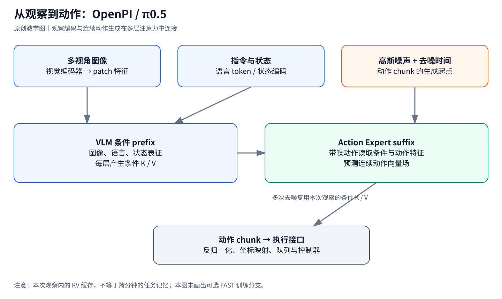
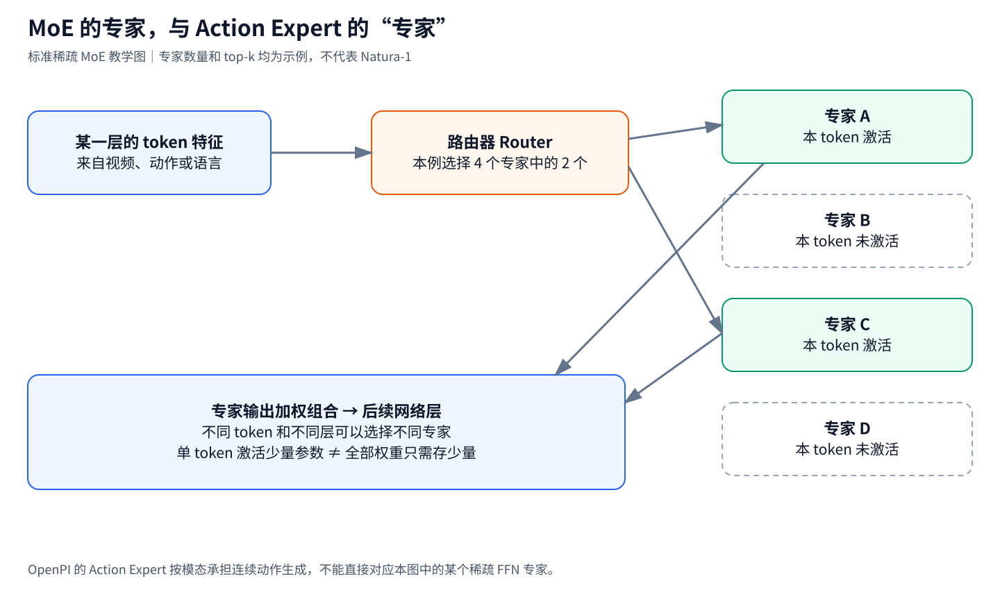
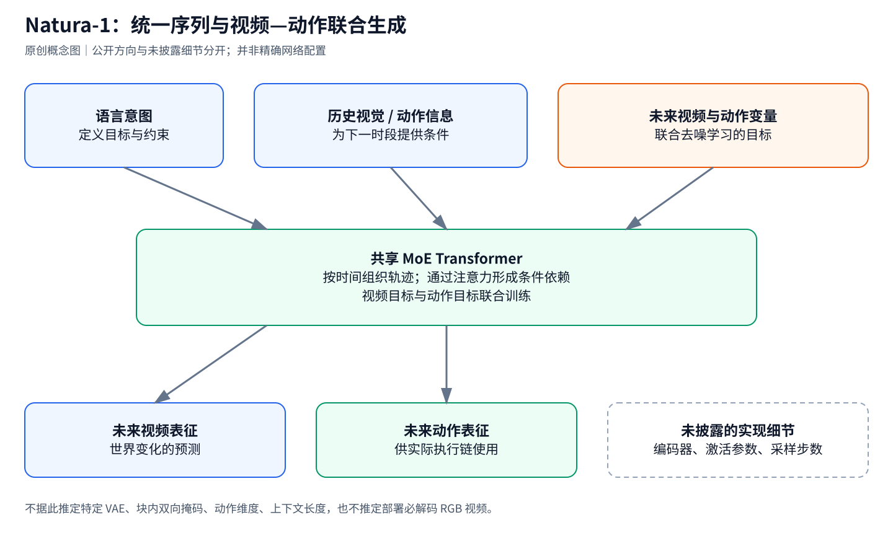
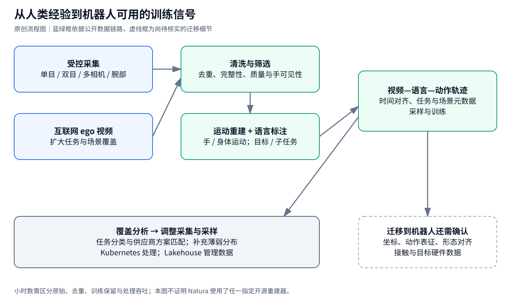
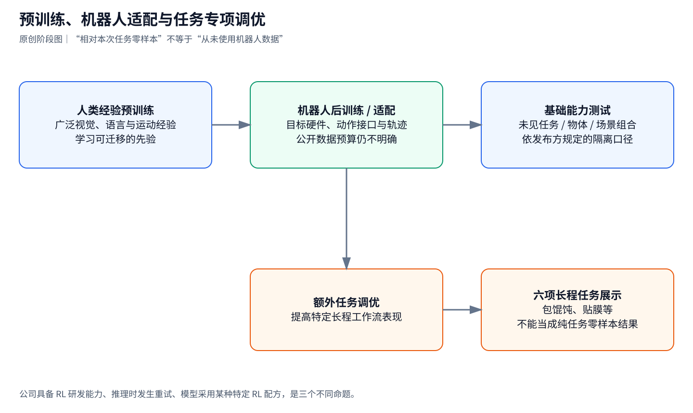

# Natura-1 架构、数据与行业对比调研报告

> 迁入快照：原调研截止2026-10-20；本轮只整理归档和引用，未重新验证技术结论。入口见[README.md](README.md)，来源与未随文保存的材料见[sources.md](sources.md)。

**面向读者：有 π0.5 / OpenPI 后训练经验，希望补齐架构、Action Expert、MoE 与人类数据预训练知识的机器人工程师。**

**资料检索：2026-10-19—2026-10-20；证据截止：2026-10-20。**

> 阅读约定：**官方披露**表示发布方公开描述，尚不等于独立复现；**代码可核对**表示能在公开实现中定位；**原理解释 / 本文推断**用于建立理解，不能当成 Natura-1 的未公开实现细节。本文没有把宣传视频当作独立真机测试，也没有运行 Natura-1 权重。
>
> xense-openpi 的比较对象是 [XenseRobotics-AI/xense-openpi 的公开仓库](https://github.com/XenseRobotics-AI/xense-openpi)，不是对你本机工作树、私有分支或实际训练配置的审计。网络缓存版本也可能不同步；复现实验时应另行固定 commit。

## 阅读导航

1. [先回答你的核心问题](#1-先回答你的核心问题)
2. [VLA、VLM、AE 到底是什么](#2-vlavlmae-到底是什么)
3. [从你熟悉的 OpenPI 把整个链路串起来](#3-从你熟悉的-openpi-把整个链路串起来)
4. [MoE 是什么，为什么不能和 Action Expert 混为一谈](#4-moe-是什么为什么不能和-action-expert-混为一谈)
5. [Natura-1 的公开架构与合理理解](#5-natura-1-的公开架构与合理理解)
6. [50B 怎么理解，VLA 与 AE 各有多大](#6-50b-怎么理解vla-与-ae-各有多大)
7. [百万小时数据从哪里来、怎样处理](#7-百万小时数据从哪里来怎样处理)
8. [预训练、机器人后训练与任务适配](#8-预训练机器人后训练与任务适配)
9. [截至调研日的行业对照](#9-截至调研日的行业对照)
10. [怎样阅读评测与 Scaling 证据](#10-怎样阅读评测与-scaling-证据)
11. [技术评价与行业讨论](#11-技术评价与行业讨论)
12. [对 xense-openpi 的具体启发](#12-对-xense-openpi-的具体启发)
13. [学习路径与待核实问题](#13-学习路径与待核实问题)
14. [来源索引](#14-来源索引)

## 1. 先回答你的核心问题

**Natura-1 最值得关注的，是把大规模人类操作经验、视频世界预测和动作生成放入一个可扩展的学习系统。仅凭“50B”“MoE”“零样本”三个词，还不足以判断它的机器人能力或部署成本。**

发布方在 **2026 年 10 月 13 日**公布 Natura-1，称其为 50B 参数 MoE 物理世界基础模型，以百万小时级第一视角人类数据预训练，再通过机器人数据适配，服务于双臂灵巧操作。发布时间以[发布方新闻稿](https://www.prnewswire.com/news-releases/physical-ai-lab-nature-will-unveils-natura-1-as-first-general-foundational-model-for-the-physical-world-302906608.html)为准；不要采用搜索结果中可能异常的日期字段。

| 你的问题 | 当前最可靠的回答 |
| --- | --- |
| Natura-1 是什么架构？ | 官方描述为一个统一的 MoE Transformer，联合学习语言、图像、视频与动作；完整轨迹按时间组织，视频和动作使用 flow matching 联合去噪。 |
| 是不是“一个 VLM 加一个 300M AE”？ | 目前没有证据支持这种拆法。不能照搬 π0.5 的模块边界。 |
| VLA 部分多少、AE 部分多少？ | **没有找到可核对的参数拆分。** 共享骨干也未必适合按功能拆成两个互不重叠的参数集合。 |
| 50B 是每次全算 50B 吗？ | MoE 通常按 token 稀疏激活；Natura-1 的专家数量、top-k 和激活参数量未见披露。 |
| 只有预训练吗？ | **不是。** 有机器人数据后训练；六项长程展示还使用额外调优。 |
| 百万小时来自机器人遥操吗？ | 主体是人类第一视角经验，受控采集为主、互联网 ego 视频为补充；不应等同于百万小时机器人遥操。 |
| “数百万小时”和“100 万小时”矛盾吗？ | 采访中的累计吞吐与最终训练语料是不同口径，见第 7 节。 |
| 能直接拿到模型在我们平台上微调吗？ | 截至本次检索，未找到能核对的官方权重、训练代码和完整模型卡。 |
| 能证明超过所有主流 VLA 吗？ | 不能。现有比较包含私有评测、硬件差异和训练配方差异。 |

架构、后训练及展示范围依据[官方技术博客](https://www.naturewill.com/blog/natura-1)。表中“未见披露 / 未找到”是本次公开检索的结果，不是对未公开系统的断言。

## 2. VLA、VLM、AE 到底是什么

### 2.1 VLA 是整个策略模型的类别

VLA = Vision–Language–Action。最常见的任务形式是：

$$
\pi_\theta(A_t\mid I_t,\ell,q_t)
$$

- $I_t$：一个或多个摄像头的图像，也可能包含历史视频。
- $\ell$：自然语言指令。
- $q_t$：机器人自身状态，例如关节位置、末端位姿、夹爪开合。
- $A_t=[a_t,\ldots,a_{t+H-1}]$：未来一段动作，即 action chunk。

“VLA”并没有规定必须用哪种语言模型、必须输出离散 token，或者必须只有当前一帧图像。它描述的是输入输出与能力组织方式，具体内部可以差别很大。

**因此，在 π0.5 的语境里，AE 是 VLA 的组成部分。把“VLA 参数”和“AE 参数”相加，可能已经把 AE 重复计算了一次。** 更适合问：视觉编码器多大？VLM 骨干多大？动作生成模块多大？共享多少参数？

### 2.2 VLM 提供什么，动作模块补什么

VLM = Vision–Language Model。它擅长把图像和文字联系起来：识别物体、理解颜色与关系、利用已有语义知识。机器人控制还需要连续数值输出、时间一致性、接触前后的修正，以及对特定机器人的动作接口建模。

理解“拿起杯子”与输出接下来 50 个控制时刻的手腕和手指目标，是不同的问题。后者不是给语言模型增加几个动作词就自动解决的。

经典 OpenVLA 展示了把动作离散化为 token 的路线；π0 则用连续生成方式建模动作分布。[OpenVLA 项目页](https://openvla.github.io/)、[π0 论文](https://arxiv.org/abs/2410.24164)

### 2.3 AE 有两个常见含义，必须先分清

| 缩写 | 全称 | 输入 → 输出 | 功能 |
| --- | --- | --- | --- |
| AE，在 π0 / π0.5 讨论里 | **Action Expert** | 条件特征 + 带噪动作 → 动作向量场 | 生成机器人动作 |
| AE，在视频生成 / 表征学习里 | **Autoencoder** | 图像或视频 ↔ 压缩 latent | 压缩与重建视觉信号 |
| VAE | Variational Autoencoder | 图像或视频 ↔ 概率 latent | 一种常见的视觉压缩器 |
| MoE 中的 expert | 专家网络 | 某层 token 特征 → 更新后的特征 | 扩大网络容量并控制计算量 |

后文提到 OpenPI 的 AE，默认指 **Action Expert**。谈到视频压缩器时，会直接写 Autoencoder / VAE。

一个视频模型完全可能同时包含视频 VAE、动作生成模块和 MoE 层。这三个部件解决的问题不同。**Natura-1 是否使用某个特定 VAE、大小多少、是否计入 50B，目前没有可核对的公开配置。**

## 3. 从你熟悉的 OpenPI 把整个链路串起来

*图 1：用于理解 π0.5 / OpenPI 的工程链路。图中的“每层交互”是注意力连接，不是把 VLM 最后一句话传给另一个独立控制模型。*

### 3.1 从一条 LeRobot 数据到训练输入

可以把你平时的后训练拆成四步：

1. **对齐数据语义。** 把数据集里的摄像头名、状态字段和动作字段映射到模型约定。
2. **对齐数值与坐标。** 处理绝对 / 相对动作、位置单位、旋转表示、左右手顺序和归一化统计。
3. **构造条件输入。** 图像变成视觉 token；指令变成语言 token；状态按照模型版本的方式编码。
4. **监督动作分布。** 从真值动作构造带噪样本，训练网络恢复生成动作所需的向量场。

这里的坐标和归一化并非外围细节。比如数据用世界坐标记录末端绝对位置，部署时却把网络输出当成工具坐标系位移，模型即便在训练分布上降低了 loss，机器人也不会得到正确命令。

你们公开仓库的重点是机器人平台适配、数据变换、训练配置和实际部署。它不是 Natura-1 的实现，也不是通过增加一个 YAML 开关就能切换为 MoE 世界模型的通用框架。[xense-openpi README](https://github.com/XenseRobotics-AI/xense-openpi)

### 3.2 视觉与语言如何进入骨干

公开实现中可以定位到：

| 代码入口 | 阅读时关注什么 |
| --- | --- |
| [pi0_config.py](https://github.com/XenseRobotics-AI/xense-openpi/blob/main/src/openpi/models/pi0_config.py) | 模型变体、动作维度、chunk 长度、π0.5 开关 |
| [pi0.py](https://github.com/XenseRobotics-AI/xense-openpi/blob/main/src/openpi/models/pi0.py) | prefix / suffix、损失与采样 |
| [gemma.py](https://github.com/XenseRobotics-AI/xense-openpi/blob/main/src/openpi/models/gemma.py) | 两组权重怎样在注意力层中连接 |
| [bi_flexiv_policy.py](https://github.com/XenseRobotics-AI/xense-openpi/blob/main/src/openpi/policies/bi_flexiv_policy.py) | 平台原始数据和模型接口之间的映射 |

图像先经过视觉编码器，得到多个 patch 特征。这些特征和语言 embedding 一起构成 **prefix**。π0.5 的状态进入离散 token 条件，动作则是另一组连续 embedding。

这里的 token 不一定是词表中的整数编号。**一段连续向量，只要以序列位置的形式交给 Transformer，也经常被称作 token。**

### 3.3 VLM 和 Action Expert 怎样连接

OpenPI 不是简单地做：

~~~text
VLM 读图 → 输出一句“抓杯子” → AE 把这句话变成动作
~~~

对动作生成路径，更接近下面的理解：

~~~text
每一层：
视觉 / 语言 / 状态 token ——使用骨干权重——生成条件 K、V
带噪动作 token          ——使用动作权重——生成动作 Q、K、V
动作 Q 读取条件 K、V，也读取动作部分 K、V
随后各自经过对应的输出投影与前馈网络
~~~

这是两组不同宽度的特征流通过注意力连接。共享的是可交互的注意力空间与序列关系，**不是两组网络所有权重都共享**。

公开 Gemma 配置里，骨干与动作专家都是 18 层；隐藏宽度分别为 2048 和 1024，前馈宽度分别为 16384 和 4096。文件对动作专家配置标注约 311M；这是配置量级说明，不是本文对某个完整 checkpoint 的逐项参数盘点。[gemma.py 配置与注意力实现](https://github.com/XenseRobotics-AI/xense-openpi/blob/main/src/openpi/models/gemma.py)

### 3.4 注意力“能看什么”决定信息怎样流动

对不包含 FAST 输出分支的简化动作生成路径，注意力可画成：

| Query \ Key | 图像 / 语言 / 状态 prefix | 带噪动作 suffix |
| --- | --- | --- |
| prefix | 可以看 | 不可以看 |
| suffix | 可以看 | 可以看 |

这意味着动作依赖观察，观察表征不依赖当前待生成的带噪动作。

**注意力屏蔽和停止梯度是两回事。** 前向传播中 prefix 不读取 suffix，并不意味着动作损失在反向传播时不能影响 prefix 的参数。只要 suffix 使用了 prefix 的 K/V，梯度就可能沿这条依赖关系返回。

这一点是理解 Knowledge Insulation 的关键。

### 3.5 Flow Matching 实际在学什么

下面使用与所查 OpenPI 采样路径一致的方向：$\tau=1$ 是噪声，$\tau=0$ 是数据。为避免混淆，用 $t$ 表示真实世界时间，用 $\tau$ 表示去噪时间。

给定真值动作 chunk $A$ 和高斯噪声 $\epsilon$：

$$
x_\tau=(1-\tau)A+\tau\epsilon,\qquad
u_\tau=\epsilon-A
$$

模型根据条件 $c$ 和带噪动作预测向量场：

$$
\mathcal L_{\mathrm{FM}}
=\mathbb E\big[\|v_\theta(x_\tau,\tau,c)-u_\tau\|^2\big]
$$

推理时先采样噪声，再沿向量场积分回数据端：

$$
x_{\tau-\Delta\tau}
\approx x_\tau-\Delta\tau\,v_\theta(x_\tau,\tau,c)
$$

由此可以理解四件事：

- 网络每次输出的是生成过程的**方向 / 向量场**，不是直接输出一个完整物理控制器。
- 一个动作 chunk 里的多个时刻可以共同去噪，不必逐个关节、逐个数值做语言式自回归。
- 训练时通常随机选一个噪声水平计算损失，推理时则可能多次调用网络。
- 去噪 10 步不等于让机器人执行 10 步。前者发生在模型生成过程中，后者发生在真实时间里。

公式是教学化表达，具体采样分布与参数方向以代码为准。[Flow Matching 原始论文](https://arxiv.org/abs/2210.02747)、[OpenPI 的损失与采样实现](https://raw.githubusercontent.com/XenseRobotics-AI/xense-openpi/main/src/openpi/models/pi0.py)

### 3.6 为什么小 AE 可以让推理更快

同一次观测对应的图像和指令，在多次去噪之间不变。因此可以先计算 prefix 的各层 K/V，再让动作专家重复读取这份缓存。

~~~text
一次观测：
视觉编码 + prefix 前向一次
        ↓
动作专家去噪若干次，复用 prefix K/V
        ↓
输出整个 action chunk
~~~

这减少了重复运行大骨干的成本，但没有消除第一次编码的成本，也没有消除动作专家本身的多步计算。

特别注意：**本次观测内复用 K/V，不等于模型拥有跨分钟的任务记忆。** 新观测改变后，缓存何时复用、如何更新，必须与模型的训练方式和时间编码相匹配。仅在服务器里保留一个对象，并不会自动得到长程记忆。

### 3.7 你做的“π0.5 后训练”与完整配方有何关系

需要区分三个层次：

| 层次 | 做了什么 |
| --- | --- |
| 原始 π0.5 论文配方 | 在异构机器人、语义与 web 任务上训练；离散动作预训练后加入连续动作专家，并保留多种监督 |
| 后来提出的 π0.5 + KI | 用离散动作 / VLM 监督训练骨干，同时阻断连续动作专家损失对骨干的梯度干扰 |
| 常见 OpenPI 任务微调 | 加载已有 checkpoint，用自己的机器人演示与动作损失继续训练 |

原始 π0.5 的高层子任务预测也是模型能力的一部分；普通任务微调脚本不一定启用完整的高层推理链。**某个 checkpoint 的预训练历史，和你当前训练脚本正在计算什么 loss，也必须分开。**

所查公开代码中，π0.5 开关直接关联状态编码与去噪时间注入方式；不能只看到这个开关就断言 FAST 辅助监督、混合 web 数据与 KI 的停止梯度都已启用。应检查实际损失函数、数据混合与冻结规则。[π0.5 论文](https://arxiv.org/abs/2504.16054)、[KI 官方说明](https://www.pi.website/research/knowledge_insulation)、[模型配置](https://raw.githubusercontent.com/XenseRobotics-AI/xense-openpi/main/src/openpi/models/pi0_config.py)

## 4. MoE 是什么，为什么不能和 Action Expert 混为一谈

*图 2：标准稀疏 MoE 的教学示例，不是 Natura-1 的专家数量或路由配置。*

### 4.1 最常见的结构：把某些 FFN 换成多组专家

普通 Transformer 中，每个 token 通常经过该层同一组前馈网络。稀疏 MoE 则准备多组专家，由路由器选择其中少量：

$$
y=\sum_{e\in \operatorname{TopK}(g(x))}w_e(x)E_e(x)
$$

其中 $g$ 是路由器，$E_e$ 是专家网络，$w_e$ 是组合权重。

“expert”通常是一层中的前馈子网络，而不是一整套完整机器人模型。输入的一段视频里，不同 token、不同层可以选择不同专家。专家的分工也不一定能被人类命名为“厨房专家”“左手专家”。[Switch Transformers 论文](https://arxiv.org/abs/2101.03961)

### 4.2 总参数与激活参数为什么不同

设共享参数为 $P_s$，所有专家合计为 $P_e$，每层共有 $N$ 个专家，每个 token 选 $k$ 个。教学近似为：

$$
P_{\mathrm{total}}\approx P_s+P_e
$$

$$
P_{\mathrm{active/token}}\approx P_s+\frac{k}{N}P_e
$$

**纯假设例子，不是 Natura-1 配置：**

共享 2B、专家合计 48B、16 选 2，则总参数是 50B，单 token 的近似激活量是 $2+48\times2/16=8$B。

不能把这个例子的 8B 写成 Natura-1 的激活参数。它只是说明：看到 50B，还不能知道每个 token 的计算量。

真实的先例是 Mixtral：发布方给出的口径为 46.7B 总参数、12.9B 每 token 使用参数。[Mistral 官方说明](https://mistral.ai/news/mixtral-of-experts/)

### 4.3 OpenPI 的 Expert 为什么不等于这种 MoE

| 维度 | OpenPI Action Expert | 典型稀疏 MoE |
| --- | --- | --- |
| 选择依据 | 模态 / token 类型预先确定 | 路由器依 token 表征选择 |
| 主要功能 | 为连续动作生成提供专门权重 | 增大模型容量，限制每 token 计算 |
| 专家数量 | 常见是一组动作专家，加 VLM 权重 | 同一层可能有很多专家 |
| 是否需要 top-k router | 不需要以此实现动作分支 | 通常需要 |
| 能否同时存在 | 可以 | 可以 |

π0 文献有时也用类似 mixture-of-experts 的语言描述模态专门权重。这里不能反过来否认这种术语来源。真正需要避免的是：把“按模态固定分工”和“动态稀疏路由”当成同一种工程结构。

### 4.4 MoE 的收益与代价

收益是以相对较小的单 token 计算扩大可存储的参数容量。代价包括路由与负载均衡、专家之间通信、不同 token 分配的不均衡，以及更大的总权重存储。

还要区分三种数量：

1. **单 token 激活的参数。**
2. **一整批 token 合起来触达的参数。**
3. **必须驻留或可及时调入显存的全部权重。**

一个视频请求有大量 token，不同 token 可以触达很多专家。不能用“只激活一小部分”直接推导“只要存一小部分模型”，也不能把激活参数量当成精确 FLOPs。

## 5. Natura-1 的公开架构与合理理解

*图 3：根据官方的统一序列、历史条件和视频—动作联合去噪描述重建的概念图。编码器、具体 token 数、块内注意力、输出维度与采样步数均未据此确认。*

### 5.1 可以确认到哪一层

官方架构说明的核心是：**统一 MoE 骨干、整条轨迹的序列建模、历史视频条件、未来视频与动作的联合 flow matching，以及让语言意图影响预测未来。** 这些是公开的设计方向；它们还不是一份足以复现模型的配置文件。[官方模型说明，第 4.3 节](https://www.naturewill.com/blog/natura-1)

官方原始架构可在[交互式模型图](https://www.naturewill.com/_releases/b45a07089dbe1f42ae5f8397aea3e0f54ded60c8c541e0c8fd62e5aff731ee5f/assets/natura-1/local/visualizations/natura-1-diagram-v4.html)查看。此链接包含发布版本路径，若失效，应从官方博客重新进入。

### 5.2 用概率建模理解它和常见动作策略的差异

下面是**教学抽象，不是官方精确公式**。

普通动作策略侧重：

$$
p_\theta(A_t\mid I_t,\ell,q_t)
$$

把视频预测纳入后，可以考虑：

$$
p_\theta(V_{\mathrm{future}},A_{\mathrm{future}}
\mid V_{\mathrm{past}},\ell,\text{其他条件})
$$

模型既要预测“接下来怎么动”，也要预测“世界接下来怎样变化”。“其他条件”在这里故意不写死，因为 Natura-1 的 proprioception、视角数量和动作表示未完整披露。

例如，同样看到桌上的杯子：

- “把杯子移到盘子左边”对应一个未来；
- “保持杯子不动，把盘子移走”对应另一个未来。

若模型只学高频动作先验，容易忽略文字；若语言确实改变了它对未来的预测，语义条件才真正参与了动作决策。

### 5.3 自回归和去噪为什么能同时存在

这两个词描述不同维度：

| 维度 | 解决的问题 |
| --- | --- |
| 真实时间上的因果 / 自回归 | 下一段只能依赖已经发生的历史 |
| 单个未来块内部的 flow / diffusion | 从带噪连续变量生成这一块内容 |

一个系统可以按时间逐块前进，每一块内再联合生成多个视频 / 动作 token。**因此，“自回归”不等于一定像 LLM 那样逐个输出离散动作数字。**

但也不能把这种一般可能性写成 Natura-1 的精确掩码：视频 token 与动作 token 在同一时刻能否完全互看、噪声水平是否独立、块大小多大，目前仍不清楚。关于因果序列与去噪结合的基础例子，可读 [Diffusion Forcing](https://arxiv.org/abs/2407.01392)；这不是说 Natura-1 已确认采用该论文的完整方法。

### 5.4 “视频和动作是同一状态”应怎样理解

这是一种有用的表征观点：同一次物理交互，可以通过视觉变化和运动轨迹共同描述。

从严格物理建模看，**动作还会改变后续状态**；图像与动作之间存在时间对齐问题。不能据一句概念描述就认定所有动作都与同索引视频帧同步，也不能断言模型已经学习到完整因果动力学。

它同样不自动意味着以下工程流程：

~~~text
先生成一段 RGB 视频
→ 再识别生成视频中的手
→ 再反求机器人动作
~~~

联合生成可以发生在共享 latent / token 空间。训练包含视频损失，也不必然要求部署时每次把预测 latent 解码成可观看的视频。**Natura-1 的实际推理路径是否解码视频，未见明确公开说明。**

### 5.5 整轨迹训练为什么可能提高学习效率

窗口训练从轨迹中采样局部片段，容易重复编码重叠的视觉条件。序列训练可以在一次前向中监督多个时刻，并显式学习历史如何影响未来。

但这不是“序列越长越便宜”。考虑一个完全假设的量级：

$$
60\ \mathrm{s}\times5\ \mathrm{frames/s}\times256\ \mathrm{tokens/frame}
=76{,}800\ \mathrm{tokens}
$$

这还只是单视角、未计动作与文字。多视角、长历史以及注意力开销，都会要求视觉压缩、时间采样、缓存或稀疏 / 分块注意力等设计。

**上述数字用于说明工程压力，不是 Natura-1 的帧率、token 数或上下文长度。** 官方所说“完整 episode”也不能被解读成任意长的原始视频都不经处理直接放进上下文。

### 5.6 统一骨干有没有彻底消灭模块

没有。即使核心 Transformer 统一，原始文字、像素、关节数值仍需要输入表示和输出映射；机器人还需要把模型输出变成硬件可接受的命令。

统一学习目标、统一主干、统一推理接口、是否存在独立低层控制器，是四个不同问题。媒体关于“没有主从模态”“第三条路线”的说法，可视为团队的设计立场；目前不足以据此重建全部编码器、解码器和控制系统。

## 6. 50B 怎么理解，VLA 与 AE 各有多大

### 6.1 能回答与不能回答的数字

| 项目 | π0 / π0.5 常见公开口径 | Natura-1 当前公开信息 |
| --- | --- | --- |
| 整体策略 | 约 3.3B 量级 | 名义规模 50B MoE |
| VLM 部分 | 约 3B，包含视觉与语言相关权重 | 无对应的可核对拆分 |
| Action Expert | 约 300M 量级 | 是否有可单独计数的同类模块，未披露 |
| 视频 Autoencoder / VAE | 标准 OpenPI 动作路径不依赖一个未来视频生成器 | 型号、大小、是否计入 50B，未披露 |
| 每 token 激活参数 | 与具体计算路径有关 | 未披露 |
| 专家数、top-k、层数、隐藏维度 | OpenPI 配置与代码可查 | 未见完整配置 |
| 精确 checkpoint 参数盘点 | 需要按实际参数树统计 | 缺少公开 checkpoint，无法统计 |

π0 论文给出了约 3B VLM 加 300M 动作专家、合计约 3.3B 的说明；π0.5 沿用相近的模块量级。[π0 原始论文](https://www.pi.website/download/pi0.pdf)、[π0.5 官方介绍](https://www.pi.website/blog/pi05)

**“gemma_2b”是语言侧配置名，不是整个 VLA 的总参数。** 视觉模型、词嵌入、动作专家和各种投影不能因为配置名而消失。反过来，也不要把 PaliGemma 已包含的视觉部分重复加一次。

Natura-1 的“50B Transformer”与包含所有外围编码器后的完整系统是否严格同一统计边界，也没有找到参数清单来核对。因此不应给出“其中视觉 X B、语言 Y B、AE Z B”这样的猜测数字。

### 6.2 为什么会做这么大

可以提出三类合理动机，**它们是架构与任务规模的解释，不是 Natura-1 的参数消融结论**。

**第一，学习目标更广。** 一个模型若同时处理语义、场景、历史、未来视频和动作，要容纳的经验分布比某个固定场景里的单任务策略广得多。

**第二，训练数据更大、更杂。** 更多物体、工具、场景与操作方式，可能要求更大的模型容量，才能把新增经验转化为可迁移的知识，而不是很快饱和。

**第三，MoE 提供了不同的容量—计算折中。** 总参数增加不一定要求每个 token 等比例增加计算，但系统实现和显存占用仍会变复杂。

36氪采访提到：团队在较小数据规模下观察到 5B 与 50B 表现接近，扩大数据后才看到较大模型的价值。**这属于采访中的团队陈述，缺少完整公开的等算力参数消融，不能视为已证实“50B 是最优规模”。** [36氪采访，搜狐转载](https://m.sohu.com/a/1087266171_114778)

### 6.3 不是因为“手有 20 个关节，所以需要 50B”

自由度增加会让控制问题更复杂，但输入输出向量的维度，不是参数规模的直接比例尺。

做一个可手算的例子：若动作输入和输出都通过 1024 维线性投影，动作维度从 32 增至 64，两层投影增加：

$$
(64-32)\times1024\times2=65{,}536
$$

个权重，远远不是几十 B。

真正难的是高维动作之间的协调、多种可行抓法、接触约束、视角遮挡与长程误差。扩大模型可能帮助学习这些分布，但“关节多 → 输出层大 → 模型必然 50B”这条推理不成立。

### 6.4 50B 对显存和成本意味着什么

以下只算权重的理论体积，不包含缓存、激活、量化元数据和外围模块：

| 假设权重存储精度 | 50B 权重理论体积，十进制 GB |
| --- | ---: |
| BF16 / FP16，2 bytes | 100 GB |
| INT8，1 byte | 50 GB |
| 4-bit，0.5 byte | 25 GB |

这些是算术估算，**不是 Natura-1 已发布的量化版本或部署配置**。不能据 4-bit 一行断言它能在 24GB 显卡上满足 100ms 延迟。

全参数 Adam 类训练还需要梯度、优化器状态，有时需要 FP32 主副本。假设总计 16 bytes/parameter，仅模型相关状态就约 800GB，尚未计激活。分片与精度策略会改变每卡占用，但不会使这些状态凭空消失。

更适合索取的部署指标是：激活参数量、每请求 token 数、去噪步数、显卡型号与数量、精度、并发数和 P50 / P95 / P99 延迟。

## 7. 百万小时数据从哪里来、怎样处理

*图 4：实线部分依据官方公开数据系统，虚线框列出迁移到机器人时通常还需解决、但 Natura-1 未完整披露的细节。*

### 7.1 先统一统计口径

| 口径 | 含义 | 本次能核对到的信息 |
| --- | --- | --- |
| 原始 / 累计处理数据 | 接入、过滤、可能反复处理的材料 | 采访提到背后吞吐数百万小时 |
| 整理后用于训练的语料 | 经筛选并形成训练信号的经验 | 官方写约 100 万小时级 |
| 处理吞吐 | 管线单位时间处理多少材料 | 官方数据图写 35 万小时 / 周 |
| 机器人适配数据 | 将人类预训练能力迁移到硬件 | 只给了有限量的定性描述，未见具体小时数 |

因此，“处理过数百万小时”不等于“最终训练用了数百万小时独立去重轨迹”；“每周处理 35 万小时”也不等于“每周新采到并保留 35 万小时”。

[晚点采访，新浪转载](https://finance.sina.cn/stock/jdts/2026-10-13/detail-inivawmy0524857.d.html)、[官方数据系统图](https://www.naturewill.com/_releases/b45a07089dbe1f42ae5f8397aea3e0f54ded60c8c541e0c8fd62e5aff731ee5f/assets/natura-1/local/visualizations/natura-data-bench.html)

### 7.2 是自己采的，还是网上下载的

官方给出的组合是：**受控采集为主，互联网第一视角视频补充**；采集视角包括单目、双目、多相机与腕部视角。其公开语料统计为 61,702,471 个 episode、317,842 个 task、14,286 个 scene。[官方数据说明](https://www.naturewill.com/blog/natura-1)

应把“受控采集”理解为对采集任务、覆盖范围和质量提出要求，不能自动等同于所有数据都由公司员工亲自拍摄。官方数据图中也明确出现 vendor proposals，即供应商提交方案与任务分类的匹配。

36氪采访以固定在人头部的手机解释低门槛采集方式。它说明这条路线为什么有机会扩展，**不证明全部数据使用相同手机、相同设备或同一传感器组合**。[36氪采访](https://m.sohu.com/a/1087266171_114778)

### 7.3 “百万小时”是否在数量级上可行

以下是本文的核算，不是实际采集团队人数：

$$
1{,}000{,}000/(270\ \mathrm{days}\times6\ \mathrm{hours/day})
\approx617\ \mathrm{people}
$$

如果按 270 天、每天每人 6 小时有效材料计算，约 617 人的持续采集就达到百万小时数量级。考虑过滤损失、闲置、重复与任务准备，实际投入还会变化。

所以百万小时不必依赖百万台机器人。真正困难的是：能否获得足够多的**有效且多样的操作经验**，以及能否把材料加工成可靠监督。

再做一个 sanity check：若 100 万小时与 61,702,471 个 episode 完全采用同一口径，平均 episode 约 58.3 秒。这是方便理解切片尺度的算术结果，不能据此认定模型上下文长度就是 58 秒。

还需要追问：小时数按自然时间还是多相机时长累计？episode 是否重叠切片？task 是标准任务类还是细粒度描述？这些定义会显著影响跨数据集比较。

### 7.4 官方公开的加工主链路

根据官方独立数据系统图，可整理为：

1. **组织采集覆盖。** 建立任务分类，把供应商方案与已有覆盖匹配，优先补缺口。
2. **接入与片段筛选。** 汇入受控采集和互联网 ego 视频，检查质量与手部可见性。
3. **清洗。** 去重并验证记录。
4. **运动重建。** 恢复稠密手部与身体运动。
5. **语言标注。** 给出任务目标、子任务与动作层级描述。
6. **形成轨迹。** 将语言、视频、动作信号对齐。
7. **分布反馈。** 根据覆盖情况调整训练采样与后续采集。
8. **基础设施。** Kubernetes 调度并行任务，Lakehouse 管理视频、传感器与中间结果。

[官方数据系统图](https://www.naturewill.com/_releases/b45a07089dbe1f42ae5f8397aea3e0f54ded60c8c541e0c8fd62e5aff731ee5f/assets/natura-1/local/visualizations/natura-data-bench.html)

采访还提到 20 多个过滤算子，以及 CPU 解码、GPU 位姿提取和通信带来的不同资源需求。这帮助解释为什么“有视频”与“可稳定训练”之间隔着一套完整工程系统。[晚点采访](https://finance.sina.cn/stock/jdts/2026-10-13/detail-inivawmy0524857.d.html)

### 7.5 视频为什么能变成动作监督

**下面解释通用方法，不声称是 Natura-1 的逐项内部实现。**

机器人数据通常直接有状态与控制命令。普通人类视频没有电机命令，必须从可见运动中恢复或估计代理标签：

~~~text
像素中的手
→ 2D 关键点 / 手部区域
→ 3D 手部姿态或网格
→ 与相机、身体或世界坐标的关系
→ 时间对齐与轨迹表示
→ 用于学习的“动作”或运动目标
~~~

HaMeR 是从单目图像恢复三维手部的一项公开基础工作；它说明“从普通视频获得结构化手部信息”有成熟研究基础，**并不说明 Natura-1 使用了 HaMeR**。[HaMeR 论文](https://arxiv.org/abs/2312.05251)

必须进一步解决：

| 问题 | 为什么对机器人重要 |
| --- | --- |
| 相机运动 | 人转头时，图像中的手在动，不一定是手相对世界在动 |
| 尺度 | 单目三维恢复可能有尺度不确定性，厘米误差对接触很关键 |
| 遮挡 | 抓住物体后，最重要的指尖往往最难看见 |
| 时间连续性 | 逐帧误差会造成轨迹抖动，速度与接触时机受到影响 |
| 坐标约定 | 相机系、手腕系、世界系的动作不能随意混用 |
| 标签置信度 | 被遮挡的位置应如何加权、插值或剔除，需要明确策略 |

官方声称运动标注在内部动作捕捉基准上相对开源方法降低 41% 的 MPJPE。这只能说明其自报的几何重建指标改善；缺少绝对毫米值、具体基线、对齐方式和测试集构成，不能换算成操作成功率。[官方运动重建说明](https://www.naturewill.com/blog/natura-1)

一般 MPJPE 可理解为：

$$
\operatorname{MPJPE}=\frac1{NJ}\sum_{n,j}
\|\hat p_{n,j}-p_{n,j}\|_2
$$

评价时还应问：有没有去掉全局旋转 / 平移或尺度？如果某种评价做了对齐，它可能不能反映机器人最在意的绝对手腕定位误差。本文没有据此断言该公司使用了哪种对齐方式。

### 7.6 人手轨迹为什么不能直接作为机器人关节命令

人手与机器人手在骨长、关节轴、活动范围、驱动耦合、摩擦、力量与可达性上不同。人体手腕轨迹也不必然处在机器人的工作空间内。

常见映射目标包括：

- 尽量保持指尖相对位置或关键向量；
- 尽量保持抓握形态；
- 满足机器人关节限制；
- 进一步考虑碰撞、接触或任务结果。

公开的 [dex-retargeting](https://github.com/dexsuite/dex-retargeting)提供了人手到机器人关节映射的实例。但**Natura-1 是否使用离线 retargeting、共享手部表征、可学习适配器或这些方法的组合，仍不能确定**。

运动学上相似，也不保证动力学上成功。人手能稳定夹住薄纸的姿态，换到不同摩擦材料的机器人手上，可能滑脱，也可能压坏物体。

### 7.7 普通视频缺少哪些监督

从视频较容易得到“可见位置怎样变化”。较难可靠得到：

- 实际接触力、扭矩、摩擦系数；
- 遮挡处的接触状态与是否滑移；
- 机器人执行命令与实际状态之间的滞后；
- 同一视觉结果背后不同的控制策略。

因此，人类视频预训练的价值通常是扩大语义、物理变化和操作方式的覆盖。**要变成真实机器人控制，仍需跨形态对齐与实际硬件经验。**

这也是为什么“人类视频非常便宜”不能单独推出“机器人数据已经不需要了”。

### 7.8 语言标注为什么不只是把任务名称写上去

“收拾桌子”可以作为总体目标，但它没有说明：

~~~text
先扶住容器
→ 再拉开抽屉
→ 把物体放入
→ 松手
→ 推回抽屉
~~~

层级标注把意图与阶段性的视觉变化联系起来。它还允许在同一个视觉场景下构造不同的目标条件，减少模型只依据场景猜动作的倾向。

不过，标注错误同样会被规模化：把左手写成右手、把放入写成拿出，都会形成错误监督。一个工程上有价值的指标，是每种语言错误怎样影响训练，而不只是 caption 总量。

**数据管线里的 agentic annotation，不等于 Natura-1 的 Agentic 推理模式，也不等于强化学习。** 同一个词出现在不同层次，必须按功能区分。

### 7.9 哪些公开数据值得用来理解这条路线

| 数据 / 项目 | 已公开的代表性规模或特点 | 与本报告的关系 |
| --- | --- | --- |
| [Ego4D](https://ego4d-data.org/) | 3,670 小时、多地区第一视角日常活动 | 理解 ego 视频的广度；并非都自带控制标签 |
| [EgoDex](https://github.com/apple-aiml-research/ml-egodex) | 829 小时、194 类桌面任务，视频配手 / 身体姿态与语言 | 适合学习“视频 + 运动标签”的数据结构 |
| [EgoMimic](https://egomimic.github.io/) | 人类与机器人经验联合学习 | 理解人到机器人的对齐问题 |
| [UMI](https://umi-gripper.github.io/) | 手持夹爪与可迁移数据采集接口 | 与裸手 ego 不同，有意缩小动作接口差异 |
| [EgoScale](https://research.nvidia.com/labs/gear/egoscale/) | 20k+ 小时动作标注人类视频及灵巧操作迁移研究 | 是 Natura-1 很相关的研究背景 |

**这些是学习与对照材料，不是已确认的 Natura-1 训练数据清单。** 不能因为项目公开就认定 Natura-1 用过它。小时、episode、任务种类和标签精度也不能直接互换。

EgoDex 公开样例尤其值得阅读：它保存相机内参、世界系变换、手部姿态与置信度；同时提示自动语言标注可能有误。这能把“视频如何成为动作数据”从抽象概念变成具体文件结构。数据与代码的许可应分别按其官方说明理解。[EgoDex 数据结构](https://github.com/apple-aiml-research/ml-egodex)

## 8. 预训练、机器人后训练与任务适配

*图 5：不要把“未针对本次测试任务专项调优”误读为“从未使用过机器人数据”。*

### 8.1 最清楚的三层理解

| 层次 | 数据和目标 | 不能混淆的边界 |
| --- | --- | --- |
| 人类经验预训练 | 从广泛人类操作中学习条件表征、视频变化和运动规律 | 不是直接得到某台机器人的所有控制细节 |
| 机器人后训练 / 适配 | 用真实机器人轨迹，把能力落到目标硬件与动作接口 | “数据有限”目前没有具体预算可供核对 |
| 任务专项调优 | 进一步提高特定工作流的执行表现 | 不能再把这些任务当成严格的零样本任务证据 |

官方明确区分了基础能力与六项额外调优的长程展示；其中包括包馄饨、打包快递、泡茶、书法、贴膜和制作酸奶碗。[官方展示及脚注](https://www.naturewill.com/blog/natura-1)

*图 6：Nature Will 官方展示封面，网络引用，版权归原作者。对应长程任务有额外调优；封面与单段演示不提供完整测试成功率。*

*图 7：Nature Will 官方展示封面，网络引用，版权归原作者。图示任务不能据“零样本”总标题而忽略专项调优脚注。*

### 8.2 Zero-shot 到底相对于什么

| 说法 | 严格含义 |
| --- | --- |
| 新场景零样本 | 已有任务能力，不用新场景的数据适配 |
| 新物体零样本 | 对未在指定训练阶段出现的物体迁移 |
| 新指令 / 组合零样本 | 已有技能在新的语言约束或组合下执行 |
| 新动作零样本 | 某种运动或操作模式没有出现在指定训练集合 |
| 新本体零样本 | 不用目标机器人数据即可直接控制它，要求更强 |
| One-shot in-context | 通过上下文示例适应，没有梯度更新，但使用了示例 |

Natura-1 的公开零样本叙述重点在机器人后训练集合之外的任务、物体、场景与组合。**不应扩大为“这些经验在人类预训练中也绝对不存在”，更不应扩大为“不需要机器人适配”。**

在闭源训练集条件下，我们只能核对发布方怎样定义和展示隔离，不能独立搜索全部百万小时语料。

### 8.3 预训练是不是完全从随机初始化开始

目前不能确定全部模块的初始化方式。

“从头写了训练推理框架”和“模型所有权重从零训练”是两件事。一个自研系统仍可能初始化自已有视觉模型、语言模型或视频编码器；一个统一 Transformer 也仍可能使用外部 tokenization 模块。

本文没有找到足够公开信息，能够把 Natura-1 定义为“完全随机初始化全栈训练”或“以某个已知 VLM / 视频模型为底座”。

### 8.4 有没有强化学习

可以确认公司公开介绍涵盖强化学习研发，采访也讨论过相关能力。**但 Natura-1 本次版本到底使用了什么 RL 算法、奖励、在线数据和训练预算，未见可复现配方。**

应当分开：

- 演示数据上的监督微调；
- 自主采集轨迹后再做监督训练；
- 基于成功 / 失败反馈的强化学习；
- 推理阶段的重试或规划。

机器人失败后重试，不足以证明它正在做 RL；部署时没有更新参数的闭环纠错，也不等于训练时采用了强化学习。

## 9. 截至调研日的行业对照

这里比较代表性路线，**不是跨私有 benchmark 拼出来的排名**。也不能把“当前行业”停留在 2025 年的 π0.5。

| 路线 / 代表项目 | 核心组织方式 | 与 Natura-1 的联系与区别 |
| --- | --- | --- |
| [OpenVLA](https://openvla.github.io/) | VLM 输出离散动作 token | 有助理解早期端到端 VLA；动作表示和训练目标不同 |
| [π0 / π0.5](https://www.pi.website/blog/pi05) | VLM 与连续动作专家连接；可结合离散训练监督 | xense-openpi 最直接的模型基础；不能按名称把 AE 映射为 Natura 的一个 MoE 专家 |
| [GR00T N1.6](https://research.nvidia.com/labs/gear/gr00t-n1_6/) | Cosmos VLM 与动作 DiT 等模块；面向多机器人适配 | 代表可核对模块边界的动作生成路线，不能笼统称“旧模型没有动作建模” |
| [Gemini Robotics 1.5](https://deepmind.google/blog/gemini-robotics-15-brings-ai-agents-into-the-physical-world/) | 机器人 VLA 与高层 embodied reasoning 模型协作 | 强调高层推理与动作执行协作；未公开的参数不应自行填写 |
| [DreamZero](https://dreamzero0.github.io/) | 视频扩散骨干，联合未来视频与动作，14B 量级 | 很直接的 WAM 参照，说明视频—动作联合建模不是 Natura 独有 |
| [FLUX 3 Action](https://bfl.ai/models/flux-3-action) | 7B 开放权重 WAM，未来视频与动作共同去噪 | 适合观察公开实现与部署合同；“开放权重”仍需按具体许可理解 |
| [EgoScale](https://research.nvidia.com/labs/gear/egoscale/) | 20k+ 小时动作标注人类数据；VLM 与动作专家及跨形态对齐 | 是大规模人类经验向灵巧操作迁移的重要研究参照 |
| [DYNA-2](https://www.dyna.co/dyna-2) | 百万小时级人类 ego 预训练的 WAM，讨论跨形态 Scaling | Natura 之前已有百万小时人类视频路线，不能称 Natura 首创这个数量级 |
| [DYNA-2.1](https://www.dyna.co/dyna-2.1) | 物理 agent、可教性、编排与长程工作流 | 2026 年 9 月 29 日发布；反映模型之外的系统能力同样重要 |
| [GEN-1 / GEN-1.5](https://generalistai.com/blog/gen-1.5) | 大规模物理经验预训练；GEN-1.5 展示示例上下文适应 | one-shot 示例适应与纯语言 zero-shot 是不同评测条件 |
| [Helix 02 / 2.5](https://www.figure.ai/news/helix-2-5-zero-shot-30-home-generalization) | 全身控制与人类经验预训练；2.5 测试陌生家庭迁移 | 评价范围包含行走与全身协调，不能直接与桌面灵巧手分数比较 |
| Natura-1 | 公开描述为统一 MoE 序列模型 | 特点是模型容量、整轨迹学习、数据管线与灵巧操作的组合；实现细节仍有限 |

### 9.1 与这些工作比较时，至少分三个轴

**模型结构轴：** 固定模态专家还是动态 MoE？单一主干还是多模型协作？有没有明确的视觉与动作编码器？

**学习目标轴：** 只学动作，还是同时学未来视觉？是否保留语言 / VQA / 子任务监督？有没有价值、奖励或成功预测？

**数据轴：** 机器人遥操、手持设备、人类裸手视频、仿真、互联网图文，各自占比多少？监督是直接传感得到还是模型重建？

它们可以自由组合。MoE 不必然有世界模型；世界模型不必然用 MoE；VLA 也可以包含历史、未来预测和层次推理。

### 9.2 几个值得单独记住的行业进展

- **π 系列并未停在 π0.5。** π0.7 的官方介绍讨论多种条件提示与不同数据来源的整合；MEM 则把短期视觉历史和长期语言记忆结合起来。[π0.7](https://www.pi.website/blog/pi07)、[MEM](https://www.pi.website/research/memory)
- **人类数据已经形成多种采集范式。** Generalist 描述的人类物理经验并不全等于裸手手机视频；GEN-1.5 的上下文 physical prompts 可以来自手持夹爪传感器轨迹。[GEN-1.5](https://generalistai.com/blog/gen-1.5)
- **“新环境零样本”并不排斥任务训练。** Helix 2.5 的官方说明明确区分先用任务数据指定行为，再到未见家庭评测。它的 30 家庭测试不能简化为“从未训练这些任务”。[Helix 2.5 评测定义](https://www.figure.ai/news/helix-2-5-zero-shot-30-home-generalization)

### 9.3 “VLA 以语言为主，WAM 以视频为主，Natura 是第三条路”怎么评价

这可以帮助理解团队想强调的区别，但还不是严格、互斥的学术分类。

若按输入输出定义，一个把视觉和语言变成动作的模型，仍可在广义上称 VLA；若它同时学习未来世界变化，也有 WAM 特征。更有信息量的判断是：**哪些参数共享、哪些目标联合训练、注意力怎样限制、哪些梯度连通、如何部署**。

在没有公开配置与消融前，不能从“第三条路”的名字推出它必然更通用、更容易扩展或优于其他路线。

## 10. 怎样阅读评测与 Scaling 证据

### 10.1 官方分数是什么，为什么不能直接排行业名次

官方报告的结果为：

| 模型 / 版本 | 给出数值结果的硬件 | 报告分数 |
| --- | --- | ---: |
| Natura-1 Base | ROKAE AR5 双臂 + Wuji 灵巧手 | 53.4 |
| Natura-1 Agentic | 同类灵巧手平台 | 59.1 |
| π0.5 | ARX AC One 双臂夹爪 | 13.5 |
| GPT-6-Astra，coding-based policy | ARX AC One 双臂夹爪 | 16.7 |

官方还说明，两项基线在其灵巧手平台上没有得到可计分结果：π0.5 经过该平台数据微调仍未成功，另一基线受到单任务时间限制。**这是发布方特定设置下的结果，不是本文真机复测。** [官方 benchmark 说明](https://www.naturewill.com/blog/natura-1)

本文把上表保留为“报告分数”。没有完整公开的任务数、试验数与聚合规则，不能自行把它定义成“随机现实任务的总体成功概率”。

### 10.2 硬件差异为什么会影响结论

夹爪和灵巧手能完成的物理操作集合不同。原地旋转物体、掌心承托软物体、多指协调等任务，本体就会显著影响成绩。

因此这组结果同时包含：

$$
\text{骨干与训练}
+\text{动作表示}
+\text{适配效果}
+\text{末端硬件}
+\text{控制与运行系统}
$$

它可以说明“该整套系统在所测任务上的表现”，不能单独识别“MoE 架构比另一骨干优越多少”。

同样，π0.5 在这套灵巧手适配中失败，也不能证明所有基于 π0.5 的高自由度策略都不可能成功。数据量、动作投影、状态表示、训练预算与调参过程都可能影响迁移。

### 10.3 π0.5 不是截至 2026 年 10 月的全部行业前沿

使用公开可测模型作为基线有现实理由，闭源模型往往无法复测。问题是结论边界：

- 可以比较公开实现与特定系统的结果。
- 不宜据此声称超过所有闭源前沿。
- 不能忽略基线发布时间、平台适配程度和任务覆盖的差异。

晚点采访也提醒，这组结果更适合展示特长，而非理解成一次完整行业排名。[晚点采访](https://finance.sina.cn/stock/jdts/2026-10-13/detail-inivawmy0524857.d.html)

### 10.4 Base 和 Agentic 增益是否证明某个模块有效

目前不宜这样解释。需要知道 Agentic 是否增加了：

- 额外模型或规划器；
- 更长历史、提示或外部记忆；
- 候选动作搜索；
- 失败检测与重试；
- 不同时间预算；
- 不同模型权重。

这些因素可以显著改变任务完成率，也可能增加完成时间。**目前没有找到足以精确复现该差异的公开方案，不能自行把 59.1−53.4 归因于某个确定的“记忆模块”。**

### 10.5 动作预测误差下降，究竟说明什么

官方独立 Scaling 图给出的首尾数值，按页面显示精度整理如下：

| 验证数据 | 指标 | 起点 | 终点 |
| --- | --- | ---: | ---: |
| 人类验证集 | Action MSE | 0.0320 | 0.0168 |
| 人类验证集 | Action MAE | 0.0916 | 0.0574 |
| 机器人验证集 | Action MSE | 0.0272 | 0.0088 |
| 机器人验证集 | Action MAE | 0.1034 | 0.0525 |

图中共有 8 个 checkpoint；机器人 MSE 拟合约为：

$$
L(D)=1.7193D^{-0.3893},\qquad R^2_{\log}=0.948
$$

这里 $D$ 的单位为小时。数值是发布方数据；表格是本文整理，并非独立训练结果。[官方 Scaling 图及数值](https://www.naturewill.com/_releases/b45a07089dbe1f42ae5f8397aea3e0f54ded60c8c541e0c8fd62e5aff731ee5f/assets/natura-1/local/visualizations/scaling-embed.html)

这是有价值的迁移信号：人类经验训练的变化，可以在未用于该项评估再训练的机器人数据上体现为更低预测误差。**它仍然不是“机器人任务成功率提升 67.7%”。**

### 10.6 Teacher forcing 为什么比闭环执行容易

Teacher forcing 评价中，模型使用记录数据中的真实历史，预测接下来的动作。闭环执行中，模型改变了世界，下一个观察可能已偏离演示轨迹。

~~~text
离线预测：
真实历史 → 预测动作 → 与记录动作比较

真机闭环：
真实观察 → 模型动作 → 世界改变 → 新观察 → 再次动作
~~~

一个典型例子：

1. 演示里手指已准确碰到杯沿。
2. 模型预测的动作与真值只差几毫米，MSE 很小。
3. 真机却因此没抓住杯子。
4. 下一步进入演示中不常见的“空手继续搬运”状态。

此外，动作可能有多个正确模式。若从左或从右抓都可以，单纯平均两个模式未必是可执行的抓法。因此，动作误差是诊断指标，不能单独替代闭环成功、恢复能力和接触表现。

### 10.7 Scaling 图还不能回答哪些因果问题

**这些是本文对实验设计的分析：**

- 横轴“训练小时”究竟是独立数据集大小，还是训练中累计见过的材料？
- 不同点是否来自独立完成训练的模型，还是同一过程中的 checkpoint？
- 模型大小、优化步数、数据质量与混合比例是否固定？
- 数据增加时，计算预算是否也一起增加？
- 幂律拟合有没有不可约误差项，能否外推到更大数量级？

要区分数据收益与额外训练计算，通常需要多组独立训练，明确控制变量，或者建立数据、参数与计算联合关系。**拟合曲线平滑不是这些实验的替代品。**

本文没有根据外部文章的猜测，把 Natura-1 的曲线确定描述为某一种未披露的实验方案。

### 10.8 演示与统计评测各自能证明什么

| 证据 | 擅长证明 | 不能单独证明 |
| --- | --- | --- |
| 单个复杂演示 | 系统确实具备某种能力的可能性 | 该任务稳定成功率 |
| 连续长视频 | 减少剪辑疑虑，展示交互连续性 | 全部尝试都成功、没有选择偏差 |
| 系统化闭环测试 | 在规定分布和规则下的表现 | 对所有现实任务都泛化 |
| 同预算消融 | 某项训练 / 架构选择的增益 | 未测条件下仍同样有效 |
| 独立复现 | 公开结论的可重复性 | 原系统所有未公开能力 |

因此，约 30 分钟一镜到底的交互视频值得看，但仍应同时索取失败样本、总尝试数、重置方式和测试规则。本文没有直接审阅并审计完整视频时间线，视频能力描述主要依据发布文本。

### 10.9 100ms、98% 利用率和 MFU 应怎样看

官方基础设施图明确提出端到端 100ms 预算，展示 Rust 编排、GPU 常驻缓存、CUDA Graph 和 TP / CP / EP 等执行组织，并报告 50%+ MFU 与 98% GPU utilization。[官方基础设施图](https://www.naturewill.com/_releases/b45a07089dbe1f42ae5f8397aea3e0f54ded60c8c541e0c8fd62e5aff731ee5f/assets/natura-1/local/visualizations/natura-infra-diagram-latest.html)

理解这些指标时要分开：

| 指标 | 含义 | 关键缺失信息 |
| --- | --- | --- |
| 观测到动作延迟 | 收到观测到返回动作需要多久 | 是否含网络、传感器曝光、执行排队 |
| 请求吞吐 | 每秒能完成多少次推理 | 并发、batch、流水重叠 |
| 动作轨迹频率 | 输出动作的时间采样密度 | chunk 长度、执行频率 |
| 底层伺服频率 | 硬件或控制器更新频率 | 驱动和控制模式 |
| GPU utilization | GPU 是否忙碌 | 忙于有效算术还是通信等操作 |
| MFU | 有用模型 FLOPs 相对峰值的比例 | GPU、精度、MoE FLOPs 统计方式 |

100ms 的倒数是 10Hz，但不能单凭一个延迟值认定策略吞吐、动作执行和电机伺服都是 10Hz。它们可以不同，也可能通过流水线重叠。

类似地，算子达到某个 TFLOP/s，不等于整个机器人系统同样高效。没有形状、精度、GPU 与基线设置，无法把该数字直接迁移到你们的 H100 / H200 / 消费级 GPU 上。

## 11. 技术评价与行业讨论

### 11.1 我认为最有价值的部分

**数据与模型之间有明确连接。** 原始视频需要变成运动、语言与时间对齐信号；这比仅宣称“看了很多视频”更接近一个可分析的学习系统。

**历史与未来预测给纠错提供了合理机制。** 当前画面看不见物体，不代表物体不存在；重复抓空之后，模型需要知道刚才已经失败。时间信息对这些问题很重要。

**把动作与丰富视觉监督放在一起，有机会提高每条轨迹的学习价值。** 当控制标签难以获得时，视觉变化可以提供额外约束。

**系统效率确实是能力的一部分。** 再好的生成模型，如果回到机器人时延迟过大，真实交互仍会受限。训练吞吐、缓存和服务编排不是与算法无关的附属工程。

以上是对公开路线的技术判断，不是对未公开实现的独立验证。

### 11.2 不能从发布材料推导的结论

| 过强结论 | 为什么证据不足 |
| --- | --- |
| 已经解决通用物理智能 | 任务覆盖、稳定性和独立复现都不足以支持 |
| MoE 是灵巧操作成功的决定因素 | 缺少同预算 dense / MoE 对照 |
| 50B 是必要或最优规模 | 缺少完整参数—数据—计算消融 |
| 人类视频可以替代全部机器人数据 | 本次模型本身还做机器人适配 |
| 会生成未来视频就理解了因果物理 | 预测与可用于干预的因果模型不同 |
| 灵巧手路线在所有任务上优于夹爪 | 本体优势依任务、速度、成本和接触需求变化 |
| 展示重试意味着在线强化学习 | 可能只是已学策略在历史条件下调整 |
| 统一模型就不需要低层控制 | 神经策略与实际执行器之间仍存在接口和动力学 |

### 11.3 视频监督也有自己的困难

**视觉 token 很多，容易压过动作目标。** 若训练主要优化背景、光照或纹理，视频变好看不一定使控制更准确。需要知道损失权重、模态采样和梯度尺度如何平衡。

**相关性不等于可控性。** 人类演示中“手移动后杯子移动”，并不自动告诉机器人在不同摩擦与力量下怎样实现同一结果。

**人类演示偏成功，失败恢复数据未必充分。** 模型必须在自己引起的偏差下继续工作，不能只看人类的理想轨迹。

**多目标联合训练可能互相帮助，也可能竞争容量。** 统一并不自动优于合理分工，最终应靠受控消融判断。

这些问题都值得研究，也解释了为什么同样使用人类视频，不同公司的实际效果可能差别很大。

### 11.4 灵巧手为什么匹配人类数据，又为什么仍难

有利的一面是：人的工具通常围绕手设计，示范中包含丰富的多指接触和承托方式。灵巧手比一维夹爪更有机会保留这些信息。

困难的一面是：增加手指也增加了感知遮挡、控制耦合、校准与接触不确定性。**更多自由度是潜力，不是自动兑现的能力。**

对你们涉及触觉与精细操作的平台，一个关键问题是：纯视觉预训练学到“该怎么操作”，而接触传感是否能进一步告诉策略“现在是否抓稳、是否开始滑动、力度够不够”。这两类信息可以互补，不能据 Natura-1 的公开视觉叙述断言触觉已经不重要。

### 11.5 外界讨论呈现了什么倾向

本次能找到的材料，以官方发布、采访和二次解读为主，独立真机复现很少。没有足够依据把某个评论站的判断称为“行业共识”。

| 材料类型 | 主要关注点 | 阅读时注意 |
| --- | --- | --- |
| [晚点采访](https://finance.sina.cn/stock/jdts/2026-10-13/detail-inivawmy0524857.d.html) | Scaling、组织和自研数据 / 训练基础设施 | 对团队陈述的记录有价值，仍非技术复现 |
| [36氪采访](https://m.sohu.com/a/1087266171_114778) | 低成本采集、模型扩展、从演示到通用交付 | 具体案例与正式统计证据不同 |
| [外部技术解读](https://ai.thesatyajit.com/articles/natura-1) | 激活参数、硬件缺失、teacher forcing 与异构平台比较 | 可作为审稿问题线索，技术事实应回查原始来源 |
| [ExplainX 解读](https://explainx.ai/blog/nature-will-natura-1-dexterous-hands-foundation-model-egocentric-human-video-2026) | 对自报结果、可用性与未独立验证的提醒 | 二次整理不是额外一份独立实验证据 |

尤其要警惕“很多网站都这么写”带来的虚假可信度：它们可能都在转述同一个发布稿。本次还检索到把百万小时误写成上亿小时的二次材料，因此报告没有采用这一数量级。

### 11.6 产业评价应从成功演示走向单位时间产出

工业或商业任务最终要关心：

$$
\text{有效吞吐}
\approx\frac{\text{合格完成次数}}{\text{总运行时间}}
$$

还需计入重置、失败恢复、人工介入与重新采集 / 适配成本。

举一个独立的教学算例：如果一段任务有 20 个独立步骤，每步成功率均为 95%，全程一次成功约为：

$$
0.95^{20}\approx35.8\%
$$

即便每步 99%，也只有：

$$
0.99^{20}\approx81.8\%
$$

真实任务的步骤并不独立，重试也能改善结果；这个例子只是说明长程可靠性为何难。它也解释了为什么“会做一次”和“连续一整天有效工作”之间仍有距离。

## 12. 对 xense-openpi 的具体启发

### 12.1 当前最值得做的不是立刻把模型换成 50B

你已有任务后训练经验，收益更直接的工作是把问题拆成可测的几个来源：

| 失败表现 | 优先核查 | 与 Natura 路线的联系 |
| --- | --- | --- |
| 换物体就不理解指令 | 语言条件、对象覆盖、预训练知识保留 | 更广语义经验与条件训练 |
| 会抓但放置关系错误 | 关系指令、坐标与动作映射 | 语言真正控制未来 |
| 抓空后继续执行 | 历史、失败状态覆盖、闭环重规划 | 时间条件与恢复 |
| 一段正确，chunk 交界突变 | 延迟、队列、RTC 条件语义 | 模型与服务执行协同 |
| 相似 loss，真机差很多 | 归一化、坐标、时序、接触 | 离线指标与闭环评价分开 |

这是工程诊断建议，不是对你们当前系统已发现这些缺陷的断言。

### 12.2 先把模型与数据接口画清楚

建议针对正在使用的一个实际配置，记录：

~~~text
摄像头：名称、顺序、分辨率、采样时刻
状态：维度、含义、坐标系、单位
动作：维度、绝对或相对、旋转表示、左右手顺序
chunk：预测多少步、执行多少步、何时再次请求
归一化：使用哪份统计，训练与部署是否相同
模型：checkpoint、动作专家配置、冻结 / LoRA 范围
训练：实际 loss、数据混合、是否启用 RTC
部署：观测时间戳、推理耗时、队列延迟与执行时间
~~~

这份接口表会比只讨论模型总参数更快帮助定位许多问题。

### 12.3 一个容易忽略的维度问题

公开 Pi0Config 常见默认动作维度为 32、chunk 长度为 50；**这些是模型配置槽位，不是机器人的真实关节数**。[配置代码](https://raw.githubusercontent.com/XenseRobotics-AI/xense-openpi/main/src/openpi/models/pi0_config.py)

纯示意：双手各 20 维手部控制，加上每侧 6 维手腕目标，就有 52 维。实际动作空间可能不同，Natura 的动作维度也不能据此认定为 52。

迁移到更高维动作时，要检查输入输出投影、状态编码、padding / mask、归一化与 checkpoint 加载。不能把动作维度调大，就视为已经完成灵巧手能力迁移。

### 12.4 一个小而有区分力的实验设计

可以先选 4 类测试，每类固定任务描述与初始分布：

| 测试 | 控制变量 | 想回答的问题 |
| --- | --- | --- |
| 同场景不同指令 | 物体不变，只换目标关系或动作顺序 | 策略是否真的使用语言 |
| 同任务换背景 / 物体 | 固定动作接口与任务 | 泛化瓶颈在语义还是运动 |
| 人为引入一次抓取失败 | 固定干预时机与方式 | 能否利用历史改变策略 |
| 改变推理延迟 | 固定模型权重 | 模型能力与执行系统影响有多大 |

每项同时报告成功率、完成时间、人工介入和失败类别。使用足够的试验数并给出不确定性；不要用一条最漂亮的视频替代结果分布。

这是建议的研究设计，本文没有替你们运行这些实验。

### 12.5 如果要探索人类数据，分阶段降低不确定性

**阶段 A：先把人类轨迹可视化正确。** 读取公开小样本，检查手腕坐标、相机运动、左右手、单位和置信度。把 3D 轨迹重投影到画面，比先开大规模训练更能暴露问题。

**阶段 B：明确人类与机器人的共同动作表征。** 比如先研究腕部相对运动与轻量手部表征，避免一开始就要求人类视频给出完整机器人关节命令。

**阶段 C：做小规模预训练—适配对照。** 对同一批机器人数据，比较无额外人类预训练、有预训练，以及只有视觉预训练三种条件；下游训练预算保持一致。

**阶段 D：加入历史或未来预测。** 先检查它们是否改善真实失败恢复，而不是只降低视频重建误差。

**阶段 E：再讨论 MoE。** 当已有证据表明容量成为瓶颈，且数据和计算足够时，再比较 dense 与 MoE 的同预算收益。

若目标是学习公开视频—动作联合生成机制，DreamZero、FLUX 3 Action 等可核对公开项目比闭源 Natura 更适合作为实现阅读对象；这不是对其在你们硬件上效果的保证。[DreamZero](https://dreamzero0.github.io/)、[FLUX 3 Action](https://bfl.ai/models/flux-3-action)

### 12.6 xense-openpi 到 Natura 路线的真实改动规模

| 能力 | 普通任务微调能否直接得到 | 通常还需要什么 |
| --- | --- | --- |
| 更换任务指令与机器人数据 | 可以在现有流程中研究 | 数据、配置与验证 |
| 更高维动作 | 部分可通过结构与接口调整研究 | 投影、状态与 checkpoint 适配 |
| 跨时间视觉记忆 | 不是仅增加视频文件就得到 | 时间编码、历史采样、训练与缓存设计 |
| 未来视频联合生成 | 不是现有 flow loss 的自动结果 | 视觉生成表示、目标和联合采样 |
| 百万小时人类数据预训练 | 不等同于增加数据目录 | 运动重建、分布治理、混合和大规模管线 |
| 动态稀疏 MoE | 不是改动 AE 名称 | 网络、路由、优化和专家并行 |
| 100ms 多机器人服务 | 不由模型结构单独决定 | 资源调度、执行图、缓存、传输与测量 |

## 13. 学习路径与待核实问题

### 13.1 适合你的阅读顺序

| 顺序 | 阅读对象 | 完成后应能解释 |
| --- | --- | --- |
| 1 | xense-openpi 的数据变换与 Pi0Config | 原始动作怎样成为训练目标 |
| 2 | pi0.py 的 prefix、suffix、loss、sample | 带噪动作怎样从条件中生成 |
| 3 | gemma.py 的注意力连接 | 不同宽度的骨干与 AE 怎样交互 |
| 4 | π0.5 与 KI 的论文 / 官方说明 | 架构、预训练配方、梯度隔离的区别 |
| 5 | EgoDex 样本与 HaMeR / retargeting | 视频里的手怎样成为结构化运动 |
| 6 | EgoScale | 人类经验怎样与机器人适配连接 |
| 7 | DreamZero / FLUX 3 Action | 联合视频与动作生成的可实现细节 |
| 8 | Natura-1 官方模型、数据、Scaling 图 | 哪些是已公开机制，哪些仍属假设 |

不要把最先读完“50B MoE”的介绍当成理解整个系统。先画出你能运行的 π0.5 的数据流，再对照统一模型，会更容易看清真正差异。

### 13.2 与 Nature Will 交流时，最值得问什么

| 类别 | 具体问题 |
| --- | --- |
| 参数口径 | 50B 是否包含全部视觉 / 视频 / 文本编码器？每 token 激活多少？ |
| MoE | 专家数、top-k、共享专家、路由粒度、哪些层稀疏化？ |
| 表征 | 视频如何 tokenization？动作是手关键点、关节、位姿还是 latent？ |
| 时序 | 帧率、上下文长度、预测范围、动作与图像的时间对齐？ |
| 掩码 | 跨时间与块内注意力怎样定义？有没有防止未来泄漏的明确约束？ |
| 训练目标 | 各模态损失、权重与采样比例是什么？文字是否也做生成监督？ |
| 初始化 | 哪些模块从随机初始化，哪些继承已有预训练？ |
| 数据口径 | 原始与有效小时、多视角累计、去重后规模、任务和场景定义？ |
| 动作标签 | 运动重建绝对误差、坐标系、遮挡处理、质量分层和验证集？ |
| 人到机器 | 采用何种 retargeting 或共享表征？机器人数据量与本体数量？ |
| 后训练 | 六个长程任务分别用多少数据？是否有 RL，算法和奖励是什么？ |
| Agentic | 相对 Base 改了哪些模型、上下文、编排和时间预算？ |
| 部署 | GPU 型号与数量、精度、去噪步数、并发、P95 延迟、触觉与低层控制？ |
| 评测 | 完整任务列表、试验数、权重、失败样本、基线配置与消融？ |
| 可用性 | 权重、代码、评测接口或可复测演示的计划？ |

这些缺口决定了目前能否复现，而不是为了形式上的披露清单。尤其是激活参数、动作表示、机器人适配数据和测试规则，会直接改变工程判断。

### 13.3 建议保留的判断

**对研究路线：值得认真跟踪。** 它把人类经验、时序世界预测、动作与系统扩展放在同一个问题里。

**对当前证据：可以确认路线与自报结果，仍不足以确定完整架构、成本与行业领先程度。**

**对你的学习和工程实践：先掌握 AE 的条件连接、flow 的两种时间、数据坐标与闭环评测，再学习视频—动作联合建模。MoE 是容量扩展工具，不是这些基础问题的替代。**

### 补充：与 Light-O1 的直接对照（2026-10-20）

亮源新创的 [Light-O1-Preview](https://huggingface.co/LightOriginsHQ/Light-O1-Preview) 当前公开的是文字到共享人体动作；[推理模型类](https://github.com/lightorigins/Light-O1/blob/main/light_deploy/transformers_model.py) 展示共享 Qwen3.5 主干与独立动作输出矩阵。它和 Natura-1 的 50B MoE、视频与动作联合建模不是同一种公开架构。

这里尤其需要避免三个误读：Preview 的人体动作 Decoder 不是 π0.5 的连续 Action Expert；完整 Light-O1 的视觉机器人能力不等于本次 Preview 开放范围；共享人体动作仍须接形态适配与低层控制器。配套学习报告拟存放于 `../light-o1/report.md`。

另外，截至本报告日期，NVIDIA 已有 [GR00T N1.7-3B](https://huggingface.co/nvidia/GR00T-N1.7-3B) 官方模型卡。前文对 N1.6 的讨论用于解释代表性路线，不应读成“当前最新版本”。比较版本时还应核对训练数据、机器人动作空间和实际后训练配方。

## 14. 来源索引

以下均为本次实际检索或打开的来源。正文中的技术结论优先回到官方材料、论文与代码；采访和外部评论单独标明。检索日期为 2026-10-19—2026-10-20。网页内容可能更新，复现实验应固定发布版本与代码 commit。

### 14.1 Natura-1 官方材料

| 编号 | 来源 | 适合核对的内容 |
| --- | --- | --- |
| N1 | [The Will to Act — Natura-1，官方技术博客](https://www.naturewill.com/blog/natura-1) | 模型、数据、展示脚注、基线设置与公开限制 |
| N2 | [Nature Will 发布方新闻稿，2026-10-13](https://www.prnewswire.com/news-releases/physical-ai-lab-nature-will-unveils-natura-1-as-first-general-foundational-model-for-the-physical-world-302906608.html) | 发布日期与对外规格；这是发布方稿件，不是独立评测 |
| N3 | [官方数据系统交互图](https://www.naturewill.com/_releases/b45a07089dbe1f42ae5f8397aea3e0f54ded60c8c541e0c8fd62e5aff731ee5f/assets/natura-1/local/visualizations/natura-data-bench.html) | 采集、标注、分布反馈、35 万小时 / 周口径 |
| N4 | [官方基础设施交互图](https://www.naturewill.com/_releases/b45a07089dbe1f42ae5f8397aea3e0f54ded60c8c541e0c8fd62e5aff731ee5f/assets/natura-1/local/visualizations/natura-infra-diagram-latest.html) | 训练、服务、缓存与并行 |
| N5 | [官方模型交互图](https://www.naturewill.com/_releases/b45a07089dbe1f42ae5f8397aea3e0f54ded60c8c541e0c8fd62e5aff731ee5f/assets/natura-1/local/visualizations/natura-1-diagram-v4.html) | 统一序列的发布示意 |
| N6 | [官方 Scaling 交互图](https://www.naturewill.com/_releases/b45a07089dbe1f42ae5f8397aea3e0f54ded60c8c541e0c8fd62e5aff731ee5f/assets/natura-1/local/visualizations/scaling-embed.html) | teacher-forced 指标、拟合与 checkpoint 数值 |

### 14.2 OpenPI 与基础方法

| 编号 | 来源 | 阅读重点 |
| --- | --- | --- |
| P1 | [π0 论文，2410.24164](https://arxiv.org/abs/2410.24164) | 连续动作生成、动作专家与预训练 / 后训练 |
| P2 | [π0.5 论文，2504.16054](https://arxiv.org/abs/2504.16054) | 异构共同训练、离散与连续动作、高层推理 |
| P3 | [π0.5 官方介绍](https://www.pi.website/blog/pi05) | 模型与任务组织的直观解释 |
| P4 | [Knowledge Insulation 官方说明](https://www.pi.website/research/knowledge_insulation) | 梯度隔离与离散动作监督 |
| P5 | [FAST 官方说明](https://www.pi.website/research/fast) | 动作 chunk 的离散压缩 |
| P6 | [Flow Matching 原始论文，2210.02747](https://arxiv.org/abs/2210.02747) | 向量场回归与生成过程 |
| P7 | [Diffusion Forcing，2407.01392](https://arxiv.org/abs/2407.01392) | 因果序列与连续去噪如何结合 |
| P8 | [Switch Transformers，2101.03961](https://arxiv.org/abs/2101.03961) | 稀疏路由与容量扩展 |
| P9 | [Mixtral 官方发布](https://mistral.ai/news/mixtral-of-experts/) | 总参数与每 token 使用参数的真实示例 |

### 14.3 你们的公开代码

| 编号 | 来源 | 阅读重点 |
| --- | --- | --- |
| X1 | [xense-openpi 仓库](https://github.com/XenseRobotics-AI/xense-openpi) | 平台适配与运行流程 |
| X2 | [pi0.py](https://github.com/XenseRobotics-AI/xense-openpi/blob/main/src/openpi/models/pi0.py) | prefix / suffix、flow loss、缓存与采样 |
| X3 | [pi0_config.py](https://github.com/XenseRobotics-AI/xense-openpi/blob/main/src/openpi/models/pi0_config.py) | 模型与动作配置 |
| X4 | [gemma.py](https://github.com/XenseRobotics-AI/xense-openpi/blob/main/src/openpi/models/gemma.py) | 模态专门权重及注意力连接 |
| X5 | [bi_flexiv_policy.py](https://github.com/XenseRobotics-AI/xense-openpi/blob/main/src/openpi/policies/bi_flexiv_policy.py) | 数据语义与机器人接口映射 |

### 14.4 人类数据与对照项目

| 编号 | 来源 | 作用 |
| --- | --- | --- |
| D1 | [HaMeR，2312.05251](https://arxiv.org/abs/2312.05251) | 三维手部重建 |
| D2 | [dex-retargeting](https://github.com/dexsuite/dex-retargeting) | 人手到机器人手的运动映射 |
| D3 | [Ego4D](https://ego4d-data.org/) | 大规模第一视角经验 |
| D4 | [EgoDex 官方仓库](https://github.com/apple-aiml-research/ml-egodex) | 视频、姿态、坐标与置信度的具体格式 |
| D5 | [EgoMimic](https://egomimic.github.io/) | 人类与机器人模仿学习 |
| D6 | [UMI](https://umi-gripper.github.io/) | 手持设备与可迁移示范 |
| D7 | [EgoScale](https://research.nvidia.com/labs/gear/egoscale/) | 人类预训练与灵巧迁移 |
| C1 | [OpenVLA](https://openvla.github.io/) | 离散动作 VLA |
| C2 | [GR00T N1.6](https://research.nvidia.com/labs/gear/gr00t-n1_6/) | VLM + 动作生成模块 |
| C3 | [Gemini Robotics 1.5](https://deepmind.google/blog/gemini-robotics-15-brings-ai-agents-into-the-physical-world/) | 具身推理与 VLA 协作 |
| C4 | [DreamZero](https://dreamzero0.github.io/) | 视频—动作联合建模 |
| C5 | [FLUX 3 Action](https://bfl.ai/models/flux-3-action) | 开放权重 WAM 的实现与评测 |
| C6 | [DYNA-2](https://www.dyna.co/dyna-2) | 百万小时人类预训练与跨形态 Scaling |
| C7 | [DYNA-2.1](https://www.dyna.co/dyna-2.1) | 长程工作流与物理 agent |
| C8 | [GEN-1](https://generalistai.com/blog/gen-1) | 人类物理经验与任务适配 |
| C9 | [GEN-1.5](https://generalistai.com/blog/gen-1.5) | 上下文示例与少步适应 |
| C10 | [Helix 02](https://www.figure.ai/news/helix-02) | 分层全身控制 |
| C11 | [Helix 2.5](https://www.figure.ai/news/helix-2-5-zero-shot-30-home-generalization) | 未见家庭评测定义与控制变量 |
| C12 | [Index](https://www.figure.ai/news/introducing-index) | 人类行为采集与数据治理 |
| C13 | [π0.7](https://www.pi.website/blog/pi07) | 更近期的 π 系列进展 |
| C14 | [MEM](https://www.pi.website/research/memory) | 短期视觉历史与长期语言记忆 |

### 14.5 采访与外部观点

| 编号 | 来源 | 证据性质 |
| --- | --- | --- |
| M1 | [数百万小时、500 亿参数，自然意志的 Scaling 信仰，晚点采访 / 新浪转载](https://finance.sina.cn/stock/jdts/2026-10-13/detail-inivawmy0524857.d.html) | 团队采访陈述 |
| M2 | [一家成立九个月的公司，让机器人走出“排练过的世界”，36氪 / 搜狐转载](https://m.sohu.com/a/1087266171_114778) | 团队采访与案例 |
| M3 | [Natura-1: a whole robot episode as one token sequence](https://ai.thesatyajit.com/articles/natura-1) | 外部评论；不作为独立实验复现 |
| M4 | [ExplainX 的 Natura-1 解读](https://explainx.ai/blog/nature-will-natura-1-dexterous-hands-foundation-model-egocentric-human-video-2026) | 二次整理与批评 |

---

**文档与图片说明：** 图 1—5 为本文原创教学示意，不是泄露或复刻的内部实现。官方演示封面采用网络引用，来源与任务调优边界已在图注注明；离线阅读可能无法载入。公开资料没有给出的参数、配方和部署配置，均保留为未知，没有用其他项目的实现补写成 Natura-1 事实。
