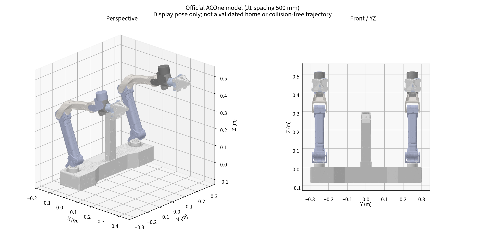
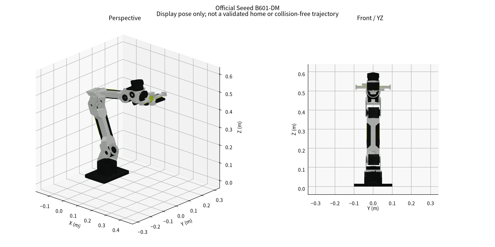
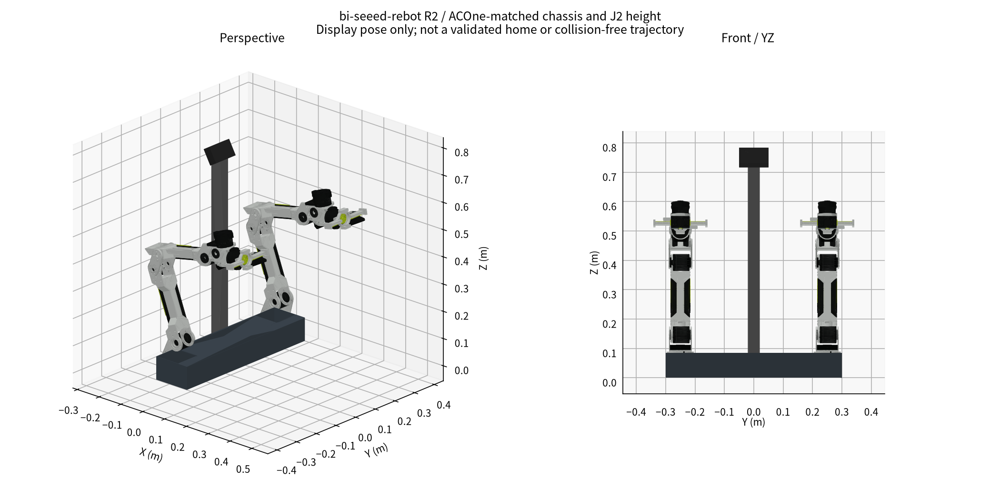

# 机械、运动学与 CAD 对比

> 阶段快照：原研究日期 2026-10-16；本次仅迁入总结并整理阅读链接，未重新执行原研究的计算、仿真或真机测试。
> 原文中的下载、文件数和检查结果描述原研究工作区。`WORKSPACE/` 表示原工作区逻辑根目录；正文中的脚本命令不在本笔记包执行。
> 原源码引用已尽量转为固定提交；未收录资料的链接明确标为“工作区资料”，来源、哈希和获取边界见 [来源说明](../sources.md)。

## 定义与证据边界

所有长度先取自固定提交的 URDF/STEP。URDF 用 m/rad，STEP 经 OpenCascade 读入后统一用 mm。下文轴间距是关节轴直线的最短距离，不是壳体长度，也不是任意两个 joint origin 的欧氏距离。沿转轴移动坐标原点不改变该转轴。

| 模型 | 原文件 | URDF 质量和 kg | 缺失网格引用 |
|---|---|---:|---:|
| A5 | [A5.urdf（工作区资料）](../sources.md#artifact-7115edb0b210) | 4.188528 | 0 |
| X5-2025 | [X5.urdf（工作区资料）](../sources.md#artifact-6845bccb93fe) | 3.492019 | 0 |
| Seeed DM | [ReBot_Arm_DM.urdf](https://github.com/Seeed-Projects/reBot-DevArm/blob/ff6aaf59f3e2175dbff814ac2e843ee78e34d7ba/Rebot_Arm_description/DM/urdf/ReBot_Arm_DM.urdf) | 4.929100 | 0 |

URDF 质量是建模数据之和，未实测。Seeed 模型约 4.9291 kg，与主仓库约 4.5 kg 的宣传口径不能自动视为一致；夹指惯量、安装件、线缆和末端设备还需审核。

## 各关节原始参数

| 模型 | 关节 | 相对父坐标原点 xyz mm | 局部轴 | 零位下根坐标轴 | 限位 rad |
|---|---|---|---|---|---|
| A5 | joint1 | [0.0, 0.0, 69.5] | [0.0, 0.0, 1.0] | [0.0, 0.0, 1.0] | -2.094, 3.1416 |
| A5 | joint2 | [20.0, 0.0, 43.5] | [0.0, 1.0, 0.0] | [0.0, 1.0, 0.0] | 0.0, 3.665 |
| A5 | joint3 | [-210.0, 0.0, 60.0] | [0.0, 1.0, 0.0] | [0.0, 1.0, 0.0] | -3.14, 0.0 |
| A5 | joint4 | [189.0, 0.0, 0.0] | [0.0, 1.0, 0.0] | [0.0, -1.0, -1e-05] | -1.571, 1.571 |
| A5 | joint5 | [77.0, 0.0, -84.5] | [0.0, 0.0, 1.0] | [0.0, 1e-05, -1.0] | -1.571, 1.571 |
| A5 | joint6 | [28.95, 0.0, 84.5] | [1.0, 0.0, 0.0] | [1.0, 0.0, 0.0] | -1.9635, 2.094 |
| X5-2025 | joint1 | [0.0, 0.0, 60.5] | [0.0, 0.0, 1.0] | [0.0, 0.0, 1.0] | -2.094, 3.1416 |
| X5-2025 | joint2 | [20.0, 0.0, 40.0] | [0.0, 1.0, 0.0] | [0.0, 1.0, 0.0] | 0.0, 3.665 |
| X5-2025 | joint3 | [-264.0, 0.03, 0.0] | [0.0, -1.0, 0.0] | [0.0, -1.0, 0.0] | 0.0, 3.24 |
| X5-2025 | joint4 | [245.0, -0.03, 56.0] | [0.0, -1.0, 0.0] | [0.0, -1.0, 0.0] | -1.571, 1.571 |
| X5-2025 | joint5 | [67.75, 0.0, 84.5] | [0.0, 0.0, -1.0] | [0.0, 0.0, -1.0] | -1.571, 1.571 |
| X5-2025 | joint6 | [28.95, 0.0, -84.5] | [1.0, 0.0, 0.0] | [1.0, 0.0, 0.0] | -1.9635, 2.094 |
| Seeed DM | joint1 | [-0.08416, 0.0, 84.65] | [0.0, 0.0, 1.0] | [0.0, 0.0, 1.0] | -2.8, 2.8 |
| Seeed DM | joint2 | [20.084, 31.625, 55.55] | [0.0, 0.0, -1.0] | [0.0, -1.0, 0.0] | -3.14, 0.0 |
| Seeed DM | joint3 | [-264.0, 0.0, 0.0] | [0.0, 0.0, 1.0] | [0.0, 1.0, -0.0] | -3.14, 0.0 |
| Seeed DM | joint4 | [242.6, -54.0, -1.625] | [0.0, 0.0, 1.0] | [0.0, 1.0, -0.0] | -1.87, 1.57 |
| Seeed DM | joint5 | [78.308, -37.5, -30.0] | [0.0, 0.0, 1.0] | [0.0, -1e-05, -1.0] | -1.57, 1.57 |
| Seeed DM | joint6 | [28.008, 0.0, 40.0] | [0.0, 0.0, 1.0] | [1.0, 0.0, 0.0] | -3.14, 3.14 |

原始旋转矩阵见 `data/urdf_analysis.json` 的 `R_parent`，避免把坐标系差异当成结构差异。

## 可直接比较的轴间距

| 相邻轴 | A5 mm | X5-2025 mm | Seeed DM mm |
|---|---:|---:|---:|
| J1–J2 | 20.000000 | 20.000000 | 20.084000 |
| J2–J3 | 218.403297 | 264.000000 | 264.000000 |
| J3–J4 | 189.000000 | 251.318523 | 248.537241 |
| J4–J5 | 77.000000 | 67.750000 | 78.308000 |
| J5–J6 | 0.000000 | 0.000000 | 0.000000 |

结论：DM 与 X5-2025 的上臂轴间距均约 264 mm，但小臂与腕部不同；A5 的上臂约 218.403 mm、小臂 189 mm，差异明显。三者是相近 6R 构型，不是等几何、等惯量或可直接重放关节轨迹的机械臂。

## ACOne 完整模型的安装关系

官方带手柄/无手柄包的两臂运动学安装参数相同。左 J1 为 (-16.02, 250, 21.5) mm，右 J1 为 (-16.02, -250, 21.5) mm，方向均为 +Z；两轴间距 **500 mm**。左右 J2 为 (3.98, ±250, 61.5) mm，均以 ACOne base_link 为参考。

该 500 mm 是公开 X5 版 ACOne 模型的数值，不自动覆盖用户的 A5 版或其他出厂版本。根坐标并非已确认的桌面/地面。独立 X5 模型 J1 高 60.5 mm，而完整平台 J1 高 21.5 mm；这是模型装配坐标的差别，不能误读成机械臂缩短。

本轮未发现 camera/head 的独立关节或光学坐标系；头部支架合并在静态 base 网格。

## 基座与安装面

相对各自 URDF base：A5 J2 高 113 mm、X5-2025 高 100.5 mm、DM 高 140.2 mm。DM 与 X5 frame 高度差 39.7 mm，与 A5 frame 差 27.2 mm。**这些首先是坐标框架差，不能无条件当作加工安装面的升降量。**

网格核查：DM base 网格底面约 z=0，独立 X5 同样约 z=0；A5 base 网格底面约 z=-9.25 mm。如果该底面就是实际安装支撑面，A5 肩轴相对该面约 122.25 mm，和 DM 的差是约 17.95 mm，而不是 27.2 mm。A5 安装支撑面仍需实物确认。这修正了前一轮只由 URDF frame 差推安装面差的过度简化。

采用原完整 ACOne 的肩轴高度作虚拟对齐时，可令 DM base z=0.0615-0.1402=-0.0787 m；这只是旧根坐标的比较；以底部支撑面z=0归一化后，DM base坐标高为6.3mm。原独立底板必须移除，不能据此声称原臂可直接装入。

## STEP 实测与安装孔候选

- ACOne body.STEP：4 个实体，外包络约 600×162.207×379.695 mm。
- head_camera.STEP：3 个实体，外包络约 76×88.607×294.695 mm。这 3 个实体与 body 中对应实体的包围盒和体积一致，body 已包含该头部结构；不能再叠加一套。
- STEP 原始坐标在约 1000 mm 附近，头部方向与 URDF 根坐标不同；本轮未建立可用于光学标定的 CAD→URDF 精确刚体变换。
- A5-AC one平台.STEP：单实体，约 520×125×70 mm，不等于上面的 ACOne body。
- DM 01_BASE_Plate.step：约 140×200×14 mm；其四个孔中心为 (±32,±32) mm，64×64 mm 阵列，孔径 4.6 mm，上部直径 7.5 mm 沉孔深约 4.5 mm。
- 上述孔是几何识别的连接孔；尚未根据完整紧固件堆叠认定它们就是对外台面安装孔。不应直接据此下单转接板。
- DM 01_BASE_Link 外包络约 92×92×63.7 mm；02_Base_Reinforcement_Part 约 92×92×6.95 mm。

以 500 mm J1 间距、DM 原底板长边沿 Y 布置，底板总横向包络约 **700 mm**，大于原 body 的 600 mm。这是保留原底板的R1方案。当前R2按用户要求取消原独立底板，改用600×140×85mm整体底座及内部安装结构；源文件不修改。

## 两个 Seeed 整机 STEP 版本

20260425：389 实体，拓扑整体检查 False；20260625：367 实体，拓扑整体检查 True。外包络不同，存在坐标/装配姿态和部件差异；不能据其包围盒认定臂展变化。单件检查详情见 step_analysis.json 和验证记录。优先以 20260625 作为本轮 CAD 参考，同时保留前版并与采购实物核对。False 表示源 CAD 拓扑需要检查，不表示实际机械臂不安全。

## 当前R2：与ACOne底座及J2高度对齐

`models/bi_seeed_rebot_concept.urdf` 当前为R2：底座600×140×85mm、J1轴距500mm、J2距同一支撑面146.5mm；DM base坐标高6.3mm。底部支撑面取ACOne根网格最低平面z=-85mm，故其J2高度为61.5+85=146.5mm。原独立底板从派生可视/碰撞网格中移除，J1主体集成到整体底座；输出/承力座穿出顶盖。底座已有概念STEP，内部支撑及顶盖开口尚未制造放行；头部相机仍为独立占位参数。详见 [R2方案](11_acone_aligned_base_r2.md)。

## 臂展补充：官方标称与同口径计算

Seeed B601-DM官方标称最大臂展767mm；方舟2023年旧ARX5官方发布工作半径620mm，不能不经型号/TCP核对就视为当前ACOne标称。

共同使用腕中心前移150mm虚拟TCP，按URDF原限位搜索的水平半径候选：ACOne/X5 753.1mm，Seeed DM 760.9mm。未考虑碰撞、任务姿态、载荷/热，不是实机认证工作区。定义、来源及腕中心比较见[臂展专题](14_arm_reach_comparison.md)。
