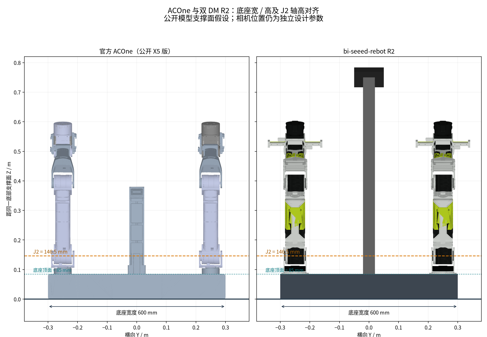
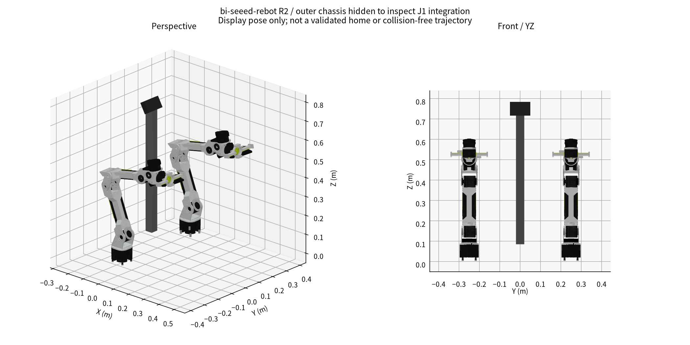

# R2：与ACOne同宽、同高并集成J1的底座方案

> 阶段快照：原研究日期 2026-10-16；本次仅迁入总结并整理阅读链接，未重新执行原研究的计算、仿真或真机测试。
> 原文中的下载、文件数和检查结果描述原研究工作区。`WORKSPACE/` 表示原工作区逻辑根目录；正文中的脚本命令不在本笔记包执行。
> 原源码引用已尽量转为固定提交；未收录资料的链接明确标为“工作区资料”，来源、哈希和获取边界见 [来源说明](../sources.md)。

## 用户约束与当前结果

R2按用户要求：对齐J2轴高、模仿ACOne把J1主体集成到整体底座内，并保持底座高度与宽度一致。R1的高框架方案已经替换，旧模型保留为历史版本。

统一基准：**平台底部支撑面z=0**。它可以是桌面；房间地面高度需再加桌面离地高度。ACOne取官方公开X5版完整模型及body.STEP的底座实体，不混用A5的520×125×70mm平台。

| 项目 | ACOne公开模型 | 双DM R2 | 状态 |
|---|---:|---:|---|
| 底座宽度Y | 600mm | 600mm | 一致 |
| 底座深度X | 140mm | 140mm | 一致 |
| 底座高度Z | 85mm | 85mm | 一致 |
| J2距底部支撑面 | 146.5mm | 146.5mm | 一致 |
| 两J1轴间距 | 500mm | 500mm | 一致 |
| 原DM base坐标高度 | 不适用 | 6.3mm | 不是底座高度，也不是垫板厚度 |
| 相机占位中心高度 | 原光学frame未知 | 750mm | 未对齐，仍是独立参数 |

计算：ACOne J2根坐标61.5mm − 根网格底面(−85mm) = 146.5mm；DM本身J2根坐标140.2mm，所以DM base放在6.3mm。这个结论以公开模型最低平面为实物支撑面作假设，实际脚垫/批次仍需测量。

## 真实改了哪些几何

1. 取消R1高150mm、宽700mm的占位框架，改为600×140×85mm整体空腔底座。
2. 从Seeed派生模型中移除140×200×14mm独立底板：按STL连通组件的尺寸/位置识别并移除，不是用外壳覆盖它。左右base碰撞网格同步替换，官方原文件不变。
3. 保留92×92mm原固定安装座及内部组件，新增内部支撑概念。每侧4根支柱，对应原64×64mm连接孔阵列；当前仅表达承力路线，不是确认原长螺栓可直接复用。
4. 采用4mm底板、2mm侧壁、2mm顶盖及两处96×96mm顶盖开口。开口让保留的输出/承力座穿出；主承力不能依赖开口边缘的薄顶盖。
5. 左右DM base放在X=-20mm、Y=±250mm、Z=6.3mm。原J1–J6关节变换、轴向、限位和移动部分网格保持不变；因去除底板，删除派生固定base的旧惯量，避免虚假质量模型。
6. 相机立柱移到X=-50mm，使其底端接在85mm底座顶面；750mm相机高度和60°俯角仍是占位参数，不是ACOne光学外参。

## “J1藏入底座”的具体含义

在原彩色STL内，按同轴位置和外包络识别到57×57×56.5mm的J1电机主体候选组件。其高度范围由DM原坐标20.95–77.45mm，变为支撑面以上 **27.25–83.75mm**，位于85mm底座包络内。

**电机主体在壳内，输出端/承力座穿出顶盖。** J1的URDF轴原点位于90.95mm，并不意味着整台电机都高于底座；沿转轴选取的原点不是电机顶面。保留组件的上部输出座约突出5.95mm，个别紧固件更高，不能承诺顶盖完全无凸出。

这个组件识别来自源网格的几何分组，未由供应商带零件号的装配CAD确认。电机完整包络、接线口和装配堆叠仍需取证。

## 当前紧凑位置与后续机械工作

- 电机主体上沿距底座顶面约1.25mm。顶盖通过开口避让该区域，不能把1.25mm当成任意2mm盖板下面的装配间隙。
- 原92mm固定座到2mm侧壁/后壁的名义间隙约2mm。这里还没有包含制造公差、线缆、维护工具、散热或绝缘间隙；若空间不足，需重新设计J1安装座，而不是增加用户已锁定的底座宽高。
- 96mm顶盖开口接近侧壁；应使用内部承力骨架、安装板和明确紧固方案，不能靠薄盖板承受肩部力矩。
- 需核查长螺栓、支柱、底部连接、局部接触应力、底板弯曲、整机固定及回生/供电布置。本轮支柱不是制造放行件。
- 需要完整J1/J2运动包络、线束弯曲半径及桌面/立柱碰撞检查。本轮只证明原关节几何保留、若干静态尺寸与代理包络关系，未证明全工作空间无碰撞。

## 本地交付与检查

- [整机R2 URDF（工作区资料）](../sources.md#artifact-e8fea1e1d71b)：左右机械臂、空腔底座、内部支柱与占位相机架。
- [底座原生STEP（工作区资料）](../sources.md#artifact-2d2f6ad8c3b6)：底座外壳及8根内部支柱，**不含整条DM机械臂的原生实体**；CAD单位mm。
- [R2参数（工作区资料）](../sources.md#artifact-155da4954ff7)、[集成几何记录（工作区资料）](../sources.md#artifact-92fbaf9817d2)、[22项R2专项检查（工作区资料）](../sources.md#artifact-22fad35cd915)。
- [旧R1 URDF（工作区资料）](../sources.md#artifact-e1bfe8342f16)及[旧预览](../assets/previews/bi_seeed_concept_r1.png)保留，避免混淆旧290.2mm与新146.5mm肩高。

专项检查包括：J2高度和J1间距、与ACOne底座尺寸一致、原运动学保留、旧底板移除、STEP有效及9个实体、静态电机候选包络包含、代理体与底座材料不相交。**22项通过不等于结构、热、全运动碰撞或制造验收通过。**

浏览器查看地址 `http://127.0.0.1:8765`；刷新后取消“显示整体底座外壳”可以看J1。操作见[三维可视化指南（工作区资料）](../sources.md#artifact-3901af58df2f)。
