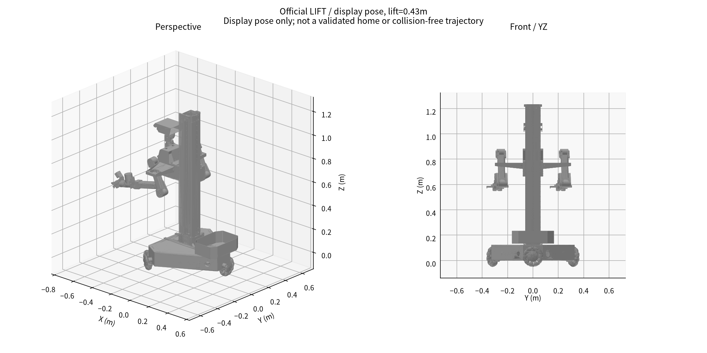
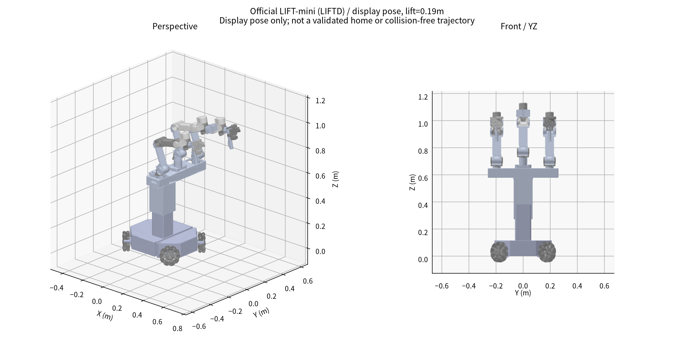

# LIFT / LIFT-mini官方资源与横向比较

> 阶段快照：原研究日期 2026-10-16；本次仅迁入总结并整理阅读链接，未重新执行原研究的计算、仿真或真机测试。
> 原文中的下载、文件数和检查结果描述原研究工作区。`WORKSPACE/` 表示原工作区逻辑根目录；正文中的脚本命令不在本笔记包执行。
> 原源码引用已尽量转为固定提交；未收录资料的链接明确标为“工作区资料”，来源、哈希和获取边界见 [来源说明](../sources.md)。

本次已实际下载、解压和解析两款官方模型，相关代码只读归档，没有安装或运行硬件控制程序。模型来源ARX_Model，控制仓库包含LIFT2等启动变体；不能自动认为两包CAD与当前LIFT2实物、SDK逐项对应。

## 下载范围与版本

新增归档 **290个文件，163,164,218字节**；两个模型包解压 **54个文件**。这属于原13仓库快照之外的增量，原统计与清单保留。原有依赖ARX_X5与ARX_all_in_one_readme的gitlink提交与已下载版本一致，复用原快照。

| 来源 | 固定提交 | 相关文件数 |
|---|---|---:|
| [ARXroboticsX/ARX_Model](https://github.com/ARXroboticsX/ARX_Model) | [74386441845f](https://github.com/ARXroboticsX/ARX_Model/tree/74386441845f12af4da203843b6400951d6c5530) | 2 |
| [ARXroboticsX/LIFT](https://github.com/ARXroboticsX/LIFT) | [006984b69396](https://github.com/ARXroboticsX/LIFT/tree/006984b693967d4e6aca51952acfd7f9b8f0df64) | 97 |
| [ARXroboticsX/ARX_PLAY](https://github.com/ARXroboticsX/ARX_PLAY) | [0214f0e6c02b](https://github.com/ARXroboticsX/ARX_PLAY/tree/0214f0e6c02bc7601c0944e0da769a5daaa48b26) | 3 |
| [ARXroboticsX/R5](https://github.com/ARXroboticsX/R5) | [0620037dca10](https://github.com/ARXroboticsX/R5/tree/0620037dca100115e30b09ba55a45d43ae20bb0b) | 188 |

包括LIFT SDK的body/、CAN/启动配置、R5依赖的模型/源码/文档及ARX_PLAY的LIFT使用手册；未拉取.so/EXE，也未运行setup、CAN或电机脚本。没有将选择性文件快照称为完整Git克隆。

## 直接打开模型

| 型号 | 原始模型 | 可直接查看的派生URDF | 原包 |
|---|---|---|---|
| LIFT | [lift.urdf（工作区资料）](../sources.md#artifact-aa949e0342ab) | [lift_view.urdf（工作区资料）](../sources.md#artifact-1b4e10e6d3e1) | [lift_urdf.zip](https://github.com/ARXroboticsX/ARX_Model/blob/74386441845f12af4da203843b6400951d6c5530/LIFT/lift_urdf.zip) |
| LIFT-mini | [LIFTD.urdf（工作区资料）](../sources.md#artifact-d8ea9cbfc0ac) | [lift_mini_view.urdf（工作区资料）](../sources.md#artifact-d805ce5e238e) | [LIFTD.7z](https://github.com/ARXroboticsX/ARX_Model/blob/74386441845f12af4da203843b6400951d6c5530/LIFT-mini/LIFTD.7z) |

**LIFT原ZIP有路径打包问题：** URDF写`../meshes/lift/`，而模型包实际为`lift_urdf/meshes/lift/`。原文件52条网格引用无法按原相对路径解析，但17种STL都在包内。派生URDF只重写URI，保留关节、scale=0.001、坐标和限位；现为0条缺失引用。LIFT-mini原包0条缺失，派生副本同样统一相对路径。不是偷偷更换模型或修改运动学。

两个模型包均未发现STEP/STP；本次获得的是URDF/STL/CSV/配置。LIFT控制仓库的root许可与模型仓库许可范围分开处理，不自动将SDK许可套到CAD。





## 四个平台的横向比较

| 项目 | ACOne公开X5版 | bi-seeed R2 | LIFT模型包 | LIFT-mini/LIFTD模型包 |
|---|---|---|---|---|
| 平台类别 | 固定桌面双臂 | 固定桌面双臂概念 | 轮式升降双臂 | 轮式升降、多支链模型 |
| 轮关节数 | 0 | 0 | 3 | 4 |
| 升降关节/行程 | 无 | 无 | joint_lift / 860mm | joint5 / 380mm |
| 两J1轴间距 | 500mm | 500mm | 500mm | 390mm |
| J2高度 | 支撑面以上146.5mm | 同左 | 轮底候选面以上470.5–1330.5mm | 同基准558.7–938.7mm |
| 根网格XY包络 | 底座600×140mm | 底座600×140mm | 约605×657.2mm | 约500×420mm |
| 主要附加支链 | 静态头架 | 占位头架 | 两转轴头部 | 除左右臂外还有joint31–36六转轴支链 |

桌面平台高度以桌面支撑面计，移动平台高度以轮网格最低点近似地面计；直接同地面部署时，ACOne/bi-seeed还要加桌高。本表保留差别，不假装146.5mm与移动平台离地高度是同一部署工况。

LIFT轮底候选面在其root的z=-49.961mm，LIFT-mini为-45.000mm。由轮底网格推算，未计轮胎压缩或实物校准。

LIFT的base_link网格包含固定升降立柱，其高度约1243.3mm，**不能把它当作底盘外壳高度**。LIFT-mini根网格也包含固定结构。总包围盒依赖姿态，不是最大臂展。

## 机械臂几何与臂展

| 相邻转轴最短距离 | ACOne/X5 mm | Seeed DM mm | LIFT左臂 mm | LIFT-mini左臂 mm |
|---|---:|---:|---:|---:|
| J1–J2 | 20.000 | 20.084 | 20.000 | 20.000 |
| J2–J3 | 264.000 | 264.000 | 264.001 | 218.403 |
| J3–J4 | 251.319 | 248.537 | 252.244 | 189.000 |
| J4–J5 | 67.750 | 78.308 | 70.250 | 77.000 |
| J5–J6 | 0.000 | 0.000 | 0.000 | 0.000 |

LIFT-mini左臂的轴距与已下载A5几何吻合；LIFT左臂上臂约264mm，但小臂/腕部与ACOne X5-2025不完全相同。不能因都叫方舟双臂就默认互换FK/IK或逐关节轨迹。LIFTD的中央六转轴支链用途未由命名明确，不猜作第三工作臂或相机云台。

臂展已另作统一口径比较：Seeed官方767mm、旧ARX5官方620mm属于不同年份/未统一TCP；共同腕中心前移150mm虚拟TCP时，ACOne/X5水平半径候选753.1mm、Seeed DM760.9mm。详见[臂展专题](14_arm_reach_comparison.md)。LIFT升降增加垂直覆盖，底盘增加全局覆盖，均不等于单臂连杆伸长。

## 完整性、限位与版本差异

| 模型 | links | joint类型统计 | 原网格缺失引用 | 派生缺失引用 |
|---|---:|---|---:|---:|
| LIFT | 26 | {'continuous': 17, 'prismatic': 5, 'fixed': 3} | 52 | 0 |
| LIFT-mini | 28 | {'continuous': 4, 'prismatic': 5, 'revolute': 18} | 0 | 0 |

- LIFT将两条臂的6个轴都标为continuous，没有真实位置限位；升降velocity=100、夹指velocity=100也不能作为安全运行参数。
- LIFT-mini大量转轴为±10rad、velocity=1000的导出范围，不能据此控制。升降URDF范围0–0.38m、速度字段0.0333m/s仍需与实物/驱动核对。
- URDF四个夹指移动关节不自动等于四个独立夹爪执行器；mimic和实际夹爪传动需另外确认。
- URDF质量之和分别约124.974kg和39.501kg，只是模型字段，未经称量，不能替代产品重量规格。

ROS2手册明确区分底盘、升降和头部；旧手册文字使用LIFT三轮组，当前源码的body_control又接受四个轮速参数，发布周期也需按版本核查。应视为版本/接口不一致的证据，不能把三轮URDF直接配四轮驱动。

LIFT仓库引用的ARX_X5与说明仓库是gitlink，不在父仓库文件树中自动展开。本次已核对并复用相同提交；R5按gitlink提交额外下载。当前R5 SDK中有6份URDF文件，包含重复的模型变体，部分依赖外部网格，不将其称为6款完整整机。

## 查看、复现与后续比较

已经提供四平台同屏查看，实际启动地址见终端（当前为`http://127.0.0.1:8767`）。各自支撑面归零，不加入实际桌高：

```bash
cd WORKSPACE/cad/arx
.venv/bin/python scripts/view_lift.py --model compare --port 8767
```

单看LIFT或mini，可将`--model compare`改为`--model lift`或`--model mini`；端口若已占用，Viser会另选，按终端输出访问。原双DM查看器8765保持独立。

```bash
.venv/bin/python scripts/fetch_lift_sources.py
.venv/bin/python scripts/prepare_lift_models.py
.venv/bin/python scripts/write_lift_report.py
.venv/bin/python scripts/validate_lift_resources.py
```

后续真正选移动底盘还需：整机质量/重心、倾覆边界、刹车与锁止、升降承载/刚度/回差、移动误差与机械臂同步、电池与回生、定位/导航、急停覆盖范围、相机外参随升降更新。不能仅把600mm桌面底座放上轮车就称为已验证的LIFT替代方案。

## 本地证据入口

- [新增下载清单与SHA256（工作区资料）](../sources.md#artifact-04262050a10b)、[解压清单（工作区资料）](../sources.md#artifact-8a0d4609ab96)。
- [整机参数JSON（工作区资料）](../sources.md#artifact-2d0cab03b454)、[逐关节CSV（工作区资料）](../sources.md#artifact-7e5fd3b7869c)。
- [LIFT控制仓库](https://github.com/ARXroboticsX/LIFT/tree/006984b693967d4e6aca51952acfd7f9b8f0df64)、[R5依赖](https://github.com/ARXroboticsX/R5/tree/0620037dca100115e30b09ba55a45d43ae20bb0b)。
- [LIFT使用手册](https://github.com/ARXroboticsX/ARX_PLAY/blob/0214f0e6c02bc7601c0944e0da769a5daaa48b26/ARX%E6%96%B9%E8%88%9F%E6%97%A0%E9%99%90aloha%E6%95%B0%E6%8D%AE%E9%87%87%E9%9B%86%E7%B3%BB%E7%BB%9FLIFT%E4%BD%BF%E7%94%A8%E6%89%8B%E5%86%8C.pdf)；[LIFT ROS2话题手册](https://github.com/ARXroboticsX/ARX_all_in_one_readme/blob/13df340df13420edc498d9b222ee51f9e2596fd6/02-LIFT/LIFT%E8%AF%9D%E9%A2%98%E6%8E%A7%E5%88%B6-ROS2.pdf)。
- [用户ACOne电机实机确认及本地代码证据（工作区资料）](../sources.md#artifact-a135e3561bde)。
