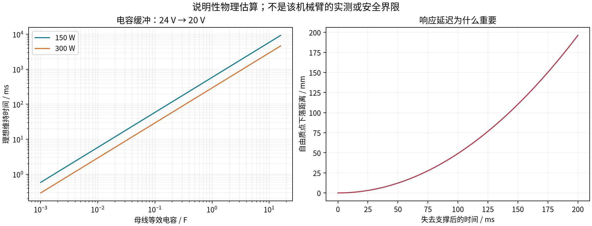

# Seeed B601-DM 防坠、异常下使能与急停设计

> 阶段快照：原研究日期 2026-10-16；本次仅迁入总结并整理阅读链接，未重新执行原研究的计算、仿真或真机测试。
> 原文中的下载、文件数和检查结果描述原研究工作区。`WORKSPACE/` 表示原工作区逻辑根目录；正文中的脚本命令不在本笔记包执行。
> 原源码引用已尽量转为固定提交；未收录资料的链接明确标为“工作区资料”，来源、哈希和获取边界见 [来源说明](../sources.md)。

本专题针对用户已经遇到的“异常下使能后机械臂砸向桌面”，同时适用于正在设计的bi-seeed-rebot。资料日期2026-10-16。**本次完成资料调查、固定版本代码审计、说明性计算与方案设计；没有连接机械臂、发送电机命令或修改用户正在使用的驱动。**

## 1. 先给结论：停止动作与保持承重是两件事

对没有机械抱闸的轻量机械臂，撤去力矩后，重力不会消失。**瞬间拉高Kd、发送零速度、软件重力补偿、通信看门狗，都不能保证在电机保护锁止、驱动损坏或母线失电后不坠落。**

建议按三个目标分层：

1. 尽量避免异常下使能：修正速度/力矩限制、热管理、供电、通信与程序退出逻辑。
2. 驱动仍健康时停止：独立伺服任务执行受控减速、重力补偿和短时保持，不再接受策略目标。
3. 驱动已经不工作时承重：弹簧施力的断电抱闸，或覆盖工作区的机械承托/捕获装置；配重、弹簧与阻尼辅助减少坠落能量。

对当前单臂，投入优先级是：**先限制砸落后果并记录故障 → 修正软件与供电根因 → 验证被动防坠 → 集成硬件急停 → 再考虑UPS/电容争取停机时间。** 如果要求任意工作姿态、整臂断电后都不能砸桌面，仅增加红色按钮、电容或Kd不够，需要独立承重路径，并按姿态、载荷和故障集合验证。

这里的“独立”是指不依赖已经失效的同一个电机功率级、同一条CAN链路和同一个Python进程。普通额外MCU可以提高可用性，但不会因此自动成为有安全等级的控制器。

## 2. 先分清“整臂掉电”究竟发生了什么

一个肩关节失去力矩，整条臂就可能看起来全部掉电；这不等于七个驱动真的同时断电。先区分以下情况，再决定是否需要电容或软件修改。

| 观察/记录 | 更可能的机制 | 验证方式与处理方向 |
|---|---|---|
| 所有电机灯同时熄灭，臂端24V明显塌陷 | 电源过载/短路保护、输入断电、公共线束/接头开路 | 同步测电源输出端与机械臂入口电压、电流；排查电源、支路保护和公共连接 |
| 电机灯还亮，反馈状态为DISABLED或故障 | 软件失能、内部驱动保护、通信超时 | 保存首个故障码、原始反馈、主机异常栈；查看disable调用 |
| 仅J2/J3先报错，其他轴仍在线 | 关节过温、过流、过载或该轴掉线 | 单轴事件顺序、温度、转矩、局部接头电压；不要把所有轴都失能作为唯一后续动作 |
| 24V仍正常，所有反馈一起消失 | USB-CAN断连、CAN故障/总线拥塞、主机卡顿 | USB/内核日志、CAN错误计数、反馈年龄、控制循环抖动 |
| 降臂/急减速时母线先上冲，再故障 | 回生能量吸收不足、过压保护 | 示波记录正向过压；电源额定功率变大不代表能吸收回生 |
| 每次Ctrl+C、窗口关闭、切控制模式时发生 | 程序退出或模式切换先撤去承重力矩 | 审计finally、disconnect、configure、estop、模式切换；支撑状态下复现 |

这些是故障树，不是对用户实机的诊断。截止写作时，用户当前SDK版本、电源型号、故障时灯态及原始错误码尚未提供。

### 2.1 达妙错误码的已有证据

本地MotorBridge的`protocol.rs`与已归档的[DM-J4310手册](https://files.seeedstudio.com/products/Damiao/DM-J4310-en.pdf)一致给出下表。手册指示灯描述属于该手册版本，需对照用户实际V4固件；反馈码也需核对实际版本。

| 状态高4位 | 含义 | 对防坠的影响 |
|---|---|---|
| 0x0 / 0x1 | 失能 / 使能 | 先区分主动失能还是故障导致退出 |
| 0x8 / 0x9 | 过压 / 欠压 | 保持力矩可能已不可用；分别调查回生和压降 |
| 0xA | 过流 | 加大阻尼或硬锁位置可能再次触发 |
| 0xB / 0xC | MOS / 电机转子温度保护 | 散热、持续力矩与任务负载问题；不能靠反复清错维持 |
| 0xD | 通信丢失 | 此时再经原CAN发送“大Kd”可能已经来不及或不可达 |
| 0xE | 过载 | 查持续负载、姿态、加速度和保护计时 |

标准8字节反馈包含位置、速度、转矩字段、MOS及转子温度，**没有母线电压字段**。不能从这个包虚构电压遥测；使用外置采样，或在确认支持后读取额外寄存器。温度值也不等于实时绕组热点，不能等读数到保护点才行动。

固件`TIMEOUT`寄存器在本地代码中为RID=9，但单位、默认值、哪些命令刷新计时以及超时后行为，必须按实际固件文档和支撑试验确认。把超时设为无限大只能隐藏掉线，还可能让旧目标持续生效。

### 2.2 建议采什么日志

保留每轴状态、温度、速度、转矩、命令/反馈单调时间戳，以及两处母线电压、支路电流、USB/CAN错误、急停输入和抱闸状态。原始CAN与解析后数据同时保留，使用事件环形缓冲，故障时冻结前后记录；不要先`clear_error()`再打印状态。

主机应用日志不足以抓住毫秒压降或回生尖峰。外部电压采样及示波触发用于定位，采样带宽按实际事件选择；避免把示波器接地夹误接到非隔离动力节点。日志字段见[故障记录模板（工作区资料）](../sources.md#artifact-60de058e848f)。

如果使用LRS-350系列，已归档[制造商规格书](https://www.meanwell.com/Upload/PDF/LRS-350/LRS-350-SPEC.PDF)明确存在过载保护/打嗝恢复行为。因此“动作时全臂电压周期性掉下去”有电源侧机制可查，但不能据此直接认定就是用户故障原因。额定350W不等于任意瞬时电流、线束压降和再生工况都合格。

## 3. 固定版本代码中已经找到的风险路径

以下针对本项目下载并固定哈希的源代码，不自动代表用户当前安装版本。逐处行号、提交、源码哈希和摘录已写入[代码审计JSON（工作区资料）](../sources.md#artifact-7598ca394f50)。没有修改上游文件。

| 文件/路径 | 实际行为 | 需要怎样调整设计 |
|---|---|---|
| Seeed SDK `actuator/rebotarm.py` 的`estop()` | 直接`disable_all()` | 这是撤销力矩接口；无抱闸时不能当作防坠停车 |
| 同文件`disconnect()` | 停控制线程后失能所有轴 | 正常退出应先到物理支撑/抱闸承重；异常退出另有独立捕获 |
| 同文件`get_state()` | 某轴没有state时以0填位置/速度/转矩；部分请求异常被忽略 | 安全监控要单列有效性、反馈年龄和故障；0不能当作新鲜实测位置 |
| `controllers/gravity_compensation.py` 的`start()` | 切MIT后`disable_all()`，等待0.1s，再逐轴使能 | 模式切换期间需要支撑或抱闸；不能在悬空承重时直接运行此序列 |
| LeRobot `seeed_b601_follower.py` 的`configure()` | 先`disable_all()`再配置并重新使能 | 初始化/重连同样需要承重交接；不要运行中随意configure |
| 同文件`disconnect()` | 部分分支先safe_zero；失败后仍继续退出，并按配置失能；随后clear_error | 不把“safe_zero尝试过”当成已停靠；故障时禁止依赖未知姿态回零，也要在清错前保存证据 |
| 同文件普通DM位置发送 | `send_pos_vel(pos_rad,32)` | 此快照没有用计算出的配置速度；要检查真实帧中的限速，不能只改配置值 |
| MIT YAML与MotorBridge编码 | J1–J3配置kd=8，编码上限5且clamp | 此组合实际不能发送8；需要锁定依赖并校验打包后的值 |

源码入口：[Seeed SDK](https://github.com/Seeed-Projects/reBotArm_control_py/blob/6415d43130d1e143c70dc106096a857ac5556f81/reBotArm_control_py/actuator/rebotarm.py)、[重力补偿启动](https://github.com/Seeed-Projects/reBotArm_control_py/blob/6415d43130d1e143c70dc106096a857ac5556f81/reBotArm_control_py/controllers/gravity_compensation.py)、[LeRobot适配](https://github.com/Seeed-Projects/lerobot-robot-seeed-b601/blob/0da1a1a5575905d77823227003ffee7672059780/lerobot_robot_seeed_b601/seeed_b601_follower.py)、[MIT编解码](https://github.com/motorbridge/motorbridge/blob/e2607dc1063bbcfa5ce8433644e6eb6fe8267525/motor_vendors/damiao/src/protocol.rs)。

软件修正不能简单变成“永远不失能”。驱动乱跑、功率器件故障或人被夹住时，持续保留驱动能力也有危险。正确做法是为正常停机、上层失联、单轴故障、驱动失控和总失电分别规定动作，并让机械防坠在电控失败时仍有效。

## 4. “瞬间拉高Kd”能解决什么

### 4.1 在驱动还使能时，Kd是主动阻尼

MIT控制可概念化为：

```text
tau_cmd = Kp*(q_ref-q) + Kd*(dq_ref-dq) + tau_ff
```

这里假设单位和控制符号已核对、关节处于MIT模式，最终还受电流/力矩、温度及固件控制约束。令Kp=0、dq_ref=0、tau_ff=0，得到`tau_cmd=-Kd*dq`。它能反抗运动，速度为0时输出阻尼力矩也为0，所以**单纯阻尼不能静态承重**。

举一个恒定重力矩5N·m的理想单轴例子：若Kd=5N·m·s/rad，在忽略摩擦、饱和和姿态变化时，可能形成约1rad/s，即57.3°/s的下落速度；这不是机械臂的实际坠落预测，只说明“大Kd”不等于保持位置。

加入`tau_ff≈g(q)`和适度位置刚度，才可能在驱动健康时保持姿态。只有Kp也需要位置误差才能形成支撑力矩，纯比例环一般会有静态下沉；高刚度可能夹人、激振，且不解决过热、断电或驱动故障。

### 4.2 不能把Kd当作故障后的救命命令

| 状态 | 提高Kd的实际效果 |
|---|---|
| 上层策略失联，低层实时环、CAN和驱动都健康 | 可作为受控减速/保持的一部分 |
| 收到了使能状态但反馈陈旧/速度符号不确定 | 不能盲目调大；可能方向错误、冲击或无法判定真实运动 |
| 电机已DISABLED或保护锁止 | MIT增益命令通常不能直接恢复受控力矩，不能据此保证停车 |
| 总母线失电或功率级故障 | 无有效控制能力；需要机械措施 |
| 已经在较快下坠 | 突增阻尼可能带来较大瞬时电流和回生，继而再次保护 |

例如当前速度2rad/s时，把Kd从1瞬间提高到5，理想命令变化为8N·m；这已经超过某些小关节的可持续能力，甚至可能超过其相应版本的峰值。这里是计算示例，不是实机调参建议。

[Seeed官方控制教程](https://wiki.seeedstudio.com/rebot_arm_b601_dm_pinocchio_meshcat/)也提示，多个轴大幅修改kp/kd可能引发振荡、过流或撞限位。当前默认POS_VEL模式并不自动使用MIT的Kd；故障时临时切MIT又可能经过失能步骤。因此不要为实现“急停加Kd”而临时跨模式切换。若采用MIT降级控制，应在正常运行前就完成验证和模式固定。

### 4.3 软件层应该落实的内容

- 让模型推理/遥操作与伺服任务分开。策略目标带单调时间戳、序号和有效期，超时后拒绝新目标；低层继续执行经过约束的停车，而不是等Python推理恢复。
- 逐轴监视使能状态、故障码、反馈年龄、速度/加速度、位置跟随误差、温度及电源状态。缓存旧state不能算新反馈，丢反馈不能补零当正常状态。
- 正常停车从当下轨迹状态生成连续的减速目标，限制速度、加速度、jerk和力矩。不要直接把高速运动的目标跳成当前位置；必要时限制参考变化并做无跳变控制交接。
- 在健康驱动上使用经标定的重力前馈、适度Kp/Kd及限幅/变化率约束。输出力矩不够时要报告支撑能力丧失，不能只继续积分或加刚度。
- 温度预警应早于厂商保护点，结合升温速率、持续转矩、负载和伸展姿态提前降载或停靠。具体阈值由实际固件额定值、误差与试验决定，不把90°C作为允许工作的默认目标。
- 通信看门狗覆盖低层和硬件独立监视。超时后若直接失能会下坠，必须同步设计机械捕获；不能为防坠取消看门狗。
- 正常停机先进入经过验证的支撑座或闭合抱闸，确认承重交接后再失能。急停则不得自动执行一条较长的回零轨迹。
- 保护故障保留锁存，不循环`clear_error()+enable()`。突然重新使能也可能撞击、重新夹紧或追赶旧目标。
- 双臂共持物体时，需要协调停车及物体承托。另一臂继续刚性追踪原轨迹可能放大事故；但“一边报错两边全失能”同样可能丢物。

不提供未经实机校准的通用Kd、力矩限制或超时数值，因为它们取决于关节惯量、负载、控制模式、实际延迟和固件范围。

## 5. 硬件方案比较：哪些是真正失电后还有效

| 方法 | 总失电后作用 | 单个驱动内部故障后作用 | 对当前平台的评价 |
|---|---|---|---|
| 桌面软垫/缓冲限位 | 降低冲击 | 有 | 最快降低损坏后果，但不保证不撞桌、不夹人 |
| 折叠停靠支架/双点托架 | 已停靠时承重 | 已停靠时有效 | 适合正常结束与维护；工作中突然失效未必能接住 |
| 外部弹簧平衡器/配重/气弹簧 | 能提供被动支撑力 | 有 | 值得优先评估，但随姿态/载荷变化，不能自动等同全工作区防坠 |
| 带阻尼的独立捕获绳/机械防坠装置 | 可限制下落位移和能量 | 有 | 需要承力锚点、额定载荷、捕获距离、动态冲击及缠绕设计 |
| 普通弹性吊绳/行李绳 | 可能缓冲但行为不可控 | 有限 | 不能冒充经过额定验证的防坠器 |
| 弹簧施力、通电释放的抱闸 | **可在失电后保持/制动，取决于选型** | 独立动作链有效时有 | 需要把制动力矩可靠传到固定基座，并验证动态与静态工况 |
| 手拧锁销/手动夹紧器 | 提前锁好才有效 | 提前锁好才有效 | 停车/维护锁；不能在意外发生时自动接管 |
| 粘性/液压旋转阻尼器 | 限制运动速度，通常不静态锁住 | 有 | 与平衡器/捕获装置搭配，验算速度和发热 |
| 24V缓冲模块/超级电容/DC UPS | 电源掉电时延长供电 | 不能修复失效驱动 | 为减速、闭闸争取时间，不是最终承重机构 |
| 动态短接电机相线 | 有适当电路时可产生速度相关阻力 | 取决于损坏与接线 | 无静态保持；集成DM驱动不宜自行外接短路改造 |

### 5.1 最适合先做的低成本防护

单臂现有台架：先设置稳固上方支撑或侧支撑，使用经额定校核的短行程承托/捕获构件，使失去力矩后无法直接撞桌；锚点应落在金属承力结构，不能绑在相机、末端线束或3D打印外壳上。托架在上臂/前臂设多个接触面，避免仅接住夹爪、让肘部仍重砸或工具脱落。

弹簧平衡器可抵消部分自重，常见做法是把拉力作用于前臂或上臂，通过滑轮/连杆把反力传回基座。需要扫过整个姿态包络：钢索不能进两臂共享区、缠住关节或绕颈；拉力方向变化后不能反向加速下落。仅在一个姿态“平衡”不能证明其他姿态无坠落。

配重和气弹簧也会引入新能量：卸去物体后可能上弹，配重增加运动惯量，气弹簧力随行程和温度变化。应验证空载与最大载荷两端，并保留限位与阻尼。工具平衡器通常不是自动满足人员防坠要求的安全装置，需要按用途确认额定和故障模式。

对bi-seeed R2，建议在600mm底座后方增加独立承力立架/停靠座，而不是让原750mm概念相机杆承担防坠载荷。当前600×140×85mm底座是几何方案，加入拉索或抱闸后必须重新验证倾覆、局部弯曲、支柱与锚固；不保证原深度140mm足够抵抗新增偏载。

## 6. “简易抱闸”如何做才有意义

### 6.1 抱闸必须连接关节两侧

J2/J3等重力承载轴是第一优先级；J4及其他轴是否需要锁住，取决于工具姿态和负载。只锁J2不能保证前臂、腕和抓取物都不下落。J1为竖直转轴时主要涉及惯性/外力运动，也需要评估急停旋转风险。

制动器一侧必须与关节固定侧连接，另一侧与输出轴/转动连杆可靠连接。只夹住电机固定外壳不产生跨关节制动力矩。通过电机输入轴抱闸会依赖减速器传动完整性；在输出侧锁止可以减少这种依赖，但尺寸和所需力矩通常更大。

建议优先：带可集成抱闸的关节/电机替代件，或成熟的弹簧制动单元与金属适配支架。外部线缆传力到基座的远置制动也可研究，但钢索、绕线轮和锚点都进入承重链，断索、松脱和回差必须计入。

### 6.2 断电抱紧，通电释放

[mayr的制动器原理说明](https://www.mayr.com/en/products/more-products/product-glossary/brakes/brake-systems)区分了弹簧施力制动器与通电吸合制动器。前者失电闭合，后者掉电松开。要防断电坠落，方向必须选对。

自行用弹簧夹钳、钢制制动盘、拉索/电磁释放机构，可以在受控台架上验证原理；但夹紧力、磨损、释放不到位、疲劳、污染和公差都需要验证。手动夹钳只能作为提前锁定的停车锁。廉价电磁插销在运动中可能对不准孔、剪断或造成冲击，不适合直接承担任意角度动态制动。

不能把3D打印支架、通电才吸住的门锁电磁铁或一般自行车制动件直接标成已验证安全抱闸。它们可以用于概念实验，但若要作为唯一防坠环节，需要达到对应载荷和故障要求，不能只凭一次吸住了机械臂。

### 6.3 需要计算的不是一个“最大扭矩”

静态重力矩按各轴的质量、质心、姿态计算，包括夹爪、相机与载荷。示例：仅1.5kg物体在0.45m水平力臂处就产生约6.62N·m，尚未计手臂自重。电机27N·m峰值既不是持续支撑能力，也不是抱闸选型的完整条件。

制动器选型至少有：静态保持力矩、动态紧急制动力矩、最大接合转速、单次制动能量、允许紧急制动次数/热负荷、温度下的降额、磨损余量、断电接合时间和机械强度。仅能保持静态载荷的保持闸不能自动用于高速急刹。[制动器厂商说明](https://www.mayr.com/en/products/more-products/product-glossary/brakes/brake-systems)也将动态制动能力作为依设计而定的条件。

```text
静态：T_hold 覆盖最不利姿态下的重力/外力矩，并按实际要求留设计余量
动态：E_stop 覆盖停止期间的动能 + 重力释放能量
摩擦近似：T ≈ n * mu * F_normal * r_effective
```

例如假设需15N·m、两摩擦面、mu=0.25、有效半径30mm，法向夹紧力约1000N。15N·m只是说明性假设，不是给B601直接指定闸规格；它说明“小夹钳随便夹一下”可能远低于所需能力。

### 6.4 接合延迟与承重交接

闸需要时间闭合。仅作自由质点说明：从静止开始，30ms约下落4.4mm，50ms约12.3mm，100ms约49.1mm。真实多连杆旋转坠落不同，原先正在运动的臂还会有初速度；不能把这张表当作机械臂坠落上界。

正常停车应先减速，电机维持重力补偿，发出闭闸命令并等待已验证接合/承载交接后，再撤掉力矩。恢复则先在闸闭合状态建立正确的支撑力矩，完成反馈和状态检查，再受控松闸；不能先松闸再逐轴慢慢使能。

闸闭合微动开关只能证明位置状态，不能证明足够制动力矩，应结合周期承载/滑移检查。闸线圈的普通续流二极管可能延长电流衰减与接合时间，抑制器件及驱动应按制动器厂商方案选型并实测，不自行取消保护以求“更快”。

## 7. 大电容、超级电容和UPS：有用，但边界很清楚

### 7.1 能量计算

电容在V_high下降至V_low期间可释放的理想能量：

```text
E = 0.5*C*(V_high^2 - V_low^2)
t ≈ eta*E/P
```

下面假设24V到20V、效率100%、恒正功率；20V只是计算例子，**不是已确认的DM欠压阈值**。ESR压降、变换器截止、温度、老化、容差与备用余量均未计入。

| 母线等效电容 | 可用能量 | 150W理想维持 | 300W理想维持 |
|---|---:|---:|---:|
| 4700μF | 0.414J | 2.76ms | 1.38ms |
| 10000μF | 0.880J | 5.87ms | 2.93ms |
| 0.1F | 8.80J | 58.7ms | 29.3ms |
| 1F | 88.0J | 0.587s | 0.293s |
| 10F | 880J | 5.87s | 2.93s |

若要以300W维持2秒，效率按0.85，仅上述电压窗口的理想最低等效电容就约8.02F，实际还需余量。说明几千/一万微法通常是瞬态缓冲量级，不能默认足够整臂安全停靠。



数据与公式见[计算JSON（工作区资料）](../sources.md#artifact-837ac889d7af)、[电容CSV（工作区资料）](../sources.md#artifact-e98f30629726)和[延迟CSV（工作区资料）](../sources.md#artifact-a40d7c50c50e)。不能用额定350W或电机相电流代替实际停机时的母线功率测量。

### 7.2 更实用的选择

优先评估完整24V DC缓冲模块或UPS，具备充电限流、状态/电源失效输出、保险与能量管理。主机、独立监控器和适配器也需要足以完成切换的供电，不能只给电机备电、控制器先死机。

例如[PULS UF20.241制造商数据表](https://products.pulspower.com/en/mwdownloads/download/link/id/2257/)给出20A下最小200ms缓冲，展示了工业缓冲的量级；这只是器件实例，不代表它适合用户双臂电流、总线电压或能完成某条停机轨迹。需要按实测峰值、维持时间、输出下限和失效方式选型。

若自己用超级电容串联：串联后等效电容下降，单体需要均衡、过压/过温监控、预充和限流、短路保护、反接/反灌处理、受控放电与封装。[Maxwell串联均衡资料](https://maxwell.com/wp-content/uploads/2021/08/technote_cell_balancing.pdf)说明单体差异会造成电压不均；不能只看整串标称总电压就认为每个单体安全。

### 7.3 电容不是回生电阻

刹车、降低重物可能把能量送回母线。增大电容会减缓升压，但容量是有限的；串入防反灌理想二极管后，还可能把电机侧变成更难泄放能量的孤立母线。

例如假设10mF原在24V，额外接收5J且无其他耗散，理想电压约升至39.7V。实际系统会受到各种保护/钳位影响，这不是DM实测，但说明“加一个电容就解决过压”不成立。

回生吸收需要与电压和能量匹配的制动斩波/耗能模块、支持双向能流的电源或合适储能系统。TVS适合相应瞬态，不应未经能量/热验算就代替持续制动电阻。不要因为电源瓦数足够就假定它能吸收反向功率。

### 7.4 最容易把急停破坏掉的接法

不能在最终动力切断接触器的负载侧直接跨一个大UPS/电容，使接触器断开后机械臂仍长期有动力。大容量储能应位于最终隔离装置上游，受同一停机逻辑控制，并确认无旁路反灌；驱动内置的小电容残余能量仍需计入停止时间。

抱闸释放回路必须独立受硬件安全链约束。**电容/UPS不能在急停或失去安全许可后继续给“松闸线圈”供电。** 有备用电时仍必须能强制闭闸并切断动力。也不能让通信故障只切掉CAN，却保留旧的驱动目标和松闸状态。

## 8. 急停按钮应该实现什么

### 8.1 区分四种功能

| 功能 | 动作 | 对无抱闸DM的含义 |
|---|---|---|
| 正常暂停/受控停止 | 控制仍工作，停止轨迹并可保持力矩 | 日常“暂停”可以这样做，但不应冒充独立硬件急停 |
| 立即去除驱动能量，停止类别0思路 | 不依赖正常控制完成减速 | 重力轴仍会下落，需要机械捕获/动态制动 |
| 先受控停止，再去除能量，停止类别1思路 | 健康控制减速，随后闭闸承重并隔离动力 | 适合设计“先停稳再断”，但要有限时和失控后备路径 |
| 停止类别2/SS2等保持带电概念 | 停止后保留驱动控制 | 用于理解带电停止，不用它替代本项目的急停功能 |

[Schneider安全链与安全功能目录](https://download.se.com/files?p_Doc_Ref=DIA3ED2140902EN)区分这三类，并说明机械急停在类别0或1中按应用选择；不能只把类别2的带电位置保持改名为急停。停止类别、SS1/STO等驱动安全功能与控制系统安全等级是不同维度。官网FAQ本轮下载返回404，因此另归档制造商目录PDF，没有将错误页当作参考正文。

STO防止驱动产生转矩，**不会消除重力和机械储能，也不是维修用的电气隔离**。SS1/SS2/SBC是特定安全功能概念，普通CAN失能或Python延时不等同于这些功能。没有资料证明当前DM套件具有经认证的STO/SBC硬件接口，因此本方案不把它标成“支持STO”。

[Pilz官方驱动技术指南](https://www.pilz.com/mam/pilz/images/import/Subsidiaries/Spain/leaf_pmc_drive_technology_1003934-en-01.pdf)PDF第31页明确要求，重力承载轴的安全停机还要有机械制动概念。这里借鉴其功能区分，不声称自行搭建的系统已满足某一PL/SIL或停机认证。

### 8.2 推荐的硬件组织

急停按钮选锁定式蘑菇头、直接断开动作的两组常闭触点，接入适当的双通道安全继电器/安全控制器。按钮传递安全控制信号；不要让小触点直接承受24V整臂电流和大电容浪涌。

多个操作点的急停应按所选控制器认可的拓扑接入，监测断线、通道不一致与接点故障。配置手动监控复位和接触器反馈；详细端子接线按器件最新手册，而不是照搬其他品牌的S11/S12编号。[Phoenix Contact双通道手动复位例图](https://assets.phoenixcontact.com/file/4b2de1d7-5d73-41ba-9ab9-6634f8c326d0/media/original?Two-channel-E-Stop-Monitoring-Manual-Reset.pdf=)可作为结构参考；它是特定器件的例子，不是本项目的完工接线图。

```text
蘑菇头两路NC ──────────> 安全继电器/安全逻辑
                              │
              ┌───────────────┼────────────────┐
              ↓               ↓                ↓
          停止请求        闸释放许可撤销     最终动力隔离输出
      独立控制器/伺服      弹簧闸接管承重     受监测的DC接触器
              ↑               ↑                ↑
         状态/超时监控     闸状态/承载验证     辅助触点反馈

外部电源 → 受保护的24V缓冲/UPS → 最终动力隔离 → 每臂保护支路 → DM电机
独立逻辑/记录供电 ────────────> 监控器/主机/日志
闸释放供电 → 硬件安全许可 AND 正常释放命令 → 闸线圈
```

图中“最终隔离”实际可由适当的冗余接触器和诊断组成，数量与覆盖范围按所需风险降低和故障分析确定；额定电流还要覆盖DC分断能力、容性浪涌及再生电流，不能只看AC标称。左右臂独立支路便于隔离故障，但人员急停应覆盖整个危险协作区域，包括夹爪、升降/轮式底盘及其他危险执行器。

这只是功能框图。它没有给出可以直接上电的端子图、保护整定、完整冗余设计或安全等级；需要按选定硬件形成具体图纸并验收。

## 9. 急停时序：必须包含失控和失电分支

### 9.1 控制仍可信的情况

1. 急停输入被硬件锁存，立即阻止新任务/策略目标，开始独立受监测的停止过程。
2. 现有伺服在仍可供电、反馈有效时按已验证限制减速，并提供必要重力补偿。若动力电源先失效，缓冲只用于维持这段短时间。
3. 速度进入允许的制动接合范围后，撤销松闸许可，弹簧闸闭合；在经过验证的接合/承重交接期间，驱动仍提供支撑。
4. 达到已验证的停止/闭闸条件后，或安全逻辑规定的独立最大时间到达时，隔离动力；没有“等Python回零成功再说”的无限等待。
5. 保持急停锁存，记录事件，禁止旧轨迹自动恢复。

等待时限必须由最大速度、负载、可接受停止距离、驱动制动能力和闸接合时间得出并实测。不能随意指定“延迟1秒断电”就称为安全停止。

### 9.2 驱动失控、反馈不可用或总失电

不能继续相信原伺服能减速，也不能等待同一CAN执行“大Kd”。独立安全链应按验证的故障反应撤销松闸并去除危险驱动能量；闸若会在转动中接合，就必须有相应的动态紧急制动能力。没有该能力时，应由独立捕获/承托限制运动，而不能把高速动态工况交给静态保持闸。

如果电机内部因过温/过流已自行失能，电容即使仍有24V，也不能让该功率级输出承重力矩。只有反馈报错后才开始的外置抱闸也存在检测和接合延迟；若DM无独立快速故障输出，就不能用CAN监控宣称实现了已证明的单故障安全。此时常在的被动平衡/捕获和运动能量限制更加关键。

安全链/控制器本身掉电时，默认状态应是闸闭合、动力隔离、禁止自动启动。闸释放不能靠“MCU活着才知道要关”的单一软件动作实现。

### 9.3 正常停机和重新启动

正常结束可把机械臂低速停靠在多个承重点上，确认停靠并闭闸，再失能。这个动作属于有计划停车；遇到碰撞、夹人或未知故障时不要自动执行回零/回收轨迹。

急停旋钮释放只是解除按钮锁定；还应经过清障、故障确认、手动复位，随后另行使能。恢复时清除旧目标和积分状态，检查有效反馈/姿态、先建立承重力矩，再释放闸。若抓取物需要保持，应事先设计机械自保持夹爪、承托或安全卸载方案，不能默认夹爪断电后物体仍不掉落。

### 9.4 不接硬件也应先写清的状态机

```text
PARKED / BRAKED → CHECKS → TORQUE_READY → RELEASE_BRAKE → RUNNING
RUNNING → CONTROLLED_STOP → BRAKE_TRANSFER → POWER_ISOLATED
任意状态 + 不可信驱动/失电 → INDEPENDENT_CAPTURE + POWER_ISOLATED
故障锁存 → 人工确认/复位 → CHECKS（不直接回RUNNING）
```

普通额外MCU可做确定性时序、CAN监控和日志，但若没有相应安全架构、诊断与验证，不能把它的状态机标成SS1认证实现。

## 10. 人形机器人和ALOHA实际给出的启示

“轻量机械臂都没有抱闸且不会掉落”这个前提不能成立。不同产品、关节和版本的制动配置不同，不能从灵巧运动外观推断失电保持能力。本次找到的可靠例子如下。

### 10.1 宇树官方G1/H1部署代码

宇树`unitree_rl_gym`的[真实机器人部署说明](https://github.com/unitreerobotics/unitree_rl_gym/blob/main/deploy/deploy_real/README.md)要求在吊装状态启动，并说明退出进入阻尼模式后机器人会倒下。它说明主动阻尼降低/改变运动，并不承诺失电站住或手臂悬停。

官方`create_damping_cmd()`对每个关节设置`kp=0、kd=8、tau=0、qd=0`，与全零力矩命令另有区分。代码已按固定提交归档于[阻尼辅助函数](https://raw.githubusercontent.com/unitreerobotics/unitree_rl_gym/276801e46c5d433564f24658bac64f254b7d2d4b/deploy/deploy_real/common/command_helper.py)、[退出路径](https://raw.githubusercontent.com/unitreerobotics/unitree_rl_gym/276801e46c5d433564f24658bac64f254b7d2d4b/deploy/deploy_real/deploy_real.py)、[部署说明](https://raw.githubusercontent.com/unitreerobotics/unitree_rl_gym/276801e46c5d433564f24658bac64f254b7d2d4b/deploy/deploy_real/README.md)，提交见[参考清单（工作区资料）](../sources.md#artifact-c721bcab198a)。仅静态阅读，没有运行这些控制代码。

这个8不能复制到DM：两家的驱动、控制接口、量化范围、惯量与默认固件都不同；本项目MotorBridge DM路径的Kd编码上限为5。官方示例也不是宇树全产品安全设计的完整披露，不能从中断言所有宇树关节都无抱闸。

可借鉴的是把零力矩、阻尼、位置保持、正常收姿态与外部吊装分开，并在开发时提供物理保护；不可借鉴为“只调Kd就解决任何掉电”。

### 10.2 ALOHA的重力补偿切换

[Trossen ALOHA官方操作文档](https://docs.trossenrobotics.com/aloha_docs/2.0/operation/stationary.html)说明，leader臂的软件重力补偿使能/退出仍会有短暂失能下落，需要承托，并在结束时放入支架。文档同时提及原有机械滑轮辅助系统。

这与Seeed模式切换中的短暂失能风险相呼应。注意这个例子针对文档指定的leader臂流程，不扩大成所有ALOHA从臂/版本的相同行为。机械辅助与停车支架有实际价值，软件补偿不能覆盖所有生命周期。

## 11. 对你的单臂和bi-seeed双臂，建议这样展开

| 阶段 | 工作 | 必须得到的结果 |
|---|---|---|
| 立即降低损失 | 轻载、缩小工作区，可靠承托/短行程捕获，设工具/肘部缓冲；固定金属底座 | 意外失去力矩时落在设计承托上，不是直接砸桌；不依赖人徒手接住 |
| 找首个故障 | 电压/电流与7轴故障状态同步记录，保留原始帧和进程异常 | 分清PSU塌陷、J2热保护、通信故障还是退出失能 |
| 软件整改 | 修正实际发送速度与增益范围，区分状态有效性；审计init/reconnect/exit/模式切换 | 无未声明的悬空失能窗口；上层失联不等于停止底层承重 |
| 台架验证机械防坠 | 在支撑条件下验证J2/J3及腕部的闸/平衡/捕获，覆盖动态能量 | 断电、单轴失能及不利姿态的位移/冲击可接受 |
| 硬件急停集成 | 两路NC、安全逻辑、手动复位、制动许可、最终动力隔离与反馈 | 无需主机响应也能进入已验证的停止/承托状态 |
| 供电增强 | 测得停机功率后选缓冲、预充、分支保护及回生吸收 | 缓冲不旁路急停、不保持松闸，并能报告自身未充满/故障 |
| 双臂集成 | 两独立CAN/动力保护、总急停、共持物体停车与夹爪承托 | 一臂故障不会让另一臂追旧轨迹或无条件丢物 |
| 移动升降扩展 | 底盘刹车/支撑、升降自保持及重心变化加入同一故障分析 | 急停不会因为底盘滑移或升降下降产生新的坠落 |

如果预算有限，先选“可靠承托/捕获 + 故障记录 + 软件生命周期修正”，再做配重/弹簧辅助，通常比先堆大电容更能覆盖内部驱动保护导致的坠落。若目标是工作中任意时刻硬急停后位置保持，则需要认真投入抱闸/关节替代方案及其验证，可能需要修改现有底座和线束设计。

不提供未经选型的完整采购型号组合和固定价格；制动器、接触器、缓冲和安全逻辑必须依据实测负载与停止时间选定。预算需要加入制动安装金属件、独立支撑、力矩/位移测试和维护更换，而不只是按钮本体。

## 12. 怎么验证，才能谈“不砸桌面”

先定义工况边界：安装方式、最大载荷/工具、允许速度、最不利姿态、允许末端/肘部下移量、允许冲击、危险区域、温度与故障集合。不能把一次空载按急停成功推广到任意姿态满载。

在独立支撑、人员退出运动区的条件下，从静态、低速和小载荷逐级验证。用模拟信号验证过温逻辑，不为了触发故障故意把电机加热到损坏边界。拔线和失电测试也应在有独立承托时进行。

| 试验 | 重点验证 |
|---|---|
| 正常暂停/退出 | 停止过程连续，支撑交接后才失能 |
| 策略卡住、GPU停顿 | 独立低层不接受过期目标，仍能停车 |
| USB/CAN断连 | 无法继续发送命令时，机械防坠仍接管 |
| J2或J3单轴失能 | 不是仅保持其他关节，就误以为整臂安全 |
| 整机24V失电 | 闸/被动承托无需继续使能也有效 |
| 最大允许速度下急停 | 停止距离、闸能量与受力不超边界；不会甩脱物体 |
| 闸释放控制线断路/反馈异常 | 默认闭合、故障锁存；不能假正常 |
| 接触器焊接/反馈异常 | 诊断并阻止复位，独立隔离/承托仍有效 |
| 缓冲未充满/短路 | 不允许运行超出能力，不经储能旁路持续驱动 |
| 松开按钮、来电、重启进程 | 不自动释放闸、不继续旧轨迹 |
| 双臂共持物体、一臂故障 | 物体、两臂及夹爪均有明确承托/停车结果 |

测量从输入触发到目标屏蔽、开始减速、闸接合、承载、动力隔离的时间，以及肘/工具位移、峰值电流/母线电压、制动温度和事件顺序。采集高速视频和电气记录对齐，控制器打印“estop done”不能替代运动测量。

见[验收记录模板（工作区资料）](../sources.md#artifact-ad98c71d81b5)。全部实物结果目前留空；本次离线检查不代表真机急停、抱闸可靠性或安全等级通过。

## 13. 仍需用户设备补充的信息

- 使用的是哪个控制栈、提交/包版本，故障发生在运动、静止、模式切换还是退出时。
- 电源型号、线径/长度、供电接口与分支保护，故障时灯态、两处电压及是否自动恢复。
- 第一个异常关节、原始错误码、温度/转矩、控制模式、负载和姿态，是否有人为或异常退出调用disable。
- 实际TIMEOUT与保护参数，电机固件版本、是否有可用的独立故障/制动接口。
- 是否接受上方吊架/后方立架，允许的下移量与停止距离；是否要求共持物体不掉落。

有这些记录后，才能从“通用防坠方案”收敛成该平台的闸力矩、保持时间、停止曲线和器件组合。

## 14. 本次交付与可追溯资料

- [固定代码审计证据（工作区资料）](../sources.md#artifact-7598ca394f50)：9个关键位置，包含提交、行号、摘录和SHA256。
- [新增一手参考清单（工作区资料）](../sources.md#artifact-c721bcab198a)：制造商文档和宇树官方源码的下载状态、URL、版本/哈希；Pilz网页HTTP403保留记录，同厂商PDF指南已成功归档。
- [说明性计算（工作区资料）](../sources.md#artifact-837ac889d7af)、[分析脚本（工作区资料）](../sources.md#artifact-0f661c0a2f4d)、[资料抓取脚本（工作区资料）](../sources.md#artifact-a1e97e100179)。
- [离线核对结果（工作区资料）](../sources.md#artifact-2c257458dcdb)，仅核对归档、代码证据和说明性计算，不是实机认证。
- [故障日志字段（工作区资料）](../sources.md#artifact-60de058e848f)、[待实测验收表（工作区资料）](../sources.md#artifact-ad98c71d81b5)。

本次没有绕过驱动保护、提高过温/过流阈值、添加自动清错重使能或运行上游硬件示例。当前R2概念模型也没有因为新增本专题就获得抱闸实体、完整接线或动态安全验证。
