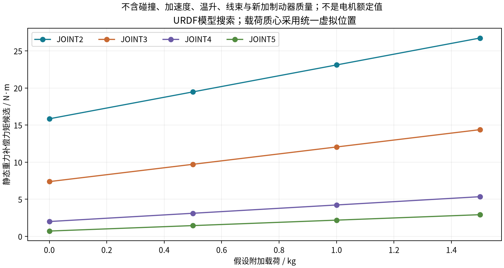
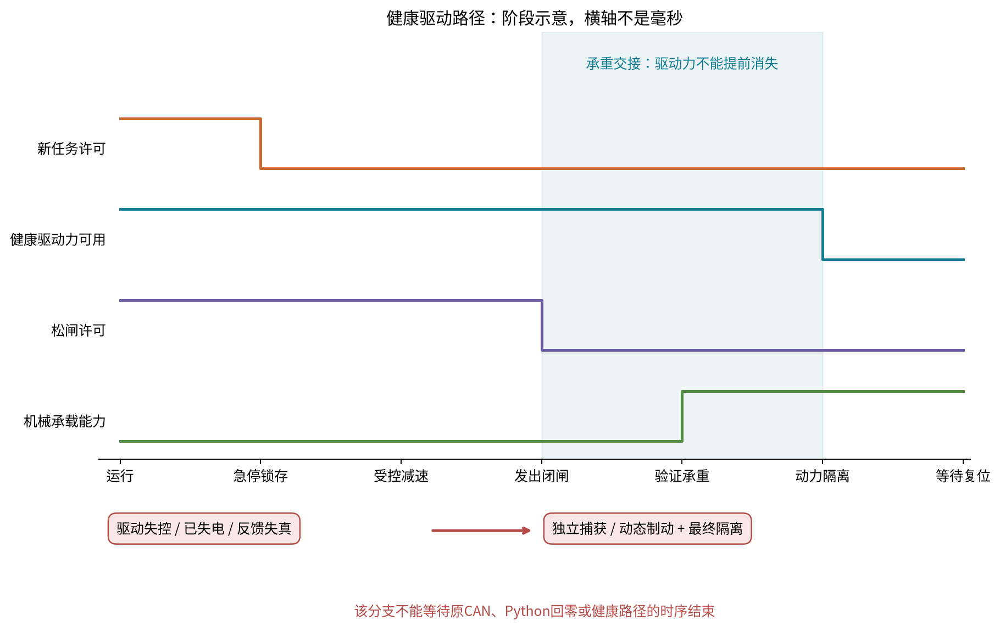

# 防坠工程化：重力矩、抱闸选型、急停时序与实施清单

本篇为2026-10-18增量快照。模型计算与离线复核在原研究工作区完成，未运行真机；原R3主题保持历史版本。

增量日期：2026-10-18。本文接续[防坠与急停原理](15_fall_prevention_and_emergency_stop.md)，把方案推进到模型载荷估算、选型输入、状态与故障响应。机械布局仍为R2；资料版更新为R3.1。没有连接真机或改写控制程序。

## 1. 这轮新增了什么

- 读取Seeed DM固定版本URDF的质量、质心和关节变换，计算0/0.5/1/1.5kg假设载荷下各轴静态重力矩。
- 对1kg物体增加50mm横向偏心，说明腕滚转轴也可能需要制动。
- 区分数值搜索候选和同一质量模型下的保守几何上界，并用独立势能梯度检查力矩符号及大小。
- 新增承重交接图、说明性制动延迟计算、14种故障响应和11项选型工作表。
- 保存4份新增原厂资料，补充实际尺寸与接合时序的约束；不预先指定用户应购买的型号。

**最重要的模型发现：不加外物时，肩部也要承担整条下游机构的自重。** 不能只算物体质量×臂长，也不能只给J2装一个闸就宣称前臂、腕部和物体都不会掉落。

## 2. 质量模型与计算定义

来源为Seeed官方[固定提交DM URDF](https://github.com/Seeed-Projects/reBot-DevArm/blob/ff6aaf59f3e2175dbff814ac2e843ee78e34d7ba/Rebot_Arm_description/DM/urdf/ReBot_Arm_DM.urdf)。按模型原始质量与质心计算，不将CAD质量字段冒称实物称重。

| 模型部分 | 质量kg | 本次如何处理 |
|---|---:|---|
| base_link | 0.8366 | 固定基座，不计入J2承重 |
| link1 | 0.1613 | 位于J2上游，不计入J2下游重力矩 |
| link2 / link3 | 1.3266 / 0.8353 | 按各自质心及关节姿态计算 |
| link4 / link5 / link6 | 0.5200 / 0.3830 / 0.3663 | 包含于下游质量模型 |
| end_link | 0.5000 | 按URDF记录计算，不声称已经识别出完整夹爪质量分配 |
| 两片finger links | 无独立inertial | 夹指质量是否已并入其他link未知；没有自行补零后声称物理上无质量 |

URDF质量合计4.9291kg；J2下游已记录质量合计3.9312kg。R2去掉的是固定底板，未改原臂运动链；固定底板质量不影响本次J2以下的静态力矩计算。新增抱闸、安装件、线束、相机或工具的质量尚未计入。

附加载荷设为点质量，其质心位于“腕中心沿J6正轴前移150mm”的统一虚拟点；偏心情形再沿link6局部X加50mm。**这是假设载荷质心，不是实际物体质心、工厂TCP或额定负载测试姿态。**

补偿力矩按下游各质量点对关节轴的重力矩求反向值：

```text
tau_hold_i = - sum[ a_i · ((p_COM - p_axis_i) × (m*g_vector)) ]
```

固定J1=0，按URDF原q2–q6限位，使用两组固定种子的差分进化搜索各轴力矩绝对值。竖直J1的旋转不改变静态重力问题。每个候选由独立XML FK的总势能有限差分再次核对，误差记录在结果中。

**不同轴最大值一般发生在不同姿态。** 搜索没有加桌面、自碰撞和任务方向约束，不保证这些候选姿态能在实机工作区安全执行，更不是已证明的全局最大值。没有摩擦、加速度、线束力、温度、装配误差、基座倾斜或新配件质量。原始URDF限位也不自动等于实物放行限位。

## 3. 各轴静态载荷估算

单位N·m；以下为各自姿态搜索得到的绝对值候选，不能直接复制成控制力矩或采购额定值。

| 假设附加载荷 | J2 | J3 | J4 | J5 |
|---|---:|---:|---:|---:|
| 无外物 | 15.84 | 7.38 | 1.99 | 0.71 |
| 0.5kg | 19.47 | 9.71 | 3.11 | 1.45 |
| 1.0kg | 23.10 | 12.04 | 4.23 | 2.18 |
| 1.5kg | 26.73 | 14.38 | 5.34 | 2.92 |

J1在基座Z竖直且只受重力时为零，不代表没有惯性、外力、线束和碰撞风险。质心在轴线附近时J6只有约0.0003N·m的模型静态值；给1kg物体增加50mm横向偏心后，J6搜索值约0.491N·m。这说明工具偏心、相机侧装和抓取方式会改变制动需求。



1.5kg情形中，J2数值约26.73N·m，已与该URDF的27N·m effort字段很接近。**effort字段、峰值转矩、持续转矩和实际保护阈值是不同的量。** 这只能提示持续承重与动态余量需要认真核查，不能据此认定用户事故就是过载，也不能用旧系列额定值代替V4实际测试曲线。

为了避免把数值候选误称上界，另对每个质量点使用“沿运动链各段长度之和”约束其到关节轴原点的距离，再按重力矩三角不等式求和。此方法忽略可达角度与方向相消，因此通常偏保守。

| 1.5kg同一假设载荷 | 搜索候选 | 同一质量模型的静态几何上界 |
|---|---:|---:|
| J2 | 26.73 | 28.68 |
| J3 | 14.38 | 16.29 |
| J4 | 5.34 | 7.20 |
| J5 | 2.92 | 4.29 |

这个上界只约束**所包含URDF质量点**的静态重力矩，不约束漏记质量、真实质心误差、动态冲击或减速器故障；它不是现实整机的认证安全边界。J6这种近同轴质量的场景尤其会被该通用距离界大幅高估。

完整极值角度、原始模型哈希、假设和核对误差见[计算JSON（工作区资料）](../sources.md#detail18-9df42f83831b)；简表见[CSV（工作区资料）](../sources.md#detail18-3335c900d307)。计算程序为[analyze_brake_sizing.py（工作区资料）](../sources.md#detail18-4b9a035a7225)。

## 4. 抱闸选型：先确定力矩在哪根轴上

### 4.1 三种位置，三种机械代价

| 安装方案 | 优点 | 需要解决的问题 |
|---|---|---|
| 关节输出侧制动 | 可以直接约束输出连杆，减少对减速器完整性的依赖 | 力矩较大，支架和反力通路更重，可能增加轴向长度/干涉 |
| 电机输入侧制动 | 理想所需力矩可随传动比减小 | DM集成模组是否有可接近输入轴未知；通常需要厂家集成或换关节；仍依赖齿轮传动 |
| 远置制动+钢索/同步传动 | 可把部分质量移回底座/立架 | 钢索、张紧、绕线轮、锚点、冗余和断索后果都进入承重链 |

如果实际减速比确为40:1，26.73N·m输出矩对应理想输入矩约0.668N·m；但这是理想传动换算，不是可以直接购买0.668N·m闸的结论。真实最低制动力矩、正反向效率/摩擦、齿隙、动态工况和安全余量另算；输入端转速也随传动比增加。不能把只夹固定外壳的结构误称“输入轴抱闸”。

### 4.2 一个原厂实例说明尺寸约束

Mayr Cobot产品页列有轻量机器人用弹簧制动器。仅取两个尺寸点说明空间量级：6N·m型号约外径98mm、轴向长21.9mm；9N·m型号约108mm、22.4mm。它们不能直接覆盖上述1.5kg情形的J2/J3输出侧静态需求，且尚未核对DM连接界面。[原厂产品页](https://www.mayr.com/en/products/safety-brakes/industrial-brakes/roba-servostop-cobot~40645)

这不是推荐用户购买该型号，而是说明：市场上存在成熟小型断电闸，但“小型”仍可能显著改变当前关节外廓。机械集成要核对转动侧、固定侧、孔位、轴承、磁性材料间距、线圈散热及紧固件承载，不能只画一圈圆盘放进去。

R2底座85mm高、宽600mm和J2高146.5mm是当前几何约束，不证明容得下某个制动器。尤其J2是水平轴，外部制动可能向底座侧面和臂间区域伸出；加装件还会改变重心和其他关节的负担。未完成适配CAD前不应承诺继续保持所有原外廓。

### 4.3 交给供应商的选型输入

至少填写：制动轴位置、最低/最高环境温度、正常/极限保持矩、最大接合速度、等效惯量、负载重力矩方向、接合延迟、单次摩擦功、紧急制动频次与累计次数、释放/保持电压、线圈峰值功率、安装空间、机械传动完整性、磨损及检测方法。

输出应是具体型号在最不利条件下的**最低可用保持/动态制动力矩**与允许能量，不只看标称最大值。静态保持试验、紧急动态试验和整机危险失效评估分别完成；没有“一律乘2就全部安全”的通用系数。

原厂操作说明将该系列限定为保持及有限次数紧急制动，并分别给出接合时间和摩擦功；不能拿它作为频繁循环刹车。对时序，只引用量级：表中DC侧接合约15–30ms，实际取决于规格、接线及工况，不能当作本平台实测最大值。[操作说明第16、18–19页](https://www.mayr.com/produkte/dokumentationen/bremsen/roba-servostop-cobot/b.8981.en_23-11-2023.pdf)

## 5. 为什么“刚好能抱住”未必能快速刹住

设一个**纯说明性单轴模型**：其他运动因素忽略，等效惯量J=0.25kg·m²、初速1rad/s、恒重力矩15N·m、闸接合后恒制动力矩20N·m。制动前延迟期间完全没有支撑力矩，随后理想瞬间建立全制动力矩。

```text
接合前：omega_1 = omega_0 + tau_g/J * t_delay
延迟转角：theta_delay = omega_0*t_delay + 0.5*tau_g/J*t_delay^2
接合后净减速度：alpha_stop = (T_brake - tau_g)/J
制动转角：theta_brake = omega_1^2 / (2*alpha_stop)
```

| 假设延迟 | 总停止转角 | 总停止时间 | 闸吸收摩擦功 |
|---|---:|---:|---:|
| 0ms | 1.43° | 50ms | 0.50J |
| 20ms | 8.77° | 130ms | 2.42J |
| 50ms | 30.08° | 250ms | 8.00J |

闸虽然20N·m大于15N·m重力矩，真正用于减速的只剩5N·m；延迟期间先积累的速度会明显增加停止距离。若制动力矩不大于沿下落方向的重力矩，在这个模型下就没有正的净减速度。

以上**不是B601的坠落仿真**，其惯量不是从B601辨识得到。真实系统的力矩随姿态改变、多个关节耦合，制动力矩也需要建立过程，不能套此表预测桌面间隙。它只是进一步说明为什么必须测“从触发到承载”的整段链，而不是只读一个抱闸闭合时间。

计算记录与能量平衡见[延迟模型JSON（工作区资料）](../sources.md#detail18-a6f3496d8c97)。实际选型需同时满足允许停止位移与最低净制动力矩，并覆盖制动能量/温度；仅加大静态保持矩不替代这些检查。

## 6. 急停与恢复：把承重交接写成明确条件



上图横轴是功能阶段，不是秒或毫秒。它表达两个约束：健康伺服不能在机械承载建立前先撤掉力矩；不可信驱动路径不能等待健康路径完成。图形电平不是实际电路、可靠性等级或已测响应时间。

| 状态 | 进入条件 | 输出/退出条件 |
|---|---|---|
| PARKED/BRAKED | 物理支撑或闸承载，动力可隔离 | 检查安全输入、接触器反馈、姿态与通信 |
| TORQUE_READY | 当前姿态反馈有效，驱动已建立支撑 | 保持闸闭合直到可用力矩与状态满足条件；避免不受限地顶闸 |
| RUNNING | 闸释放与动力均受许可，所有必要检查通过 | 接受有效期内轨迹；超时、故障和急停进入对应分支 |
| CONTROLLED_STOP | 驱动和反馈仍可信 | 独立受限停车；超时或可信度丧失立即进入后备分支 |
| BRAKE_TRANSFER | 速度满足所选闸允许条件 | 撤松闸许可，覆盖接合时间并验证承载；开关状态不替代力矩证明 |
| POWER_ISOLATED | 已按策略承托或执行独立捕获/隔离 | 急停锁存，清除旧目标；禁止自动松闸或重新追目标 |
| MANUAL_RECOVERY | 人工确认清障并复位 | 单独使能；先支撑再松闸，不直接回RUNNING |

控制可信度丧失包括：编码器/反馈不可信、驱动乱跑、总失电或承重轴已自行保护退出。此时应由独立机械捕获/合适动态制动及最终隔离承担后果。没有这些物理措施，不能用状态机文字补出防坠能力。

按时间预算分开记录：输入检测、逻辑判断、停止请求到驱动、减速、线圈退磁、摩擦矩建立、承载验证、接触器打开和残余能量。最大时间取有依据的最不利值并实测，不能把厂家平均接合时间加一个随意延时当安全上界。

对于夹困救援，抱闸可能把机构锁在压迫位置。应预先设计人工释放/卸载方式，且在释放前独立承托重力载荷；“急停后不会落下”不能替代救援可行性，也不能自动执行一条未知碰撞路径的回零动作。

## 7. 独立链路与14类故障响应

两路NC急停→安全逻辑→制动释放许可/最终动力隔离是功能结构。与主机共用一个USB接口、一个Python线程或同一DM功率级的“后备”，不能算对相同失效的独立覆盖。

需要分别检查：按钮断线/触点粘连、闸输出短路导致持续松闸、闸反馈卡死、接触器焊接、低层控制器重启、缓冲未充满或短路、上电回放旧目标。日志必须能区分“要求闭闸”“闸开关显示闭合”“已证明能够承载”。

| 故障 | 不能依赖的部分 | 必要响应方向 |
|---|---|---|
| 策略或GPU卡住 | 新策略目标 | 独立伺服拒绝过期目标并受控停止 |
| 主机进程崩溃 | finally/disconnect | 主机外的停止/捕获路径仍有效 |
| USB/CAN失联 | 同一CAN上的最后一条命令 | 机械捕获或独立制动许可接管 |
| J2/J3保护失能 | 该轴继续输出承重力矩 | 捕获该轴并协调健康关节/另一臂 |
| 24V总失电 | 主电源与原驱动 | 默认闭闸/常在承托；缓冲不得继续松闸 |
| 驱动乱跑 | 原伺服减速能力 | 独立隔离与动态捕获，不等待回零 |
| 闸控制短路 | 该普通输出 | 独立释放许可切断、冗余/捕获及诊断 |
| 接触器焊接 | 单一隔离触点 | 独立切断、反馈异常锁存和复位禁止 |
| 急停松开/来电 | 自动恢复策略 | 人工复位后另行使能，清除旧轨迹 |

完整14行矩阵见[故障响应CSV（工作区资料）](../sources.md#detail18-c685fc1eee0f)。它是设计检查表，不是已覆盖每个故障的验证声明；也没有依据不足的失效概率/RPN数字。

### 7.1 对Kd策略再补两条约束

逐轴固定运行模式，确认编解码范围、单位和输出限幅；不能等失能后才切MIT。低层实时保护需要输出“有能力停车/支撑”与“已无能力”的明确状态，而不只是给出更大的阻尼数字。

即使选择位置保持，若发生夹困或驱动不可信，也不能把保持位置当作唯一急停响应。健康控制、独立捕获、最终隔离和救援释放需要共同设计；固件过流/过温保护不得被自动清错循环绕过。

### 7.2 对电容方案再补三项

- 缓冲模块“就绪/未充满”应影响允许执行的工况，不能刚来电就默认有完整备用能量。
- 测量两臂同时停车、正常下降和单侧故障时的母线能量；双臂电流峰值不保证互相抵消。
- 选定电气拓扑后，验证断开最终接触器确实移除所有危险动力路径。CAN、USB地、DC/DC、UPS和额外工具电源的反灌需逐一查明，保护接地不作为随急停切断的动力回路。

## 8. 分阶段方案和采购输入

| 阶段 | 要完成的具体事项 | 达到什么条件才进入下一阶段 |
|---|---|---|
| P0：先限制损坏 | 独立捕获/多点托架、轻载低速、双点电压与故障环形日志 | 支撑状态下能区分供电掉电、单轴保护、通信/程序退出 |
| P1：单臂防坠样机 | 选输出/输入/远置制动方案，形成承力路径和接线；区分控制可信/失控路径 | 静态/动态/失电/单轴失能/恢复均有测量结果，覆盖工具与肘部 |
| P2：供电增强 | 按停机实测选缓冲、预充、回生吸收与支路保护 | 不旁路急停，空储能和故障状态可检测，停车余量可验证 |
| P3：双臂与物体 | 两臂急停域、共持物体响应、夹爪保持、物体托盘 | 一侧失效时另一侧不追旧目标、不因全失能直接丢物 |
| P4：工程化 | 加工图、线圈/闸/接触器规格、线束图、维护与周期测试 | 能由其他人员按文档装配、检查和维护；有明确适用边界 |

选型工作表已有11项，包含捕获、J2/J3、腕部/工具、急停、安全逻辑、DC隔离、线圈驱动、储能、回生、记录与救援。型号、额定值、实测结果和责任人留空，见[选型CSV（工作区资料）](../sources.md#detail18-b3d7345c33e6)。

正常停靠架可以先做，但它只覆盖已经停靠的情况。若仍要任意工作姿态失电不砸桌，应配置覆盖该工作区的捕获/制动，不能把停车架当作工作中防坠完成。

静态承载测试要在独立支撑和允许位置进行，并按所选制动器和整机要求确定测试矩、持续时间及允许位移。不要把“闭闸开关已到位”替代承载试验，也不要为了测试猛加冲击。[原厂静态测试建议](https://www.mayr.com/produkte/zusaetzliche-informationen/hinweise-und-empfehlungen-zum-statischen-bremsentest_en-rotation.pdf)

## 9. 本轮证据与仍然缺少的实物输入

新增原厂资料见[增量清单（工作区资料）](../sources.md#detail18-aab17a7fa111)：产品页、原厂操作说明、目录和静态测试建议；保存URL、时间和哈希，原文不作为本项目自有设计规范。原有14份参考及故障代码审计保持历史版本，没有以重抓网页覆盖它们。

离线专项检查见[复核JSON（工作区资料）](../sources.md#detail18-b639430c3b93)，覆盖模型哈希、力矩/势能、独立FK梯度、几何界、延迟能量与资料哈希。所有实机验收、故障根因、抱闸选定型号及安全等级仍未验证。

仍需要：实际控制栈/固件、错误发生时的首个状态、两处24V/电流、负载与姿态、实测质量/质心、允许下移量、运动速度和停止距离，以及是否允许改关节/加立架。取得这些后，才能把本文的模型量级收敛成具体规格。

知识库只同步本专题与必要图表；模型、源码、原厂PDF、计算程序和数据留在研究工作区。同步时记录本次哈希，旧R3资料保留为历史快照。
