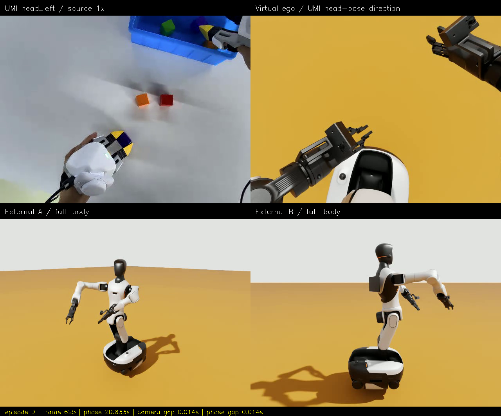

# Episode 000 v6：可选 Pinocchio 在线回放

> 历史文档快照：2026-10-19 迁入。正文中的“本次／我／已通过”沿用原报告口径，不表示本轮重跑；原执行者身份未独立核实。 [阶段与修正导航](../../report.md) · [来源及未随文资源](../../sources.md)。
> 正文命令及 `wbc_demo/`、`logs/` 等路径属于原工程；需在原工程及原环境使用，知识库仅保存笔记与精选素材。
> 素材删选提示：本包保留下方明确列出的文件；原 HTML 导出、原始 JSON/CSV 与其余视频未迁入，原文中的“同目录完整验收包”只描述原工作区。

直接播放 [精选四分屏视频](head_left.mp4)。这是 2026-10-19 的真实 PhysX 位置驱动回放，不是离线 FK 基准或预计算关节动画。

- 模型：Pinocchio 4.1.0；双手共享腰部、动态指尖 EEF、两夹爪主关节；底盘固定。
- 使用已验证的同一首帧关节解；接近路径重新验证。正式段仍是原 QP 控制律，不是实测状态笛卡尔闭环或力矩 WBC。
- 1250 条命令、零超时；实际控制段 41.669305 s，源视频/导出视频 41.666667 s。
- 四分屏：UMI head_left、方向对齐虚拟第一视角、两个外部视角。相机最大源相位差 27.528 ms，通过原 100 ms 门槛，没有放宽阈值。
- 这是单独的 Web 可视化运行 `wbc-online-web-20261019-02/run-001`，不替代无 Web 负载的配对 A/B。未在本轮重新做真实鼠标拖动/按钮操作验收。
- 没有重建块/箱接触任务，不能用视频宣称抓取成功或真实头部相机已完成标定。
- 原始执行报告、指标和原文件清单位于原工作区同目录，本包只保留精选媒体及迁入哈希；批测中的失败与超时问题见 [实验记录](../../topics/umi-replay/ONLINE_AB_RESULTS_ZH.md)，本片成功不代表所有约束问题已修复。

## 本次实际保留的素材

- [head_left.mp4](head_left.mp4)
- [quad-middle.png](quad-middle.png)
- [error-decomposition.png](error-decomposition.png)

