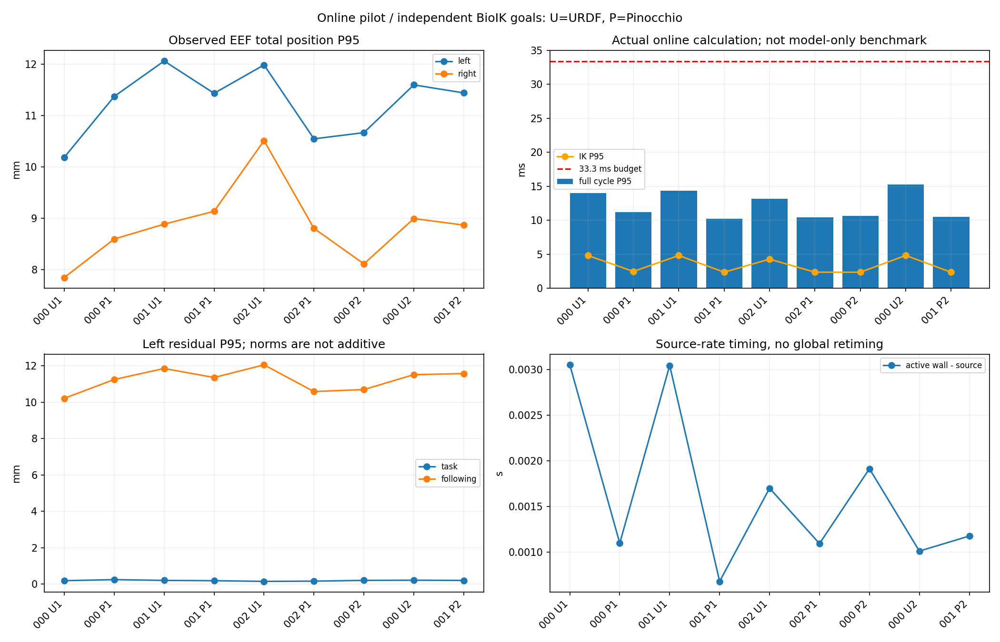

# 探索批次：保留失败与未执行项

> 历史文档快照：2026-10-19 迁入。正文中的“本次／我／已通过”沿用原报告口径，不表示本轮重跑；原执行者身份未独立核实。 [阶段与修正导航](../../report.md) · [来源及未随文资源](../../sources.md)。
> 正文命令及 `wbc_demo/`、`logs/` 等路径属于原工程；需在原工程及原环境使用，知识库仅保存笔记与精选素材。
> 素材删选提示：本包保留下方明确列出的文件；原 HTML 导出、原始 JSON/CSV 与其余视频未迁入，原文中的“同目录完整验收包”只描述原工作区。

本页保留探索批次说明和诊断图。计划 12 项，9 项完成并回零；1 项在关节位置/速度/加速度边界无交集时停止，余 2 项未执行。

- 失败是 episode 001 / URDF / repeat 2，源相位 28.234 s；腰 `idx01_body_joint1` 达上限时仍需正速度，不能在加速度边界内降为零。
- 最后失败观测也记录，共 848 条快照、847 条命令；没有把提前停止视为轨迹成功。
- 每次独立 BioIK 的首帧解差异较大，不能拿此批精度差直接归因于后端。之后才做 [固定同一关节解的对照（Markdown 摘录）](../online-ab-v1/README.md)。
- 原始停止原因及定量重算在 `summary.json/failure_diagnostics`，图包含失败轨迹的已观测部分，不补齐未执行动作。
- 核心源码哈希 `source-manifest.json`；本机原始源码快照在 `wbc_demo/logs/wbc-online-ab-20261019-01/source-snapshot`。
- [完整实验记录与未解决限制](../../topics/umi-replay/ONLINE_AB_RESULTS_ZH.md)。

## 本次实际保留的素材

- [online-comparison.png](online-comparison.png)
- [episode-001-urdf-r02.png](episode-001-urdf-r02.png)

