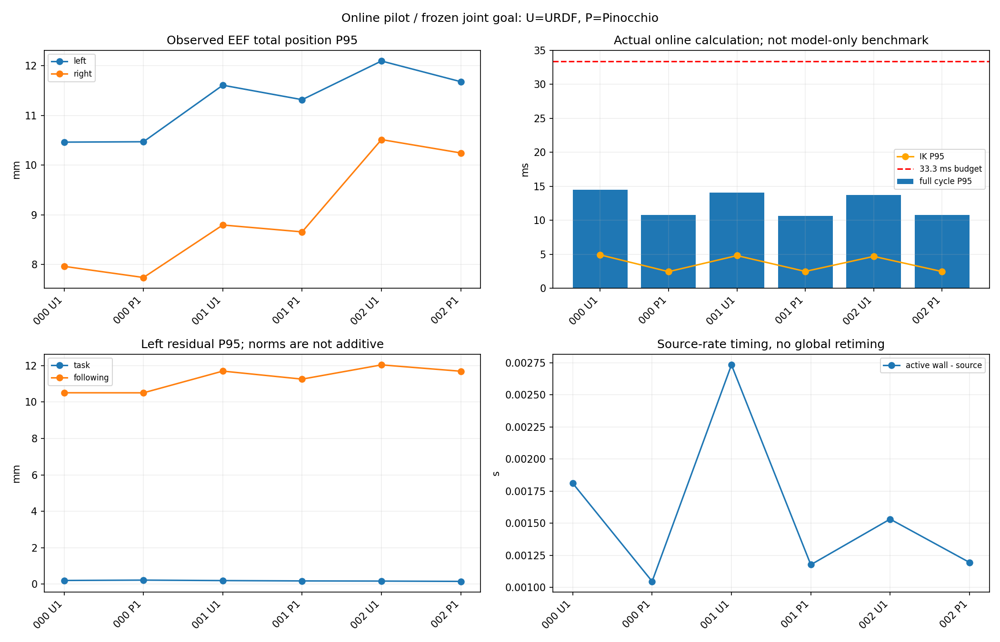

# 在线 A/B：固定同一首帧关节解

> 历史文档快照：2026-10-19 迁入。正文中的“本次／我／已通过”沿用原报告口径，不表示本轮重跑；原执行者身份未独立核实。 [阶段与修正导航](../../report.md) · [来源及未随文资源](../../sources.md)。
> 正文命令及 `wbc_demo/`、`logs/` 等路径属于原工程；需在原工程及原环境使用，知识库仅保存笔记与精选素材。
> 素材删选提示：本包保留下方明确列出的文件；原 HTML 导出、原始 JSON/CSV 与其余视频未迁入，原文中的“同目录完整验收包”只描述原工作区。

先看本页下方对照图，或阅读 [实验说明](../../topics/umi-replay/ONLINE_AB_RESULTS_ZH.md)。

- 000/001/002 × URDF/Pinocchio：6 次执行报告均完成回放及回零；每对初始关节目标完全一致，但物理初态仍有微小差异。
- **不是全项验收通过**：5 项完整命令审计通过；002/URDF 有一次超时，旧加速度审计不完整。HOLD 补充审计重算出名义加速度超过配置 0.545367 rad/s²。
- `summary.json` 区分原始执行状态和 `nominal_command_validation_status=not_fully_passed`。不篡改旧报告状态，也不删除不利样本。
- 同一固定世界变换、同一 QP/约束、同一解释器，30 Hz / 源 1× / 文件前瞻一帧。尚未改成实测状态笛卡尔闭环，尚未修复通用制动可行域与超时平滑降级。
- 图是实际同步日志重算；following 相对最后发布命令，不是驱动确认或因果百分比。每个运行抽样 100 tick 的独立 FK 重算见 JSON。
- `results.csv` 可自行分析；`source-manifest.json` 对应实验时核心源码哈希，原始源码快照在本机 `wbc_demo/logs/wbc-online-controlled-20261019-01/source-snapshot`。
- [另一次 Pinocchio Web 真视频（Markdown 摘录）](../episode-000-v6/README.md) 不混入本批耗时对照。

## 本次实际保留的素材

- [online-comparison.png](online-comparison.png)

