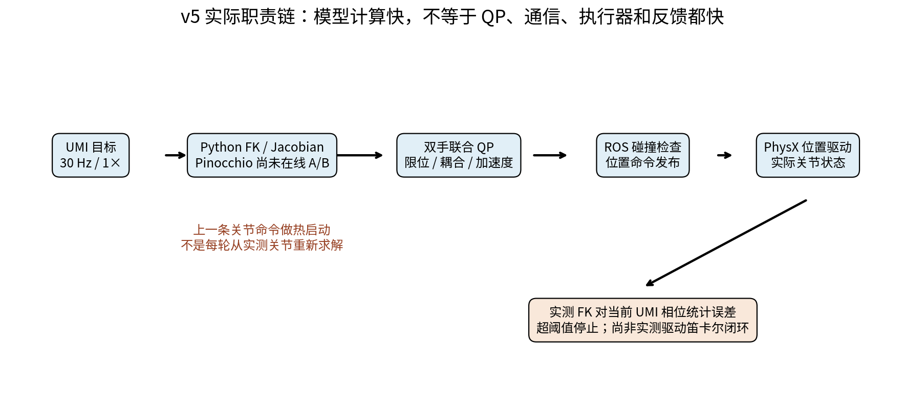

# 阶段、修正与证据导航

这是一份历史阅读导航。下面的实验、计算和“通过”均来自原报告，本轮没有重跑。捕获版本、执行者边界与未随文资料见 [来源](sources.md)；入口摘要见 [README](README.md)。

## 一条链路，几类不同的证据

```text
UMI 文件与坐标语义
  → 共同世界变换 + 模型夹爪 EEF
  → 首帧 IK / 就位路径
  → 在线模型 FK、Jacobian + 联合微分 IK / QP
  → 约束与模型碰撞检查
  → 仿真位置命令
  → PhysX 关节反馈 FK
  → 误差、时序、图像交付与失败审计
```

源数据正确、模型内 FK 一致、目标可达、命令合法、反馈跟踪良好以及画面流畅，必须分别核查。末端微米级的模型残差不能解释成真机精度；最后发布命令也不等于执行器确认已应用的命令。

## 2026-10-12 至 2026-10-13：固定底盘与全身 IK

[全身 IK 入门](topics/wbc/WHOLE_BODY_IK_GUIDE_ZH.md)解释 FK、IK、Jacobian、软偏好、硬约束及动力学 WBC 的区别。[原工程入口](topics/wbc/README.md)和[实验台说明](topics/wbc/LAB_USAGE.md)保留历史调用方式，运行时仍需原工程及其环境。

- [初版结果](topics/wbc/RESULTS.md)：两次独立启动各完成 3 轮、12 个双手目标；最终记录模型 IK/FK 最大位置残差 2.83 微米，反馈关节 FK 的位置误差为 3.43–7.90 mm。
- [大范围与交互实验](topics/wbc/EXPERIMENT_RESULTS.md)：原生限位下 18 个挑战和 18 次回家通过，最大反馈 TCP 位置误差 12.54 mm；锁腰/解锁对照另有几何臂长上界依据。
- [复现过程](topics/wbc/REPRODUCTION_LOG.md)：保留缺失扩展、启动时序与虚拟底盘 TF 竞态的失败和修正。原始构建/运行日志没有搬入知识库。

原报告中的腰部参与是联合运动学求解，位置控制执行。离散自碰撞检查不覆盖连续扫掠碰撞；空场景或未同步的货架不能当作环境避障验证。

## 2026-10-14：世界坐标、虚拟工具与模型夹爪 EEF

[坐标说明](topics/umi-replay/COORDINATES_ZH.md)记录 XTac 数据的 world 定义、已应用的 tracker 外参、两列旋转 6D 和下一帧 action 语义。原文核对了 11 段数据的格式，实际运动范围须按实验分开看。

[最初回放结果](topics/umi-replay/RESULTS_ZH.md)采用虚拟 EEF，原报告明确撤回其符合用户夹爪 EEF 要求的有效性。不得从这份旧表格提取指标当作后续有效夹爪 TCP 的成绩。

[EEF 更正](topics/umi-replay/GRIPPER_EEF_CORRECTION_ZH.md)将任务点改为模型指尖中点，并重新执行。[后续反馈核查](topics/umi-replay/USER_FEEDBACK_REVIEW_ZH.md)继续修正相机侧轴、侧倾偏好和同源相位分屏。[UMI 学习指南](topics/umi-replay/UMI_REPLAY_GUIDE_ZH.md)串起概念、错误和修正，[执行记录](topics/umi-replay/WORK_LOG.md)保留时间线。

左右手必须共用世界变换；世界对齐和 EEF 到法兰的工具换算需分别解释。配置字段 `calibrated` 只表示显式输入矩阵，不能据此声称经过硬件标定。


## 2026-10-14 至 2026-10-15：四视角、夹爪与原速在线 IK

[在线 IK 与视图说明](topics/umi-replay/ONLINE_IK_AND_VIEWS_ZH.md)和 [v3 验收](topics/umi-replay/MULTIVIEW_RESULTS_ZH.md)属于早期阶段。旧“在线回放”可能先离线求完全部关键帧，再在线发送；它与每周期重新求解的在线 IK 不同。

[夹爪与 Web 修复](topics/umi-replay/GRIPPER_AND_WEB_FIX_ZH.md)增加归一化开合驱动、随开度变化的 TCP、端点与真实鼠标操作核查。[v4 媒体说明](assets/episode-000-v4/README.md)记录回放段约 934 s：按源相位压成 41.67 s 的展示视频不能证明原速控制。

[原速在线 IK](topics/umi-replay/REALTIME_REPLAY_ZH.md)记录 v5 改为 30 Hz 联合微分 IK / OSQP，并修复图像 QoS 交付问题。其一次实际控制段为 41.670043 s；最大反馈 EEF 位置误差左/右为 21.410 / 18.359 mm。该结果需要与旧慢放精度区分，不能只看源视频时长和编码帧率。

源文件已知的一帧前瞻、软实时位置控制、反馈误差保护，均不构成无前瞻 VLA 输入或力矩闭环验证。旧“软直腰”名称也须结合后续腰姿核查理解。

## 2026-10-15 至 2026-10-17：模型选型、审计与图解

[代码审计](topics/umi-replay/CODE_AUDIT_ZH.md)记录超时后审计漏检、NaN、配置读取时机、mimic 有限差分等问题及修正。[Pinocchio 研究](topics/umi-replay/PINOCCHIO_STUDY_ZH.md)属于离线模型兼容性与计算段基准；Pinocchio 负责模型 FK/Jacobian，不自动替换 QP、碰撞、驱动和控制律。

[图解 IK 教程](topics/umi-replay/IK_LEARNING_GUIDE_ZH.md)解释解析 IK、数值 IK、Jacobian、QP 与模型一致性，使用旧 v5 日志再计算诊断。教学示意图没有冒充新机器人实验，图中“尚未在线 A/B”描述的是当时阶段。



## 2026-10-19：在线 A/B、失败审计与腰部优先级

[在线 A/B](topics/umi-replay/ONLINE_AB_RESULTS_ZH.md)补齐同一观测周期的目标、反馈和最后发布命令，区分位置向量分解与因果归因。记录包括探索批次及固定首帧批次：

| 范围 | 原报告结果与限制 |
|---|---|
| 探索批次 12 项计划 | 9 项完成；001 / URDF / repeat 2 因关节位置、速度与加速度可行集合无交集停止，后 2 项未执行。初始 IK 分支不同，不能据此归因精度差。 |
| 固定同一首帧的 6 次运行 | 全部完成回放及回零；002 / URDF 有一次超时，HOLD 补充审计重算出名义加速度超过配置约 0.545367 rad/s²，验收为 `not_fully_passed`。 |
| 计算预算 | 固定首帧批次 IK P95 从约 4.7–4.9 ms 降至约 2.45–2.49 ms；不能推广为整链路同比提速或精度显著改善。 |
| 单独的 v6 Web 运行 | 1250 条命令、零超时，控制段 41.669305 s；这一个成功样本不覆盖所有批次与长尾。 |

[v6 精选视频](assets/episode-000-v6/head_left.mp4)包含源采集画面、方向对齐虚拟 ego 和两个外部视角。源相位匹配最大差 27.528 ms；头部光学参数未标定，场景没有复现块/箱接触任务。来源和许可见 [素材说明](assets/episode-000-v6/README.md)。

[最新卡顿与腰姿分析](topics/umi-replay/PLAYBACK_ALIGNMENT_AND_WAIST_ZH.md)保留又两次失败：一次夹爪跟踪保护，一次捕获 875.830 ms 控制周期后保护停止。该长周期内 IK 仅耗时 1.843 ms，现有证据不足以把全部长尾归因于模型求解。

同一分析指出：旧协同 QP 仅额外抑制侧倾，没有“手臂能做就保持腰不动”的严格优先级。固定五个腰关节的首帧候选通过只读模型检查，但没有发布、没有验证就位路径和后续轨迹。

## 引擎资料与后续路线

[引擎工程复盘](topics/engine-review.md)从 7 份源码配套资料摘编 USD 消费、引擎差异、参数链、Newton 转换和 OVRtx 同步经验；没有导入实现代码和工程资产，设计验收条件也没有改写成实测结果。

[WBC 后续路线](topics/umi-replay/WBC_NEXT_STAGE_ZH.md)是规划与验收门槛，需结合最新 A/B 与卡顿分析阅读。当前优先级包括离散制动可行域、HOLD 连续性、合理首帧和腰臂策略，再评估实测状态闭环、无前瞻输入与动力学分支。
