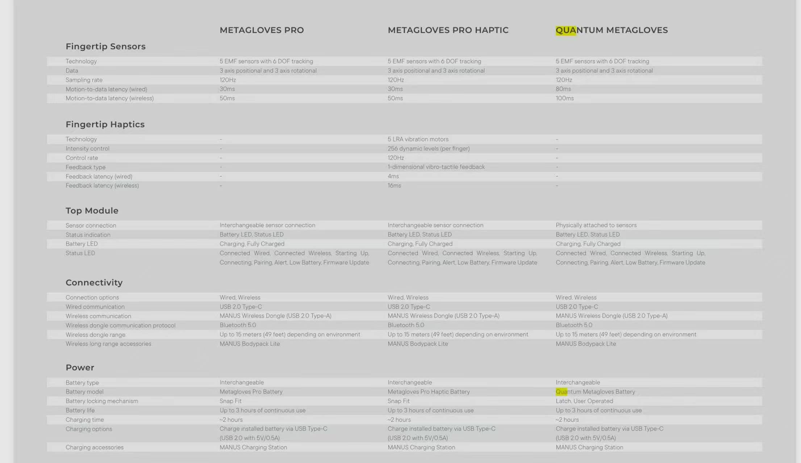

> 历史文档快照：原记录日期 2026-09-21，于 2026-10-22 复制整理。文中“本次”“本仓库”和测试结果均指原研究工作区及当时范围；本轮只做归档、路径适配和知识库检查，未重新验证技术结论。来源见 [sources.md](sources.md)。

# MANUS Metagloves Pro Haptic 数采手套技术、机械结构与产品竞争力调研

> 调研日期：2026-09-21\
> 研究对象：MANUS Metagloves Pro Haptic，兼顾 Metagloves Pro、已停产 Quantum Metagloves 及主流替代技术\
> 主要用途：灵巧手遥操作、具身智能示教数据采集、手部运动学研究与 XR 交互\
> 证据口径：当前官方规格与文档优先；本地 2026 产品册、MANUS 专利、同行评测论文、授权经销商价格和本地工程代码分别标注；未公开的电路与算法细节不作为已确认事实



---

## 0. 结论摘要

1. **Metagloves Pro Haptic 的核心不是“每个关节装一个角度传感器”，而是测量五个指尖相对手背磁场源的 6DoF 位姿，再由手模型反求整手关节。** 每只手套有 5 个 6DoF EMF 指尖传感器，输出每个指尖的三维位置与三维旋转；手背还有用于手腕朝向的 IMU。MANUS Hand Solver 根据个人手长、骨长、指尖位姿和生物力学约束重建完整手骨架。所谓 25DoF 是数字手模型可表达的自由度，不是 25 个独立物理传感器。

2. **21 点、17 个解剖关节、22 个手指运动自由度和产品所称 25DoF 是不同层次。** 常用 21 点模型是 1 个手腕点加每指 4 个点，共 21 个三维位置点；它是一种关键点数据格式。Metagloves Pro Haptic 官方关节表可数出约 22 个手指运动轴，再加手腕三轴旋转，正好可解释为 25DoF。21 点不等于 21DoF，也不等于 21 个传感器。

3. **EMF 的“无漂移”是相对纯 IMU 积分漂移而言，不等于不受电磁环境影响。** 指尖持续参照手背上的交流磁场源，位置不会像加速度/角速度积分那样随时间无限累积误差；它也不依赖相机视线和照明。但大块导电金属会产生涡流并改变幅相，铁磁材料会改变磁导，电机、变频器、磁化工具和邻近手套磁源会叠加干扰。官方校准步骤要求使用非金属平面，授权经销商也明确建议避开大金属、活动电机和强磁源。

4. **公开证据足以说明其信号链的大框架，但不足以画出量产 PCB 原理图。** MANUS 专利描述了手背单一 EMF 源、每指一个磁场传感器、线缆回传、放大、截止/陷波滤波、ADC 和 MCU 处理，并描述多手套之间的“先监听、后发射”自组织时分避让。公开论文进一步确认上一代 Quantum 使用一组三轴源线圈与五组三轴接收线圈，源—接收的 3×3 组合形成 9 个耦合量来求每个指尖 6DoF。载波频率、ADC 位数、模拟增益、同步检波算法、误差模型和 Pro Haptic 的具体 PCB 布局没有公开。

5. **手背壳体 Top Module 是系统中价值最高的机电核心。** 官方明确称其中包含“全部电子与连接”；结合规格、SDK 和专利，可以确认或高置信推断其中包括三轴 EMF 发射线圈/驱动、手腕 IMU、模拟前端、ADC、MCU/固件、BLE 5.0、USB 2.0 Type-C、电源管理、可换电池接口、状态灯和手套连接器。授权经销商给出的 Pro Haptic Top Modules 备件价约 6,019 美元/对，而带传感器和织物的 Sensor Gloves 约 1,875 美元/对，也侧面说明核心成本集中在手背电子模组。

6. **手指背面看到的“小方块”要分两类。** 位于指尖/指甲背面的较大壳体是 EMF 指尖接收器，官方尺寸约 20.3×14.6×9.6 mm；Pro Haptic 额外布置的约 12.5×12.5×8.1 mm 小方块是 LRA 线性谐振振动器，用于逐指振动触觉。后者只能产生一维振动提示，不会阻止手指穿过虚拟物体，也不测量真实接触力；“触觉反馈”不能等同于力反馈或触觉传感。

7. **数据在“手套端 + PC 端”分级处理。** 手套端至少完成发射时序、模拟采样、基础滤波/调度、数据打包和无线/USB 传输；PC 上的 MANUS Core/集成式 SDK 完成用户标定、指尖位姿到骨架/人体工学角度的求解、外部 tracker 融合、记录、重定向和插件输出。官方 SDK 可输出原始五指传感器位姿、原始骨架、重定向骨架和 ergonomics 角度；“原始传感器数据”仍是解算后的指尖 Pose，不是线圈 ADC 波形，而且需要对应授权。

8. **它的优势是高质量“手形运动学数据”，不是万能遥操作输入。** EMF 方案同时具备不遮挡、绝对局部位置、120 Hz、指尖姿态和较轻穿戴，特别适合精细抓取、捏合、道具交互和机器人手数据采集。它不直接提供手腕在世界坐标中的三维位置，因此通常仍要用 VR 控制器、Vive/光学 tracker、Xsens 或机器人臂末端位姿来补足 6DoF 手腕；也不提供接触力、切向力或滑移标签。

9. **相较应变/电阻/电容手套，MANUS 更擅长跨姿态保持准确的指尖空间关系；相较机械外骨骼，它更轻、更自然但没有阻力反馈；相较纯视觉，它不怕遮挡；相较分布式 IMU，它没有积分漂移。** 代价是磁环境敏感、手背模块和指尖壳体偏厚、续航仅约 3 小时、软件授权与闭源求解器依赖强，且 30/50 ms 的 motion-to-data 延迟不是极低延迟力控级指标。

10. **国内约 8 万元/套并非只由硬件 BOM 决定。** 2026 年海外渠道公开价从约 7,400 美元/对（硬件）到 9,200 美元起（带 Core 3），另一授权渠道列出 Pro Haptic 约 9,656 美元、Core 3 约 2,124 美元，SDK 升级还可能另计。换算、进口税费、渠道服务、售后、校准/集成和授权后，8 万元人民币处在合理渠道区间。高价主要来自低量专业硬件、EMF 标定和求解 IP、软件生态、永久/功能授权、专业支持及市场规模，而不能据此推断其物料成本接近售价。

11. **产品竞争力强，但营销表述需要验收。** “毫米级、无漂移、无遮挡、快速持久标定”有合理技术基础；公开第三方研究对上一代 Quantum 的动态角度离散度给出 1.20°–2.79°，优于其对比的 IMU 和电阻弯曲手套。但这不是 Pro Haptic 在机器人电机旁的指尖绝对位置精度验证。当前官网也没有给出误差分布、金属敏感距离、时钟抖动、丢包率或端到端控制延迟。

12. **采购前最重要的不是演示握拳，而是目标工位原位测试。** 应在机器人上电/断电、电机静止/运动、不同金属工具、双手靠近、USB/无线两种模式下，用光学真值测量指尖静态误差、动态误差、长时稳定性、异常尖峰和端到端延迟；同时锁定 Top Module、Sensor Glove 尺码、Core/Solver/固件版本、SDK/Raw/Linux/ROS 2 授权和装箱数量。

---

## 1. 研究边界与证据分级

本报告把信息分为五级：

| 等级 | 含义 | 本文示例 |
|---|---|---|
| A | 当前官方产品规格、官方文档、SDK 文档 | 5 个 6DoF EMF 传感器、120 Hz、30/50 ms、LRA、数据接口 |
| B | 厂商专利、官方历史版本、官方发布说明 | 放大—滤波—ADC 信号链、多手套避让、固件调度改进 |
| C | 同行评审论文、独立实验 | Quantum 的静动态重复性、源/接收三轴线圈结构 |
| D | 授权经销商、渠道报价、公开用户/研究使用反馈 | 海外价格、金属干扰提示、易损/佩戴意见 |
| E | 基于 A–D 的工程推断 | Top Module 内部功能分区、LRA 与 EMF 的隔离策略可能性 |

以下边界必须先说明：

- 本报告没有实物拆机，因此不会把内部 PCB 数量、芯片型号、载波频率、线圈匝数、ADC 位数和屏蔽材料写成事实。
- MANUS 的相关专利可证明厂商掌握并保护了某种架构，但不能证明当前 Pro Haptic 每一处均原样采用专利实施例。
- Quantum 是 Pro 系列的技术前代。独立论文对 Quantum 的测量结果可支持路线判断，不能直接替代 Pro Haptic 的验收报告。
- “用户问题”优先引用官方 release notes 和维护文档。匿名论坛中缺少版本、场景和复现步骤的陈述仅作风险线索，不作缺陷定论。

---

## 2. 灵巧手与数据采集快速入门

### 2.1 人手关节的基本命名

四根长指从掌部到指尖依次为：

```text
腕/掌 ── MCP ── PIP ── DIP ── 指尖
          掌指     近端     远端
          关节     指间     指间
```

- **MCP（掌指关节）**：连接掌骨与近节指骨，通常有屈伸和有限的外展/内收两个主要转轴。
- **PIP（近端指间关节）**：中间的大弯曲关节，主要做屈伸。
- **DIP（远端指间关节）**：靠近指尖的弯曲关节，主要做屈伸。
- **CMC（腕掌关节）**：掌骨与腕骨之间。食指/中指 CMC 活动很小；环指/小指 CMC 有一定掌弓运动。

拇指的链路不同：

```text
腕/掌 ── CMC ── MCP ── IP ── 指尖
          对掌     掌指    指间
```

拇指的对掌不是单一平面弯曲，而是 CMC 多轴运动、掌骨旋转、屈伸与外展的组合。因此任何只测一条“弯曲量”的廉价手套，拇指通常都是最难准确还原的部分。

### 2.2 位置、姿态、关节角和自由度不是一回事

- **位置 position**：一个点在三维空间的 (x,y,z)。
- **姿态 orientation**：一个刚体朝向，常用旋转矩阵、四元数或欧拉角表达。
- **6DoF Pose**：三维位置 + 三维旋转。
- **关节角**：骨段之间绕关节轴的相对旋转。
- **自由度 DoF**：描述系统独立运动所需的最少变量数。

五个指尖各有 6DoF，形式上是 30 个数，但它们受到同一只手骨架的长度和关节约束，并不等于人体手有 30 个独立自由度。反过来，21 个关键点每点有 3 个坐标，共 63 个数，也不意味着 63DoF。

### 2.3 常用 21 点手模型

MediaPipe/OpenPose 风格的 21 点约定通常如下：

| 索引 | 节点 | 解剖含义 |
|---:|---|---|
| 0 | wrist | 手腕/掌根参考点 |
| 1–4 | thumb | CMC、MCP、IP、tip |
| 5–8 | index | MCP、PIP、DIP、tip |
| 9–12 | middle | MCP、PIP、DIP、tip |
| 13–16 | ring | MCP、PIP、DIP、tip |
| 17–20 | pinky | MCP、PIP、DIP、tip |

它的主要价值是让摄像头、MANO、数据手套和机器人重定向器共享同一种语义接口。需要注意：

- 21 点只定义“这些点是什么”，不规定坐标轴方向、单位和原点；
- 视觉系统直接预测 21 点，手套系统常先解算骨架再导出 21 点；
- 点间连线是骨段近似，不是传感器真的贴在每个点上；
- 左右手的叉乘方向和坐标系手性不同，镜像处理错误会导致拇指和外展方向反转。

### 2.4 MANUS 的 25DoF 如何理解

当前 Pro Haptic 官方关节列表可按下表理解：

| 部位 | 官方可表达运动 | 运动轴数 |
|---|---|---:|
| 拇指 | CMC 外展/内收 + 屈伸；MCP 屈伸；IP 屈伸 | 4 |
| 食指 | MCP 外展/内收 + 屈伸；PIP；DIP | 4 |
| 中指 | MCP 外展/内收 + 屈伸；PIP；DIP | 4 |
| 环指 | CMC 屈伸；MCP 外展/内收 + 屈伸；PIP；DIP | 5 |
| 小指 | CMC 屈伸；MCP 外展/内收 + 屈伸；PIP；DIP | 5 |
| 手腕 | 三轴旋转 | 3 |
| **合计** | **手指 22 + 手腕 3** | **25** |

这与常见机器人手的 20DoF 也不相同。例如 Wuji Hand 2 是五指各 4 个主动轴：四根长指通常是 MCP 屈伸、MCP 外展、PIP、DIP；拇指是 CMC 两轴、MCP、IP。MANUS 多表达的环指/小指 CMC 掌弓运动在映射到 20DoF 机器人时必须丢弃、合并或由优化器吸收。

官方规格来源：[Metagloves Pro Haptic Specs](https://www.manus-meta.com/products/metagloves-pro-haptic-specs)。

### 2.5 从手套数据到机器人动作

一条完整的灵巧手遥操作链路不是“手套角度直接发电机”，而是：

```text
人体手运动
  ↓
物理传感：五指 EMF Pose + 手腕 IMU
  ↓
个体标定：手长、骨长、传感器偏置、捏合关系
  ↓
人体手解算：原始传感器 → 人手骨架/21 点/关节角
  ↓
坐标统一：左右手、单位、腕坐标、轴方向、时间戳
  ↓
Retargeting：人体关键点/方向 → 机器人关节角 q
  ↓
关节限位、碰撞、速度/加速度限制、低通与安全状态机
  ↓
机器人灵巧手位置/速度/力矩控制
```

Retargeting 常见目标函数可概括为：

\[
q^*=\arg\min_q\left(
w_p\sum_i\|p_i^{robot}(q)-sRp_i^{human}\|^2 +
w_d\sum_j\|d_j^{robot}(q)-Rd_j^{human}\|^2 +
w_t\|q-q_{t-1}\|^2 +
w_b\Phi(q)
\right)
\]

其中 (p_i) 是关键点，(d_j) 是骨段/捏合方向，(s,R) 是尺度和坐标旋转，时间项抑制抖动，Φ 表示关节限位、耦合或碰撞惩罚。关键结论是：**手套测得再准，若机器人骨长、关节轴、自由度或损失权重不合适，抓取仍会失真。**

### 2.6 数据集应记录什么

只保存最终机器人 action 会丢失大量诊断信息。建议同步保存：

| 层级 | 建议字段 | 价值 |
|---|---|---|
| 设备 | glove ID、左右手、固件、Core/Solver 版本、连接模式、电量、丢包/状态 | 可复现与故障定位 |
| 标定 | `.mcal`、手尺寸、标定时间、尺码、操作者 ID | 跨人/跨日一致性 |
| 原始 Pose | 五指相对手背的 position + quaternion、手腕 IMU | 后续重算、评估传感层 |
| 人手模型 | 21 点、骨架节点、ergonomics 角度 | 通用算法接口 |
| Retargeting | 坐标变换、尺度、机器人 q target、优化残差 | 发现映射错误 |
| 真机 | q actual、速度、电流/力矩、触觉、告警 | 动作执行质量 |
| 外部上下文 | RGB/RGB-D、腕/臂 Pose、物体 Pose、任务标签 | 具身学习需要 |
| 时序 | 统一时钟时间戳、采样时间、到达时间、控制下发时间 | 延迟与同步分析 |

---

## 3. 产品定位与当前规格

### 3.1 三代/三型产品不要混淆

| 产品 | 指尖跟踪 | 触觉 | 当前定位 |
|---|---|---|---|
| Quantum Metagloves | 五指 EMF 6DoF，120 Hz | 无 | 2022 年平台，2026 年已宣布售罄/EOL；大量论文使用该代 |
| Metagloves Pro | 新一代五指 EMF 6DoF，120 Hz | 无 | 专业动作捕捉、科研与机器人数据采集 |
| **Metagloves Pro Haptic** | 与 Pro 同类的五指 EMF 6DoF，120 Hz | **每指 1 个 LRA** | 遥操作、具身 AI、XR 中需要事件/接触提示的版本 |

MANUS 官方称 Quantum 是其首款基于专有 EMF 的手套；Pro Haptic 是在 Pro 平台上增加逐指触觉，而不是增加力/触觉传感。来源：[Quantum EOL 公告](https://www.manus-meta.com/blog/manus-quantum-metagloves-reach-end-of-life)、[Pro Haptic 产品页](https://www.manus-meta.com/products/metagloves-pro-haptic)。

### 3.2 Pro Haptic 当前硬件规格

| 项目 | 当前公开值 | 工程解读 |
|---|---:|---|
| 指尖传感器 | 5 个 EMF，单个 6DoF | 测五个指尖相对手背源的 3D 位置与旋转 |
| 采样率 | 120 Hz | 传感/输出标称频率；不等于端到端控制频率 |
| 动作到数据延迟 | 有线 30 ms；无线 50 ms | 约 3.6/6 个 120 Hz 周期；机器人闭环还要叠加重定向和执行器延迟 |
| 手腕 | 3 轴旋转 | 来自手背 IMU；本体不提供世界坐标手腕平移 |
| 手模型 | 25DoF | 22 指部运动轴 + 3 手腕旋转的合理解释 |
| 触觉 | 5 个 LRA；每指 256 强度；120 Hz 控制 | 一维振动提示，不是法向阻力、皮肤牵引或力反馈 |
| 触觉延迟 | 有线 4 ms；无线 16 ms | 指命令到振动链路指标，独立于动作到数据延迟 |
| 通信 | USB 2.0 Type-C；专用 USB-A dongle/Bluetooth 5.0 | Dongle 还承载软件授权；标称无线范围最高 15 m |
| 电池 | 可更换；最高 3 h；约 2 h 充电 | 支持热换工作流和 USB-C 外部供电，但单电池续航短 |
| 质量 | 中码、含电子和电池 178 g | 官方用单数 glove 描述，工程上通常按单只理解；应向供应商确认 |
| 手背模组 | 60.7×78.2×34.3 mm | 对手背碰撞和袖口/腕部空间有影响 |
| 指尖壳体 | 20.3×14.6×9.6 mm | 可能影响狭窄空间、按键、紧贴物体和指甲触感 |
| LRA 壳体 | 12.5×12.5×8.1 mm | Pro Haptic 特有的小方块 |
| 织物 | 72% 聚酯纤维、28% 氨纶 | 电子件拆除后可洗；当前官网有 M、L 两码 |
| 环境 | 0–40°C；10%–80% RH，无凝露 | 非防水、非高温、非洁净/防爆认证信息 |

来源：[官方规格页](https://www.manus-meta.com/products/metagloves-pro-haptic-specs)与本地 [2026 Product Portfolio（工作区资料，未随文保存）](sources.md#workspace-83a69876ed5d)。

### 3.3 必须注意的版本口径差异

| 项目 | 2026-02 本地产品册 | 2026-09 当前网页/文档 | 采购含义 |
|---|---|---|---|
| Haptic 尺码 | M | M、L | 报价单必须写尺码和替换规则 |
| 箱内电池 | 4 块 | 2 块 | 不要按旧册默认数量验收 |
| 标定 | 宣传为 persistent、跨电池/佩戴无需重标 | 最新文档建议每次使用前标定；Core 3.2 已从 4 步变为 8 步 | 生产节拍应按实际软件版本测量 |
| 标定耗时 | 50 s/4 步 | 8 步，增加四次逐指捏合 | 旧规格页尚未完全同步最新流程 |
| 延迟 | 30/50 ms | 当前规格仍为 30/50 ms；Core 3.0 发布说明曾称约 25±4.5/41.5±4.5 ms | 把 30/50 ms 作为保守选型值，现场实测 |

这类差异不是小问题。数据采集项目应在合同中锁定：硬件 revision、左右手、尺码、固件、MANUS Core、Hand Solver、SDK、授权 features/seats、装箱附件和两年内的软件兼容策略。

---

## 4. EMF 跟踪的技术原理

### 4.1 它测的是什么

手背线圈产生已知的交流近场磁场；指尖三轴接收器测量局部磁场的幅值与方向。理想小线圈可近似为磁偶极子，其准静态磁场为：

\[
\mathbf B(\mathbf r)=\frac{\mu_0}{4\pi r^3}
\left[3\hat{\mathbf r}(\mathbf m\cdot\hat{\mathbf r})-\mathbf m\right]
\]

其中 \(\mathbf m\) 是发射线圈磁矩，\(\mathbf r\) 是从源到接收器的位置。关键特点是：

- 场强近似按 (1/r^3) 衰减，因此很适合手背到指尖这种短距离局部工作空间；
- 指尖移动会改变幅值，指尖旋转会改变三轴接收器对磁场的投影；
- 若源依次沿三个正交轴激励、接收器也测三个正交轴，就得到一个 3×3 耦合矩阵，共 9 个量；
- 已知源的磁场模型和线圈标定后，可用非线性求解估计接收器的 3D 位置与 3D 姿态。

2025 年同行评审论文对 Quantum 的描述正是“一组三轴源线圈 + 五组三轴检测线圈”，用 9 个源—接收组合求每指 6DoF。来源：[Saggio et al., Biosensors 2025](https://doi.org/10.3390/bios15100640)。

### 4.2 为什么能“无漂移”

纯 IMU 的位置需要对加速度二次积分，姿态中的航向也可能随陀螺零偏逐渐漂移。EMF 每一帧都重新测量指尖相对手背源的绝对局部 Pose：

\[
{}^{hand}T_{tip}=f^{-1}(\mathbf B_{3\times3})
\]

只要磁场模型和环境不变，前一帧的小误差不会被积分到后一帧，因此不会产生典型的随时间累计漂移。但它仍可能出现：

- 固定偏差：线圈安装偏置、手模型或标定错误；
- 空间畸变：金属、磁体、外部交流场改变磁场；
- 瞬时尖峰：多源碰撞、饱和、无线丢包或求解器局部异常；
- 解剖误差：指尖 Pose 正确，但中间关节角并非唯一。

所以更准确的表述是：**EMF 不依赖惯性积分，具有局部绝对参考；它不是零误差，也不是磁免疫。**

### 4.3 Pro Haptic 的硬件拓扑

```text
                           每根手指
┌────────────────┐      ┌──────────────────────┐
│ 手背 Top Module │─────►│ 指尖三轴 EMF 接收线圈 │
│                │◄─────│ + 线缆回传            │
│ 三轴 EMF 源/驱动│      │                      │
│ 手腕 IMU        │─────►│ LRA 振子（触觉命令）  │
│ 放大/滤波/ADC   │      └──────────────────────┘
│ MCU/时序/求解前端│               ×5
│ BLE 5 / USB 2.0 │
│ 电池/电源管理   │
└───────┬────────┘
        │ USB-C 或 BLE→专用 Dongle
        ▼
  MANUS Core / SDK（PC、Linux 主机或集成式运行）
```

证据边界：官方确认 Top Module 包含全部电子和连接、手背有磁场源与 IMU，专利确认可采用线缆—放大—滤波—ADC—MCU 链路；图中具体功能是否分布在一块或多块 PCB、是否有独立协处理器，公开资料没有说明。

### 4.4 信号如何解耦

“解耦”至少有四层，不能只理解为一个算法：

#### A. 三轴源的解耦

最直接的方法是让三个正交源线圈在不同时间片依次激励；接收器在已知时隙同步采样，就知道当前磁场来自哪一源轴。另一类方法是给不同源分配不同频率，再用窄带/同步解调分离。MANUS 专利讨论了频分和时分，并指出多频叠加会增加放大与幅相分离难度，因此“同一时刻只发送一个信号”更容易正确检测。

#### B. 五个指尖通道的解耦

每个指尖传感器通过独立导线/通道回到手背，控制器按通道识别 thumb/index/middle/ring/pinky。官方 SDK 的原始传感器顺序也固定为拇指到小指。它不是从一条混合无线信号里猜五根手指。

#### C. 左右手/多人之间的解耦

两只手靠近时，各自手背源会被对方指尖接收器看见。MANUS 的同步专利提出自组织机制：源关闭时先监听传感器；若没有外部源信号才发射；发射期间继续监听并分析。其目的相当于近距离多手套的分布式时隙避让/碰撞检测，避免同时发射造成幅值错误。专利还提到可用内部振荡器/晶振控制间歇发射。

#### D. 指尖 Pose 与关节角的解耦

磁测量只直接给五个指尖相对源的 Pose。MANUS Core 用个人骨长和手模型做逆运动学，将多个可能的中间关节构型约束为生理合理的 25DoF 手姿。捏合补偿、casing compensation、手尺寸微调和 Solver 更新都发生在这一层。因此“指尖信号完整”不自动意味着每个 PIP/DIP 角度唯一准确。

MANUS 专利来源：[WO2023037289A1 / US12474731B2](https://patents.google.com/patent/WO2023037289A1/en)。

### 4.5 模拟前端与数字信号链

根据专利可确认的通用流程为：

```text
交流磁场激励
  → 三轴接收线圈产生微弱感应信号
  → 多通道低噪声放大
  → 截止/带通/陷波，抑制宽带噪声与特定干扰
  → ADC 数字化
  → 按发射时序提取幅值/相位或耦合矩阵
  → 线圈标定与非线性逆解，得到五指 Pose
  → 骨架 Solver，得到关键点/关节角
  → 时间滤波、封包和 SDK/插件输出
```

工程上通常还会使用同步检波或相关解调，因为已知发射载波频率和相位，可以把不相关噪声平均掉。**但 MANUS 没有公开 Pro Haptic 是否采用何种同步检波、FFT、锁相、卡尔曼滤波或神经网络校正，本文不作确定判断。**

### 4.6 抗电磁干扰能力

| 干扰 | 物理机制 | 典型表现 | EMF 方案能否天然消除 |
|---|---|---|---|
| 50/60 Hz 电源磁场 | 与载波不同频的低频场 | 周期噪声、幅值波动 | 可用载波选择、窄带/陷波显著抑制，但非绝对 |
| 机器人电机/线束/PWM | 强时变磁场和宽带谐波 | 抖动、瞬时跳变、局部偏差、前端饱和 | 不能天然消除；需距离、布线、屏蔽、频率规划和现场标定 |
| 大块铝/铜/钢 | 涡流产生二次场并改变幅相 | 空间相关的系统偏差 | 不能靠普通滤波消除，因为干扰与目标载波同频 |
| 铁磁材料/永磁体 | 改变磁导或叠加静磁场 | 偏差、方向异常、饱和 | 不能保证消除；交流耦合可抑制纯直流分量，但材料仍会扭曲交流场 |
| 另一只/多只 EMF 手套 | 同频或相近源叠加 | 幅值增强/抵消，Pose 错解 | 专利的自组织时分避让用于缓解；极端密集场景仍应测 |
| LRA 振子与其驱动 | 电磁致动、机械振动 | 可能串入接收或造成壳体微振 | 产品显然需要调度/滤波/结构隔离，但具体隔离指标未公开 |
| BLE/Wi‑Fi 射频 | 高频射频耦合、丢包 | 通信抖动/丢帧，不一定直接扭曲磁测量 | 协议重传与 RF 设计可缓解；无线延迟仍高于有线 |

真正困难的是导电/铁磁物体造成的**同频空间畸变**：它不是简单的额外白噪声，而是把“位置→磁场”的物理模型改掉。再强的低通滤波也可能只得到平滑但错误的 Pose。

### 4.7 信号完整性如何评价

正面因素：

- 源与接收器都在同一只手上，距离短、相对工作空间有限，信号比大型房间级磁跟踪更容易做强；
- 指尖是绝对局部 Pose，不会累计积分漂移；
- 全封闭织物线缆减少摆动、接触不良和外部勾挂；
- 120 Hz 对一般人手动作和遥操作足够，发布说明称新固件优化过传感调度与滤波；
- 有线 USB 可绕开无线丢包并把标称延迟从 50 ms 降到 30 ms。

公开资料缺口：

- 没有 SNR、ENOB、ADC 位数、带宽、载波、通道串扰和温漂；
- 没有指尖位置/旋转的 RMS、P95/P99、不同工作空间的误差图；
- 没有机器人电机、钢桌、磁性工具附近的抗扰度曲线；
- 没有 BLE 丢包率、时间戳精度、两手同步误差和 USB 抖动；
- 没有 LRA 全强度工作时对 EMF 数据的对照实验；
- “毫米级”没有公开统一测试距离、真值系统和统计口径。

因此，对“信号完整性很好”的专业表述应是：**架构上有强局部信号、同步激励和专用滤波，且商品化结果支持稳定使用；但厂商未公开足够底层指标，必须用目标工位实测验证。**

---

## 5. 机械结构与部件解释

### 5.1 模块划分

Metagloves Pro Haptic 由三类可拆部分构成：

1. **Sensor Glove**：贴身织物、五个 EMF 指尖传感器、五个 LRA、内部线缆和手背连接底座；
2. **Top Module**：磁场源、主要电子、电池、通信、状态灯和连接器；
3. **外部附件**：专用无线 Dongle、USB-C、电池、充电座、Vive/Quest/Xsens/光学 tracker 适配器、Bodypack Lite。

Top Module 用铰链定位并压到一体卡扣，官方称一次连接动作即可安装。电子拆除后织物可清洗。这种架构把昂贵、易升级的电子与贴身、尺码相关、会磨损的织物分开，适合多人轮班共享 Top Module。

### 5.2 手背壳子里有什么

| 子系统 | 证据状态 | 作用 |
|---|---|---|
| 三轴 EMF 发射源/线圈 | 官方博客 + 论文确认同代路线 | 建立手背局部磁坐标系 |
| 发射驱动/时序 | 专利确认 | 合成、放大并按时隙驱动交流磁场 |
| 五指接收模拟前端 | 专利确认架构 | 放大与过滤五指回传的微弱信号 |
| ADC | 专利确认架构 | 模拟信号数字化 |
| MCU/处理器/存储 | 专利 + 产品功能 | 时序、采集、基础计算、固件、设备 ID/状态 |
| 手腕 IMU | 官方 SDK/文档 | 三轴手腕旋转；原始流包含 IMU orientation |
| BLE 5.0 + USB 2.0 | 官方规格 | 无线/有线数据与固件升级 |
| 电源管理 + 可换电池 | 官方规格 | 供线圈、模拟前端、无线与 LRA 使用 |
| LRA 驱动 | 由触觉规格必然需要，芯片形式未知 | 五路强度控制 |
| 外部 tracker 安装接口 | 官方规格 | 补足世界坐标手腕位置/姿态 |

不能确认：PCB 数量、主控型号、IMU 型号、BLE SoC、模拟放大器、线圈几何、是否有磁屏蔽片、是否在手套端完成完整 6DoF 逆解。

### 5.3 指头背后小方块是什么

| 外观位置 | 规格尺寸 | 真实功能 | 常见误解 |
|---|---:|---|---|
| 指尖/指甲背面，较长壳体 | 20.3×14.6×9.6 mm | 三轴 EMF 接收器，测相对手背源的指尖 6DoF | 不是 IMU，也不是压力传感器 |
| 手指背面，近方形小块 | 12.5×12.5×8.1 mm | LRA 振动执行器，按软件命令提示接触/事件 | 不测触觉，不提供阻止屈曲的力反馈 |

LRA（Linear Resonant Actuator）用电磁方式让内部质量块在共振附近往复运动。其优点是响应快、能量集中、可做清晰的点击/振动感；缺点是只告诉用户“发生了什么/强弱多少”，无法真实呈现物体刚度、形状、持续阻力和剪切滑移。

### 5.4 信号和电力如何穿过手套

官方称指尖传感器与 LRA 的线缆完全整合并封闭在织物内。合理的机械设计目的包括：

- 固定线缆相对线圈的位置，减少运动伪差；
- 避免裸线勾住工具；
- 将传感器/振子做成可从织物通道取出的电子子件，以便洗涤；
- 把所有支路集中到手背连接器，一次扣合 Top Module。

代价是织物通道、柔性线缆和小型连接器会成为长期弯折与拉扯的可靠性点。官方穿脱指南反复要求拉织物而不是拉传感器或线缆，本身就是需要纳入培训和耐久测试的信号。

### 5.5 为什么不把传感器直接贴在每个关节

五指指尖方案只需要五个终端模块，线束和校准量少；每个指尖 6DoF 又能对整条指链提供较强约束。若每个指节放 IMU/应变传感器：

- 器件、线缆、功耗和故障点急剧增加；
- 指侧与掌侧变厚，妨碍接触物体；
- 多个小传感器安装角误差会沿运动链累积；
- 每次穿戴时传感器相对骨段的位置更难保持。

MANUS 的代价是中间关节角依赖模型推断，对非标准手形、关节畸形、极端超伸和接触受限姿态未必等同于直接测角。

---

## 6. 数据在哪里处理、如何传到电脑

### 6.1 两种基本连接

```text
有线：手套 Top Module ── USB 2.0 Type-C ── PC/边缘主机

无线：手套 Top Module ── Bluetooth 5.0 ── MANUS USB-A Dongle ── PC
```

- 有线动作到数据标称 30 ms，无线 50 ms；
- Dongle 标称 15 m，最佳实践是避免遮挡；
- Dongle 还可承载 MANUS Core 授权，即使手套有线连接，也可能仍需接入授权 Key/Dongle；
- 固件升级要求手套有线连接，手套与 Dongle 固件不一致会导致无线无法连接；
- 更远距离和“零数据损失”工作流可加 Bodypack Lite，用 Wi‑Fi 6E/千兆以太网转发。

### 6.2 手套端与主机端的职责

| 位置 | 可确认/高置信职责 | 不应假定 |
|---|---|---|
| 手套固件 | 线圈激励、采样调度、模拟/数字滤波、基础 Pose/状态生成、BLE/USB 打包、LRA 控制 | 未知是否执行完整 Hand Solver，未知底层原始 ADC 是否可导出 |
| MANUS Core | 设备管理、用户与标定、手模型 Solver、骨架/ergonomics、外部 tracker、记录回放、插件/SDK 服务 | 不是必然的硬实时控制器 |
| SDK Integrated | 将 Core 能力嵌入 Linux/Windows 应用，可在 x86_64/ARM64 运行 | 仍受授权功能和闭源 SDK 约束 |
| 用户应用 | Retargeting、安全约束、机器人控制、数据记录、质量检测 | 不应只消费平滑后 action 而丢掉时间戳与原始数据 |

### 6.3 官方可输出的数据层

1. **Raw Device Data**：五个指尖传感器相对手背磁线圈源的位置和旋转，外加手腕 IMU orientation；需要 Pro 系列与 raw feature 授权。
2. **Raw Skeleton**：接近佩戴者实际手形的骨架节点位置/旋转；更真实但更难直接套用机器人/角色模型。
3. **Retargeted Skeleton**：按目标骨架定义重定向后的数据；更便于动画或标准化使用。
4. **Ergonomics**：关节角/人体工学量。
5. **Haptics Command**：按 glove ID 或 skeleton ID 向五指发送 0–1 强度命令。

官方 SDK 明确说明原始五指 Pose 坐标是**相对手背壳体内主线圈**，因此传感器壳体到真实指尖/关节的几何偏置必须纳入解释。来源：[C++ SDK Client / Raw sensor data](https://docs.manus-meta.com/3.2.0/Plugins/SDK/C%2B%2B/SDK%20Client/)、[ROS 2 Package](https://docs.manus-meta.com/3.2.0/Plugins/SDK/ROS2/ros2%20package/)。

### 6.4 软件集成能力

| 方式 | 适用场景 | 注意点 |
|---|---|---|
| MANUS Core Dashboard | 标定、监视、录制、回放、导出 | `.mrec`、FBX、CSV 能力取决于授权 |
| C++ / Python SDK | 自研机器人与科研应用 | 3.2 已有 Windows/Linux x64/Linux ARM64 预编译包 |
| ROS 2 | 机器人中间件 | 可发 raw skeleton、ergonomics、raw sensor Pose，并支持触觉命令 |
| Unity/Unreal/OpenXR | XR、仿真、训练 | 插件和 OpenXR feature 受授权管理 |
| Xsens/OptiTrack/Qualisys/Nokov | 全身+手融合 | 需要相应集成授权、tracker 对齐与同步 |
| Bodypack Lite | 大场地、连续记录 | 增加设备、网络、供电与时间同步复杂度 |

授权不是附属细节。Core 3.2 把 recording、exporting、SDK remote/integrated、raw sensor、Linux、ROS 2 相关能力、外部光学/惯性系统集成和 seats 分成 feature 管理。来源：[Core Licensing](https://docs.manus-meta.com/3.2.0/Software/Core/licensing/)。

### 6.5 本地工程中的实际链路

本工作区 `lerobot-xensehand` 已有 Manus→Wuji/Revo2 的实现，提供了比产品宣传更具体的数据证据：

```text
Manus SDK raw skeleton：N≈26 × 10
  每节点 position(3) + quaternion wxyz(4) + scale(3)
  z-up、右手系、米
        ↓
按 chain_type + finger_joint_type 重排
        ↓
MediaPipe 语义 21×3 关键点
        ↓
腕点归零、掌坐标归一化、左右手/固定旋转补偿
        ↓
dex-retargeting / wuji_retargeting
        ↓
目标灵巧手关节 qpos
        ↓
机器人 SDK / 网络下发
```

代码不是写死 SDK 行号，而是按节点语义抽取 21 点，并用 `.mcal` 恢复标定。输入丢失、形状变化或 NaN 时保持上一帧而非发送坏值。详见本地 [Manus/Wuji Retargeting 分析（工作区资料，未随文保存）](sources.md#workspace-e67c444b1cf0)与 [Manus 控制说明（工作区资料，未随文保存）](sources.md#workspace-83694fe727a3)。

---

## 7. 人机工程学设计

### 7.1 做得好的地方

- **软手套而非外骨骼**：178 g 级、手掌内侧没有刚性连杆，抓真实道具比外骨骼自然。
- **指尖传感器置于手背/指甲侧**：掌侧和指腹尽量留给真实触觉与抓取。
- **全封闭线缆**：减少勾挂、缠绕和佩戴时的通道错位。
- **Top Module 可拆**：个人只需适配尺码的 Sensor Glove，电子模组可共享；织物可洗。
- **可换电池 + USB-C**：适合轮班，电量耗尽不必整套停机。
- **双腕带/魔术贴与弹性织物**：稳定手背源相对掌骨位置。
- **外部 tracker 通用安装位**：允许把局部指尖数据与世界坐标手腕合并。
- **逐指 LRA**：无需在掌侧增加硬件就能给操作者离散触觉提示。

### 7.2 现实代价

- 手背模块高约 34.3 mm，手伸入窄缝、贴近桌面或穿过工装时容易碰撞；
- 指尖壳体高约 9.6 mm，会影响狭窄插入、真实键盘、细小紧固件和手套外再戴防护手套；
- 指尖必须坐正并贴合，尺码/佩戴不到位会把壳体偏置转化为 Pose 与骨长误差；
- Haptic 目前只有 M/L，仍难覆盖极小/极大手；旧产品册甚至只列 M；
- 178 g 的质量主要落在手背，长时间操作有腕部负担；双手整套的体感不能只看单只数字；
- 3 小时续航意味着长班必须管理电池、充电座和热换；
- 满指织物会改变真实物体的摩擦、温度和细微触感，也可能污染不耐洗的电子通道；
- 内置线缆可拆洗但拆装需要正确穿过 cable tunnel，维护工时不能忽略。

### 7.3 标定为什么与人机工学强相关

Core 3.2 的 8 步标定包括：非金属平面、握拳、连续开合、拇指碰指根，以及拇指依次与四指尖轻捏。其目的不是校准磁传感器是否“有信号”，而是识别：

- 手掌和各指骨长度；
- 最大/常用弯曲轨迹；
- 拇指对掌关系；
- 每根指尖传感器到真实指尖的偏置；
- 个人捏合时的闭合位置。

同一硬件在不同尺码、戴法和操作者上，原始 EMF Pose 可以同样稳定，但骨架关节角与捏合对齐仍会不同。因此“persistent profile”适合固定操作者复用；换人、换 Sensor Glove、重新穿线或发现捏合偏差时仍应复核。

---

## 8. EMF 与其他数据采集路线比较

### 8.1 先纠正“压电、应变片”的术语

- **压电（piezoelectric）**：受力/形变产生电荷，适合振动和动态变化；理想情况下不适合长期静态弯曲，因为电荷会泄漏。更适合作为敲击、动态触觉或速度特征，而不是单独测稳定关节角。
- **压阻/电阻弯曲（piezoresistive/resistive flex）**：电阻随应变变化，可以测静态弯曲。常见低成本 flex sensor 和导电织物属于此类，但有迟滞、温漂、个体差异与寿命问题。
- **应变片（foil strain gauge）**：也是电阻式，但通常粘贴在受力结构上、用惠斯通电桥读微小应变。放在柔软手套上需要稳定的机械基底与温度补偿。
- **电容拉伸（capacitive stretch）**：弹性介质拉伸使电容变化，可柔软、静态测量，StretchSense 是代表。
- **FSR/压力/触觉阵列**：主要测接触或压力，不能单独恢复完整手姿；它应与运动学手套组合，而不是简单替代。

### 8.2 路线横向对比

| 路线 | 直接观测量 | 优点 | 主要缺点 | 最适场景 |
|---|---|---|---|---|
| **EMF 指尖 6DoF（MANUS）** | 指尖相对手背的绝对位置与旋转 | 无光学遮挡、无积分漂移、指尖空间关系强、传感器数量少、120 Hz | 金属/电机磁环境敏感；中间关节靠模型；闭源；指尖壳体和价格高 | 精细遥操作、捏合/道具、长期稳定采集、相机易遮挡场景 |
| 电阻/压阻弯曲 | 沿手指的局部弯曲/伸长 | 便宜、轻、低功耗、可测静态、实现简单 | 迟滞、温漂、非线性、织物滑移、跨人标定差；难直接得到指尖 3D | 手势分类、康复角度、成本敏感原型 |
| 箔式应变片 | 结构微应变 | 线性度可高、成熟桥式测量、可兼测力 | 必须有稳定受力结构；贴片/引线/温补复杂；软手套耐久差 | 刚性外骨骼关节、力/扭矩测量 |
| 电容拉伸 | 弹性传感带形变 | 柔软、可静态、灵敏、可做多关节阵列；不受磁场影响 | 湿度/材料蠕变/穿戴预张力与串扰；从形变到关节/指尖仍需标定 | 动捕动画、多人表演、金属/电机环境 |
| 分布式 IMU | 每个骨段的角速度、加速度、重力/磁航向 | 无遮挡、全局旋转易获得、模块化、动态响应好 | 航向/位置漂移；磁力计受金属影响；多传感器安装误差累积 | 全身动捕、较大动作、与其他传感器融合 |
| 光纤/FBG 弯曲 | 光衰减、波长或曲率 | 电磁免疫、可柔软、无局部电源；FBG 可多点复用 | 光电解调成本、弯曲路径/温度交叉敏感、维护复杂 | MRI/强电磁环境、医疗、科研高精度弯曲 |
| 机械外骨骼/拉索编码器 | 关节连杆角或拉索位移 | 直接几何测量、重复性好；易叠加主动/被动力反馈 | 笨重、对齐关节困难、限制动作、夹点与穿戴时间长 | VR 训练、力反馈、需要阻力/刚度呈现 |
| 外部光学/视觉 | 图像中的关键点/标记 | 无需/少穿戴；可记录手—物体关系；成本可低 | 遮挡、照明、视角、运动模糊；接触时最容易丢手指 | 大规模视频数据、非侵入交互、开放空间 |
| 磁体 + Hall/磁阻局部角度 | 永磁体相对传感器的场 | 小型、低成本、无机械接触，可测静态 | 邻近磁体串扰、金属/外场敏感，标定与安装几何复杂 | 单关节/少关节、小型可穿戴原型 |
| sEMG/肌电 | 肌肉激活/运动意图 | 可在动作发生前捕获意图，遮挡无关 | 不直接给真实关节 Pose；跨人/出汗/电极位置变化大 | 意图识别、假肢控制、与运动学融合 |

综合综述可参考：[A Survey on Hand Pose Estimation](https://pmc.ncbi.nlm.nih.gov/articles/PMC7071082/)与[Commercial Smart Gloves Systematic Review](https://pmc.ncbi.nlm.nih.gov/articles/PMC8070066/)。

### 8.3 按任务选择

| 任务 | 优先路线 | 原因 |
|---|---|---|
| 灵巧手示教，强调捏合/指尖位置 | EMF 或高密度多关节电容手套 | 指尖空间关系和全手 DoF 更重要 |
| 机器人电机/钢台架旁操作 | 电容/光纤/机械，或 EMF 经原位验收 | 先规避/验证磁畸变 |
| 低成本手势识别 | 电阻 flex + 少量 IMU | 不需要毫米级连续骨架 |
| 医疗关节活动度 | 经验证的关节测角/光纤/电阻或 EMF | 关注可重复性、佩戴重现和病理手适配 |
| 强力反馈 VR 培训 | 外骨骼/拉索制动 | LRA 只能提示，无法呈现阻力 |
| 大规模无穿戴视频数据 | 多视角视觉/MANO | 吞吐与成本优先，接受遮挡和推断误差 |
| MRI/强磁环境 | 光纤/非磁机械 | EMF、IMU 磁力计与有源电子不适合 |
| 高速冲击/敲击事件 | 压电 + 运动学传感器融合 | 压电擅长动态，不适合单独静态姿态 |

---

## 9. 产品竞争力与代表性竞品

### 9.1 同类产品对比

| 产品/路线 | 运动捕捉 | 触觉/力反馈 | 公开性能与优势 | 相对 MANUS 的取舍 |
|---|---|---|---|---|
| **MANUS Pro Haptic** | 5×6DoF EMF，25DoF 模型，120 Hz，30/50 ms | 5×LRA，256 级，120 Hz；无力反馈 | 无遮挡/无积分漂移；指尖 Pose；SDK/ROS 2/主流动捕生态；178 g | 精度/生态强，磁敏感、续航 3 h、软件授权贵 |
| StretchSense MoCap Pro Fidelity | 26 个电容拉伸传感器，最高 120 fps | 无 | 每个手部 DoF 有传感器、8 h、电磁免疫、指腹可较开放 | 金属环境和全天动捕更优；指尖绝对 6DoF/空间约束不如 EMF 直接 |
| CyberGlove III | 18/22 flex sensors，最高 120 records/s | 可配 CyberTouch/Grasp | 关节测角历史成熟；<1°分辨率、Wi‑Fi/USB/SD | 直接多关节测弯，系统较老、佩戴重现/弯曲标定问题明显 |
| Rokoko Smartgloves | 7×6DoF 传感单元，外发 100 fps | 无 | 动画工作流和价格更大众，官方称旋转动态精度 ±1° | 适合内容生产；IMU/融合路线的绝对指尖位置与漂移劣于 EMF |
| SenseGlove Nova 2 | 拉索位移，约 60 Hz；需外部 tracker | 4 指被动力反馈最高约 20–24 N；局部 LRA | 能真实阻止屈曲、呈现刚度；训练体验强 | 力反馈远强于 MANUS；动作采集 DoF 少、约 350 g、限制自然抓取 |
| 多视角光学/MediaPipe/MANO | 视觉关键点/网格 | 无 | 无穿戴、同时捕获物体，扩展多人方便 | 遮挡和接触条件差；MANUS 更适合稳定在线控制 |

竞品规格来源：[StretchSense brochure](https://stretchsense.com/wp-content/uploads/2023/05/StretchSense-brand-brochure-online-version-_USLETTER-2023.pdf)、[CyberGlove III](https://www.cyberglovesystems.com/cyberglove-iii/)、[Rokoko FAQ](https://support.rokoko.com/hc/en-us/articles/20912004920593-Rokoko-Smartgloves-FAQs)、[SenseGlove Nova 2 Docs](https://senseglove.gitlab.io/SenseGloveDocs/nova-2.html)。

### 9.2 MANUS 的核心壁垒

1. **物理观测设计**：把五个指尖 6DoF 做进可穿戴手套，而不是仅测五条弯曲曲线。
2. **标定与手模型 Solver**：从 5 个 Pose 恢复 25DoF 解剖手，包括拇指对掌、掌弓和超伸，是长期算法/IP 积累。
3. **产品化模拟前端**：在短距离多线圈、双手靠近、无线和触觉同时工作的条件下维持 120 Hz。
4. **专业工作流**：Core、SDK、ROS 2、Unity/Unreal/OpenXR、Xsens、OptiTrack、Qualisys、Nokov、MotionBuilder、Vicon 等生态。
5. **模块化与服务**：Top Module 与个人 Sensor Glove 分离、可换电池、可洗织物、备件与专业支持。
6. **数据层开放程度相对较好**：可访问 raw sensor Pose、raw skeleton 和关节/骨架，但底层电磁波形与 Solver 仍闭源。

### 9.3 它不构成优势或容易被误读的地方

- 25DoF 是模型表达能力，不是 25 个直接传感轴；
- “haptic”只是一维振动，不是力反馈，也不意味着手套有触觉传感器；
- “毫米级”尚缺公开的全工作空间误差 CDF 和金属环境曲线；
- 120 Hz 采样不等于 8.3 ms motion-to-data，官方端到端已是 30/50 ms；
- “无漂移”不等于磁环境变化时无偏差；
- 手腕仅有旋转，若没有外部 tracker，不能独立控制机械臂末端的世界 6DoF；
- Hand Solver 的关节角是模型估计。病理手、非典型骨长或接触约束姿态需要单独验证。

### 9.4 第三方测量给出的真实信号

2025 年 Biosensors 论文对 Quantum 做了静态与动态重复性/再现性测试：

- 静态握持/握拳时各关节标准差约 1.4°–3.8°，平手约 0.2°–2.1°；
- 动态测试标准差约 1.20°–2.79°，略优于论文引用/比较的 IMU 手套和电阻 flex 手套；
- 动态表现与手大小未发现显著相关；静态平手结果对手大小出现一定相关性；
- 论文强调关节角由专有校准和逆运动学近似，不适合直接假定对畸形/病理手同样有效。

这说明 EMF 商用品的动态稳定性确有竞争力，但论文测的是关节角离散度，不是 Pro Haptic 的毫米级指尖绝对位置误差，也没有覆盖电机和金属工位。来源：[全文 PDF](https://art.torvergata.it/retrieve/06e2db3e-6c7f-4e92-8f23-2f668b0e5c52/biosensors-15-00640.pdf)。

---

## 10. 为什么国内约 8 万元人民币一套

### 10.1 海外公开价格锚点

截至本次检索，不同美国渠道的含义并不完全一致：

| 渠道 | 公开价格 | 口径 |
|---|---:|---|
| Channel XR | Pro Haptic 手套对约 **US$7,400.25** | 硬件对 |
| Channel XR | Pro Haptic + Core 3 约 **US$9,200.25 起** | 基础软件 bundle |
| Knoxlabs（授权经销商） | Pro Haptic 约 **US$9,656.20 起** | 页面实时产品价 |
| Knoxlabs | Core 3 约 **US$2,124 起** | 软件另购 |
| Knoxlabs | SDK upgrade 商业版曾列约 **US$2,832** | feature upgrade，配置需核价 |
| Knoxlabs | Haptic Top Modules 约 **US$6,019/对** | 备件 |
| Knoxlabs | Haptic Sensor Gloves 约 **US$1,875/对** | 备件 |

来源：[Channel XR MANUS catalog](https://channelxr.com/collections/manus-gloves)、[Knoxlabs MANUS catalog](https://www.knoxlabs.com/collections/manus)。价格会变化，且是否含税、授权、附件和支持必须逐项核对。

按约 7.2 人民币/美元作纯示意：

- 7,400 美元约 5.3 万元；
- 9,200 美元约 6.6 万元；
- 9,656 美元约 7.0 万元；
- 再叠加国际运输、进口环节税费、国内含税发票、渠道毛利、售后、培训和集成，约 8 万元并不反常；
- 若包含商业 SDK/Raw/Linux/外部动捕 feature、充电座、备用电池或 Bodypack，完整系统可能明显超过 8 万元。

### 10.2 价格不是单纯硬件成本

| 成本/价值项 | 为什么昂贵 |
|---|---|
| 多轴 EMF 线圈与模拟前端 | 需要低噪声、小型化、温漂/串扰控制和逐机校准 |
| 求解器与标定 IP | 从稀疏指尖 Pose 恢复全手 25DoF，需长期数据与算法迭代 |
| 低量专业产品 | 市场远小于消费电子，研发/NRE、认证和库存难摊薄 |
| 机械/织物模块化 | 可洗、可拆、尺码、内藏线缆、小型连接器与耐久工艺 |
| 软件生态 | Core、SDK、ROS 2、引擎与动捕插件、时间同步/导出 |
| 授权与支持 | feature、seat、perpetual/service end date、升级和专业工单 |
| 渠道与进口 | 本地演示、备件、售后、报关、税费、账期与项目支持 |

因此，8 万元是否“值”取决于数据吞吐与失败成本：如果一套手套能减少遮挡重采、后期清洗和 retargeting 调参，并提高每小时有效示教数，专业团队可能很快摊平；若只是识别握拳/张手，几百到几千元的 flex/视觉方案更合理。

### 10.3 采购报价必须拆行

要求供应商分别列出：

- 左右手 Haptic Sensor Gloves、尺码与数量；
- 左右 Top Modules、Dongle、USB-C、电池数量、箱包；
- Core 版本、授权 term、service end date、seat 数；
- SDK remote/integrated、Raw Sensor、Linux、ROS 2、Optical/Xsens/XR features；
- 充电座、备用电池、Bodypack、tracker 适配器；
- 保修年限、换新/RMA 周期、国内备件库存；
- 培训、标定、ROS/机器人集成和现场验收费用。

只写“MANUS 手套一套”无法判断 8 万元对应什么能力。

---

## 11. 已知硬件与软件问题

### 11.1 官方文档能够确认的问题

| 类别 | 已公开问题/限制 | 证据与影响 |
|---|---|---|
| 配对 | Core 3.0.1 修复 Quantum/Pro 配对问题；3.2 又修复 Haptic 可能配对失败 | 无线可用性依赖 Core/固件组合 |
| 传感数据 | Pro 固件 5.16 修复罕见错误传感数据 | 旧固件可能出现错误帧，必须版本记录和异常检测 |
| 标定 | 3.1.1 修复 3.1.0 引入的拇指标定问题；3.2 再改进拇指/捏合 | Solver 正在快速演进，数据集跨版本可能不一致 |
| 数值稳定 | Core 3.2 修复接近 180°关节旋转时 NaN/invalid hand data | 机器人控制必须自行拦截 NaN 和跳变 |
| 运行稳定 | 3.2 修复 retargeting/coordinator 崩溃、race condition、shutdown deadlock | Core 并非无故障，生产系统需 watchdog |
| 帧时序 | 3.1 才强调改进 frame time consistency、减少 jitter | 不能只按 120 Hz 假定严格等周期 |
| 固件维护 | 手套与 Dongle 版本不一致时无线不可用；升级必须有线 | 现场运维与批量设备版本管理成本 |
| 授权 | Dongle/Key 需连接；功能和 seat 受 license 控制 | 丢失/损坏/过期服务版本可能影响工作流 |
| 尺码/戴法 | 官方要求传感器准确位于指背并勿拉线缆 | 佩戴误差会进入数据；线缆是维护风险 |
| 磁环境 | 校准要求非金属平面；渠道明确警告大金属、磁化工具、电机/电子设备 | 机器人目标工位必须做原位误差图 |

官方发布记录：[Core 3.0.1](https://docs.manus-meta.com/3.2.0/ReleaseNotes/history/Core301/)、[Core 3.1.x](https://docs.manus-meta.com/latest/ReleaseNotes/history/Core310/)、[Core 3.2.0](https://docs.manus-meta.com/3.2.0/ReleaseNotes/)。

### 11.2 宣传与实际工作流的张力

- 产品页强调标定 profile 持久、换电/再次佩戴无需重标；最新版 First Time Setup 同时写着“为最佳结果建议每次使用前校准”。合理理解是 profile 可复用，但高精度项目仍应复核/重标。
- 标称“无漂移”不代表遇到钢制机器人、电机和磁性夹具时不偏；渠道 FAQ 明确承认可能出现 jitter、drift 或准确度下降。这里的 drift 更接近环境相关偏差/抖动，不是 IMU 积分漂移。
- “全手 25DoF”由五个指尖 Pose + 模型得到；当 Solver 更新时，相同原始数据可能输出不同关节角。
- “Haptic”容易让采购方误以为有机器人触觉回传传感器。实际上必须由机器人/仿真端检测接触，再主动给手套发送五指振动强度。

### 11.3 典型用户侧痛点

结合官方维护信息、研究使用方式和硬件形态，可将高概率痛点归纳为：

1. **拇指/捏合最难调**：最新 Core 增加四个 pinch 步骤本身说明旧流程对拇指—指尖闭合仍需加强。
2. **需要额外手腕 tracker**：手套自身只给手腕旋转，机器人臂或 XR 世界位置还要另一套系统。
3. **磁环境调试**：演示室正常、钢制工位异常是可能的部署模式，问题未必能靠重新标定根治。
4. **软件/固件矩阵复杂**：Core、固件、Dongle、SDK、ROS 2、Python 版本和授权要匹配。
5. **闭源依赖**：底层波形、磁畸变质量指标与 Solver 内部不可见，难以自行修复。
6. **续航与电池运维**：3 小时需要轮换电池，触觉强度与无线工作可能进一步影响真实续航。
7. **穿戴一致性**：织物滑移、尺码、指尖是否完全插入、腕带松紧都会影响标定。
8. **指尖与手背碰撞**：真实装配/狭窄空间中，外凸壳体可能先于皮肤碰物。
9. **振动不是力反馈**：复杂接触仍严重依赖视觉；无法传达抓力大小和稳定阻力。
10. **版本间数据一致性**：Solver/补偿改进对实时效果是好事，但长期数据集需记录并可能冻结版本。

### 11.4 不应过度解读的反馈

网上早期 Manus VR/Prime 系列关于 tracker 偏移、旧 Unity 插件、弯曲传感器漂移或旧版标定的反馈，不应直接归因于 2026 Pro Haptic。反过来，Pro Haptic 上市时间短、公开长期耐久反馈少，也不代表其已经经过大规模 24/7 现场验证。对当前型号，官方 release notes 和目标工位验收比匿名旧帖更有价值。

---

## 12. 采购与研发尽调测试

### 12.1 先定义可接受指标

不同用途不能用同一门槛：

| 用途 | 优先指标 |
|---|---|
| 动画预览 | 视觉自然、丢帧少、低频抖动小 |
| 模仿学习 | 跨人/跨日一致性、时间同步、原始数据可追溯 |
| 在线遥操作 | P95/P99 延迟、异常跳变、安全降级、目标工位抗扰 |
| 运动科学 | 关节角重复性/再现性、测量不确定度、版本冻结 |
| 精密装配 | 指尖误差、捏合闭合误差、金属/电机影响、壳体干涉 |

### 12.2 静态与几何精度

- 用 Vicon/OptiTrack 或高精度机械治具给五指建立外部真值；
- 测平手、握拳、四种捏合、柱抓、球抓、侧捏和极限外展；
- 报告每指 position/orientation 的 mean、RMS、P50/P95/P99、最大误差；
- 分别评估 raw sensor Pose、raw skeleton 21 点、ergonomics 关节角和最终机器人 q；
- 传感器壳体 Pose 与真实指腹/指尖接触点必须用固定外参转换；
- 同一人重复穿脱 10 次、不同日期重复，区分 repeatability 与 reproducibility。

### 12.3 动态与延迟

- 1–10 Hz 指屈伸、快速捏合、敲击和随机手势扫频；
- 同时记录高速相机/光学真值、SDK publish time、主机接收、retarget 完成、机器人下发和实际关节状态；
- 分开报告 motion-to-data、data-to-command 和 command-to-motion；
- 比较 USB 与 BLE、单手与双手、LRA 关闭与满强度、不同 CPU 负载；
- 检查 120 Hz 的周期直方图、丢帧、重复帧、乱序和时间戳回跳，而不只看均值。

### 12.4 电磁兼容原位测试

建立三维工作区网格，逐点重复标准姿态，依次切换：

1. 机器人完全断电；
2. 控制柜上电、电机未使能；
3. 电机使能保持；
4. 单轴/多轴高速运动；
5. 末端工具、真空泵、电磁阀、焊机或变频器工作；
6. 不同金属/磁性物体由远到近；
7. 左右手靠近、交叉、多人手套同时工作；
8. 有线/无线及不同 Dongle 距离。

结果应形成“位置—设备状态—误差”的热力图。若某一区域出现同频畸变，重新标定可能只能改善局部，最稳妥的策略是限制可用区、改变电机/线束布局、增加距离，或改用电容/光纤路线。

### 12.5 人机工学与可靠性

- 30 min、2 h、4 h 的舒适度、腕疲劳、出汗、皮肤压痕和操作吞吐；
- 各尺码、不同手宽/指长的覆盖率与捏合误差；
- 戴手套前后对真实道具摩擦、按键、螺母、小物件和狭缝任务的影响；
- Top Module 卡扣、指尖壳体、LRA、内部线缆和连接器的 10k/100k 次弯折与穿脱；
- 织物拆电子—清洗—复装后的标定和线缆完整性；
- 电池真实续航、热换时间、外接 USB 供电时的拉扯风险；
- 跌落、手背碰撞和指尖壳体撞击后的零点/精度复测。

### 12.6 软件与故障注入

- 手套掉线、Dongle 拔出、电量耗尽、Core 崩溃、SDK callback 堵塞；
- 单帧 NaN、Pose 跳变、时间戳停滞、旧帧和异常骨长；
- 固件与 Dongle 不同版本、授权 Key 缺失、网络服务不可达；
- 确认应用层是否保持上一帧、渐停、张开、急停或拒绝重新使能；
- 验证 `.mcal`、配置、授权和日志能否离线备份、跨机器恢复；
- 数据集写入原始数据和版本元信息，不允许只保存最终 action。

### 12.7 建议验收门槛示例

门槛应按实际任务定，以下只是工程模板：

- 目标工作区 P95 指尖位置误差 ≤5 mm，最大异常需单独限定；
- 四种静态捏合的指尖间距误差 ≤5 mm；
- 30 min 静态保持无单向累计趋势，环境切换偏差可复现；
- USB 模式 P95 motion-to-data 不高于合同规格，P99 帧间隔受限；
- 1 h 连续任务无未恢复掉线、NaN 或大于阈值的 Pose 跳变；
- 双手交叉和机器人全速运动时仍满足误差/异常率门槛；
- 重复穿戴/重标后关节角与指尖误差分布不显著恶化；
- SDK、Raw Sensor、Linux/ROS 2 和 haptics 在交付授权中现场演示通过。

---

## 13. 最终判断

MANUS Metagloves Pro Haptic 是目前少数把“五指绝对局部 6DoF、完整手模型、专业软件生态和逐指振动反馈”组合成成熟商品的方案。其最强竞争力不在某个传感器名词，而在完整链路：短程三轴 EMF、低噪声采集、多手套避让、个体标定、Hand Solver、Raw/Skeleton/Ergonomics 多层数据、外部动捕融合以及机器人/XR SDK。对于捏合密集、视觉遮挡严重、需要稳定连续手姿的灵巧手示教，它通常比廉价 flex、纯视觉或纯 IMU 更接近“开箱可用的专业测量工具”。

它同样不是万能方案。EMF 解决的是视觉遮挡与惯性积分漂移，不解决机器人电机和金属结构造成的场畸变；五个指尖 Pose 通过模型估计中间关节，不能等同于逐关节直接测量；LRA 是通知型触觉，不是力反馈；手套也没有世界坐标手腕平移和真实接触力。对具身数据采集而言，还必须同步摄像头、手腕/机械臂 Pose、机器人状态与触觉，才能形成可训练、可审计的数据。

约 8 万元人民币的售价从国际渠道价格和软件授权体系看是合理的专业设备报价，但是否具备性价比取决于项目是否真正需要高质量指尖空间数据、生态集成和低遮挡失败率。若目标只是粗手势分类或金属工位上长时间低成本采集，电容拉伸、光纤、视觉或混合方案可能更合适；若目标是精细灵巧手遥操作，Pro Haptic 值得作为基准设备，但必须把目标工位抗扰、端到端延迟、捏合误差、版本锁定和原始数据授权作为采购前置门槛。

---

## 附录 A：关键术语

| 术语 | 含义 |
|---|---|
| EMF | Electro Magnetic Field，本文特指手套内主动交流电磁场跟踪 |
| IMU | 惯性测量单元，通常含陀螺仪和加速度计，可含磁力计 |
| LRA | 线性谐振执行器，用于振动触觉 |
| 6DoF | 三维位置 + 三维旋转 |
| CMC/MCP/PIP/DIP/IP | 腕掌/掌指/近端指间/远端指间/指间关节 |
| 21 点 | wrist + 五指各四点的通用关键点格式 |
| Skeleton | 有层级和骨长的数字骨架，不只是无连接点云 |
| Ergonomics | MANUS 输出的关节角/人体工学量 |
| Retargeting | 将人的手姿映射到不同结构机器人手/数字角色 |
| `.mcal` | MANUS Calibration 标定文件 |
| Raw Device Data | 五指相对手背源的 Pose + 手腕 IMU；不是 ADC 原始波形 |
| Casing compensation | 对传感器壳体/安装几何影响的补偿强度设置 |
| Pinch compensation | 让数字指尖在真实捏合时更好对齐的补偿 |

## 附录 B：公开信息仍然缺失的关键问题

1. Pro Haptic 发射载波频率、功率、线圈几何和 SAR/磁场强度测试；
2. 模拟前端拓扑、ADC 位数/速率、SNR、滤波器与同步检波方法；
3. 指尖 position/orientation 在完整工作空间的 RMS/P95/P99 与最大误差；
4. 金属类型/尺寸/距离、电机功率与误差之间的曲线；
5. 两手/多人同步机制的最大密度、同步误差和碰撞恢复时间；
6. 120 Hz 数据流的时间戳精度、USB/BLE 丢包率和 jitter；
7. LRA 工作对 EMF 的串扰测试；
8. Top Module 内具体 PCB、主控、IMU、BLE 和电源架构；
9. 电池在持续 5 指高强度触觉下的实际续航；
10. Sensor Glove、线缆、卡扣和指尖壳体的循环寿命与防护等级；
11. Hand Solver 对异常手形、关节病理和手套滑移的适用范围；
12. “毫米级”是否指单轴分辨率、平均准确度、重复性还是特定姿态误差。

## 附录 C：核心资料索引

### MANUS 官方

- [Metagloves Pro Haptic 产品页](https://www.manus-meta.com/products/metagloves-pro-haptic)
- [Metagloves Pro Haptic 完整规格](https://www.manus-meta.com/products/metagloves-pro-haptic-specs)
- [EMF Hand Tracking Technology](https://www.manus-meta.com/blog/emf-hand-tracking-technology-in-manus-metagloves)
- [Pro Haptic First Time Setup](https://docs.manus-meta.com/3.2.0/Products/Metagloves%20Pro%20Haptic/FirstTimeSetup/)
- [Pro Haptic Calibration](https://docs.manus-meta.com/3.2.0/Products/Metagloves%20Pro%20Haptic/Calibration/)
- [C++ SDK Client 与 Raw Device Data](https://docs.manus-meta.com/3.2.0/Plugins/SDK/C%2B%2B/SDK%20Client/)
- [ROS 2 Package](https://docs.manus-meta.com/3.2.0/Plugins/SDK/ROS2/ros2%20package/)
- [Core Licensing](https://docs.manus-meta.com/3.2.0/Software/Core/licensing/)
- [Core 3.2.0 Release Notes](https://docs.manus-meta.com/3.2.0/ReleaseNotes/)
- [Quantum EOL 公告](https://www.manus-meta.com/blog/manus-quantum-metagloves-reach-end-of-life)

### 专利与独立研究

- [MANUS 自组织同步专利 WO2023037289A1](https://patents.google.com/patent/WO2023037289A1/en)
- [Saggio et al. 2025：EMF 数据手套静动态测量能力](https://doi.org/10.3390/bios15100640)
- [手姿穿戴传感与视觉方法综述](https://pmc.ncbi.nlm.nih.gov/articles/PMC7071082/)
- [商业智能手套系统综述](https://pmc.ncbi.nlm.nih.gov/articles/PMC8070066/)

### 价格与竞品

- [Knoxlabs MANUS catalog](https://www.knoxlabs.com/collections/manus)
- [Channel XR MANUS catalog](https://channelxr.com/collections/manus-gloves)
- [StretchSense MoCap Pro Fidelity brochure](https://stretchsense.com/wp-content/uploads/2023/05/StretchSense-brand-brochure-online-version-_USLETTER-2023.pdf)
- [CyberGlove III](https://www.cyberglovesystems.com/cyberglove-iii/)
- [Rokoko Smartgloves FAQ](https://support.rokoko.com/hc/en-us/articles/20912004920593-Rokoko-Smartgloves-FAQs)
- [SenseGlove Nova 2 技术文档](https://senseglove.gitlab.io/SenseGloveDocs/nova-2.html)

### 本地资料与工程证据

- [MANUS 2026 全系列产品册（工作区资料，未随文保存）](sources.md#workspace-83a69876ed5d)
- [Manus / MINT 到 Wuji Retargeting 实现分析（工作区资料，未随文保存）](sources.md#workspace-e67c444b1cf0)
- [Manus 手套遥操作说明（工作区资料，未随文保存）](sources.md#workspace-83694fe727a3)
- [Manus → Wuji 真手遥操作（工作区资料，未随文保存）](sources.md#workspace-dfc417ad82a6)
